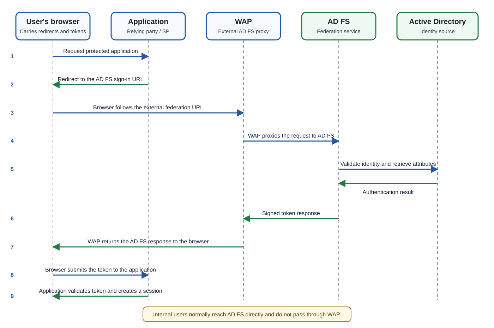
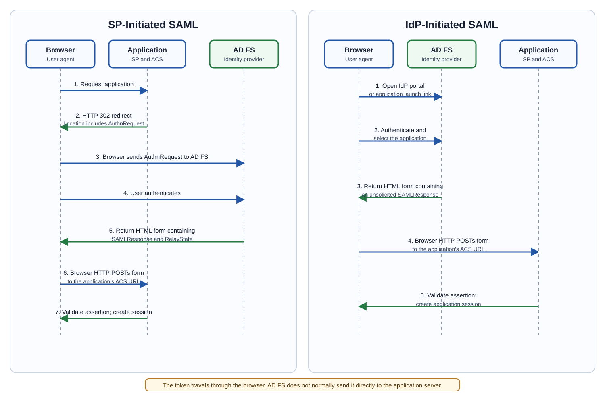

# Day 21: AD FS Architecture, Authentication, and Federation Protocols

## Beginner-Friendly Overview

Active Directory Federation Services (**AD FS**) is a Windows Server identity service that authenticates users and issues signed security tokens to trusted applications. This lesson builds from a single-server design to highly available farms, then explains authentication methods, network requirements, WS-Federation (**WS-Fed**), Security Assertion Markup Language (**SAML**), OAuth, request parameters, token contents, and troubleshooting.

> [!TIP]
> Keep one idea in mind: **AD FS proves identity; the application validates the token and decides whether to grant access.**



## AD FS Architecture Without High Availability

This section introduces each component first, then connects the components in an end-to-end authentication flow.

This diagram shows how an external user securely accesses an internal application using AD FS (Active Directory Federation Services).

### Key Components

#### Domain Controller (DC)

**What it is:**

The server that contains Active Directory (AD).
Stores user accounts, passwords, groups, computer objects, and policies.

**Main Job:**

Verifies usernames and passwords.
Acts as the identity source for the organization.

**Think of it as:**

The company's identity database.

#### AD FS Server

**What it is:**

Authentication service that sits between applications and Active Directory.

**Main Job:**

Authenticates users against AD.
Issues security tokens containing user claims.

Claims Examples:

Username
Email
Group Membership
Department

**Think of it as:**

The trusted identity provider (IdP).

#### Application Server

**What it is:**

Hosts the application users want to access.

**Examples:**

SharePoint
Custom Web Application
ERP System
CRM System

**Main Job:**

Consumes the token issued by AD FS.
Grants or denies access.

**Think of it as:**

The resource the user actually wants.

#### Web Application Proxy (WAP)

**What it is:**

A reverse proxy server placed in the perimeter network (DMZ).

**Main Job:**

Publishes AD FS to the internet securely.
Prevents direct internet access to internal AD FS servers.

**Think of it as:**

The security guard at the company gate.

#### Internal User

**What it is:**

User located inside the corporate network.

**Main Job:**

Accesses applications directly through AD FS.

**Think of it as:**

Employee sitting in the office.

#### External User

**What it is:**

User connecting from home, hotel, coffee shop, or anywhere on the internet.

**Main Job:**

Uses WAP to reach AD FS securely.

**Think of it as:**

Remote employee or partner.

#### Internal Network

**What it is:**

Trusted corporate network.

**Contains:**

Domain Controller
AD FS Server
Application Server

**Think of it as:**

The inside of the company building.

#### Perimeter Network (DMZ)

**What it is:**

Semi-trusted network between the internet and internal network.

**Contains:**

Web Application Proxy

**Main Job:**

Shields the internal network from direct exposure.

**Think of it as:**

Reception area before entering the building.

#### Firewall

**What it is:**

Security boundary controlling network traffic.

**Main Job:**

Allows only approved communication.

**Examples:**

HTTPS (443)
AD FS traffic
WAP communication

**Think of it as:**

Security checkpoints.

#### Security Token

**What it is:**

A digitally signed authentication package issued by AD FS.

**Contains:**

Username
Claims
Groups
Authentication status

**Think of it as:**

A temporary access badge.

### How Everything Joins Together

### External User Authentication Flow

#### Step 1: The Browser Requests the Application

The external user's browser opens the protected application URL. The browser reaches the application directly through whatever publishing path protects that application. **WAP is not automatically in front of the application; its role here is to publish the AD FS federation service.**

#### Step 2: The Application Redirects the Browser

The application sees that the user has no valid session. It returns an authentication redirect that points the browser to the public AD FS sign-in URL.

#### Step 3: The Browser Reaches WAP

Because the user is external, the browser follows the federation URL to the Web Application Proxy in the perimeter network. An external load balancer may select one WAP server when multiple proxies are deployed.

#### Step 4: WAP Proxies the Federation Request

WAP forwards the AD FS request to the internal AD FS service. In a farm, an internal load balancer selects a healthy federation server.

#### Step 5: AD FS Authenticates the User

AD FS performs the configured authentication method. When username and password or Windows authentication is used, AD FS relies on Active Directory to verify the identity and retrieve relevant attributes.

The identity check can confirm that:

- The user exists.
- The supplied proof is valid.
- The account is enabled and allowed to authenticate.
- Required group or attribute information is available for claims processing.

#### Step 6: AD FS Issues a Signed Token

After authentication and policy evaluation succeed, AD FS creates a signed security token containing the claims intended for the application.

#### Step 7: The Response Returns to the Browser

The AD FS response travels back through WAP to the browser. WAP proxies the response; it does not consume the application token.

#### Step 8: The Browser Submits the Token to the Application

The browser delivers the token to the application's reply endpoint. The exact mechanism depends on the protocol:

- **WS-Federation:** The browser normally submits `wresult` to the relying party.
- **SAML 2.0:** The browser normally HTTP `POST`s `SAMLResponse` to the Assertion Consumer Service (ACS).
- **OAuth/OpenID Connect:** The browser returns an authorization response, after which the client may redeem an authorization code at the token endpoint.

#### Step 9: The Application Validates the Token

The application validates the signature, issuer, audience, lifetime, and other protocol-specific requirements. If validation succeeds, it creates an application session and grants access.

> [!IMPORTANT]
> The browser is an active carrier in passive federation flows. AD FS does not normally send the token directly from the AD FS server to the application server.

### Visual End-to-End Flow

The architecture image at the beginning of this lesson is a sequence diagram. Read it from top to bottom: the application starts the redirect, WAP publishes AD FS to external users, and the browser returns the token to the application.

### Important Exam/Interview Terms

| Term | Meaning |
| --- | --- |
| AD | Active Directory |
| AD FS | Active Directory Federation Services |
| WAP | Web Application Proxy |
| DC | Domain Controller |
| Claims | User attributes sent in token |
| Federation | Trusting another identity provider |
| SSO | Single Sign-On |
| Token | Proof of successful authentication |
| IdP | Identity Provider (AD FS) |
| RP | Relying Party (Application) |
| DMZ | Perimeter/Screened Network |

Why "No HA"?

This design has:

1 AD FS Server
1 WAP Server
1 Domain Controller

If any of them fail:

- ❌ Authentication stops

- ❌ Users cannot sign in

- ❌ External access is unavailable

A production deployment would normally have:

2+ AD FS Servers
2+ WAP Servers
2+ Domain Controllers
Load Balancer

to provide High Availability (HA) and fault tolerance.

### Simple One-Liner

The External User reaches the Web Application Proxy, the WAP forwards authentication to AD FS, AD FS verifies the user with the Domain Controller, issues a security token, and the Application Server trusts that token to grant access.

## High Availability with Windows Internal Database (WID)

This design adds high availability (HA) by using an AD FS farm backed by Windows Internal Database (WID).

### Key Terms

### AD FS (Active Directory Federation Services)

**What it is:**

Microsoft's federation and authentication service.
Provides Single Sign-On (SSO).
Authenticates users against Active Directory.
Issues authentication tokens.

**Role here:**

AD FS 1 and AD FS 2 authenticate users.

**Think of it as:**

The security office issuing visitor badges.

### WID (Windows Internal Database)

**What it is:**

A built-in database used by AD FS.
Stores AD FS configuration data.
Eliminates the need for a separate SQL Server.

**In the diagram:**

AD FS 1 has a WID database.
AD FS 2 has a copied/replicated WID database.

Key Point:

Primary AD FS
          ↓
Replicates
          ↓
Secondary AD FS

Only the Primary AD FS can make configuration changes.

### AD FS 1 (Primary Federation Server)

**What it is:**

Main federation server.
Holds the writable WID database.

**Responsibilities:**

Processes authentication requests.
Stores AD FS configuration.
Replicates configuration to AD FS 2.

Think:

Team leader for the AD FS farm.

### AD FS 2 (Secondary Federation Server)

**What it is:**

Additional federation server.

**Responsibilities:**

Authenticates users.
Receives replicated configuration from AD FS 1.
Takes load from AD FS 1.

Think:

Backup team member ready to help.

### AD FS Farm

**What it is:**

Multiple AD FS servers working together.

**In this design:**

AD FS 1
AD FS 2

**Benefits:**

- ✅ Load sharing

- ✅ Fault tolerance

- ✅ Better performance

- ✅ High availability

### Internal Load Balancer

Located between users and AD FS.

**Main Job:**

Distributes incoming authentication traffic.

    Request 1 → AD FS 1
    Request 2 → AD FS 2
    Request 3 → AD FS 1

**Benefits:**

No single server overload.
Automatic failover.

Think:

Traffic controller.

### Web Application Proxy (WAP)

Two proxy servers exist:

WAP 1
WAP 2

Purpose:

Publish AD FS externally.
Protect internal servers.
Proxy authentication traffic.

Think:

Secure reception desks.

### External Load Balancer

Located in front of WAP servers.

**Main Job:**

Directs traffic to either proxy.

    External User
          ↓
Load Balancer
          ↓
WAP 1 or WAP 2

**Benefits:**

- ✅ Availability

- ✅ Load distribution

- ✅ No single proxy failure

### Internal User

A corporate user already on the company network.

Authentication path:

    Internal User
          ↓
Load Balancer
          ↓
AD FS Farm

### External User

A remote user on the internet.

Path to the externally published AD FS endpoint **after the browser receives an authentication redirect from an application**:

    External User
          ↓
Internet
          ↓
External Load Balancer
          ↓
WAP Farm
          ↓
Internal Load Balancer
          ↓
AD FS Farm

### Replication

Notice the text:

Pull Replication over HTTP

This means:

AD FS 2 pulls configuration from AD FS 1.
Configuration changes originate from AD FS 1.
Trusts, certificates, relying party information, and settings are copied to all federation servers.

Think:

Synchronization between federation servers.

### How Everything Joins Together

### External User Authentication Flow

The WID farm changes **availability**, not the browser-based federation sequence:

1. The browser requests the protected application.
2. The application redirects the browser to the external AD FS URL.
3. The browser reaches the external load balancer, which selects WAP 1 or WAP 2.
4. WAP proxies the request to the internal AD FS load balancer.
5. The internal load balancer selects AD FS 1 or AD FS 2.
6. AD FS authenticates the user with Active Directory and applies the relying-party and claims configuration stored in WID.
7. AD FS issues the signed token response.
8. The response returns through WAP to the browser.
9. The browser submits the token to the application's reply endpoint.
10. The application validates the token, creates a session, and grants access.

> [!NOTE]
> WID replication distributes AD FS configuration between federation servers. It is not part of the user's token-delivery path.

### What Happens if a Server Fails?

#### Scenario 1: AD FS 1 Fails

AD FS 1 ❌
AD FS 2 ✅

Users continue authentication through AD FS 2.

No outage.

#### Scenario 2: WAP 1 Fails

WAP 1 ❌
WAP 2 ✅

Traffic automatically moves to WAP 2.

Users still sign in.

#### Scenario 3: Load Balancer Detects Failure

Server Health Check
             ↓
Failed Server Removed
             ↓
Traffic Redirected

Users normally do not notice.

### WID Database Limitations (From the Slide)

Supports Maximum 30 AD FS Servers
AD FS Farm ≤ 30 servers

Beyond that, SQL-based AD FS is recommended.

Supports Maximum 100 Trust Relationships

**Examples:**

Microsoft 365
Salesforce
ServiceNow
Custom Applications

**Maximum:**

100 Trust Entries

No SAML Artifact Resolution

A WID deployment does not support this SAML feature.

No Token Replay Detection

AD FS cannot detect if a previously used token is replayed by an attacker.

SQL-based deployment supports that feature.

Configuration Changes Only on Primary AD FS
AD FS 1 ✅ Can Modify
AD FS 2 ❌ Read Only

Changes then replicate automatically.

### Architecture Summary

This topology is easier to understand when the runtime request path and the configuration-replication path are kept separate.

**Runtime federation path:**

```text
Browser
  -> Application
  <- Redirect to AD FS
Browser
  -> External load balancer
  -> WAP 1 or WAP 2
  -> Internal load balancer
  -> AD FS 1 or AD FS 2
  <-> Active Directory
  <- Signed token response
Browser
  -> Application reply endpoint
  <- Application session
```

**WID configuration path:**

```text
AD FS primary WID
  -> pull replication by secondary AD FS servers
```

The WID configuration path is separate from user authentication and token delivery.

### Interview/Support Engineer Gold Question

> **Question:** Why use WID-based AD FS HA instead of a single AD FS server?

**Answer:**

A WID-based AD FS farm provides high availability by deploying multiple federation servers and multiple Web Application Proxy servers behind load balancers. If one AD FS server or WAP server fails, authentication continues through the remaining servers. Configuration is stored in the primary AD FS server's Windows Internal Database and replicated to secondary federation servers, eliminating the need for SQL Server while still providing redundancy and scalability.

## Enterprise High Availability with SQL Server

This enterprise high-availability design uses a shared SQL Server database instead of WID.

This architecture solves many of the limitations of the WID design and is typically used in large organizations with many applications, trusts, and authentication requests.

### Key Components

### AD FS (Active Directory Federation Services)

**What it is:**

Microsoft's federation platform that provides:

Authentication
Single Sign-On (SSO)
Claims-based access
Federation with external systems
**Main Job:**

Validates users against Active Directory
Issues security tokens
Provides access to applications
**Think of it as:**

The identity service that issues trusted access badges.

### SQL Database

**What it is:**

A dedicated Microsoft SQL Server database used by the AD FS farm.

Stores
AD FS configuration
Trust relationships
Certificates information
Claims rules
Federation settings
In this diagram
          SQL DB
          /   \
         /     \
    AD FS 1   AD FS 2

Both AD FS servers read and write to the same database.

Major Advantage

Unlike WID:

- ✅ Any AD FS server can update configuration

- ✅ No replication delays

- ✅ Supports very large deployments

**Think of it as:**

The central library shared by all AD FS servers.

### AD FS 1

**What it is:**

Federation server #1.

Main Duties
Authenticate users
Generate claims
Issue tokens
Read/write configuration to SQL
### AD FS 2

**What it is:**

Federation server #2.

Main Duties

Exactly the same as AD FS 1.

Unlike WID:

AD FS 1 = Writable
AD FS 2 = Writable

No Primary/Secondary concept.

Both are equal.

### AD FS Farm

**What it is:**

Multiple AD FS servers sharing a common SQL database.

**In this design:**

AD FS 1
AD FS 2

but could be:

AD FS 1
AD FS 2
AD FS 3
AD FS 4
AD FS 5
...

### Benefits

- ✅ Scalability

- ✅ Fault Tolerance

- ✅ Load Sharing

- ✅ Easy Growth

### Internal Load Balancer

What it does

Distributes requests among AD FS servers.

    Request 1 → AD FS 1
    Request 2 → AD FS 2
    Request 3 → AD FS 1

### Benefits

Prevents overload
Automatically redirects traffic
Supports failover
**Think of it as:**

A traffic officer directing vehicles.

### Web Application Proxy (WAP)

The DMZ contains:

WAP 1
WAP 2

**Purpose:**

Publishes AD FS securely to the Internet.

Prevents direct access to internal servers.

**Think of it as:**

Secure reception desks at the building entrance.

### External Load Balancer

**Purpose:**

Sits in front of WAP servers.

Internet
        ↓
Load Balancer
        ↓
WAP 1 / WAP 2

### Benefits

- ✅ High Availability

- ✅ Load Distribution

- ✅ Automatic Failover

### Internal User

User connected to corporate network.

Authentication flow:

    Internal User
          ↓
Load Balancer
          ↓
AD FS Farm

### External User

Remote user from:

Home
Hotel
Airport
Mobile Network

Path to the externally published AD FS endpoint **after the application redirects the browser**:

    External User
          ↓
Internet
          ↓
External Load Balancer
          ↓
WAP Farm
          ↓
Internal Load Balancer
          ↓
AD FS Farm

### Domain Controller (Not Shown)

Even though it's missing from the diagram, it still exists.

**Purpose:**

Provides:

User accounts
Password verification
Group membership

Flow:

    AD FS
     ↓
Domain Controller

### How Everything Joins Together

### External Authentication Flow

The SQL-backed farm uses the same browser-mediated sign-in pattern as the WID farm:

1. The browser requests the application.
2. The application redirects the browser to the public AD FS URL.
3. The browser reaches the external load balancer, which selects a healthy WAP.
4. WAP proxies the federation request to the internal load balancer.
5. The internal load balancer selects a healthy AD FS server.
6. AD FS uses Active Directory to authenticate the user and obtain directory attributes.
7. AD FS reads shared configuration—such as trust definitions, claims rules, and token settings—from SQL Server.
8. AD FS creates a signed security token.
9. The response returns through WAP to the browser.
10. The browser submits the token to the application.
11. The application validates the token and grants access.

> [!NOTE]
> SQL Server is the shared AD FS configuration store in this design. The browser does not communicate with SQL Server, and the token does not pass through SQL Server.

### What Happens During Failures?

#### Scenario 1: AD FS 1 Fails

AD FS 1 ❌
AD FS 2 ✅

Load balancer redirects traffic.

Users continue logging in.

#### Scenario 2: WAP 1 Fails

WAP 1 ❌
WAP 2 ✅

External users continue authenticating.

#### Scenario 3: Add More AD FS Servers

**WID:**

Maximum = 30

**SQL:**

Practically Unlimited

You can expand as demand grows.

#### Scenario 4: Configuration Change

WID Deployment
Primary AD FS Only

Change replicated later.

SQL Deployment
AD FS 1 ✅
AD FS 2 ✅
AD FS 3 ✅

Any server can update configuration.

Changes are immediately available.

### Why SQL is Better than WID

| Feature | WID | SQL |
| --- | --- | --- |
| Max AD FS Servers | 30 | No Practical Limit |
| Trust Relationships | 100 | No Practical Limit |
| SAML Artifact Resolution | ❌ | ✅ |
| Token Replay Detection | ❌ | ✅ |
| Config Changes on Any AD FS | ❌ | ✅ |
| Replication Required | ✅ | ❌ |
| Scalability | Medium | Very High |

### Architecture Summary

The SQL design also has separate runtime and configuration paths.

**Runtime federation path:**

```text
Browser
  -> Application
  <- Redirect to AD FS
Browser
  -> External load balancer
  -> WAP 1 or WAP 2
  -> Internal load balancer
  -> AD FS 1 or AD FS 2
  <-> Active Directory
  <- Signed token response
Browser
  -> Application reply endpoint
  <- Application session
```

**Shared configuration path:**

```text
AD FS 1 <-> Shared SQL configuration database <-> AD FS 2
```

SQL stores AD FS configuration. It does not sit between Active Directory and the application, and it does not carry user tokens.

### Interview/Support Engineer Gold Question

> **Question:** Why would an organization choose SQL-based AD FS instead of WID-based AD FS?

**Answer:**

SQL-based AD FS is chosen when an organization requires greater scalability, advanced federation capabilities, and enterprise-level high availability. Unlike WID, SQL supports unlimited AD FS servers, supports SAML artifact resolution and token replay detection, eliminates replication dependencies, and allows configuration changes from any federation server because all AD FS servers share a common SQL database. This makes SQL-based deployments ideal for large enterprises with many applications and trust relationships.

### One-Liner

After an application redirects an external user's browser to AD FS, the browser reaches a load-balanced WAP farm, which proxies the request to a load-balanced AD FS farm. The selected AD FS server uses Active Directory for identity validation and the shared SQL database for AD FS configuration, then returns a signed token response through the browser for the application to validate.

## Network and Connectivity Requirements

This section focuses on the network communication required for AD FS, WAP, Azure AD Connect Health, and Microsoft Entra ID (formerly Azure AD) to function properly.

### Key Terms

### Azure AD Connect Health

**What it is:**

A monitoring service that provides health and performance monitoring for:

AD FS Servers
Web Application Proxy (WAP)
Azure AD Connect
**Main Job:**

Monitors:

- ✅ Authentication activity

- ✅ Server performance

- ✅ Certificate expiration

- ✅ Service failures

- ✅ Sign-in trends

- ✅ Alerts and troubleshooting

**Think of it as:**

A security camera and monitoring dashboard for your AD FS environment.

### AD FS (Active Directory Federation Services)

**What it is:**

The federation service responsible for:

Authenticating users
Issuing tokens
Providing SSO
**Communicates with:**

Domain Controllers
Azure AD Connect Health
Microsoft Entra ID (Azure AD)
WAP Servers
### WAP (Web Application Proxy)

**What it is:**

A reverse proxy located in the DMZ.

**Main Job:**

Publishes AD FS externally
Protects internal AD FS servers
Handles internet authentication requests
### TCP Port 80 (HTTP)

**Protocol:**

HTTP
**Port 80:**

**Used For:**

Azure AD Connect Health
    AD FS
     ↓
Azure AD Connect Health

Older versions used TCP 80 for some monitoring communication.

Certificate Revocation List (CRL) Downloads
AD FS/WAP
          ↓
Certificate Authority

Servers check whether a certificate has been revoked.

**Think of it as:**

Asking, "Is this certificate still trusted?"

### TCP Port 443 (HTTPS)

**Protocol:**

HTTPS
**Port 443:**

The most important port in AD FS environments.

**Used For:**

AD FS Authentication
    User
     ↓
    AD FS

Federation Metadata Retrieval
    AD FS
     ↓
Azure AD

Azure AD Connect Health
    AD FS
     ↓
Azure

**Think of it as:**

The secure highway used by almost every AD FS communication.

### TCP Port 5671

**What it is:**

A secure AMQP (Advanced Message Queuing Protocol) port.

Historically used by:

Azure AD Connect Health Agent

### Important Note

The slide states:

Not needed with latest version of agent

**Meaning newer Azure AD Connect Health agents no longer require this port.:**

**Think of it as:**

An old communication channel that modern versions don't need.

### Certificate Revocation List (CRL)

**What it is:**

A list maintained by a Certificate Authority (CA).

**Contains:**

Revoked certificates
Expired certificates
Compromised certificates
**Why AD FS Checks It:**

Before trusting a certificate, AD FS verifies:

Has this certificate been revoked?

**If revoked:**

Authentication Fails

**Example:**

Imagine a stolen company badge.

Even though the badge exists, security checks a blacklist before allowing entry.

The CRL is that blacklist.

### Federation Metadata

**What it is:**

An XML document containing federation information.

**Contains:**

Certificates
Endpoints
Trust settings
Signing information
**Purpose:**

Allows Azure AD and AD FS to trust each other.

**Think of it as:**

A digital business card exchanged between trusted systems.

### Azure AD (Microsoft Entra ID)

**What it is:**

Microsoft's cloud identity service.

**Role in Federated Authentication:**

When federation is enabled:

User Login
           ↓
Azure AD
           ↓
Redirect to AD FS

Azure AD trusts AD FS to authenticate users.

### Internet Connectivity

The slide mentions:

Only unauthenticated proxy is supported

**Meaning:**

AD FS and WAP servers must be able to access Microsoft services without:

- ❌ Proxy authentication

- ❌ Username/password prompts

- ❌ Interactive sign-ins

**Supported:**

- ✅ Direct internet access

- ✅ Transparent proxy

- ✅ Non-authenticated proxy

**Why?:**

Services such as:

Azure AD Connect Health
### Federation Metadata

CRL Checks

must communicate automatically.

No user is available to enter proxy credentials.

### How Everything Joins Together

### Azure AD Connect Health Flow

#### Step 1

AD FS generates health data.

AD FS Server

#### Step 2

Health Agent collects information.

Authentication Events
Performance Data
Certificates
Alerts

#### Step 3

Information sent to Azure.

Using:

TCP 443

Historically also:

TCP 5671

#### Step 4

Administrators view health reports.

Azure Portal

Certificate Validation Flow
#### Step 1

User attempts authentication.

    User
     ↓
    AD FS

#### Step 2

AD FS checks certificate.

Certificate Found

#### Step 3

AD FS downloads CRL.

    AD FS
     ↓
CRL Server
TCP 80

#### Step 4

Certificate validated.

Certificate Trusted

#### Step 5

Authentication continues.

Federation Metadata Flow
#### Step 1

Azure AD trusts AD FS.

Azure AD
 ↔
     AD FS

#### Step 2

AD FS retrieves metadata.

Using:

TCP 443

#### Step 3

Trust relationship stays updated.

Certificates:

- ✅ Current

- ✅ Trusted

- ✅ Valid

### Independent Network Flows

The following are **separate communications**, not one end-to-end chain:

```text
External browser -> WAP -> AD FS
AD FS <-> Domain Controller
AD FS / WAP -> CRL distribution point over HTTP or HTTPS
AD FS Connect Health agent -> Microsoft monitoring service over HTTPS
Federation partner -> AD FS federation metadata endpoint over HTTPS
```

> [!IMPORTANT]
> Microsoft Entra ID, Azure Portal, CRL servers, and domain controllers do not form a single serial authentication route. Each connection has a different purpose and should be troubleshot independently.

Ports Summary
| Port | Protocol | Purpose |
| --- | --- | --- |
| 80 | HTTP | Certificate Revocation List (CRL) downloads |
| 443 | HTTPS | AD FS authentication, Azure AD communication, Federation Metadata |
| 5671 | AMQP over TLS | Legacy Azure AD Connect Health communication |

### Interview/Support Engineer Gold Question

> **Question:** Why are ports 80 and 443 required in an AD FS environment?

**Answer:**

Port 443 (HTTPS) is used for secure communication between AD FS, WAP, Microsoft Entra ID, and Azure AD Connect Health services. Port 80 (HTTP) is primarily required for Certificate Revocation List (CRL) checks, allowing AD FS and WAP servers to verify that certificates used for authentication have not been revoked.

### One-Liner

AD FS and WAP require outbound internet connectivity so they can communicate with Azure AD Connect Health, download certificate revocation information over TCP 80, retrieve federation metadata over TCP 443, and securely maintain trust with Microsoft Entra ID. 🚀

## Authentication Methods in AD FS

This section explains the authentication methods supported by AD FS and where they are commonly used.

Authentication is simply:

The process of proving who you are before AD FS issues a token and grants access to an application.

In this slide, AD FS supports four major authentication methods:

Forms-Based Authentication
Windows Integrated Authentication
Certificate-Based Authentication
Multi-Factor Authentication (MFA)
### Forms-Based Authentication (FBA)

**What it is:**

The traditional login page where users manually enter:

Username
Password

Example:

Email: elijah@company.com
Password: ********

### How It Works

#### Step 1

User accesses application.

    User
     ↓
    Application

#### Step 2

User is redirected to AD FS.

    Application
     ↓
    AD FS

#### Step 3

AD FS displays login page.

Username
Password

#### Step 4

User enters credentials.

#### Step 5

AD FS validates credentials against Active Directory.

    AD FS
     ↓
Domain Controller

#### Step 6

Token is issued.

    AD FS
     ↓
    Token

#### Step 7

Access granted.

**Common Use Cases:**

- ✅ Remote users

- ✅ Internet users

- ✅ Partner organizations

- ✅ Non-domain joined devices

- ✅ Personal laptops

**Think Of It As:**

Showing your ID card at a reception desk and manually signing a visitor register.

### Windows Integrated Authentication (WIA)

**What it is:**

A seamless authentication method that automatically logs users in without prompting for credentials.

Uses:

Kerberos
or
NTLM

behind the scenes.

### How It Works

#### Step 1

User already logged into Windows.

Laptop Login

#### Step 2

User opens application.

Browser
     ↓
    Application

#### Step 3

AD FS recognizes the domain-joined device.

#### Step 4

Kerberos ticket is sent automatically.

    User
     ↓
Kerberos Ticket
     ↓
    AD FS

#### Step 5

AD FS validates ticket.

#### Step 6

User gets access.

No password prompt.

### Benefits

- ✅ True Single Sign-On

- ✅ Better user experience

- ✅ No repeated credential entry

- ✅ More secure than repeated password submission

**Common Use Cases:**

Internal users:

Office PC
Corporate Network
Domain-Joined Device

**Think Of It As:**

Your employee badge automatically opening doors without stopping at reception.

### Certificate-Based Authentication (CBA)

**What it is:**

Authentication using a digital certificate instead of a password.

The certificate proves the user's identity.

What Is a Certificate?

A digital identity card issued by a trusted Certificate Authority (CA).

**Contains:**

User Identity
Public Key
Issuer
Validity Period

### How It Works

#### Step 1

User accesses application.

#### Step 2

AD FS requests a certificate.

Present Certificate

#### Step 3

Device offers certificate.

Certificate Sent

#### Step 4

AD FS validates certificate.

Certificate Authority
     ↓
Trusted?

#### Step 5

Token issued.

#### Step 6

Access granted.

**Common Use Cases:**

- ✅ Smart Cards

- ✅ Government Organizations

- ✅ Military Environments

- ✅ Financial Institutions

- ✅ High Security Networks

### Benefits

- ✅ No password required

- ✅ Very difficult to steal

- ✅ Strong authentication

**Think Of It As:**

Using a secure company badge with an embedded chip rather than typing a password.

### Multifactor Authentication (MFA)

**What it is:**

Requires more than one authentication factor.

**Instead of:**

Password Only

**Use:**

Password
+
Something Else

### Authentication Factors

Something You Know
Password
PIN

Something You Have
Phone
Authenticator App
Smart Card
    Token

Something You Are
Fingerprint
Face Recognition
Iris Scan

**Example:**

**User enters:**

Username
Password

**Then receives:**

Microsoft Authenticator Prompt

Approve sign-in.

**Flow:**

#### Step 1

User enters credentials.

Username
Password

#### Step 2

AD FS validates password.

#### Step 3

AD FS requests second factor.

Approve Sign-In

#### Step 4

User approves.

#### Step 5

AD FS issues token.

#### Step 6

Access granted.

### Benefits

- ✅ Strongest protection

- ✅ Blocks stolen-password attacks

- ✅ Protects against phishing

- ✅ Reduces account compromise risk

**Think Of It As:**

Showing your ID card AND entering a security code before entering a restricted area.

How They All Join Together

Think of AD FS as the security office.

The user reaches AD FS, and AD FS can use different methods to prove identity before issuing a token.

                              AD FS
                                 │
          ┌──────────────────────┼──────────────────────┐
          │                      │                      │
          ▼                      ▼                      ▼

Forms-Based       Windows Integrated      Certificate-Based
(Username/PW)        (Kerberos/NTLM)         (Certificate)

                                 │
                                 ▼

                     Multi-Factor Auth
                  (Optional Additional Layer)

                                 │
                                 ▼

                    Security Token Issued

                                 │
                                 ▼

                           Application

                                 │
                                 ▼

                          Access Granted

### Which Method Is Typically Used?

| User Type | Authentication Method |
| --- | --- |
| Internal Domain User | Windows Integrated Authentication |
| Remote User | Forms-Based Authentication |
| Smart Card User | Certificate-Based Authentication |
| High Security Access | MFA |
| Microsoft 365 Federated User | Usually Forms + MFA |
| Corporate Desktop User | Windows Integrated + MFA |

### Real-World Example

Let's say Elijah is working from the office.

Internal Access
Elijah
     ↓
Domain Joined Laptop
     ↓
Kerberos
     ↓
    AD FS
     ↓
    Token
     ↓
Microsoft 365

No password prompt.

Now Elijah works from home.

External Access
Elijah
     ↓
Internet
     ↓
    WAP
     ↓
AD FS Login Page
     ↓
Username + Password
     ↓
Authenticator Approval
     ↓
    Token
     ↓
Microsoft 365

Access granted.

### Interview/Support Engineer Gold Question

> **Question:** What is the difference between Forms-Based Authentication and Windows Integrated Authentication?

**Answer:**

Forms-Based Authentication requires users to manually enter credentials on an AD FS sign-in page, making it suitable for external users and non-domain joined devices. Windows Integrated Authentication uses Kerberos or NTLM to automatically authenticate users who are already signed into domain-joined devices within the corporate network, providing a seamless Single Sign-On experience.

### One-Liner

AD FS can authenticate users through Forms-Based Authentication (username/password), Windows Integrated Authentication (Kerberos/NTLM SSO), Certificate-Based Authentication (smart cards/certificates), and Multi-Factor Authentication, then issues a security token that trusted applications use to grant access. 🚀

## Primary Authentication: Intranet and Extranet

This section goes one level deeper than the authentication-method overview.

The previous slide showed the authentication methods supported by AD FS.

This slide focuses specifically on Primary Authentication Methods, meaning:

The first method AD FS uses to verify a user's identity before issuing a token.

It also introduces the important concept of Intranet vs Extranet authentication.

### Key Terms

### Primary Authentication

**What it is:**

The first authentication challenge presented to a user.

**Examples:**

Username + Password
Certificate
Kerberos
Windows Hello
Azure MFA

**Before AD FS can issue a token:**

    User
     ↓
### Primary Authentication

     ↓
AD FS Token
     ↓
Application Access

**Think of it as:**

The first security checkpoint before entering the building.

### Forms Authentication

**What it is:**

Traditional login page.

User manually enters:

Username
Password

Typical Use

Most common for:

- ✅ External users

- ✅ Personal devices

- ✅ Non-domain joined devices

- ✅ Internet users

**Flow:**

    User
     ↓
AD FS Login Page
     ↓
Username
Password
     ↓
    AD FS

**Think Of It As:**

Signing your name at the reception desk.

### Windows Authentication (Intranet Only)

**What it is:**

Also called:

Windows Integrated Authentication (WIA)

Uses:

Kerberos
NTLM

to automatically authenticate users.

**Why "Intranet Only"?:**

Because it expects:

- ✅ Domain Joined Device

- ✅ Active Directory Connectivity

- ✅ Internal Network

**Flow:**

    User
     ↓
Domain Joined PC
     ↓
Kerberos Ticket
     ↓
    AD FS
     ↓
Authenticated

No password prompt.

### Benefits

- ✅ Seamless SSO

- ✅ Better user experience

- ✅ Faster authentication

- ✅ More secure than repeatedly entering passwords

**Think Of It As:**

Using your employee badge to open a door automatically.

### Certificate Authentication

**What it is:**

User proves identity using a certificate.

**Instead of:**

Password

**They present:**

Digital Certificate

**Common Devices:**

Smart Cards
PIV Cards
CAC Cards
TPM-backed Certificates
**Flow:**

    User
     ↓
Certificate
     ↓
    AD FS
     ↓
Certificate Validation
     ↓
    Access Granted

### Benefits

- ✅ Passwordless

- ✅ Strong security

- ✅ Difficult to steal

**Think Of It As:**

Presenting a government-issued security badge.

### Device Authentication (AD FS 2016+)

**What it is:**

AD FS authenticates not only the user but also the device.

Questions AD FS asks:

Who are you?
What device are you using?

**Checks:**

Device Registration
Device Certificate
Device Trust Status
**Examples:**

Corporate Laptop ✅

Personal Laptop ❌

Managed Device ✅

Unknown Device ❌

### Benefits

- ✅ Conditional Access

- ✅ Device-Based Policies

- ✅ Stronger Security

**Flow:**

    User
     ↓
Managed Device
     ↓
Device Authentication
     ↓
User Authentication
     ↓
Token Issued

**Think Of It As:**

Security checking both your identity card and your company-issued laptop.

### Azure MFA (AD FS 2016+)

**What it is:**

Microsoft Entra MFA integrated directly into AD FS.

Requires an additional verification step.

**Example:**

**User enters:**

Username
Password

**Then receives:**

Microsoft Authenticator Prompt

Approve sign-in.

**Flow:**

    User
     ↓
Password
     ↓
Azure MFA
     ↓
Approve Sign-in
     ↓
    AD FS

### Benefits

- ✅ Protects against password theft

- ✅ Protects against phishing

- ✅ Strong identity verification

**Think Of It As:**

Showing your badge and entering a PIN code.

### Windows Hello Authentication (AD FS 2016+)

**What it is:**

Passwordless authentication.

Uses:

Face Recognition
PIN
Fingerprint

through Windows Hello for Business.

**Flow:**

Face Scan
     OR
Fingerprint
     OR
PIN
     ↓
Windows Hello
     ↓
    AD FS

### Benefits

- ✅ Passwordless

- ✅ Faster login

- ✅ Better user experience

- ✅ Resistant to password attacks

**Think Of It As:**

Unlocking a secure vault with your fingerprint.

### External Providers

**What it is:**

Authentication delegated to another provider.

**Examples:**

Azure AD
Third Party MFA
Duo
RSA
Partner Identity Provider

**Flow:**

    User
     ↓
    AD FS
     ↓
External Provider
     ↓
Authentication Success
     ↓
AD FS Token

**Think Of It As:**

Security calling another trusted company to verify your identity.

Understanding Intranet vs Extranet

This is the most important concept on this slide.

Intranet
**What it is:**

Trusted internal corporate network.

**Examples:**

Office LAN
Corporate Wi-Fi
VPN Connected Device

Typical Authentication Methods

- ✅ Windows Authentication

- ✅ Certificate Authentication

- ✅ Device Authentication

- ✅ Windows Hello

- ✅ MFA

**Example:**

Office User
          ↓
Domain Joined Device
          ↓
Kerberos
          ↓
    AD FS

No credential prompt.

**Think Of It As:**

Being inside company headquarters.

Extranet
**What it is:**

Users coming from outside the organization.

**Examples:**

Home
Hotel
Airport
Coffee Shop
Internet

Typical Methods

- ✅ Forms Authentication

- ✅ Certificate Authentication

- ✅ MFA

- ✅ External MFA Providers

**Example:**

Home User
         ↓
Internet
         ↓
    WAP
         ↓
Forms Login
         ↓
MFA
         ↓
    AD FS

**Think Of It As:**

Visiting the company from outside the building.

### How Everything Joins Together

                             User
                               │
                ┌──────────────┴──────────────┐
                │                             │
                ▼                             ▼

        Intranet                     Extranet
    (Internal User)              (Internet User)

                │                             │

                ▼                             ▼

 Windows Auth                  Forms Authentication
 Certificate Auth              Certificate Auth
 Device Auth                   Azure MFA
 Windows Hello                 External Providers
 Azure MFA

                │
                ▼

            AD FS

                │
                ▼

     Identity Verified

                │
                ▼

       Token Issued

                │
                ▼

           Application

                │
                ▼

          Access Granted

What the Authentication Methods Window Shows

The screenshot on the right is the AD FS Management Console.

It allows administrators to configure:

Extranet Authentication

Typically:

- ✅ Forms Authentication
- ✅ Certificate Authentication
- ✅ MFA

Intranet Authentication

Typically:

- ✅ Windows Authentication
- ✅ Certificate Authentication
- ✅ Device Authentication
- ✅ Windows Hello
- ✅ MFA

Different methods can be enabled simultaneously.

Example:

Intranet:
   Windows Authentication
   + MFA

Extranet:
   Forms Authentication
   + MFA

### Interview/Support Engineer Gold Question

> **Question:** Why is Windows Authentication typically enabled only for the Intranet?

**Answer:**

Windows Authentication relies on Kerberos or NTLM and requires connectivity to Active Directory, making it most suitable for domain-joined devices within the corporate network. External users on the internet generally cannot use Kerberos directly, so Forms Authentication, Certificate Authentication, or MFA are typically used instead.

### One-Liner

Primary Authentication Methods are the first identity checks performed by AD FS. Internal (Intranet) users commonly use Windows Authentication, Device Authentication, or Windows Hello, while external (Extranet) users typically use Forms Authentication, Certificate Authentication, and MFA before AD FS issues a trusted security token. 🚀

## AD FS Protocol Overview

This section introduces one of the most important AD FS topics: protocols.

Protocols are the languages used by applications and AD FS to communicate authentication information and tokens.

**Think of it as:**

AD FS is the translator, and these protocols are the different languages spoken by applications.

This slide shows the three most common protocols supported by AD FS:

WS-Federation (WS-Fed)
SAML-P (SAML 2.0)
OAuth
### What is an Authentication Protocol?

An authentication protocol defines:

How users authenticate
How tokens are exchanged
How identity information is transmitted
How applications trust AD FS

Without a protocol:

    User
     ↓
    AD FS
     ↓
    Application

cannot securely exchange authentication information.

### WS-Federation (WS-Fed)

**What it is:**

A Microsoft authentication protocol built on:

WS-* Web Services Standards

and closely associated with:

SAML 1.1 Tokens

Main Purpose

Provides:

- ✅ Single Sign-On (SSO)

- ✅ Claims-based authentication

- ✅ Browser-based sign-in

- ✅ Federation between applications

**Typical Applications:**

Historically used by:

SharePoint
Microsoft 365 (older federated deployments)
ASP.NET applications
Microsoft enterprise applications
### How It Works

#### Step 1

User accesses application.

    User
     ↓
    Application

#### Step 2

Application redirects user to AD FS.

    Application
     ↓
    AD FS

#### Step 3

User authenticates.

Forms
Kerberos
Certificate
MFA

#### Step 4

AD FS issues a SAML token.

    AD FS
     ↓
SAML 1.1 Token

#### Step 5

Token returned to application.

#### Step 6

Access granted.

**Think Of It As:**

An older but trusted language used mainly by Microsoft web applications.

Key Term: Claims

WS-Fed heavily relies on Claims-Based Authentication.

Example claims:

Username
Email
Department
Groups

AD FS places these claims inside the token.

### SAML-P (SAML 2.0)

**What it is:**

SAML means:

Security Assertion Markup Language

SAML-P means:

SAML Protocol

Main Purpose

Allows identity information to be exchanged between:

Identity Provider (AD FS)
         and
Service Provider (Application)

Most Common Federation Protocol

Used extensively for:

Salesforce
Workday
ServiceNow
AWS
Google Workspace
Thousands of SaaS Applications
### Key Components

Identity Provider (IdP)

In our environment:

    AD FS

Authenticates users.

Service Provider (SP)

The application.

**Examples:**

Salesforce
ServiceNow
Workday

Trusts AD FS.

### How It Works

#### Step 1

User opens application.

    User
     ↓
Salesforce

#### Step 2

Application redirects user.

Salesforce
     ↓
    AD FS

#### Step 3

AD FS authenticates user.

#### Step 4

AD FS creates a SAML Assertion.

### SAML Assertion

**Contains:**

Name
Email
Claims
Groups

#### Step 5

Application validates assertion.

#### Step 6

Access granted.

**Think Of It As:**

A digital passport accepted by thousands of organizations worldwide.

### SAML Assertion

**What it is:**

The token sent by AD FS.

**Contains:**

Who the user is
How they were authenticated
Claims
Permissions

**Example:**

<User>
`Email=elijah@company.com`

`Department=Support`

</User>

(Application never sees the password.)

### OAuth

**What it is:**

OAuth stands for:

Open Authorization

Unlike SAML and WS-Fed, OAuth is designed primarily for:

- ✅ APIs

- ✅ Mobile Apps

- ✅ Modern Applications

- ✅ Cloud Services

### Important Distinction

SAML / WS-Fed

Focused on:

User Authentication

OAuth

Focused on:

Authorization

Meaning:

What can this application access on behalf of the user?

**Example:**

Suppose:

Outlook Mobile App

wants access to:

Exchange Online

Instead of collecting passwords:

OAuth Token Issued

### How It Works

#### Step 1

User opens application.

Mobile App

#### Step 2

Application redirects to AD FS.

#### Step 3

User signs in.

#### Step 4

AD FS issues OAuth Access Token.

Access Token

#### Step 5

Application accesses API.

App
     ↓
API

using the token.

#### Step 6

API validates token.

#### Step 7

Access granted.

**Think Of It As:**

A valet parking ticket. The valet can drive your car but doesn't own it.

OAuth Access Token

**Contains:**

User Identity
App Identity
Permissions
Expiration

Example:

Read Mail
Read Profile
Read Calendar

### OAuth vs SAML

This is a very common interview question.

| Feature | SAML | OAuth |
| --- | --- | --- |
| Main Purpose | Authentication | Authorization |
| Common Use | Enterprise SaaS Apps | APIs & Modern Apps |
| Token Type | SAML Assertion (XML) | Access Token (JWT/Bearer) |
| Browser Based | Yes | Yes |
| Mobile Friendly | Limited | Excellent |
| API Friendly | Limited | Excellent |

How They All Join Together

Think of AD FS as a translator that can speak multiple languages.

                         AD FS
                            │

            ┌───────────────┼───────────────┐
            │               │               │

            ▼               ▼               ▼

     WS-Fed          SAML 2.0        OAuth

  Microsoft Apps    SaaS Apps      Modern Apps
                                        &
                                      APIs

            │               │               │

            ▼               ▼               ▼

    SAML 1.1      SAML Assertion    Access Token

            │               │               │

            └───────┬───────┴───────┬───────┘
                    │               │

                    ▼

          Application Trust

                    │

                    ▼

             Access Granted

### Real-World Examples

WS-Fed Example
    User
     ↓
SharePoint
     ↓
    AD FS
     ↓
WS-Fed Token
     ↓
SharePoint Access

SAML Example
    User
     ↓
Salesforce
     ↓
    AD FS
     ↓
### SAML Assertion

     ↓
Salesforce Access

OAuth Example
Outlook Mobile App
             ↓
    AD FS
             ↓
OAuth Token
             ↓
Exchange Online API
             ↓
Mail Access

### Interview/Support Engineer Gold Question

> **Question:** What is the difference between WS-Fed, SAML, and OAuth?

**Answer:**

WS-Federation is a Microsoft-centric federation protocol commonly used with traditional web applications and SAML 1.1 tokens. SAML 2.0 is an industry-standard federation protocol used for browser-based Single Sign-On between Identity Providers (AD FS) and Service Providers (applications such as Salesforce or ServiceNow). OAuth is a modern authorization protocol used by mobile applications, web applications, and APIs to obtain access tokens without exposing user credentials.

### One-Liner

AD FS supports WS-Federation for traditional Microsoft applications, SAML 2.0 for enterprise federation and SaaS applications, and OAuth for modern applications and APIs, allowing AD FS to issue trusted tokens that applications use to authenticate and authorize users. 🚀

## WS-Federation (WS-Fed)

This section examines WS-Federation (WS-Fed), a protocol that AD FS uses for authentication and single sign-on (SSO).

What is WS-Fed?

WS-Federation (WS-Fed) is a federation protocol that allows applications and identity providers (such as AD FS) to exchange authentication information securely.

It is commonly used for:

- ✅ Single Sign-On (SSO)

- ✅ Claims-Based Authentication

- ✅ Browser-based applications

- ✅ Microsoft enterprise applications

### OASIS Open Standard

What is OASIS?

OASIS (Organization for the Advancement of Structured Information Standards) is an international standards body.

**Why it matters:**

WS-Federation is based on open standards, meaning:

Different vendors can implement it.
Applications can communicate using a common authentication language.
Identity systems can federate across organizations.
**Think of it as:**

A universally agreed language that allows different companies' authentication systems to understand each other.

### WS-Federation Passive Endpoint

This is the most important item on the slide.

What is a Passive Endpoint?

A passive endpoint is a special AD FS URL used for:

Browser-Based Authentication

The word Passive means:

The user's web browser simply follows redirects between the application and AD FS.

The browser does not actively process authentication itself.

**Example:**

    User
     ↓
    Application
     ↓
Redirect
     ↓
AD FS Passive Endpoint
     ↓
Authentication
     ↓
    Token
     ↓
Return to Application

Common WS-Fed Passive Endpoint

Typically looks like:

`https://adfs.company.com/adfs/ls/`

or

`https://login.microsoftonline.com/`

depending on the service.

The screenshot shows an endpoint configured for Microsoft 365 federation.

Key Term: Endpoint
What is an Endpoint?

An endpoint is simply:

A URL where a service listens for requests.

**Examples:**

`https://adfs.company.com/adfs/ls/`

`https://adfs.company.com/adfs/services/`

Applications send authentication requests to these URLs.

**Think of it as:**

A department's reception desk where requests are delivered.

Key Term: Relying Party (RP)

The slide mentions:

Endpoints configured at Relying Parties

What is a Relying Party?

A Relying Party is:

An application that trusts AD FS to authenticate users.

**Examples:**

Microsoft 365
SharePoint
Dynamics 365
Custom Web Apps
Claims-aware ASP.NET applications
Why "Relying Party"?

Because the application is:

Relying on AD FS

to prove the user's identity.

**Example:**

    Application
     ↓
Trusts
     ↓
    AD FS

The application does not verify passwords itself.

How WS-Fed Works
#### Step 1

User opens an application.

    User
     ↓
SharePoint

#### Step 2

Application sees no authentication token.

Not Authenticated

#### Step 3

Application redirects user to AD FS.

SharePoint
     ↓
    AD FS

using the WS-Fed endpoint.

#### Step 4

AD FS authenticates user.

Possible methods:

Forms Authentication
Kerberos
Certificate
MFA
Windows Hello

#### Step 5

AD FS creates a security token.

Usually containing:

User Name
Email
Groups
Department
Role

#### Step 6

Token returned to browser.

    AD FS
     ↓
Browser

#### Step 7

Browser forwards token to application.

Browser
     ↓
    Application

#### Step 8

Application validates the token.

Token Trusted

#### Step 9

Access granted.

    Application
     ↓
    Access Granted

What is Inside the Token?

WS-Fed typically carries claims.

**Examples:**

UPN
Email Address
Department
Role
Group Membership
Employee ID

Example:

Email = elijah@company.com
Department = Support
Role = Administrator

The application uses these claims for authorization.

Why Does Microsoft 365 Use WS-Fed?

In traditional federated Microsoft 365 environments:

Microsoft 365
            ↓
    AD FS

Microsoft 365 acts as the Relying Party.

When a user signs in:

    User
     ↓
Microsoft 365
     ↓
Redirect to AD FS
     ↓
Authentication
     ↓
WS-Fed Token
     ↓
Microsoft 365

Access is then granted.

### How Everything Joins Together

                        User
                          │
                          ▼

              Web Application
             (Relying Party)

                          │
                          ▼

            WS-Fed Passive Endpoint
                  (AD FS)

                          │

             ┌────────────┼────────────┐
             │            │            │

      Forms       Kerberos      MFA
       Auth          Auth       Auth

                          │
                          ▼

               Identity Verified

                          │
                          ▼

            Claims-Based Token

                          │
                          ▼

                Web Browser

                          │
                          ▼

                   Application

                          │
                          ▼

                    Access Granted

### WS-Fed vs SAML

| Feature | WS-Fed | SAML 2.0 |
| --- | --- | --- |
| Common in Microsoft Apps | ✅ | ⚠️ |
| Browser-Based SSO | ✅ | ✅ |
| Claims-Based Authentication | ✅ | ✅ |
| Microsoft 365 Federation | ✅ | Limited |
| SaaS Adoption | Lower | Very High |
| Uses Passive Endpoints | ✅ | ✅ |

### Real-World Example

Suppose Elijah wants to access SharePoint:

### Authentication Flow

Elijah
     ↓
SharePoint
     ↓
WS-Fed Redirect
     ↓
AD FS Passive Endpoint
     ↓
Windows Authentication
     ↓
AD FS Issues Claims Token
     ↓
Browser Returns Token
     ↓
SharePoint
     ↓
    Access Granted

Notice:

- ✅ SharePoint never sees the password

- ✅ AD FS performs authentication

- ✅ SharePoint simply trusts the token

### Interview/Support Engineer Gold Question

> **Question:** What is a WS-Federation Passive Endpoint?

**Answer:**

A WS-Federation Passive Endpoint is the AD FS URL used for browser-based authentication. When a user attempts to access a relying party application, the application redirects the browser to the WS-Fed passive endpoint, where AD FS authenticates the user and issues a claims-based security token that is returned to the application for access.

### One-Liner

WS-Federation is a claims-based authentication protocol primarily used by Microsoft applications, where a relying party redirects a browser to an AD FS WS-Fed Passive Endpoint, AD FS authenticates the user, issues a claims token, and the application trusts that token to grant access. 🚀

## Reading a WS-Fed Authentication Request

This section shows what happens inside a WS-Federation authentication request and how to read its URL parameters during troubleshooting.

This is the kind of slide Support Engineers often see when analyzing AD FS sign-in failures.

The slide shows a decoded redirect URL:

```text
https://adfs.contoso.com/adfs/ls/?
wa=wsignin1.0&
wtrealm=https://claimsweb.contoso.com/&
wctx=rm=0&id=passive&ru=%2ffederation%2f&
wct=2011-04-15T15:12:28Z
```

When a user accesses an application, the application redirects the browser to AD FS using a WS-Fed URL containing several parameters.

Think of these parameters as:

Instructions telling AD FS what application is requesting authentication and what should happen next.

### Complete Authentication Flow

    User
     ↓
Claims Web Application
     ↓
WS-Fed Redirect URL
     ↓
AD FS Login Endpoint
     ↓
Authentication
     ↓
SAML Token Issued
     ↓
    Application
     ↓
    Access Granted

### Breaking Down Each Parameter

### AD FS Login Endpoint

**Parameter:**

`https://adfs.contoso.com/adfs/ls/`

**What it is:**

The AD FS sign-in endpoint.

This is where the browser is redirected.

**What AD FS Does Here:**

AD FS waits for:

Username/password
Kerberos ticket
Certificate
MFA response
**Flow:**

    Application
     ↓
AD FS Login Endpoint
     ↓
User Authentication

**Think Of It As:**

The reception desk where visitors check in.

### wa=wsignin1.0

**Parameter:**

`wa=wsignin1.0`

**Meaning:**

WA stands for:

Web Action

It tells AD FS what action to perform.

**In this case:**

wsignin1.0

means:

Perform Sign-In

**Common Values:**

Sign-In
`wa=wsignin1.0`

Authenticate user.

Sign-Out
`wa=wsignout1.0`

Log user out.

**Think Of It As:**

The instruction on the form saying "Login" or "Logout".

### wtrealm

**Parameter:**

`wtrealm=https://claimsweb.contoso.com/`

**Meaning:**

WTRealm stands for:

Web Trust Realm

This identifies the application requesting authentication.

It tells AD FS:

"I am this application. Please issue a token for me."

Why It's Important

AD FS uses wtrealm to locate the correct:

Relying Party Trust
Claims Rules
Token Configuration
**Example:**

`wtrealm=https://claimsweb.contoso.com/`

means:

ClaimsWeb Application

is requesting authentication.

**Think Of It As:**

A visitor telling reception which department they want to visit.

### Relying Party (RP)

The application represented by:

wtrealm

is the Relying Party.

What is a Relying Party?

A system that trusts AD FS.

**Examples:**

SharePoint
Microsoft 365
Dynamics 365
Salesforce
Custom App

**Relationship:**

    Application
         ↓
Trusts
         ↓
    AD FS

Application does not authenticate users itself.

### wctx

**Parameter:**

`wctx=rm=0&id=passive&ru=%2ffederation%2f`

**Meaning:**

WTX stands for:

Context Information

This is data AD FS should preserve during authentication.

**Purpose:**

Keeps track of:

Original request
Session data
Return information

After authentication is finished, AD FS returns this information unchanged.

**Why?:**

Without it, AD FS would not know:

Where the user came from
Where the user should return

**Think Of It As:**

A claim ticket handed to you at a coat check. You get the exact same ticket back when collecting your coat.

### Passive Authentication

Inside wctx:

`id=passive`

This indicates:

Passive Authentication

**Meaning:**

A browser-based sign-in process.

The browser simply follows redirects.

**Example:**

    User
     ↓
App
     ↓
Redirect
     ↓
    AD FS
     ↓
Redirect
     ↓
App

No active API calls by the user.

**Think Of It As:**

Following directions from one office to another until reaching the right destination.

### ru=%2ffederation%2f

**Parameter:**

`ru=%2ffederation%2f`

URL Encoding

The slide highlights:

%2f = /

So:

%2ffederation%2f

decodes to:

`/federation/`

**Purpose:**

Represents the resource URL.

Usually indicates where the user should be returned after authentication.

Troubleshooting Tip

Many AD FS cases involve:

Incorrect URL Encoding

or

Wrong Return URL

causing sign-in failures.

### wct

**Parameter:**

`wct=2011-04-15T15:12:28Z`

**Meaning:**

WS-Federation Creation Time

Timestamp showing when the authentication request was generated.

**Why Useful?:**

Helps administrators:

Track requests
Correlate logs
Troubleshoot failures
**Example:**

Request Created
15:12:28 UTC

**Think Of It As:**

The timestamp printed on a support ticket.

### What Happens After Authentication?

The slide mentions:

After signing on, a SAML 1.1 token is issued

Security Token

After AD FS validates the user:

Username
Password
Kerberos
Certificate
MFA

AD FS creates a token.

Token Contains
User Name
Email
Department
Role
Groups
Authentication Method

Example:

UPN = elijah@contoso.com
Department = Support
Role = Admin

Why SAML 1.1?

WS-Federation typically carries:

SAML 1.1 Assertions

This is one of the biggest differences from modern SAML 2.0 implementations.

### How Everything Joins Together

                         User
                           │
                           ▼

             ClaimsWeb Application
                (Relying Party)

                           │

                           ▼

               WS-Fed Redirect

`https://adfs.contoso.com/adfs/ls/`

?wa=wsignin1.0
&wtrealm=ClaimsWeb
&wctx=ContextData
&wct=Timestamp

                           │

                           ▼

                        AD FS

                           │

          ┌─────────┬─────────┬─────────┐
          │         │         │         │

   Forms     Kerberos  Cert Auth   MFA

                           │
                           ▼

             Identity Verified

                           │
                           ▼

              SAML 1.1 Token

                           │
                           ▼

              ClaimsWeb App

                           │
                           ▼

                   Access Granted

### Support Engineer Troubleshooting Gold

When troubleshooting WS-Fed, these are the first parameters to check:

| Parameter | Question to Ask |
| --- | --- |
| wa | Is it sign-in or sign-out? |
| wtrealm | Is the correct application being targeted? |
| wctx | Is context preserved correctly? |
| ru | Is the return URL valid? |
| wct | Does it match log timestamps? |
| /adfs/ls/ | Is AD FS receiving the request? |

### Interview/Support Engineer Gold Question

> **Question:** What does the wtrealm parameter do in a WS-Federation request?

**Answer:**

The wtrealm parameter identifies the Relying Party application requesting authentication. AD FS uses this value to locate the correct Relying Party Trust, apply the appropriate claims rules, and generate a token intended specifically for that application.

### One-Liner

In a WS-Federation sign-in, the application redirects the browser to the AD FS /adfs/ls/ endpoint using parameters like wa (action), wtrealm (application identity), wctx (session context), and wct (timestamp); AD FS authenticates the user and returns a SAML 1.1 token that the application trusts to grant access. 🚀

## SAML 2.0 Fundamentals

This section introduces Security Assertion Markup Language (SAML), a widely used federation protocol in enterprise identity systems.

Just like we broke down WS-Fed, let's break down SAML and connect all the pieces together.

What is SAML?

SAML stands for:

Security Assertion Markup Language

It is an XML-based standard used to exchange authentication and authorization data between:

Identity Provider (IdP)
        and
Service Provider (SP)

In an AD FS environment:

AD FS = Identity Provider (IdP)

Application = Service Provider (SP)

### Key Terms

### Identity Provider (IdP)

**What it is:**

The system that authenticates the user.

In this architecture:

    AD FS

is the Identity Provider.

**Responsibilities:**

- ✅ Verify user identity

- ✅ Validate credentials

- ✅ Issue SAML assertions

- ✅ Provide claims

**Think of it as:**

The passport office that confirms who you are.

### Service Provider (SP)

**What it is:**

The application requesting authentication.

**Examples:**

Salesforce
ServiceNow
AWS
Workday
SuccessFactors
Custom applications
**Responsibilities:**

- ✅ Trust AD FS

- ✅ Accept SAML assertions

- ✅ Grant access

**Think of it as:**

The country border officer trusting a passport issued by your government.

### SAML Request-Response Protocol

The slide says:

An SAML protocol is a simple request-response protocol.

This means authentication follows a very predictable flow.

Request

Application asks AD FS:

Can you verify this user?

Response

AD FS replies:

Yes.
Here is a signed SAML Assertion.

Simple View
    Application
          │
          │ Authentication Request
          ▼
        AD FS
          │
          │ SAML Assertion
          ▼
    Application

**Think Of It As:**

Asking a trusted authority for proof of identity and receiving a signed document.

### Assertion

This is the most important SAML concept.

What is a SAML Assertion?

A SAML Assertion is a security token containing user identity information.

It is issued by AD FS after successful authentication.

**Contains:**

Username
Email
Groups
Role
Department
Authentication Time
Issuer

Example:

Email = elijah@contoso.com
Department = Support
Role = Administrator

Important

Applications usually never see:

User Password

Only the assertion.

**Think Of It As:**

A digitally signed passport.

### SAML Assertion Consumer Endpoint (ACS)

This is the key concept on the slide.

What is an ACS Endpoint?

ACS means:

Assertion Consumer Service

or

Assertion Consumer Endpoint

It is the URL on the application where the SAML Assertion is sent.

**Purpose:**

Receives:

SAML Response

from AD FS.

**Flow:**

    AD FS
     ↓
### SAML Assertion

     ↓
ACS Endpoint
     ↓
    Application

**Think Of It As:**

The mailbox where the application receives identity documents.

Why Is ACS Important?

Without it:

    AD FS

would not know where to deliver the assertion.

The ACS URL tells AD FS:

"Send the user's SAML token here."

**Example:**

`https://salesforce.com/saml/acs`

`https://servicenow.com/sso/acs`

`https://app.company.com/saml/consume`

Understanding the Screenshot

The screenshot shows:

SAMLTest Properties

and specifically:

SAML Assertion Consumer Endpoints

inside a Relying Party Trust.

This tells AD FS:

When issuing a SAML Assertion,
prepare the response for the browser to post to this URL.

### Authentication Flow

Let's walk through a complete login.

#### Step 1

User accesses application.

    User
     ↓
Salesforce

#### Step 2

Application checks for authentication.

Authenticated?

Response:

No

#### Step 3

Application redirects user to AD FS.

Salesforce
     ↓
    AD FS

#### Step 4

AD FS authenticates user.

Methods can include:

Forms Authentication
Kerberos
Certificate
MFA
Windows Hello

#### Step 5

AD FS generates SAML Assertion.

Example:

Name
Email
Role
Groups

#### Step 6

AD FS returns an HTML form containing the SAML response to the browser. The browser automatically submits that form with an HTTP `POST` to the application's ACS endpoint.

```text
AD FS -> Browser -> Application ACS URL
```

> [!NOTE]
> People often shorten this to "AD FS sends the assertion to the ACS." Technically, the browser carries and posts the response.

#### Step 7

Application validates the assertion.

Checks:

- ✅ Signature

- ✅ Issuer

- ✅ Expiry

- ✅ Claims

#### Step 8

Access granted.

    User
     ↓
    Application
     ↓
Success

### What Claims Travel in SAML?

Common claims include:

| Claim | Purpose |
| --- | --- |
| UPN | User Principal Name |
| Email | User email |
| Display Name | User name |
| Department | Organizational unit |
| Group Membership | Authorization |
| Role | Application permissions |

### SAML vs WS-Fed

Many engineers confuse these.

| Feature | WS-Fed | SAML 2.0 |
| --- | --- | --- |
| Primary Vendor | Microsoft | Industry Standard |
| Token Type | SAML 1.1 | SAML 2.0 Assertion |
| Endpoint | WS-Fed Passive Endpoint | ACS Endpoint |
| Microsoft Apps | Common | Less Common |
| SaaS Applications | Limited | Extremely Common |
| Salesforce Support | Rare | Standard |
| ServiceNow Support | Rare | Standard |

### How Everything Joins Together



The image separates the two starting points while preserving the same critical fact: the **browser**, not a direct AD FS-to-application connection, posts the SAML response to the ACS endpoint.

### Real-World Example

Suppose Elijah wants to access ServiceNow.

### Authentication Flow

```text
Elijah's browser
  -> ServiceNow
  -> follows redirect to AD FS
  -> completes forms authentication and MFA
  <- receives the signed SAML response from AD FS
  -> POSTs the SAML response to the ServiceNow ACS endpoint
  <- receives a ServiceNow session after assertion validation
```

Notice:

- ✅ ServiceNow never sees the password

- ✅ AD FS authenticates the user

- ✅ ServiceNow trusts the SAML Assertion

- ✅ ACS Endpoint receives the assertion

### Support Engineer Troubleshooting Gold

When troubleshooting SAML, always verify:

| Component | What to Check |
| --- | --- |
| ACS Endpoint | Correct URL configured |
| Signing Certificate | Valid and trusted |
| Claims Rules | Correct claims issued |
| Issuer URL | Matches application expectation |
| Clock Synchronization | No time drift |
| SAML Assertion | Contains required attributes |
| Relying Party Trust | Correctly configured |

### Interview/Support Engineer Gold Question

> **Question:** What is a SAML Assertion Consumer Endpoint (ACS)?

**Answer:**

A SAML Assertion Consumer Endpoint (ACS) is the URL on a Service Provider application that receives SAML Assertions from an Identity Provider such as AD FS. After successfully authenticating a user, AD FS posts the signed SAML Assertion to the ACS endpoint, where the application validates it and grants access.

### One-Liner

SAML is a request-response federation protocol where an application (Service Provider) redirects the user's browser to AD FS (Identity Provider). AD FS authenticates the user and creates a SAML assertion, which the browser posts to the application's ACS endpoint. The application validates the assertion and grants access.

## Reading a SAML Request URL

This section provides the SAML equivalent of the preceding WS-Fed URL breakdown.

Instead of parameters like:

wa=
wtrealm=
wctx=

SAML uses:

SAMLRequest
RelayState
SigAlg
Signature

These parameters tell AD FS what application is requesting authentication and ensure the request has not been tampered with.

The slide shows a decoded URL:

```text
https://adfs.contoso.com/adfs/ls/?
SAMLRequest=jZF...
&RelayState=cookie...
&SigAlg=http://www.w3.org/2000/09/xmldsig#rsa-sha1
&Signature=M0xoW...
```

**After authentication:**

SAML 2.0 Token (Assertion)

is issued.

### Complete Authentication Flow

    User
     ↓
Service Provider (Application)
     ↓
SAML Request
     ↓
    AD FS
     ↓
Authentication
     ↓
### SAML Assertion

     ↓
    Application
     ↓
    Access Granted

### AD FS Login Endpoint

**URL:**

`https://adfs.contoso.com/adfs/ls/`

**What it is:**

The AD FS endpoint that receives SAML authentication requests.

**Think of it as:**

The front desk where all SAML authentication requests arrive.

**Flow:**

    Application
     ↓
AD FS Login Endpoint
     ↓
Authentication Begins

### SAMLRequest

**Parameter:**

`SAMLRequest=jZF...`

**What it is:**

The most important parameter.

Contains the actual SAML Authentication Request generated by the application.

**Purpose:**

The application is essentially asking AD FS:

Please authenticate this user.

Contains Information Such As
Issuer
Request ID
Destination
Protocol Version
Requested Authentication

**Example:**

Application = Salesforce

Salesforce generates:

SAMLRequest

and sends it to AD FS.

**Think Of It As:**

An official authentication form submitted to AD FS.

### RelayState

**Parameter:**

`RelayState=cookie...`

**What it is:**

Additional state information that the application wants returned unchanged.

**Purpose:**

Helps maintain context during the authentication process.

**Examples:**

Original URL
Session Data
Application State

**Why Needed?:**

Imagine a user tries to access:

`https://portal.company.com/reports`

After authentication, the user should return to:

`/reports`

**instead of:**

Portal Home Page

RelayState helps AD FS remember that.

**Think Of It As:**

A luggage tag that ensures your bag returns to the correct owner.

### SigAlg

**Parameter:**

`SigAlg=http://www.w3.org/2000/09/xmldsig#rsa-sha1`

**Meaning:**

Signature Algorithm

Identifies the cryptographic algorithm used to create the request signature.

**Why Needed?:**

Ensures:

- ✅ Integrity

- ✅ Authenticity

- ✅ Non-repudiation

**Common Algorithms:**

Older
RSA-SHA1

Modern
RSA-SHA256

**Purpose:**

AD FS needs to know:

Which algorithm was used?

before validating the signature.

**Think Of It As:**

The type of lock used to secure a document.

### Signature

**Parameter:**

`Signature=M0xoW...`

**What it is:**

A digital signature attached to the request.

**Purpose:**

Proves:

Request came from trusted application

and

Request was not modified

**Validation Process:**

**AD FS:**

Receives Request
            ↓
Checks Signature
            ↓
Uses Public Key
            ↓
Validates Authenticity

**If Validation Fails:**

Authentication Fails

Common error:

Invalid Signature

**Think Of It As:**

An official company stamp proving a document is genuine.

### Why Signatures Matter

Without signatures, an attacker could modify:

User Identity
Application Identity
Return URLs
Claims Requests

The signature prevents tampering.

### What Happens After Authentication?

The slide notes:

After signing on, a SAML 2.0 token is issued

### SAML Assertion (Token)

**After authentication:**

Forms Authentication
Kerberos
Certificate
MFA

AD FS creates a SAML Assertion.

**Contains:**

NameID
Email
Groups
Department
Role
Authentication Method
Timestamp

Example:

Email = elijah@contoso.com
Role = Administrator
Department = Support

### Assertion Sent to ACS Endpoint

Remember from the previous slide:

ACS = Assertion Consumer Service

Flow:

    AD FS
     ↓
### SAML Assertion

     ↓
ACS Endpoint
     ↓
    Application

The application validates the assertion and grants access.

SAML Request vs SAML Assertion

This is an interview favorite.

SAML Request

Created by:

Service Provider

Purpose:

Request Authentication

Direction:

    Application → AD FS

### SAML Assertion

Created by:

    AD FS

Purpose:

Provide Authentication Result

Direction:

    AD FS → Application

Simple Diagram
SAML Request
    (App → AD FS)

              ↓

Authentication

              ↓

### SAML Assertion

    (AD FS → App)

### How Everything Joins Together

                      User
                        │
                        ▼

             Service Provider
              (Application)

                        │

      SAMLRequest
      RelayState
      SigAlg
      Signature

                        ▼

                       AD FS

                        │

         ┌────────┬────────┬────────┐
         │        │        │        │

   Forms   Kerberos  Cert Auth  MFA

                        │
                        ▼

           Identity Verified

                        │
                        ▼

            SAML 2.0 Assertion

                        │
                        ▼

            ACS Endpoint

                        │
                        ▼

                  Application

                        │
                        ▼

                 Access Granted

Comparing This to WS-Fed
| WS-Fed | SAML |
| --- | --- |
| wa=wsignin1.0 | SAMLRequest |
| wtrealm | Issuer / Entity ID |
| wctx | RelayState |
| SAML 1.1 Token | SAML 2.0 Assertion |
| Microsoft-centric | Industry Standard |

### Support Engineer Troubleshooting Gold

When troubleshooting SAML URLs, check:

| Parameter | Why It Matters |
| --- | --- |
| SAMLRequest | Was the request generated correctly? |
| RelayState | Is the user returning to the correct resource? |
| SigAlg | Is a supported signing algorithm used? |
| Signature | Is the request trusted and untampered? |
| /adfs/ls/ | Is AD FS receiving the request? |
| ACS Endpoint | Is AD FS posting the assertion to the correct URL? |

### Interview/Support Engineer Gold Question

> **Question:** What is the difference between a SAML Request and a SAML Assertion?

**Answer:**

A SAML Request is generated by the Service Provider (application) and sent to AD FS to request authentication. After the user is authenticated, AD FS generates a SAML Assertion, which contains identity claims and authentication details, and sends it back to the application's ACS endpoint. The application validates the assertion and grants access.

### One-Liner

In a SAML authentication flow, the application sends a signed SAMLRequest to the AD FS login endpoint, uses RelayState to preserve context, specifies the signing algorithm in SigAlg, protects the request with a Signature, and after successful authentication AD FS issues a SAML 2.0 assertion that the application trusts to grant access. 🚀

## Anatomy of a SAML Assertion

This section examines the contents of the SAML token, or SAML assertion, that AD FS issues after successful authentication.

Think of this as:

The digital passport AD FS creates and hands to an application to prove who the user is.

Protocols – SAML Token (SAML Assertion)
What is a SAML Token?

A SAML Token (or SAML Assertion) is an XML document generated by AD FS after successful authentication.

It contains information about:

- ✅ Who the user is

- ✅ Who issued the token

- ✅ Which application can use it

- ✅ When it is valid

- ✅ The user's claims and attributes

- ✅ The digital signature proving authenticity

### Authentication Flow

    User
     ↓
    Application
     ↓
    AD FS
     ↓
Authenticate User
     ↓
Generate SAML Assertion
     ↓
    Application
     ↓
    Access Granted

The application never sees the password.

Instead it receives the SAML token.

### Breaking Down the Token
### SAML Version

Example:

```xml
<saml:Assertion MajorVersion="1" MinorVersion="1">
```

or

`Version="2.0"`

**What it is:**

Identifies which SAML standard is being used.

Common versions:

SAML 1.1
SAML 2.0

**Why it matters:**

The receiving application must understand the version.

Example:

Application expects SAML 2.0

but receives:

SAML 1.1

Authentication may fail.

**Think Of It As:**

The edition number of a passport format.

### Issuer

Example:

```xml
<Issuer>https://adfs.contoso.com/adfs/services/trust</Issuer>
```

**What it is:**

The Identity Provider that created the token.

Usually:

    AD FS

**Purpose:**

Allows the application to verify:

Who issued this token?

**Example:**

Issuer:
adfs.contoso.com

The application trusts this issuer.

**Think Of It As:**

The government that issued your passport.

### Validity Period

Example:

`NotBefore="2011-09-09T08:40:39"`

`NotOnOrAfter="2011-09-09T09:40:39"`

**What it is:**

Defines the token lifetime.

NotBefore

The token cannot be used before:

08:40:39

NotOnOrAfter

The token expires at:

09:40:39

**Why Important?:**

Prevents:

- ✅ Old token usage

- ✅ Replay attacks

- ✅ Stolen token abuse

**Think Of It As:**

The expiry date on a visitor badge.

### Audience Restriction

The slide labels this as:

Where to use it

Example:

```xml
<saml:Audience>https://claimsweb.contoso.com</saml:Audience>
```

**What it is:**

Specifies the intended application.

**Why Important?:**

Prevents a token issued for:

SharePoint

from being used against:

Salesforce

**Example:**

Token Intended For:
ClaimsWeb

Only ClaimsWeb should accept it.

**Think Of It As:**

A visitor pass that only grants access to one building.

### Subject

Example:

```xml
<saml:Subject>…</saml:Subject>
```

**What it is:**

Identifies the authenticated user.

Contains details about:

User Identity

**Examples:**

elijah@contoso.com

ELAREMU

User Principal Name

**Think Of It As:**

The name printed on a passport.

### Attributes

The slide highlights:

Attributes

These are the user's claims.

**What are Attributes?:**

Information AD FS places inside the token about the user.

Common Attributes
Username
Email
Department
Group Membership
Role
Employee ID
Display Name

**Example:**

Attribute Name="email"

AttributeValue=
elijah@contoso.com

Department Example
`Department=Support`

Role Example
`Role=Administrator`

**Why Important?:**

Applications use attributes for authorization.

Example:

    Administrators → Full Access

    Support Team → Limited Access

    Finance Team → Financial Data

**Think Of It As:**

Information printed inside a passport such as nationality, date of birth, and status.

### Claims

Attributes become Claims.

Example claims:

Name
Email
UPN
Role
Department
Group Membership

**Why Claims Matter:**

The application makes decisions based on claims.

Example:

Role = Admin

Application grants administrator access.

**Example:**

If Department = HR
Show HR Portal

If Department = Support
Show Support Dashboard

### Subject Confirmation Method

Example:

`urn:oasis:names:tc:SAML:1.0:cm:bearer`

**What it is:**

Defines how the token is presented.

Common Method
Bearer Token

Meaning:

Whoever possesses the token can present it.

(Within validity limits.)

**Think Of It As:**

A valid event ticket that admits the holder.

### Signature

Not fully shown but referenced on the slide.

**What it is:**

Digital signature applied by AD FS.

**Purpose:**

Guarantees:

- ✅ Token was issued by AD FS

- ✅ Token wasn't modified

- ✅ Contents are trustworthy

**Validation Process:**

    Application
     ↓
Checks Signature
     ↓
Uses AD FS Certificate
     ↓
Valid?
     ↓
Accept Token

**If Signature Fails:**

Authentication Fails

**Think Of It As:**

An official government seal on a passport.

### Authentication Statement

Example:

```xml
<saml:AuthenticationStatement>…</saml:AuthenticationStatement>
```

**Contains:**

Information about:

How user authenticated

**Examples:**

Forms Authentication

Kerberos

Certificate Authentication

MFA

Windows Hello

**Why Useful?:**

Application can require stronger authentication.

Example:

MFA Required

Application checks the authentication method claim.

### How Everything Joins Together

                        User
                          │
                          ▼

                        AD FS

                          │
        User Successfully Authenticated

                          ▼

### SAML Assertion

     ┌─────────────────────────────────────┐
     │                                     │
     │  SAML Version                       │
     │  Issuer (AD FS)                     │
     │  Subject (User)                     │
     │  Validity Period                    │
     │  Audience Restriction               │
     │  Claims / Attributes                │
     │  Authentication Method              │
     │  Digital Signature                  │
     │                                     │
     └─────────────────────────────────────┘

                          │
                          ▼

                    Application

                          │
          Validate Token & Claims

                          ▼

                   Access Granted

### Real-World Example

Suppose Elijah signs into ServiceNow.

AD FS Authenticates
Username + Password + MFA

AD FS Creates Token
Issuer = adfs.contoso.com

Subject = elijah@contoso.com

Audience = ServiceNow

Department = Support

Role = Administrator

Auth Method = MFA

Valid Until = 09:40 AM

ServiceNow Reads Token
Role = Administrator

Grants Admin access.

No password ever reaches ServiceNow.

### Support Engineer Troubleshooting Gold

When analyzing a SAML token, check:

| Component | Why Check It |
| --- | --- |
| Issuer | Trusted AD FS server? |
| Audience | Intended application correct? |
| Validity Period | Token expired? |
| Subject | Correct user? |
| Attributes | Claims missing? |
| Role Claims | Authorization issue? |
| Signature | Token integrity verified? |
| Authentication Method | MFA expected? |

### Interview/Support Engineer Gold Question

> **Question:** What information does a SAML token contain?

**Answer:**

A SAML token contains identity and authentication information about the user, including the issuer (AD FS), subject (user identity), validity period, audience restriction, authentication method, and claims or attributes such as email address, department, group membership, and roles. The token is digitally signed to ensure authenticity and integrity.

### One-Liner

A SAML token is a digitally signed XML passport issued by AD FS that contains the user's identity, claims, authentication details, validity period, intended application, and issuer information, allowing trusted applications to grant access without ever seeing the user's password. 🚀

## SAML Service Provider (SP)-Initiated Flow

This section explains the SAML Service Provider (SP)-initiated authentication flow commonly used by Salesforce, ServiceNow, Workday, AWS, and custom applications.

The key point:

The login process starts from the Application (Service Provider), not from AD FS.

### Key Terms

### Service Provider (SP)

**What it is:**

The application the user wants to access.

**In the diagram:**

WebApp1

is the Service Provider.

**Examples:**

Salesforce
ServiceNow
AWS
Workday
Dynamics 365
Custom Web App

**Responsibilities:**

- ✅ Requests authentication

- ✅ Redirects users to AD FS

- ✅ Validates SAML tokens

- ✅ Grants access

**Think of it as:**

The building the user wants to enter.

### Identity Provider (IdP)

**What it is:**

The system that authenticates users.

In this diagram:

    AD FS

is the Identity Provider (IdP).

**Responsibilities:**

- ✅ Authenticate user

- ✅ Verify credentials

- ✅ Issue SAML assertions

- ✅ Send claims

**Think of it as:**

The passport office that confirms the user's identity.

### Work Account

**What it is:**

The user's corporate account.

Example:

elijah@contoso.com

Stored in:

Active Directory

and authenticated by:

    AD FS

**Think Of It As:**

Your company identity.

### Federated User

**What it is:**

A user whose authentication is delegated to AD FS.

Instead of the application storing passwords:

    Application
          ↓
Trusts AD FS

### Benefits

- ✅ Central Authentication

- ✅ Single Sign-On

- ✅ MFA Enforcement

- ✅ Centralized Access Control

Understanding SP-Initiated Authentication
What Does "SP-Initiated" Mean?

It means:

The Application Starts The Login Process

User Journey

The user first goes to:

WebApp1

NOT to:

    AD FS

That's why it's called
Service Provider Initiated

Visual Representation
    User
     ↓
WebApp1
     ↓
    AD FS
     ↓
WebApp1

Authentication Flow Breakdown

The diagram shows three main steps.

#### Step 1

Federated User Accesses Application

Diagram Label:

### Federated user accesses App

What Happens?

User browses to:

`https://webapp1.company.com`

Application Checks
Is User Authenticated?

Response:

No

Result

The application needs AD FS to authenticate the user.

**Flow:**

    User
     ↓
WebApp1

**Think Of It As:**

Arriving at a building that requires identity verification.

#### Step 2

302 Redirect with AuthnRequest

Diagram Label:

### 302 Redirect AuthnRequest

What is a 302 Redirect?

An HTTP response telling the browser:

Go somewhere else

Where?

To:

    AD FS

Authentication Request (AuthnRequest)

The application creates:

SAML AuthnRequest

which contains:

Application Identity
Request ID
Destination
Protocol Details

**Flow:**

```text
WebApp1
  -> returns HTTP 302 with the AD FS URL
Browser
  -> follows that URL and carries the AuthnRequest to AD FS
```

Browser URL Changes
`https://adfs.contoso.com/adfs/ls/`

**Think Of It As:**

The receptionist saying, “Please go to the security office and prove your identity.”

#### Step 3

User Authenticates at AD FS

AD FS now handles authentication.

Possible methods:

Forms Authentication

Windows Authentication

Certificate Authentication

Windows Hello

MFA

**Example:**

Username
Password
+
MFA

**Flow:**

    User
     ↓
    AD FS
     ↓
Authentication Success

#### Step 4

AD FS Creates SAML Assertion

After successful authentication:

    AD FS

creates:

### SAML Assertion

**Contains:**

NameID
Email
Department
Groups
Roles
Authentication Method

Example:

`Email=elijah@contoso.com`

`Department=Support`

`Role=Admin`

**Think Of It As:**

A signed passport proving identity.

#### Step 5

Browser Posts the SAML Response

Diagram Label:

### HTTP POST with SAML Response

What Happens?

AD FS returns an auto-submitting HTML form to the browser. The form contains:

SAML Response

The browser posts the form to the application's ACS endpoint.

**Contains:**

### SAML Assertion

**Flow:**

```text
AD FS
  -> Browser receives HTML form containing SAMLResponse
  -> Browser HTTP POSTs form to WebApp1 ACS endpoint
```

**Think Of It As:**

Security issuing a validated visitor badge and sending the visitor back to the building.

#### Step 6

Application Validates Assertion

WebApp1 checks:

- ✅ Issuer

- ✅ Signature

- ✅ Audience

- ✅ Expiry

- ✅ Claims

Questions It Asks
Did AD FS issue this?

Has it expired?

Was it modified?

Is it meant for me?

If Valid
    Access Granted

### Complete End-to-End Flow

                    User
                      │
                      ▼

              WebApp1
       (Service Provider)

                      │
                      ▼

         Authentication Needed?

                      │
                      ▼

        302 Redirect AuthnRequest

                      │
                      ▼

                    AD FS
         (Identity Provider)

                      │

     Forms
     Kerberos
     Certificate
     MFA
     Windows Hello

                      │
                      ▼

          User Authenticated

                      │
                      ▼

### SAML Assertion

                      │
                      ▼

     Browser POSTs SAML Response

                      │
                      ▼

              WebApp1

                      │
                      ▼

         Assertion Validation

                      │
                      ▼

                Access Granted

### SP-Initiated vs IdP-Initiated

A very common interview question.

| Feature | SP-Initiated | IdP-Initiated |
| --- | --- | --- |
| Login Starts At | Application | AD FS |
| First URL Opened | WebApp | AD FS Portal |
| AuthnRequest Sent | ✅ Yes | ❌ No |
| Most Common | ✅ Yes | ⚠️ Less Common |
| Better Security Tracking | ✅ Yes | Limited |

### Real-World Example

Suppose Elijah wants to access ServiceNow.

#### Step 1

Open:

`https://company.service-now.com`

#### Step 2

ServiceNow detects:

No Authentication

#### Step 3

ServiceNow returns a redirect containing the SAML AuthnRequest. Elijah's browser follows the redirect and delivers the request to AD FS.

#### Step 4

AD FS prompts:

Username
Password
MFA

#### Step 5

AD FS generates:

### SAML Assertion

#### Step 6

The browser posts the assertion to ServiceNow's ACS endpoint.

#### Step 7

ServiceNow validates assertion.

#### Step 8

Access granted.

### Support Engineer Troubleshooting Gold

When SP-Initiated SAML fails, check:

| Component | Common Issue |
| --- | --- |
| AuthnRequest | Missing or malformed |
| Relying Party Trust | Incorrect configuration |
| ACS Endpoint | Wrong URL |
| SAML Assertion | Missing claims |
| Signature | Invalid certificate |
| Audience Restriction | Wrong application identifier |
| Time Synchronization | Token expired/not yet valid |
| MFA Policies | Blocking authentication |

### Interview/Support Engineer Gold Question

> **Question:** What is SP-Initiated SAML Authentication?

**Answer:**

SP-Initiated SAML Authentication begins when a user accesses a Service Provider application. The application generates a SAML Authentication Request (AuthnRequest) and redirects the user's browser to AD FS. AD FS authenticates the user and returns a SAML response to the browser. The browser posts that response to the application's ACS endpoint, where the application validates the assertion and grants access.

### One-Liner

In an SP-Initiated SAML flow, the user starts at the application, the browser carries the application's AuthnRequest to AD FS, AD FS authenticates the user, and the browser posts the resulting SAML response to the application's ACS endpoint for validation.

## SAML Identity Provider (IdP)-Initiated Flow

This section explains the Identity Provider (IdP)-initiated SAML authentication flow.

Unlike the previous slide (SP-Initiated), where the user starts at the application, here the user starts at AD FS (the Identity Provider).

What is IdP-Initiated Authentication?

IdP-Initiated means:

The authentication process begins at the Identity Provider (AD FS), not at the application.

**Instead of:**

    User → Application → AD FS

The flow is:

    User → AD FS → Application

### Key Terms

### Identity Provider (IdP)

**What it is:**

The system that authenticates users.

In this diagram:

    AD FS

is the Identity Provider.

**Responsibilities:**

- ✅ Authenticate users

- ✅ Verify credentials

- ✅ Issue SAML Assertions

- ✅ Send identity claims

- ✅ Maintain trust relationships

**Think Of It As:**

The passport office that verifies identity and issues travel documents.

### Service Provider (SP)

**What it is:**

The application that trusts AD FS.

**In the diagram:**

WebApp1

is the Service Provider.

**Responsibilities:**

- ✅ Accept SAML assertions

- ✅ Validate signatures

- ✅ Read claims

- ✅ Grant access

**Examples:**

Salesforce
ServiceNow
Workday
AWS
SharePoint
Custom Applications

**Think Of It As:**

The destination building that trusts security's visitor badge.

### Work Account

**What it is:**

The corporate user identity.

Example:

elijah@contoso.com

Stored in:

Active Directory

Authenticated by:

    AD FS

### Understanding the Diagram

Notice there is no AuthnRequest from WebApp1.

This is the biggest difference from SP-Initiated SAML.

In this model:

AD FS already knows
which application the user wants.

So AD FS directly creates the SAML response.

### Step-by-Step Authentication Flow

#### Step 1

User Accesses AD FS Sign-On Page

Diagram Label:

`/adfs/ls/idpinitiatedsignon.aspx`

**What is it?:**

A special AD FS webpage.

Example:

`https://adfs.contoso.com/adfs/ls/idpinitiatedsignon.aspx`

**Purpose:**

Allows users to:

Authenticate directly
View trusted applications
Launch applications
**Flow:**

    User
     ↓
AD FS Sign-On Page

**Think Of It As:**

Entering the security office before going anywhere else.

#### Step 2

User Authenticates

AD FS verifies identity.

Authentication methods may include:

Forms Authentication

Windows Authentication

Certificate Authentication

MFA

Windows Hello

**Example:**

Username
Password
+
MFA

**Flow:**

    User
     ↓
    AD FS
     ↓
Identity Verified

#### Step 3

AD FS Generates SAML Response

After authentication succeeds:

    AD FS

creates:

SAML Response

containing:

### SAML Assertion

What's Inside the Assertion?

Common claims include:

UPN
Email
Department
Role
Groups
Authentication Method

Example:

Email = elijah@contoso.com
Role = Administrator
Department = Support

**Think Of It As:**

A digitally signed passport issued after identity verification.

#### Step 4

Browser Posts the SAML Response to the Application

Diagram Label:

### SAML Response

**Flow:**

```text
AD FS
  -> returns an auto-submitting form to the browser
Browser
  -> HTTP POSTs SAMLResponse to WebApp1's ACS endpoint
```

No AuthnRequest was required.

AD FS returns the unsolicited SAML response to the browser, and the browser posts it to the application's ACS endpoint.

#### Step 5

Application Validates the SAML Token

**The application checks:**

- ✅ Issuer

- ✅ Signature

- ✅ Audience

- ✅ Expiration

- ✅ Claims

**Questions Asked:**

Did AD FS issue this?

Has it expired?

Was it modified?

Is it intended for me?

**If validation succeeds:**

    Access Granted

### Visual End-to-End Flow

Refer to the **IdP-Initiated SAML** panel in the comparison image above. It shows the missing browser hop between AD FS and the application's ACS endpoint.

### Comparing SP-Initiated and IdP-Initiated

This is one of the most common support and interview topics.

| Feature | SP-Initiated | IdP-Initiated |
| --- | --- | --- |
| Login Starts At | Application | AD FS |
| User First Visits | WebApp | AD FS |
| AuthnRequest Exists | ✅ Yes | ❌ No |
| SAML Response Exists | ✅ Yes | ✅ Yes |
| Most Common Today | ✅ Yes | Less Common |
| Better Tracking of Requested Resource | ✅ Yes | Limited |
| Useful for App Launch Portals | Limited | ✅ Yes |

### Why Use IdP-Initiated?

Common scenarios:

AD FS Application Portal

User signs into AD FS and sees:

Salesforce
ServiceNow
AWS
Workday

Clicks one of them.

Centralized Launch Experience
    User
     ↓
AD FS Portal
     ↓
Choose App
     ↓
Application Opens

Legacy Applications

Some older SAML integrations support:

IdP-Initiated Only

### Real-World Example

Suppose Elijah wants to access Salesforce.

SP-Initiated
Elijah
     ↓
salesforce.com
     ↓
Redirect to AD FS
     ↓
Authenticate
     ↓
### SAML Assertion

     ↓
Salesforce

IdP-Initiated
Elijah
     ↓
AD FS Sign-On Page
     ↓
Authenticate
     ↓
Click Salesforce
     ↓
AD FS Creates Assertion
     ↓
Browser POSTs Assertion to Salesforce ACS
     ↓
    Access Granted

### Support Engineer Troubleshooting Gold

When troubleshooting IdP-Initiated SAML, check:

| Component | Common Issue |
| --- | --- |
| Relying Party Trust | Missing or incorrect |
| Sign-On URL | Not configured |
| Claims Rules | Missing claims |
| Audience URI | Incorrect |
| SAML Signature | Validation failure |
| Certificate | Expired signing certificate |
| Authentication Policy | Blocking login |
| MFA Policy | Preventing issuance |

### Interview/Support Engineer Gold Question

> **Question:** What is the difference between SP-Initiated and IdP-Initiated SAML?

**Answer:**

In SP-Initiated SAML, the user first accesses the application, which returns an AuthnRequest for the browser to carry to AD FS. In IdP-Initiated SAML, the user first authenticates directly with AD FS and no application AuthnRequest is received. In both cases, the browser posts the resulting SAML response to the application's ACS endpoint.

### One-Liner

In an IdP-Initiated SAML flow, the user starts at AD FS (the Identity Provider), authenticates using forms, Windows authentication, certificates, or MFA, and receives an unsolicited SAML response. The browser posts that response to the trusted application's ACS endpoint, where the application validates the assertion and grants access.

| Method of Authentication Wanted      | wauth URI                                 |
| ------------------------------------ | ----------------------------------------- |
| Username and password authentication | `urn:oasis:names:tc:SAML:1.0:am:password` |
| Windows integrated authentication    | `urn:federation:authentication:windows`   |
| SSL client authentication            | `urn:ietf:rfc:2246`                       |

## The `wauth` Authentication Request Parameter

This section explains the `wauth` Uniform Resource Identifier (URI), which a WS-Federation request uses to tell AD FS which authentication method is requested.

**Think of it as:**

A request from the application telling AD FS exactly how it wants the user to authenticate.

What is wauth?
Definition

wauth stands for:

Web Authentication

It is a parameter that can be included in a WS-Federation request.

Example:

`https://adfs.contoso.com/adfs/ls/?`

`wa=wsignin1.0`

&wtrealm=WebApp
&wauth=urn:federation:authentication:windows

The wauth value tells AD FS:

Use Windows Authentication

instead of presenting other methods.

Why is wauth Used?

Normally AD FS decides the authentication method based on:

Intranet vs Extranet
Authentication Policies
Device Location
Access Control Policies

With wauth, the application can request:

Use a specific authentication method

**Example:**

Without wauth

    User
     ↓
    AD FS
     ↓
AD FS decides auth method

With wauth

    User
     ↓
    Application
     ↓
    AD FS
     ↓
Requested Authentication Method

Authentication Methods in the Slide

The slide shows three common wauth URIs.

### Username and Password Authentication

**URI:**

`urn:oasis:names:tc:SAML:1.0:am:password`

What it means

The application requests:

Forms Authentication

using:

Username
Password

**Flow:**

    User
     ↓
AD FS Login Page
     ↓
Enter Username
Enter Password
     ↓
    AD FS

### Common Usage

- ✅ Internet Users

- ✅ Remote Users

- ✅ Non-Domain Joined Devices

- ✅ External Partners

**Think Of It As:**

Signing in manually using a username and password.

### Windows Integrated Authentication

**URI:**

`urn:federation:authentication:windows`

What it means

The application requests:

Windows Authentication

using:

Kerberos
or
NTLM

**Flow:**

Domain Joined User
     ↓
Browser
     ↓
Kerberos Ticket
     ↓
    AD FS

No login page appears.

### Benefits

- ✅ Seamless SSO

- ✅ No password prompts

- ✅ Faster sign-in

- ✅ Better user experience

### Common Usage

Corporate Network
Domain Joined Devices
Internal Users

**Think Of It As:**

Your employee badge automatically opens the office door.

### SSL Client Authentication

**URI:**

`urn:ietf:rfc:2246`

What it means

The application requests:

Certificate Authentication

using an SSL/TLS client certificate.

**Flow:**

    User
     ↓
Certificate Presented
     ↓
    AD FS
     ↓
Certificate Validation
     ↓
Authenticated

### Common Usage

- ✅ Smart Cards

- ✅ Government Organizations

- ✅ Defense/Military

- ✅ Financial Services

- ✅ High Security Environments

### Benefits

- ✅ Strong Authentication

- ✅ Passwordless

- ✅ Difficult to Phish

- ✅ Certificate-Based Trust

**Think Of It As:**

Presenting a secure smart card instead of entering a password.

### How AD FS Uses wauth

Suppose an application sends:

`wauth=urn:federation:authentication:windows`

AD FS interprets that as:

Use Kerberos/NTLM

**Result:**

    User
     ↓
Windows Authentication
     ↓
    AD FS
     ↓
Token Issued

Suppose the application sends:

`wauth=urn:oasis:names:tc:SAML:1.0:am:password`

AD FS interprets that as:

Show Forms Login Page

**Result:**

    User
     ↓
Username + Password
     ↓
    AD FS

### How Everything Joins Together

                    Application
                          │
                          ▼

              WS-Fed Request

                          │

                wauth URI

                          │

         ┌────────────────┼────────────────┐
         │                │                │

         ▼                ▼                ▼

 Password      Windows Auth      Certificate Auth

 urn:oasis     urn:federation    urn:ietf:rfc:2246

         │                │                │

 Forms Auth     Kerberos/NTLM     SSL Certificate

         │                │                │

         └────────────────┼────────────────┘

                          ▼

                         AD FS

                          ▼

             Identity Verified

                          ▼

               Security Token

                          ▼

                    Application

                          ▼

                   Access Granted

### Real-World Example

Imagine Elijah is accessing an internal SharePoint site.

The application sends:

`wauth=urn:federation:authentication:windows`

Flow:

Elijah
     ↓
SharePoint
     ↓
    AD FS
     ↓
Kerberos Authentication
     ↓
Token Issued
     ↓
SharePoint Access

No login prompt appears.

Now Elijah accesses a public-facing application.

The application sends:

`wauth=urn:oasis:names:tc:SAML:1.0:am:password`

Flow:

Elijah
     ↓
AD FS Login Page
     ↓
Username + Password
     ↓
Token Issued
     ↓
Application Access

### Support Engineer Troubleshooting Gold

When wauth issues occur, check:

| Component | What to Check |
| --- | --- |
| wauth Value | Correct URI configured? |
| Authentication Policy | Does AD FS allow that method? |
| Intranet/Extranet Settings | Method enabled? |
| Browser Support | Kerberos/NTLM available? |
| Certificates | Valid for SSL client auth? |
| Claims Rules | Token issued successfully? |

### Interview/Support Engineer Gold Question

> **Question:** What is the purpose of the wauth parameter in AD FS?

**Answer:**

The wauth parameter allows an application to request a specific authentication method from AD FS. It tells AD FS whether the user should authenticate using Forms Authentication (username/password), Windows Integrated Authentication (Kerberos/NTLM), Certificate Authentication, or another supported authentication method before a security token is issued.

### One-Liner

wauth is a WS-Federation parameter that instructs AD FS which authentication method to use, such as Forms Authentication (password), Windows Integrated Authentication (Kerberos/NTLM), or Certificate-Based Authentication, before issuing a trusted security token.

| Authentication Method | Authentication Context Class URI |
| --- | --- |
| User name and password | urn:oasis:names:tc:SAML:2.0:ac:classes:Password |
| Integrated Windows authentication | urn:federation:authentication:windows |
| Kerberos | urn:oasis:names:tc:SAML:2.0:ac:classes:Kerberos |
| Password protected transport | urn:oasis:names:tc:SAML:2.0:ac:classes:PasswordProtectedTransport |
| Transport Layer Security (TLS) client | urn:oasis:names:tc:SAML:2.0:ac:classes:TLSClient |
| X.509 certificate | urn:oasis:names:tc:SAML:2.0:ac:classes:X509 |


## Update ADFS Certificates – SSL/Service Communication

- Request a new certificate from your Third-Party CA
- The same certificate will be used for SSL and Service Communication
- Import the new certificate with the Private Key on all Servers in the AD FS Farm (WAP Included)
    - Install at Local Machine – Personal Store
    - Remove old certificates once the replacement is done

- On Primary AD FS Server, run the following PowerShell commands:
```powershell
Set-AdfsCertificate -CertificateType Service-Communications -Thumbprint <thumbprint>

Set-AdfsSslCertificate -Thumbprint <thumbprint>
```

(For WS2012 R2, run on all servers)

On WAP servers:
```powershell
Set-WebApplicationProxySslCertificate -Thumbprint <thumbprint>
```


## Certificate Auto Rollover (Default settings)
AutoCertificateRollover: $true
CertificateGenerationThreshold: 20
CertificateDuration: 365
CertificateCriticalThreshold: 2
CertificatePromotionThreshold: 5
CertificateThresholdMultiplier: 1440 (24 hours)
CertificateRolloverInterval: 720 (12 hours)


## Certificate Auto Rollover (Default settings)

CertificateDuration: 365
    Validity period of the auto-generated Certificate.

CertificateCriticalThreshold: 2
    Days prior to expiry of the certificate before a new certificate is generated and promoted if AutoCertificateRollover has not performed naturally.

CertificateGenerationThreshold: 20
    Days before expiration of current primary a new certificate will be generated.

CertificatePromotionThreshold: 5
    Days the newly generated certificate will exist before being promoted from secondary to primary.

CertificateRolloverInterval: 720
    Interval in minutes at which we check to see if a new certificate needs to be generated.

CertificateThresholdMultiplier: 1440
    Number of minutes used in calculation of other threshold counters (default value is 1440 minutes or 24 hrs. X 60 minutes, which makes threshold values equal to full days).

```text    
CertificateDuration           = 365 days
CertificateCriticalThreshold  = 2 days
CertificateGenerationThreshold= 20 days
CertificatePromotionThreshold = 5 days
CertificateRolloverInterval   = 720 minutes (12 hours)
CertificateThresholdMultiplier= 1440 minutes (24 hours)


Source: https://docs.microsoft.com/en-us/archive/blogs/vilath/how-to-update-certificates-for-ad-fs-3-0