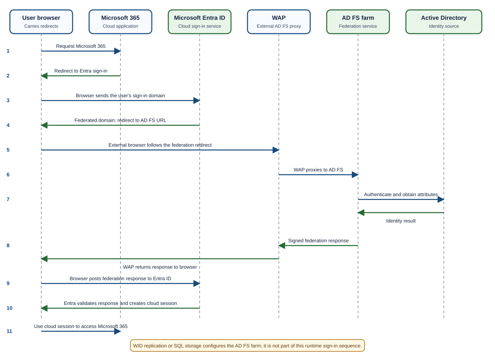
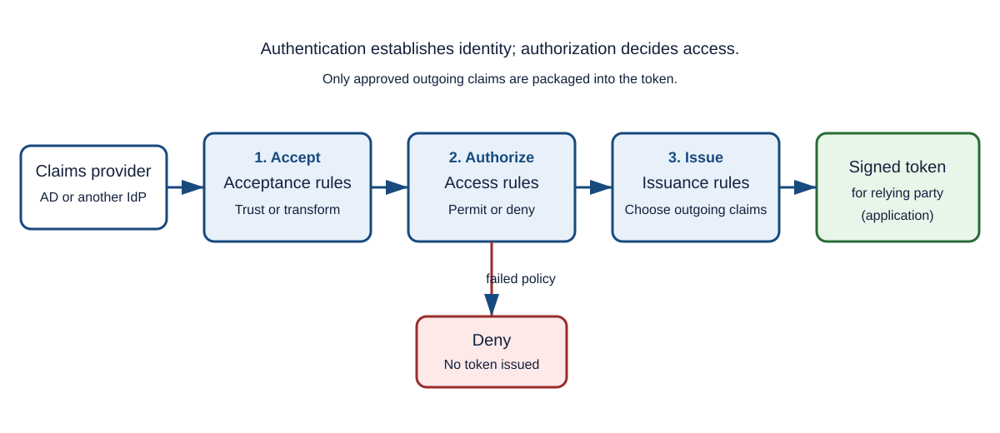

# Day 22: AD FS Farms, Authentication Flows, Claims, and Windows Sign-In Tools

Active Directory Federation Services (**AD FS**) is a Windows Server identity service that authenticates users and issues security tokens containing claims. This lesson explains the vocabulary first, then builds a highly available AD FS farm, traces internal and external sign-ins, follows claims through the claim pipeline, covers certificate maintenance, and finishes with related Microsoft Entra and Windows support notes.

> [!IMPORTANT]
> In browser-based federation, the browser follows redirects and normally carries the authentication response or token between AD FS and the application. Do not picture AD FS directly pushing a token to Microsoft 365. Also keep runtime authentication traffic separate from farm-configuration replication, monitoring, and network-management traffic.

## Foundations

### What AD FS Does

The main purpose of AD FS is federation: it bridges an identity source such as Active Directory Domain Services (**AD DS**) and an application that trusts AD FS. It is a claims-based authenticator and Security Token Service (**STS**).

AD FS works with claims—identity attributes such as an email address, department, role, or User Principal Name (**UPN**). After authenticating a user, AD FS processes these claims and issues an appropriate security token to a trusted application.

### Key Terminology

| Term | Beginner-friendly meaning |
|---|---|
| **Identity** | A set of attributes that describes an entity, such as a user. |
| **Claim** | One piece of identity information, such as an email address or department. |
| **Token** | A serialized, usually signed set of claims. |
| **Security Token Service (STS)** | A service that issues security tokens to authenticated clients. AD FS is an STS. |
| **Claims provider** | Software or a service that supplies one or more claims during sign-in. |
| **Identity provider (IdP)** | A claims provider that authenticates users and enables single sign-on (**SSO**) between an organization, other claims providers, and relying parties. |
| **Relying party (RP)** | An application that relies on claims in a token issued by a trusted claims provider. |
| **Relying party trust (RPT)** | The AD FS configuration that establishes trust with an application. It includes details such as identifiers, endpoints or application URLs, protocol settings, certificates, and claim rules. |
| **UPN** | User Principal Name, commonly formatted like `user@contoso.com`. |
| **WAP** | Web Application Proxy, a reverse proxy that publishes AD FS securely for external users. |
| **MFA** | Multifactor authentication, which requires an additional verification factor. |
| **SPOF** | Single point of failure: one component whose failure stops the service. |

> [!TIP]
> A simple mental model is: **the claims provider is the source of identity, AD FS processes identity, and the relying party is the destination that consumes the token.**

### Passive and Active Clients

- A **passive client** is normally a web browser. It follows HTTP redirects and carries protocol messages between the application and AD FS.
- An **active client** is an application or protocol client that communicates with an authentication endpoint rather than relying on interactive browser redirects.

The distinction matters because the exact protocol and token-delivery path depend on the client. The browser-carried flows in this lesson describe passive clients.

## AD FS Farms

### What Is an AD FS Farm?

An AD FS farm is a group of two or more AD FS servers that share federation configuration and present one authentication service to users. Instead of one server, the service can contain:

```text
AD FS 1
AD FS 2
AD FS 3
...
```

The servers work behind a load balancer. This design provides high availability, scalability, and fault tolerance.

**Interview answer:** An AD FS farm is a collection of two or more AD FS servers that share the same federation configuration and operate as a single authentication service. A load balancer distributes requests across the farm so authentication can continue if an individual server fails.

**One-line answer:** An AD FS farm is a group of load-balanced AD FS servers that work as one authentication service and provide resilient SSO for applications such as Microsoft 365, SharePoint, Salesforce, ServiceNow, and virtual private network (**VPN**) solutions.

### Why Use a Farm?

Imagine that 20,000 employees use Microsoft 365, Salesforce, ServiceNow, SharePoint, and VPN authentication. If every request goes through one AD FS server and that server fails:

- Nobody can complete a federated sign-in.
- SSO stops working.
- Microsoft 365 federated sign-ins fail.
- Remote workers cannot authenticate to applications that depend on that server.

A single-server deployment therefore creates a SPOF:

```text
Users
  |
  v
AD FS server
  |
  v
Active Directory

AD FS server fails
  |
  v
Authentication stops
```

A farm removes that server-level SPOF:

```text
                Users
                  |
                  v
            Load balancer
             /          \
            v            v
        AD FS 1       AD FS 2
             \          /
              v        v
           Active Directory
```

If AD FS 1 fails but AD FS 2 remains healthy, the load balancer routes new requests to AD FS 2 and authentication continues. Users usually do not notice.

### Main Farm Components

#### AD FS Servers

The federation servers:

- Authenticate users.
- Issue tokens.
- Process Security Assertion Markup Language (**SAML**) requests.
- Process WS-Federation (**WS-Fed**) requests.
- Process supported OAuth requests.

Example members are `AD FS 1`, `AD FS 2`, and `AD FS 3`.

#### Load Balancers

A load balancer distributes traffic among healthy servers:

```text
Request 1 -> AD FS 1
Request 2 -> AD FS 2
Request 3 -> AD FS 1
```

Think of it as a traffic officer directing vehicles. An external deployment can use an external load balancer for WAP servers and an internal load balancer for federation servers.

#### Active Directory

AD DS is the back-end identity source. It stores users, password data, groups, and policies. Every AD FS server relies on domain controllers when AD DS performs the authentication.

#### Web Application Proxy

WAP is used to publish AD FS for external users:

```text
Internet
  |
  v
WAP
  |
  v
AD FS farm
```

WAP prevents direct internet exposure of the internal AD FS servers and acts like a security gate at the company entrance.

### Single Server Compared with a Farm

| Feature | Single AD FS server | AD FS farm |
|---|---:|---:|
| High availability | No | Yes |
| Load balancing | No | Yes |
| Server fault tolerance | No | Yes |
| Scalability | Limited | Higher |
| Suitable as a resilient production design | No | Yes |
| Support for a large user base | Limited | Better |

> [!NOTE]
> A farm protects against an individual federation-server failure. True end-to-end availability also requires resilient load balancers, WAP servers, domain controllers, databases where applicable, Domain Name System (**DNS**), certificates, and network paths.

### Farm Database Models

There are two main farm database models.

#### Windows Internal Database Farm

Windows Internal Database (**WID**) is included with Windows Server and does not require a separate SQL Server deployment.

```text
             Load balancer
              /          \
             v            v
         AD FS 1       AD FS 2
            |
            v
       WID configuration
            |
            v
        Replication
```

In a WID farm:

- The **primary** federation server owns the writable copy of the AD FS configuration.
- **Secondary** federation servers receive replicated configuration.
- A typical layout might have one primary and two secondary servers.
- WID is free, simple to deploy, and suitable for many environments.
- No separate SQL Server is required.

The original study limits recorded for this design are:

- Maximum 30 AD FS servers.
- Maximum 100 trust relationships.
- No token replay detection.
- No SAML artifact resolution.

> [!CAUTION]
> Farm limits and feature support vary by Windows Server and AD FS version. Treat recorded limits as version-dependent design notes and confirm them in the documentation for the deployed version.

**Example:** A company with 500 employees using Microsoft 365, SharePoint, and VPN might use two AD FS servers, two WAP servers, and WID. This is a simple, cost-effective design.

#### SQL Server Farm

A SQL-based farm stores AD FS configuration in Microsoft SQL Server:

```text
             Load balancer
              /          \
             v            v
         AD FS 1       AD FS 2
              \        /
               v      v
             SQL database
```

All federation servers read from and write to the shared database, so there is no WID-style primary/secondary role. This model is used when requirements include:

- Token replay detection.
- SAML artifact resolution.
- A large number of trust relationships.
- Enterprise database availability and scale.

It is often described as supporting “unlimited scaling,” but practical capacity is never literally unlimited; servers, SQL, networks, and dependent services must all be sized and made resilient.

**Large-enterprise example:** A company with 100,000 employees using Microsoft 365, Salesforce, Workday, ServiceNow, SuccessFactors, and Amazon Web Services (**AWS**) might deploy four to eight AD FS servers, a SQL cluster, and multiple load balancers.

### A Highly Available External Design

```text
Internet users
      |
      v
External load balancer
    /              \
   v                v
WAP 1             WAP 2
    \              /
     v            v
Internal load balancer
    /              \
   v                v
AD FS 1          AD FS 2
       \          /
        v        v
     Active Directory
```

The diagram below adds the browser to show the correct runtime direction and separately marks the configuration path.



The paths serve different purposes:

- **Runtime authentication:** Browser, application, WAP, AD FS, and AD DS exchange sign-in-related traffic.
- **Configuration replication or storage:** WID secondaries receive configuration from the primary, or farm members use SQL. This is not a user sign-in path.
- **Monitoring:** Health probes, event collection, and alerting observe components without authenticating the user.
- **Network management:** DNS, firewall, load-balancer, certificate, and administrative traffic supports the platform but is not the federation protocol itself.

## Authentication Architecture and Flows

### Generic External Authentication Flow

Suppose Elijah is working from home and opens a federated application.

1. **Access the application.** The browser requests Microsoft 365, ServiceNow, Salesforce, SharePoint, or a custom application such as `https://portal.contoso.com`.
2. **Follow the federation redirect.** The application sends the browser to AD FS using the configured protocol, such as SAML, WS-Fed, or OAuth/OpenID Connect (**OIDC**) where supported.
3. **Reach the perimeter.** The external browser reaches the published federation service through WAP. An external load balancer can select WAP 1 or WAP 2.
4. **Select a federation server.** WAP proxies the request through the internal load balancer to AD FS 1 or AD FS 2.
5. **Authenticate.** AD FS uses the configured method. Possibilities include username and password, Kerberos, certificate authentication, Windows Hello, and MFA.
6. **Validate with a domain controller.** When AD DS is used, relevant checks can include the username, password, group membership, account status, and lockout state.
7. **Create the response or token.** Depending on the protocol, AD FS may issue a WS-Fed token carrying a SAML 1.1 token, a SAML 2.0 assertion, or OAuth access and refresh tokens.
8. **Return through the browser.** For the passive flows described here, WAP returns the AD FS response to the browser, and the browser posts or presents it to the application. This is more accurate than drawing a direct AD FS-to-application token push.
9. **Validate at the application or service.** Checks include issuer, signature, audience, expiry time, and claims.
10. **Grant access.** The user enters the application without giving the application the AD password.

Common token claims include:

- Email address
- UPN
- Department
- Groups
- Roles
- Authentication method

### Internal User Flow

A domain-joined device on the corporate network may use integrated Windows authentication:

```text
Internal user
  |
  v
Domain-joined device
  |
  v
Kerberos authentication
  |
  v
AD FS
  |
  v
Active Directory
  |
  v
Browser receives token or response
  |
  v
Application
```

Applications can include SharePoint, Microsoft 365, and Dynamics 365. When integrated authentication succeeds, the user may see no additional sign-in prompt, which provides SSO.

### External User Flow

```text
External user
  |
  v
Internet
  |
  v
WAP
  |
  v
AD FS
  |
  v
Username and password plus MFA
  |
  v
Active Directory
  |
  v
Browser carries token or response
  |
  v
Application
```

For example:

```text
Home user -> Microsoft 365 -> AD FS -> MFA -> access granted
```

### Microsoft 365 Federation Flow

Historically, many large organizations federated Microsoft 365 domains with AD FS:

```text
Microsoft 365
      |
      v
AD FS farm
      |
      v
Active Directory
```

A more precise passive sign-in sequence is:

1. The user opens Outlook Online, Microsoft Teams, SharePoint Online, OneDrive, or `https://portal.office.com`.
2. Microsoft Entra ID inspects the sign-in domain, for example `elijah@contoso.com`, and discovers that the domain is federated to AD FS.
3. Entra ID sends an HTTP redirect to the **browser**. The browser then requests the AD FS sign-in endpoint.
4. For a remote user, the request reaches WAP in the demilitarized zone (**DMZ**) or perimeter network. WAP securely publishes AD FS and proxies the request internally.
5. An AD FS farm member authenticates the user. If AD DS validates the credentials, checks can include username, password, account status, group membership, and lockout status.
6. AD FS processes claims and creates the protocol response. Claims might include UPN, email address, display name, groups, roles, and authentication method.
7. The response returns through WAP to the browser. The browser carries it back to the Entra ID endpoint identified by the protocol.
8. Entra ID validates the issuer, signature, audience, signing certificate, expiry, and claims.
9. If validation succeeds, the user receives access to Exchange Online, Teams, SharePoint Online, OneDrive, and Power Platform without giving Microsoft 365 the user's AD password.

Example outgoing claims:

```text
UPN = elijah@contoso.com
Department = Support
Role = Employee
```

> [!IMPORTANT]
> “No password is sent to Microsoft 365” does not mean the browser is absent. In this passive flow, the browser follows redirects and carries the signed federation response. Microsoft 365 trusts the validated token rather than receiving the user's AD password.

#### Roles in the Microsoft 365 Flow

| Component | Purpose |
|---|---|
| User and browser | Request an application, follow redirects, and carry protocol messages. |
| Microsoft 365 / Entra ID | Detect the federated domain and validate the federation response. |
| WAP | Publish AD FS externally and proxy external authentication requests. |
| AD FS farm | Authenticate according to policy, process claims, and issue a signed response. |
| Active Directory | Store users, password data, groups, and policies and validate AD credentials. |
| Security token | Provide signed proof of authentication and approved claims. |
| Microsoft 365 applications | Rely on the established cloud session and grant access to services. |

**Short interview answer:** In a federated Microsoft 365 environment, Entra ID redirects the user's browser to AD FS. For an external user, the browser reaches AD FS through WAP. AD FS authenticates the user against Active Directory, processes claims, and returns a signed federation response through the browser. Entra ID validates it and grants access to services such as Exchange Online, Teams, SharePoint, and OneDrive.

### Application Examples

#### Microsoft 365

```text
User browser
  -> Microsoft 365
  -> redirect to AD FS farm
  -> Active Directory authentication
  -> response returns through browser
  -> Microsoft 365 validates it
```

#### ServiceNow

```text
Employee browser
  -> ServiceNow
  -> redirect to AD FS farm
  -> MFA
  -> response returns through browser
  -> ServiceNow validates it
```

The employee signs in once and can gain access without another password prompt.

#### Salesforce

```text
Employee browser
  -> Salesforce
  -> redirect to AD FS farm
  -> SAML assertion returns through browser
  -> Salesforce validates it
```

Salesforce never sees the user's AD password.

### Farm Failure Scenario

**Normal operation:** AD FS 1 and AD FS 2 are healthy.

**Failure:** AD FS 1 becomes unavailable.

**Automatic recovery:** The load balancer stops selecting AD FS 1 and routes new requests to AD FS 2. Authentication continues, and users usually never notice.

## AD FS Certificates

AD FS uses certificates for:

- **Service communication:** TLS/SSL protection for the federation service endpoint.
- **Token signing:** Lets relying parties verify that a token was issued by the trusted AD FS service and was not modified.
- **Token decrypting:** Decrypts tokens sent to AD FS when encryption is used.

### Urgent Token-Certificate Rollover

On the primary AD FS server, the original procedure uses these PowerShell commands:

```powershell
Set-ADFSProperties -AutoCertificateRollover $false

Update-AdfsCertificate -CertificateType token-signing -Urgent

Update-AdfsCertificate -CertificateType token-decrypting -Urgent

Set-ADFSProperties -AutoCertificateRollover $true
```

> [!WARNING]
> An urgent rollover can break trust if relying parties do not obtain the new token-signing or token-decrypting certificate. Coordinate the change, confirm metadata or certificate update behavior, and verify every relying party.

### Inspecting Certificate Configuration

Use PowerShell to inspect the AD FS SSL certificate and certificate-related properties:

```powershell
Get-AdfsSslCertificate

Get-AdfsProperties | fl *certificate*
```

The original notes also contained this command:

```powershell
Get-AsfsCertificate
```

> [!CAUTION]
> `Get-AsfsCertificate` is preserved from the source notes, but its `Asfs` spelling appears to be a typo. Verify the intended installed AD FS cmdlet before running it rather than assuming the command is valid.

## The AD FS Claim Pipeline

The claim pipeline is the sequence of processing stages through which identity information passes before AD FS issues a security token to an application.

Think of it like an airport:

1. A traveler arrives with a passport and ticket.
2. Security verifies the information.
3. Authorization determines whether the traveler may proceed.
4. A boarding pass is issued.
5. The traveler continues to the destination.

Likewise, AD FS receives claims, accepts or transforms trusted inputs, authorizes access, and issues only approved claims to the application.



### What Is a Claim?

A claim is one piece of information about a user. Examples include:

```text
Username = elijah.aremu@contoso.com
Department = IT
Role = Global Administrator
Email = elijah.aremu@contoso.com
Country = Rwanda
```

When a user authenticates, AD FS can process identity attributes as claims.

### Pipeline Overview

```text
Stage 1 -> Accept incoming claims
Stage 2 -> Authorize the requester
Stage 3 -> Issue outgoing claims
```

The stages answer three different questions:

1. **Acceptance:** Which incoming claims should AD FS trust, pass through, or transform?
2. **Authorization:** Should this user access this relying party?
3. **Issuance:** Which claims should the relying party receive?

### Stage 1: Accepting Incoming Claims

AD FS receives claims from a trusted identity source represented by a **claims provider trust**. Sources can include:

- Active Directory
- Another AD FS farm
- Microsoft Entra ID
- A third-party identity provider

```text
User
  |
  v
Claims provider
  |
  v
AD FS
```

Example incoming claims:

```text
User = Elijah
Department = IT
Location = Kigali
```

#### Acceptance Rules

Acceptance rules determine which incoming claims AD FS accepts and can also transform them. A simple policy might say:

```text
Accept Username
Accept Email
Accept Department
Ignore Location
Ignore Mobile Number
```

For example, given:

```text
Name = Elijah
Email = elijah@contoso.com
Department = IT
Phone = 12345
```

If the rule accepts only email and department, the result is:

```text
Email = elijah@contoso.com
Department = IT
```

The phone number is discarded.

### Stage 2: Authorizing the Claims Requester

Authentication and authorization are different:

| Question | Meaning |
|---|---|
| **Who are you?** | Authentication |
| **Do you have permission?** | Authorization |

Authorization rules evaluate the accepted claims and produce a **permit** or **deny** decision.

#### Permit Example

Rule:

```text
Allow all users in IT Department
```

User claim and outcome:

```text
Department = IT
Outcome = PERMIT
```

#### Deny Example

Rule:

```text
Only Managers may access Payroll App
```

User claim and outcome:

```text
Role = Employee
Outcome = DENY
```

#### HR Application Example

```text
Permit:
HR Managers
HR Directors

Deny:
Everyone Else
```

If the conditions are met, AD FS permits the request. Otherwise it denies the request, processing stops, and no token is issued.

### Stage 3: Issuing Outgoing Claims

If authorization succeeds, issuance rules decide what the application receives. Applications rarely need every Active Directory attribute.

Suppose AD contains:

```text
First Name
Last Name
Email
Department
Manager
Employee ID
Country
Phone Number
```

The application needs only:

```text
Email
Department
Role
```

Issuance rules can produce:

```text
Email = elijah@contoso.com
Department = IT
Role = Administrator
```

Only those approved outgoing claims are sent.

### Security Token Creation

After issuance rules finish, AD FS creates a security token. Common descriptions in the notes include:

```text
SAML token
JWT token
WS-Federation token
```

Strictly speaking, WS-Federation is a federation protocol and JSON Web Token (**JWT**) is a token format; the exact format depends on the configured protocol and application.

An illustrative payload is:

```json
{
  "name": "Elijah Aremu",
  "email": "elijah@contoso.com",
  "department": "IT",
  "role": "Administrator"
}
```

The relying party trusts AD FS, validates the token, and uses its claims in the access decision.

### Claims Provider Trust Compared with Relying Party Trust

| Trust | Role | Examples |
|---|---|---|
| **Claims provider trust** | Source of identity and incoming claims | Active Directory, another AD FS farm, Entra ID, third-party IdP |
| **Relying party trust** | Destination that consumes approved claims | Salesforce, Microsoft 365, SharePoint, ServiceNow, Workday, custom application |

**Interview answer:** The AD FS claim pipeline accepts incoming claims through acceptance rules, authorizes the user through rules that permit or deny access, and creates outgoing claims through issuance rules. If access is permitted, AD FS packages the approved claims into a token for the relying party. This provides authentication, authorization, and claim transformation before access is granted.

## Related Microsoft Entra and Windows Notes

### Azure VM Extension Study Note

The original notes listed three Azure virtual machine (**VM**) extension identifiers associated with enabling Microsoft Entra sign-in on a VM:

```text
AADlogin
AzurePolicyforWindows
enablevmaccess
```

> [!CAUTION]
> These names are preserved as recorded study notes. Extension publisher/type names and required components are case- and platform-specific, and not all three are necessarily prerequisites for every Entra sign-in scenario. Verify the current Azure VM sign-in procedure and exact extension names before deployment.

### Workplace Join Scheduled Task

For device-registration troubleshooting, the relevant Windows Task Scheduler path recorded in the notes is:

```text
Task Scheduler > Windows > Workplace Join > Automatic-Device-Join
```

This lesson also references the Microsoft identity and access administrator exam:

```text
SC-300
```

## The `netplwiz` Windows Utility

### What Is `netplwiz`?

`netplwiz`—often expanded as Network Password Wizard—is a built-in Windows utility for managing user accounts, group membership, passwords, and automatic sign-in settings.

Either command opens the user-account management interface:

```powershell
netplwiz
```

```powershell
control userpasswords2
```

### How to Open It

#### Method 1: Run

1. Press **Windows key + R**.
2. Enter:

   ```powershell
   netplwiz
   ```

3. Select **OK**.

#### Method 2: Command Prompt

Run:

```bat
netplwiz
```

### Configure Automatic Sign-In

Normally, startup looks like this:

```text
Start PC -> sign-in screen -> enter password
```

With automatic sign-in:

```text
Start PC -> desktop opens automatically
```

To configure it:

1. Open `netplwiz`.
2. Select the user account.
3. Clear **Users must enter a user name and password to use this computer**.
4. Select **Apply**.
5. Enter the account password when prompted.

Windows will then automatically sign in that user at startup.

> [!WARNING]
> Automatic sign-in reduces physical security because anyone who can start the device may reach the desktop. Use it only when the risk is understood and the organization's policy permits it.

### Manage Local Users

The interface can show accounts such as:

```text
Administrator
Elijah
Guest
SupportAccount
```

Depending on the account and Windows configuration, administrators can use it to:

- Add or remove local users.
- Reset passwords.
- Change group membership.

### Manage Group Membership

1. Select a user.
2. Select **Properties**.
3. Open **Group Membership**.
4. Choose an appropriate option, such as **Standard User**, **Administrator**, or another group.

### Support and Troubleshooting Uses

Microsoft support engineers can use `netplwiz` to answer questions such as:

- Is the user signing in with a local, domain, or Microsoft account?
- Was automatic sign-in configured unexpectedly?
- Which displayed users have local administrator membership?

If a device signs in automatically when it should not, `netplwiz` is one of the first places to inspect. It can also provide a quicker account view than opening Computer Management.

### Entra-Joined Devices

`netplwiz` still provides basic account viewing on Microsoft Entra joined and Microsoft Entra hybrid joined devices. Modern organizations, however, generally manage identity and access through Microsoft Entra ID, Microsoft Intune, and Conditional Access rather than relying on `netplwiz`.

**Interview answer:** `netplwiz` is a Windows utility for viewing and managing user accounts, changing group membership, resetting supported local-account passwords, and configuring automatic sign-in. Support engineers commonly use it while troubleshooting Windows sign-in and account issues.

## Lesson Summary

- AD FS authenticates users, processes claims, and issues signed tokens to relying parties.
- A load-balanced farm improves availability; WID uses primary-to-secondary configuration replication, while SQL-backed members share a database.
- WAP securely publishes AD FS for external users.
- In passive federation, the browser follows redirects and carries protocol responses; AD FS does not simply push a token directly to Microsoft 365.
- Acceptance, authorization, and issuance rules form the claim pipeline.
- Certificate rollover must be coordinated with relying parties.
- Microsoft Entra VM, Workplace Join, and `netplwiz` notes support adjacent device and Windows sign-in troubleshooting.
