# Day 23: Microsoft Entra Device Identities, Hybrid Join, and Authentication

A device can have an identity just as a user, group, or application can. This lesson starts with Windows terminology, compares the three Microsoft Entra device states, and then traces a managed Microsoft Entra hybrid join from Active Directory Domain Services (**AD DS**) to cloud registration. It finishes with authentication, single sign-on (**SSO**), verification, and troubleshooting.

> [!IMPORTANT]
> **Registered**, **joined**, and **hybrid joined** are distinct states. A hybrid-joined Windows device remains joined to on-premises AD DS and separately completes the Microsoft Entra hybrid-join process. It is not merely an ordinary registered device, and it is not joined to two Windows domains.

## Foundations

### What Is a Device?

A computer device is a tool or machine that accepts and processes input. Devices discussed in identity and management work include:

- Mobile phones
- macOS devices
- Windows devices

**OEM** means Original Equipment Manufacturer: the company that originally manufactures a device or its components.

### Windows Edition, Version, and Build

Windows **edition** and **version** are related but different:

| Term | What it identifies | Examples |
|---|---|---|
| **Edition** | Feature set and licensing level | Windows 11 Home, Pro, Enterprise, or Education; Windows Server Standard or Datacenter |
| **Version** | Feature-release level | Windows 10 1909 or 22H2; Windows 11 21H2, 22H2, 23H2, or 24H2 |
| **OS build** | Exact compiled build and revision | `26100.4351` |

Think of the **edition** as a car model and the **version** as its software-update level.

| Edition | Typical use |
|---|---|
| Home | Personal users |
| Pro | Small businesses and IT professionals |
| Enterprise | Large organizations |
| Education | Schools and universities |

For example, Windows 11 Pro and Windows 11 Enterprise can run the same version while offering different capabilities. Depending on the edition and release, differences can include:

- BitLocker
- Hyper-V
- Group Policy
- AppLocker
- DirectAccess

A company laptop might report:

```text
Edition: Windows 11 Enterprise
Version: 24H2
OS Build: 26100.xxxx
```

This means:

- **Enterprise** is the business feature set.
- **24H2** is the feature update released in the second half (`H2`) of 2024.
- **OS build** is the exact compiled build and revision.

To check interactively, run:

```text
winver
```

Example output:

```text
Windows 11 Enterprise
Version 24H2
OS Build 26100.4351
```

You can also open:

```text
Settings > System > About
```

Look for **Edition**, **Version**, and **OS build**.

> [!TIP]
> **Edition:** What features do I have?  
> **Version:** How updated is Windows?  
> **Build:** What exact installation revision is present?

### Windows Edition and Microsoft Entra Join

- Windows Pro can Microsoft Entra join.
- Windows Home cannot Microsoft Entra join; it can participate in Microsoft Entra registration scenarios instead.

Always verify the supported edition and release before planning deployment.

## Device Identity in Microsoft Entra ID

### What Is Device Registration?

Device registration creates a **device identity**—an object in Microsoft Entra ID, similar in concept to a user, group, or application object.

A device identity:

- Provides device information to administrators.
- Helps make access decisions through integration with Conditional Access policies (**CAPs**).
- Supports SSO.
- Is a prerequisite for other device-related features.
- Can support cloud device management.

Device identity and device management are related but separate. A device can exist in Entra ID without being enrolled in Microsoft Intune, and Intune enrollment adds management capabilities rather than changing every join state.

### Key Acronyms and Components

| Term | Meaning |
|---|---|
| **AD DS** | Active Directory Domain Services, the on-premises directory and domain service |
| **BYOD** | Bring Your Own Device, normally a personally owned device used for work |
| **CAP** | Conditional Access policy, which evaluates signals before granting access |
| **DRS** | Device Registration Service, the Microsoft Entra service that creates and maintains device identities |
| **GPO** | Group Policy Object, used to apply AD-based computer and user policy |
| **MDM** | Mobile Device Management, such as Microsoft Intune |
| **PRT** | Primary Refresh Token, a Microsoft Entra token used to support SSO on Windows |
| **SCP** | Service Connection Point, an AD object that provides tenant discovery information |
| **SSO** | Single sign-on, access to multiple resources without repeated credential prompts |

> [!NOTE]
> The original notes used `SEP` for Service Connection Point. The correct acronym is **SCP**.

## The Three Device Identity States

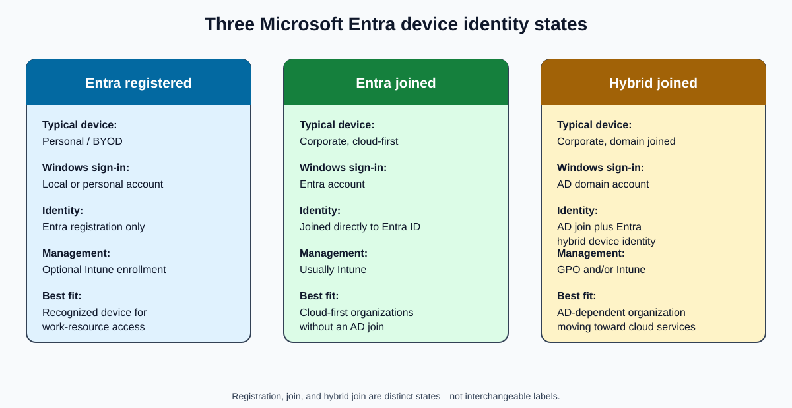

### Device-State Comparison

| Feature | Entra ID Registered | Entra ID Joined | Entra ID Hybrid Joined |
|---|---|---|---|
| Typical device | Personal/BYOD device | Corporate cloud-only device | Corporate domain-joined device |
| Joined to on-premises AD | ❌ No | ❌ No | ✅ Yes |
| Joined to Entra ID | ❌ Not fully joined; registered only | ✅ Yes | ✅ Has a Microsoft Entra hybrid-join identity |
| Device management | Optional (Intune) | Usually Intune | Intune and/or Group Policy (GPO) |
| User sign-in account | Local/personal account | Entra ID account | AD domain account |
| SSO to Microsoft 365 | Available for the connected work account, but not an Entra Windows sign-in | Full | Full when prerequisites are met |
| Group Policy support | ❌ No | ❌ No traditional AD GPO | ✅ Yes |
| Kerberos/NTLM access to on-premises resources | ❌ No inherent domain trust | Possible with the right identity, connectivity, and configuration; not domain join | ✅ Yes through the AD domain identity |
| Best for | Bring Your Own Device (BYOD) | Cloud-first organizations | Hybrid organizations |

> [!IMPORTANT]
> **Hybrid join is not “domain joined + ordinary Entra registration.”** Microsoft Entra hybrid join is a specific trust state in which the AD-joined device obtains a corresponding device identity in Entra ID through the supported hybrid-join process.

### Microsoft Entra Registered

#### Definition and Profile

A personal or unmanaged device is registered with Entra ID so the organization can recognize it. The device normally remains personally owned, and registration does not replace the user's existing Windows profile with an organizational Windows sign-in profile.

This state:

- Supports BYOD scenarios.
- Allows access to organizational resources from a personal device.
- Can provide SSO for the connected work account.
- Can support Conditional Access.
- Can optionally be enrolled in Intune.
- Does not domain join or Entra join the device.
- Does not apply traditional AD Group Policy.

#### Example and Flow

An employee uses a personal laptop and signs in to:

```text
Outlook
Teams
OneDrive
```

During account connection, Windows may present:

```text
Allow my organization to manage my device
```

The exact result depends on the workflow and tenant policy: adding the work account can register the device, while allowing management can also trigger MDM enrollment. Do not treat registration and Intune enrollment as the same operation.

```text
Personal laptop
       |
       v
Microsoft 365 sign-in / work-account connection
       |
       v
Device registration
       |
       v
Microsoft Entra ID device object
```

**Characteristics**

- ✅ Supports Conditional Access.
- ✅ Appears in Entra ID.
- ✅ Can be enrolled in Intune.
- ❌ Is not domain joined.
- ❌ Does not receive traditional AD Group Policy.
- ❌ Is not automatically a corporate-managed device.

### Microsoft Entra Joined

#### Definition and Profile

The device is joined directly to Microsoft Entra ID and is considered a corporate cloud-managed device. This is the cloud-oriented counterpart to traditional domain join, although the technologies and capabilities are not identical.

Microsoft Entra join:

- Lets the user sign in to Windows with an Entra account.
- Creates an organizational Windows profile.
- Supports passwordless authentication.
- Commonly pairs with Intune.
- Supports Conditional Access and cloud SSO.
- Has no requirement to be joined to on-premises AD.
- Does not receive traditional AD GPO.

#### Example and Flow

A company purchases a new Windows 11 laptop. During setup, the user selects:

```text
Set up for work or school
```

The user enters:

```text
user@company.com
```

The device joins directly to Entra ID:

```text
Windows device
       |
       v
Microsoft Entra join
       |
       v
Microsoft Entra ID
       |
       v
Cloud authentication and management
```

**Characteristics**

- ✅ Typically corporate-owned.
- ✅ Uses an Entra account for Windows sign-in.
- ✅ Supports passwordless authentication.
- ✅ Supports Intune management.
- ✅ Supports Conditional Access.
- ✅ Fits a cloud-first design.
- ❌ Does not depend on an on-premises AD join.
- ❌ Does not receive traditional AD GPO.

> [!NOTE]
> An Entra-joined device can access some on-premises resources with Kerberos or NTLM when the user identity, network connectivity, name resolution, and environment are correctly configured. This capability does not make the device domain joined.

**Real-world example:** A startup uses Microsoft 365, Intune, Microsoft Defender, and SharePoint Online but has no on-premises servers. Its laptops are:

```text
Microsoft Entra joined
```

### Microsoft Entra Hybrid Joined

#### Definition and Profile

A hybrid-joined Windows device is joined to on-premises AD DS and has completed Microsoft Entra hybrid join. This is common while an organization transitions from traditional AD infrastructure to cloud services.

Hybrid join:

- Preserves the AD computer account and AD domain sign-in.
- Creates a related device identity in Entra ID.
- Supports Group Policy.
- Supports AD-based Kerberos and NTLM authentication.
- Supports access to file servers and legacy applications.
- Enables cloud applications, Microsoft 365 SSO, and Conditional Access when prerequisites are met.
- Can be managed with Group Policy, Intune, or both, according to design.

The user can sign in as:

```text
CORP\Elijah
```

or with an AD User Principal Name (**UPN**):

```text
elijah@company.com
```

The correct conceptual formula is:

```text
AD DS domain join
+
Microsoft Entra hybrid-join registration process
=
Microsoft Entra hybrid joined
```

#### Examples

A bank or large enterprise might have:

```text
Domain Controllers
File Servers
AD FS
Microsoft 365
```

Another organization might have:

```text
1,000 users
Domain Controllers
File Shares
Legacy Applications
Microsoft 365
```

Hybrid join is a typical fit when the organization needs all of the following during migration:

- Kerberos
- Group Policy
- On-premises applications
- Cloud services

#### Memory Aid

Think of the organization as a house:

- **Entra registered — visitor:** The organization knows who you are, but you do not live there.
- **Entra joined — resident:** You live in Microsoft's cloud house.
- **Hybrid joined — resident with two homes:** The device has an on-premises AD home and a Microsoft Entra device identity.

```text
On-premises AD
+
Microsoft Entra ID
```

The analogy helps with recall, but remember that hybrid join is a defined device-trust process—not two unrelated joins.

## Microsoft Entra Hybrid Join in a Managed Environment

### What “Managed” Means

In this context, a **managed authentication domain** uses cloud authentication rather than federating user authentication to Active Directory Federation Services (**AD FS**). Identities are synchronized from AD DS through Microsoft Entra Connect.

Common managed authentication methods are:

- **Password Hash Synchronization (PHS):** A derived representation of the AD password hash is synchronized so Entra ID can validate cloud sign-in.
- **Pass-Through Authentication (PTA):** Entra ID receives the sign-in request, and on-premises PTA agents validate the password against AD DS.

Both are managed-domain models. PTA still depends on on-premises agents and AD DS for password validation, so “managed” does not mean every validation step occurs only in the cloud.

> [!NOTE]
> The user's domain authentication method and the device's hybrid-join state are related parts of the overall design, but they are not the same setting.

### Components

1. A domain-joined Windows device
2. Active Directory Domain Services
3. The Windows `Automatic-Device-Join` scheduled task
4. A Service Connection Point
5. Microsoft Entra Connect
6. Microsoft Entra ID
7. Microsoft Entra Device Registration Service (DRS), historically called Azure DRS

### Configuration Approaches and Team Responsibilities

The original operational notes associated hybrid join with:

- **Microsoft Entra Connect** — commonly supported by the authentication or identity team.
- **Group Policy** — commonly supported by the Windows team; targeted client-side registry policy can provide tenant discovery in controlled scenarios.
- **Windows Autopilot from Intune** — commonly supported by the Intune team.

These are not three interchangeable mechanisms:

- Microsoft Entra Connect configures hybrid-join synchronization and normally writes the SCP.
- Group Policy can target or configure clients as part of deployment.
- An Autopilot hybrid-join deployment uses Intune plus the Intune Connector for Active Directory and an offline domain-join process before hybrid join completes.

### Two Related Device Objects

A hybrid device is represented in two directories:

- An **AD DS computer object**, with AD identifiers such as its object GUID and security identifier.
- A **Microsoft Entra device object**, with a Microsoft Entra device ID.

Microsoft Entra Connect synchronizes information between the directories, but the second identifier is not “an Azure Connect device ID.” Troubleshooting must use the correct device ID in the correct system.

## End-to-End Hybrid-Join Architecture

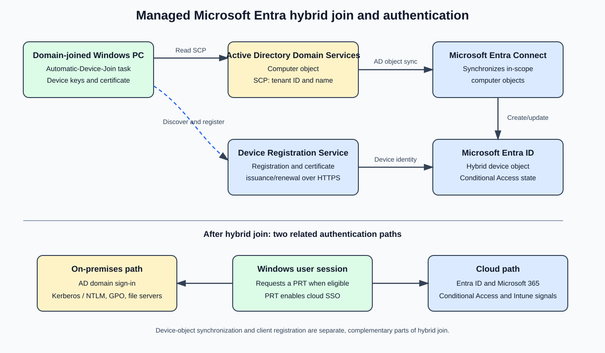

The architecture contains two complementary paths:

1. **Directory synchronization:** The AD computer object moves through Microsoft Entra Connect into Entra ID.
2. **Client registration:** The Windows device discovers tenant details and contacts DRS over HTTPS to prove its identity and complete registration.

The synced object alone is not proof that client-side hybrid join has completed.

### Phase 1: Join the Device to Active Directory

The computer first joins the corporate AD domain:

```text
PC1
 |
 +----> joins ----> Active Directory
```

AD creates a computer object, conceptually:

```text
CN=PC1
OU=Workstations
```

The device must be domain joined before it can become hybrid joined.

### Phase 2: Synchronize the Computer Object

Microsoft Entra Connect synchronizes in-scope computer objects from AD DS to Entra ID:

```text
Active Directory
       |
       | Computer-object synchronization
       v
Microsoft Entra Connect
       |
       v
Microsoft Entra ID
```

Requirements include:

- The device's organizational unit (**OU**) is included in synchronization scope.
- Required default device attributes have not been excluded.

The expected result is:

```text
Computer object appears in Microsoft Entra ID
```

### Phase 3: Discover the Tenant Through the SCP

When hybrid join is configured, Microsoft Entra Connect normally creates a Service Connection Point in the Active Directory configuration partition. The SCP tells domain-joined devices which Entra tenant to use.

```text
Active Directory
      |
      +-- Service Connection Point
             |
             +-- Tenant ID
             +-- Tenant name
```

The workstation reads this information to discover the tenant.

### Phase 4: Run Automatic-Device-Join

Windows includes this built-in scheduled task:

```text
Task Scheduler
 └─ Microsoft
     └─ Windows
         └─ Workplace Join
             └─ Automatic-Device-Join
```

The task initiates the hybrid-join client process and can run at triggers such as user sign-in and scheduled retry intervals.

```text
Domain-joined PC
       |
       | Reads SCP
       v
Active Directory
       |
       | Returns tenant information
       v
Automatic-Device-Join task
       |
       | HTTPS
       v
Microsoft Entra Device Registration Service
```

### Phase 5: Register Through DRS

Microsoft Entra Device Registration Service:

- Handles device registration.
- Creates the cloud device identity.
- Issues the device certificate used in the device trust.
- Supports device-certificate renewal.

During registration, the client discovers DRS endpoints, generates device keys, and completes registration with Entra ID.

```text
Domain-joined Windows device
       |
       | Registration request and proof
       v
Microsoft Entra DRS
       |
       | Device identity and certificate
       v
Microsoft Entra ID
```

### Full Sequence

1. The laptop joins AD DS.
2. AD creates its computer account.
3. Microsoft Entra Connect synchronizes the computer object.
4. The SCP tells the device which tenant to use.
5. The `Automatic-Device-Join` task runs.
6. The device contacts DRS.
7. DRS completes the cloud device identity and certificate workflow.
8. The device becomes Microsoft Entra hybrid joined.
9. The organization can use device trust for Conditional Access, cloud SSO, and supported Intune management.

## Authentication After Hybrid Join

### On-Premises Authentication

The user still signs in to Windows with the AD domain identity. The AD computer and user identities support:

- Kerberos
- NT LAN Manager (**NTLM**) where required
- Group Policy
- File servers
- AD-integrated and legacy applications

```text
User
  |
  v
Windows sign-in
  |
  v
Active Directory
  |
  +--> Kerberos preferred
  |
  +--> NTLM fallback where applicable
```

Kerberos is normally preferred in a healthy AD environment. NTLM is not the defining mechanism for hybrid join and should not be described as the cloud authentication path.

### Cloud Authentication, PRT, and SSO

After an eligible user signs in, Windows can request a Primary Refresh Token from Entra ID. The PRT is bound to the user and device context and supports SSO to Entra-integrated applications. It is distinct from the device certificate and from an application's access token.

```text
AD domain user signs in to hybrid-joined Windows
       |
       v
Windows obtains a PRT when prerequisites succeed
       |
       v
Cloud authentication broker requests app tokens
       |
       v
Microsoft 365 and other Entra-integrated applications
```

The Microsoft Entra device identity can contribute to:

- Conditional Access device evaluation
- Microsoft 365 access
- Intune device association and compliance signals
- Passwordless scenarios where supported
- Cloud SSO

> [!IMPORTANT]
> A device showing as hybrid joined does not by itself guarantee that the current user has a PRT. Check both the join state and `AzureAdPrt` in `dsregcmd /status`.

### Identity Purposes Side by Side

| Identity | Stored in | Primarily used for |
|---|---|---|
| AD computer account | Active Directory | Domain trust, Kerberos/NTLM, GPO, file servers, and AD-integrated resources |
| Entra device object | Microsoft Entra ID | Device trust, Conditional Access signals, Intune association, Microsoft 365, and cloud SSO support |
| PRT | Protected Windows sign-in context | User SSO and acquisition of tokens for Entra-integrated applications |

### Real-World Environment

Suppose Contoso Ltd. has:

```text
2 Domain Controllers
1 Microsoft Entra Connect server
500 Windows 11 devices
Microsoft 365
Microsoft Intune
```

The operational flow is:

1. A laptop joins AD.
2. AD creates its computer account.
3. Entra Connect synchronizes the computer object.
4. The SCP directs the client to the correct tenant.
5. The automatic device-join task runs.
6. The device contacts DRS.
7. DRS completes the cloud identity workflow.
8. The device becomes hybrid joined.
9. The user can receive:
   - Kerberos SSO on premises.
   - Microsoft 365 SSO in the cloud.
   - Conditional Access enforcement.
   - Intune management when enrollment and policy are configured.

## Verification and Troubleshooting

### Check Windows Join and PRT Status

Run:

```powershell
dsregcmd /status
```

For a successful hybrid-join state, look for:

```text
AzureAdJoined : YES
DomainJoined  : YES
```

For the signed-in user's cloud SSO state, also inspect:

```text
AzureAdPrt : YES
```

Interpretation:

- `AzureAdJoined : YES` plus `DomainJoined : YES` indicates the local device reports a hybrid-join state.
- `AzureAdPrt : YES` indicates the current user has a PRT.
- A missing PRT is an authentication/SSO symptom, not proof that the device object does not exist.

> [!TIP]
> Run the command in the affected user's sign-in context when investigating user-state fields. Correlate tenant ID, device ID, timestamps, and diagnostic sections instead of checking only two flags.

### Check the Cloud Device Object

Open:

```text
Microsoft Entra admin center
  -> Identity
  -> Devices
  -> All devices
```

Expected join type:

```text
Microsoft Entra hybrid joined
```

Portal presence alone is insufficient: compare the portal device ID with the client result and check for duplicate, stale, disabled, or pending records.

### Use the Correct Device Identifier

Device-management troubleshooting should focus on the affected device and its identifiers:

1. Record the device name and the `DeviceId` from `dsregcmd /status`.
2. Match that ID to the Entra device object.
3. Separately locate the AD computer account.
4. If Intune is involved, correlate the Intune managed-device record; its management record ID can differ from the Entra device ID.
5. Check whether the correct object is enabled, compliant, and in policy scope.

### Troubleshooting Checklist

1. **Domain join:** Confirm `DomainJoined : YES`, domain connectivity, Domain Name System (**DNS**), and time synchronization.
2. **Synchronization:** Confirm the computer's OU is in Entra Connect scope and required attributes are synchronized.
3. **Tenant discovery:** Confirm the SCP contains the intended tenant information and the client can read it.
4. **Scheduled task:** Check `Automatic-Device-Join` task history and retries.
5. **Network:** Confirm HTTPS access to required Microsoft identity and registration endpoints; inspect proxy or TLS interception issues.
6. **Client registration:** Review `dsregcmd /status` diagnostic details and the User Device Registration event logs.
7. **Cloud object:** Check join type, device ID, enabled state, duplicates, and pending or stale records.
8. **PRT and SSO:** Check `AzureAdPrt`, the signed-in identity, authentication method, connectivity, and time.
9. **Intune:** Remember that join and enrollment are separate; verify MDM enrollment and compliance independently.
10. **GPO and on-prem access:** Troubleshoot AD policy, Kerberos, NTLM, DNS, and resource connectivity separately from cloud registration.

## Related Federation Commands

The original notes included these Microsoft Online Services (**MSOnline**) PowerShell commands:

```powershell
Connect-MsolService

Get-MsolFederationProperty -DomainName xxx | Format-List Source, TokenSigningCertificate

Update-MsolFederatedDomain -DomainName xxx
```

They inspect or update **federated domain** configuration and are not steps in the managed hybrid-join registration flow described above.

> [!WARNING]
> `Update-MsolFederatedDomain` changes federation configuration and should not be run as a generic device-registration repair. The MSOnline module is legacy; use the currently supported Microsoft guidance and tooling for the tenant, understand the impact, and replace `xxx` with the intended verified domain only when performing an approved federation operation.

## Interview Answers and Review

### 30-Second Device-State Answer

**Microsoft Entra registered** is typically used for BYOD devices: the device is recognized by Entra ID for work access but is not Entra joined. **Microsoft Entra joined** is for cloud-oriented corporate devices whose Windows sign-in uses Entra ID. **Microsoft Entra hybrid joined** is for Windows devices that remain joined to on-premises AD DS and also complete the Entra hybrid-join process, retaining capabilities such as Group Policy and AD Kerberos while gaining cloud device trust, Conditional Access, Intune integration, and SSO.

### Managed Hybrid-Join Answer

In a managed Microsoft Entra hybrid-join environment, a Windows device is joined to on-premises AD DS and also obtains a device identity in Entra ID. Microsoft Entra Connect synchronizes the computer object, an SCP supplies tenant discovery information, and the Windows `Automatic-Device-Join` task contacts DRS to complete registration. AD DS continues to provide domain sign-in, Kerberos, NTLM where needed, and Group Policy; Entra ID adds cloud device trust, Conditional Access signals, Intune integration, and Microsoft 365 SSO. A PRT supports the signed-in user's cloud SSO when authentication prerequisites succeed.

### Final Review Questions

1. **What does a device identity provide?**  
   Administrative visibility, a signal for access decisions, SSO support, prerequisites for device features, and a basis for cloud management.

2. **Does Microsoft Entra registration create an organizational Windows sign-in profile?**  
   No. Registration normally connects a work identity to an existing local or personal profile.

3. **What signs in to Windows on an Entra-joined device?**  
   A Microsoft Entra account.

4. **What signs in to Windows on a hybrid-joined device?**  
   An AD domain account, commonly represented as `DOMAIN\user` or an AD UPN.

5. **What are the two main hybrid-join paths?**  
   Entra Connect synchronizes the AD computer object, while the Windows client discovers the tenant and registers through DRS.

6. **What does the SCP contain?**  
   Tenant discovery information, including the tenant ID and tenant name.

7. **Which service creates and maintains the cloud device identity?**  
   Microsoft Entra Device Registration Service.

8. **What proves the local hybrid-join state?**  
   In `dsregcmd /status`, both `AzureAdJoined : YES` and `DomainJoined : YES`.

9. **What supports cloud SSO for the signed-in Windows user?**  
   A Primary Refresh Token, shown by `AzureAdPrt : YES` when present.

10. **Is hybrid join merely ordinary Entra registration of a domain computer?**  
    No. It is a specific hybrid device-trust state with an AD computer identity and a corresponding Entra device identity established through the supported hybrid-join workflow.

## Device Identity Summary

Choose the device state by ownership, sign-in authority, management model, and resource dependencies:

- Use **Entra registration** to recognize BYOD devices without replacing their Windows sign-in.
- Use **Entra join** for cloud-first corporate Windows devices.
- Use **Entra hybrid join** when corporate Windows devices still depend on AD domain join, Group Policy, Kerberos, file servers, or legacy applications while also needing Entra-based device trust and cloud SSO.

Successful hybrid join depends on both directory synchronization and client registration. Successful user SSO additionally depends on authentication and PRT issuance. Keeping those layers separate makes design and troubleshooting much clearer.


## AD FS Extranet Lockout Protection

The lesson now moves from device identity to Active Directory Federation Services (**AD FS**) security. Device registration and Primary Refresh Token (PRT) issuance are not AD FS extranet-lockout operations; this section covers the separate runtime path used when AD FS validates extranet username/password requests.

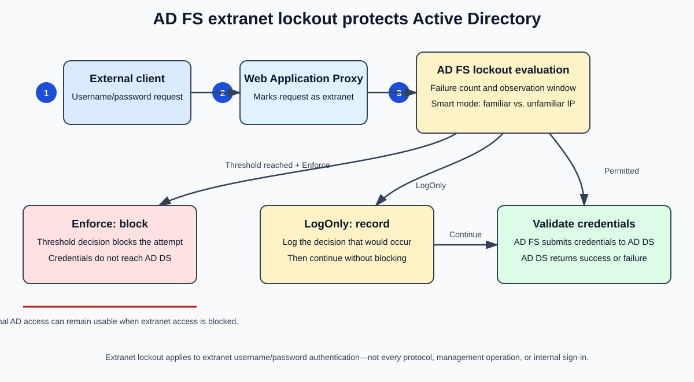

### Soft Extranet Lockout


AD FS validates user credentials against Active Directory

Customers often use Account Lockout Policies in their Active Directory forests.

Customers need to protect their credentials from brute-force attacks.

Attackers can target accounts through AD FS public endpoints.

Together, these present a Denial-of-Service (DoS) attack vector from the Internet.

Many failed user login attempts against AD FS could lead to the lockout of internal Active Directory accounts.

Windows Server 2012 R2 introduced an Extranet Soft Lockout feature that:

Is independent of Active Directory account lockout.
Protects against extranet brute-force password guessing attacks.

AD FS Extranet Account Soft Lockout allows:

A separate password lockout policy for extranet logins.
Extranet user lockout independent of Active Directory account lockout.
#### Simple Explanation

Before Extranet Lockout existed, AD FS would simply pass every authentication request to Active Directory.

Internet User
      |
      v
    AD FS
      |
      v
Active Directory


Suppose an attacker knows a user's username:

elijah@contoso.com


The attacker could repeatedly try passwords:

Password1
Password2
Password3
...


Each failed attempt would be counted by Active Directory.

Eventually:

AD Account Lockout Threshold Reached


and the legitimate user would be locked out.

This creates a Denial-of-Service attack, where the attacker doesn't need to know the password; they only need to generate enough failed login attempts to lock the user's account.

#### How Extranet Soft Lockout Solves This

Instead of immediately forwarding every bad password attempt to Active Directory, AD FS starts tracking failures itself.

Internet User
      |
      v
    AD FS
      |
      +---- Tracks failed attempts
      |
      v
Active Directory


When the configured threshold is reached:

AD FS blocks further external attempts


before they reach Active Directory.

As a result:

✅ Active Directory account stays unlocked

✅ Internal users can continue working

✅ Brute-force attacks are mitigated

✅ Internet-based password spraying is reduced

#### Real-World Example

Active Directory Account Lockout Policy:

Lockout Threshold = 10 attempts


AD FS Extranet Soft Lockout:

Extranet Lockout Threshold = 5 attempts


An attacker tries:

Wrong Password x5


At the 5th failure:

AD FS Soft Locks the User


The requests are stopped at AD FS.

The attacker never reaches the AD threshold of 10 attempts.

Therefore:

AD Account = Not Locked
AD FS Extranet Access = Temporarily Blocked

#### Visual Flow
#### Without Extranet Lockout
Attacker
    |
    v
AD FS
    |
    v
Active Directory
    |
    v
Account Locked

#### With Extranet Soft Lockout
Attacker
    |
    v
AD FS
    |
    +--> Soft Lockout Triggered
    |
    X
Active Directory Never Reached

#### Interview Answer

AD FS Extranet Lockout is a security feature introduced in Windows Server 2012 R2 that protects internet-facing AD FS authentication endpoints from brute-force and password-spraying attacks. It allows AD FS to track failed extranet logins and temporarily lock access before Active Directory account lockout thresholds are reached. This prevents attackers from causing internal AD account lockouts while still allowing legitimate users to authenticate internally.


### Smart Extranet Lockout
Windows Server 2016 (June 2018 Update) includes an Extranet Smart Lockout feature that:
Differentiates sign-in attempts from familiar (known) and unfamiliar (unknown) locations.
Can lock out attackers while allowing legitimate users to continue using their accounts.
Prevents denial-of-service (DoS) attacks against users and protects against targeted password attacks.
Leverages the existing Extranet Soft Lockout feature while helping avoid Active Directory account lockouts.
Includes a Log-Only Mode that allows the system to learn normal and potentially malicious sign-in behavior without blocking any accounts.
Requires installation of KB4489889 (March 2019 update) to change the account lookup mechanism.
Windows Server 2019 includes additional Extranet Smart Lockout capabilities:
Allows independent lockout thresholds for:
#### Familiar locations
Unfamiliar locations
Enables audit mode for Smart Lockout while continuing to enforce the previous Soft Lockout behavior.
#### Simple Explanation

Extranet Smart Lockout is an advanced version of Extranet Soft Lockout.

While Soft Lockout only counts failed password attempts, Smart Lockout adds intelligence by determining:

Is this user signing in from a known location?
or
Is this sign-in attempt coming from an unfamiliar location?


It then applies different lockout behavior accordingly.

#### Why Was Smart Lockout Needed?

Imagine a user normally signs in from:

London Office
Home Network
Corporate VPN


These become:

Known / Familiar Locations


One day an attacker begins attempting passwords from:

Another Country
Unknown IP Address
Unrecognized Location


Without Smart Lockout:

AD FS sees all attempts equally


With Smart Lockout:

AD FS recognizes suspicious activity
and can block it before impacting the user.

#### Traditional Soft Lockout Flow
Attacker
    |
Wrong Passwords
    |
    v
AD FS
    |
Failure Count Reached
    |
    v
Soft Lockout


The decision is based primarily on the number of failed attempts.

#### Smart Lockout Flow
Sign-In Attempt
        |
        v
   AD FS Analysis
        |
        +----------------+
        |                |
        v                v
 Known Location     Unknown Location
        |                |
    Higher Limit     Lower Limit
        |                |
        v                v
 Allow User      Lock Suspicious Attempts


Now AD FS considers:

Password failures
User behavior
Known locations
Unknown locations

before taking action.

#### Real-World Example

Suppose Elijah normally signs in from:

London Office
Kigali Office
Corporate VPN


AD FS learns that these are trusted locations.

Normal User Mistypes Password
Wrong Password
Wrong Password
Wrong Password


from:

London Office


AD FS sees:

Known User
Known Location


Result:

Allow More Attempts


No unnecessary lockout.

Attacker Scenario

Attacker attempts:

Password1
Password2
Password3
Password4


from:

Unknown IP Address
Unknown Country


AD FS sees:

Unknown Location
Suspicious Activity


Result:

Smart Lockout Triggered


before Active Directory accounts become affected.

Familiar vs Unfamiliar Location
Familiar Location

A location previously associated with successful sign-ins.

Examples:

Corporate Office
Home Office
Corporate VPN


AD FS treats these locations with more trust.

Unfamiliar Location

A location that has no positive sign-in history.

Examples:

New Internet Provider
Unknown Public IP
Suspicious External Network


AD FS applies stricter lockout controls.

Log-Only Mode

Smart Lockout can operate in:

Learning Mode


also known as:

Log-Only Mode


In this mode:

✅ Sign-ins are tracked

✅ Risky behavior is identified

✅ Events are logged

✅ Users are NOT blocked

This allows administrators to tune Smart Lockout settings before enforcing them.

Windows Server 2019 Enhancement

Windows Server 2019 introduced separate thresholds.

Example:

Trusted Locations
Lockout Threshold = 20

Untrusted Locations
Lockout Threshold = 5


This means:

Known User + Known Location
      = More Tolerance

Unknown User + Unknown Location
      = Quick Protection

#### Soft Lockout vs Smart Lockout
| Feature | Soft Lockout | Smart Lockout |
|---|---:|---:|
| Counts failed logins | ✅ | ✅ |
| Protects against brute force | ✅ | ✅ |
| Prevents AD lockout | ✅ | ✅ |
| Distinguishes familiar locations | ❌ | ✅ |
| Distinguishes unfamiliar locations | ❌ | ✅ |
| Behavioral learning | ❌ | ✅ |
| Log-only mode | ❌ | ✅ |
| Separate lockout thresholds | ❌ | ✅ (Windows Server 2019) |
#### Architecture Flow
                   Internet
                       |
                       v
            +--------------------+
            |   AD FS Server      |
            +----------+----------+
                       |
         +-------------+-------------+
         |                           |
         v                           v
  Familiar Location         Unfamiliar Location
  (Known User Pattern)      (Suspicious Pattern)
         |                           |
         |                           |
  Higher Threshold           Lower Threshold
         |                           |
         v                           v
 Allow Authentication      Smart Lockout Triggered
         |
         v
  Active Directory

#### Interview Answer

Extranet Smart Lockout is an AD FS security feature introduced in Windows Server 2016 and enhanced in Windows Server 2019. It builds upon Extranet Soft Lockout by distinguishing between familiar and unfamiliar sign-in locations. This allows AD FS to block malicious password-spraying and brute-force attacks from untrusted locations while allowing legitimate users from known locations to continue authenticating. Smart Lockout helps prevent Active Directory account lockouts, reduces denial-of-service risks, and provides learning and audit capabilities through Log-Only Mode.


### Configure Soft Extranet Lockout
Configure AD FS Soft Extranet Lockout
Slide Content (Text Copy)
The recommended configuration should match this:
ExtranetLockoutThreshold in AD FS should be less than (<) the Account Lockout Threshold value in Active Directory.
ExtranetObservationWindow in AD FS should be greater than (>) the Reset Account Lockout Counter After value in Active Directory.
Run the following PowerShell command:
```powershell
Set-AdfsProperties `
-EnableExtranetLockout $true `
-ExtranetLockoutThreshold 15 `
-ExtranetObservationWindow (New-TimeSpan -Minutes 30)
```

#### Simple Explanation

When configuring AD FS Extranet Soft Lockout, the goal is to ensure that AD FS locks out internet-based attackers before Active Directory locks out the actual user account.

Think of AD FS as a protective shield in front of Active Directory.

Internet
    |
    v
 AD FS
    |
    v
Active Directory


Instead of allowing every bad password attempt to hit Active Directory directly, AD FS counts bad attempts coming from the internet and blocks them first.

#### Understanding the Two Important Settings
1. ExtranetLockoutThreshold

This determines:

How many failed external login attempts AD FS will allow before soft locking the user.

Example:

ExtranetLockoutThreshold = 15


After:

15 bad password attempts


AD FS blocks further external authentication attempts.

2. ExtranetObservationWindow

This determines:

How long AD FS remembers failed login attempts.

Example:

ExtranetObservationWindow = 30 minutes


AD FS keeps track of failed sign-ins for 30 minutes.

If the threshold is exceeded during that period:

Soft Lockout Occurs

Why Must AD FS Threshold Be Lower Than AD Threshold?

Suppose Active Directory has:

Account Lockout Threshold = 20


If AD FS is configured with:

ExtranetLockoutThreshold = 15


then:

Attacker
    |
15 Bad Password Attempts
    |
    v
AD FS Soft Lockout


The requests are stopped before reaching the AD lockout threshold of 20.

Result:

✅ User account remains unlocked

✅ AD is protected

✅ Denial-of-Service attacks are reduced

Bad Configuration Example
Active Directory
Account Lockout Threshold = 10

AD FS
ExtranetLockoutThreshold = 15


This is incorrect.

Why?

Because the user's account could become locked in AD before AD FS intervenes.

Attacker
    |
10 Failed Attempts
    |
    v
AD Account Locked


AD FS never gets a chance to protect the account.

Why Must ExtranetObservationWindow Be Greater?

Suppose:

Active Directory
Reset Account Lockout Counter After = 15 Minutes


Recommended:

AD FS
ExtranetObservationWindow = 30 Minutes


This ensures AD FS continues monitoring failed attempts longer than Active Directory.

Benefits:

✅ Better attack detection

✅ Better password spraying protection

✅ Reduced chance of AD account lockouts

#### Real-World Example
Active Directory Policy
Account Lockout Threshold = 20

Reset Counter After = 15 minutes

AD FS Configuration
ExtranetLockoutThreshold = 15

ExtranetObservationWindow = 30 minutes


Attack scenario:

Password1
Password2
Password3
...
Password15


After 15 failures:

AD FS Soft Lockout Activated


The attacker is blocked.

Active Directory never reaches:

20 Failed Attempts


Therefore:

AD Account = Safe

What the PowerShell Command Does
```powershell
Set-AdfsProperties `
-EnableExtranetLockout $true `
-ExtranetLockoutThreshold 15 `
-ExtranetObservationWindow (New-TimeSpan -Minutes 30)
```

EnableExtranetLockout
TRUE


Turns on the feature.

ExtranetLockoutThreshold 15
15 failed external authentication attempts


before soft lockout occurs.

ExtranetObservationWindow 30
30 minutes


of monitoring and tracking failed attempts.

Authentication Flow
                    Internet
                        |
                        v
                 +-------------+
                 |    AD FS    |
                 +------+------+ 
                        |
            Counts Failed Attempts
                        |
          +-------------+-------------+
          |                           |
          v                           v
   Below Threshold            Above Threshold
          |                           |
          v                           v
 Active Directory         AD FS Soft Lockout
 Authentication               Triggered
          |
          v
      User Access

#### Best Practice

A common recommendation is:

AD Account Lockout Threshold   = 20
AD FS Lockout Threshold        = 15

AD Reset Counter After         = 15 minutes
AD FS Observation Window       = 30 minutes


This ensures:

AD FS protects Active Directory
rather than Active Directory
protecting itself.

#### Interview Answer

AD FS Soft Extranet Lockout is configured so that AD FS blocks repeated failed internet-based authentication attempts before Active Directory account lockout policies are triggered. The AD FS ExtranetLockoutThreshold should always be lower than the Active Directory Account Lockout Threshold, and the ExtranetObservationWindow should be greater than the AD Reset Account Lockout Counter value. This protects users from brute-force and password-spraying attacks while preventing unnecessary Active Directory account lockouts.


### Configure Smart Extranet Lockout
Configure AD FS Smart Extranet Lockout
Slide Content (Text Copy)
Requisites to enable Extranet Smart Lockout
All Windows Server 2016 AD FS servers are up to date as of the June 2018 Windows Updates.
Farm Behavior Level is Windows Server 2016 or 2019.
Ensure AD FS Audit Logging is enabled.
Update Artifact Database Permission
```powershell
Update-AdfsArtifactDatabasePermission -Credential Get-Credential
```

> [!WARNING]
> Verify this preserved source syntax before use. Obtain a credential first (for example, `$credential = Get-Credential`) and pass it with `-Credential $credential`; the literal token `Get-Credential` is not itself a `PSCredential` object.

Run the following PowerShell command
```powershell
Set-AdfsProperties `
-EnableExtranetLockout $true `
-ExtranetLockoutThreshold 15 `
-ExtranetObservationWindow (New-TimeSpan -Minutes 30) `
-ExtranetLockoutMode ADFSSmartLockoutEnforce
```

Restart AD FS Service on all Farm members.
#### Simple Explanation

Configuring AD FS Smart Extranet Lockout builds upon the traditional Soft Lockout feature by adding intelligence and behavioral analysis.

With Soft Lockout:

AD FS only counts bad password attempts


With Smart Lockout:

AD FS counts bad password attempts
+
Learns good sign-in behavior
+
Recognizes familiar locations
+
Recognizes suspicious locations


This significantly improves protection against:

Password spraying
Brute-force attacks
Credential stuffing attacks
Denial-of-service attacks targeting user accounts
Before Smart Lockout

Without Smart Lockout, AD FS only knows:

Success
or
Failure


Example:

User = Elijah

Wrong Password
Wrong Password
Wrong Password


AD FS simply counts failures.

Eventually:

Threshold Reached


and lockout occurs.

With Smart Lockout

AD FS now evaluates:

Who is signing in?
Where are they signing in from?
Have they signed in successfully before?
Is this location familiar?


Example:

Normal User
Location:
London Office

Password:
Wrong once
Wrong twice


AD FS recognizes:

Known User
Known Device
Known Location


More tolerance is given.

Attacker
Location:
Unknown Country

Password:
Password1
Password2
Password3


AD FS recognizes:

Unfamiliar Location
Suspicious Pattern


The attacker is blocked much faster.

Prerequisites Explained
1. AD FS Servers Must Be Updated

Microsoft introduced Smart Lockout in later AD FS updates.

If some AD FS servers are missing required updates:

Node 1 = Supports Smart Lockout
Node 2 = Does Not Support Smart Lockout


the farm may behave inconsistently.

Therefore:

All AD FS Servers
=
Fully Updated

2. Farm Behavior Level

The AD FS farm must be operating at:

Windows Server 2016


or

Windows Server 2019


Farm Behavior Level determines which AD FS features are available.

Think of it as:

Farm Functional Level


for AD FS.

3. Audit Logging

Smart Lockout depends heavily on analyzing authentication activity.

Enable audit logging so AD FS can record:

Successful Sign-ins
Failed Sign-ins
Suspicious Locations
Attack Patterns


Without auditing:

No historical data
No behavioral learning

#### What is the Artifact Database Permission Command?
```powershell
Update-AdfsArtifactDatabasePermission -Credential Get-Credential
```


This updates permissions for the AD FS artifact database.

Why?

Because Smart Lockout stores and evaluates sign-in information across the farm.

Every AD FS server must be able to:

Read Data
Write Data
Share Lockout Information


across all farm members.

Understanding the Main Command
Enable Smart Lockout
-EnableExtranetLockout $true


Turns on Extranet Lockout protection.

Lockout Threshold
-ExtranetLockoutThreshold 15


If AD FS detects:

15 failed sign-in attempts


it begins the lockout process.

Observation Window
-ExtranetObservationWindow 30 minutes


AD FS tracks failures occurring during that period.

Example:

15 Failures
Within 30 Minutes
=
Trigger Lockout

Smart Lockout Mode
-ExtranetLockoutMode ADFSSmartLockoutEnforce


This is the most important setting.

It tells AD FS:

Actively enforce Smart Lockout decisions


instead of simply monitoring.

Smart Lockout Modes
Audit Mode
Learning Mode


AD FS:

✅ Learns behavior

✅ Logs activity

✅ Detects suspicious patterns

❌ Does NOT block users

Enforce Mode
ADFSSmartLockoutEnforce


AD FS:

✅ Learns behavior

✅ Identifies suspicious sign-ins

✅ Distinguishes familiar/unfamiliar locations

✅ Blocks attackers automatically

Why Restart AD FS Services?

After configuration:

```powershell
Restart-Service ADFSSRV
```


(or restart services manually)

This ensures:

New Configuration
New Thresholds
New Smart Lockout Policies


are loaded by every farm member.

Authentication Flow After Smart Lockout
                     Internet
                         |
                         v
                +----------------+
                |     AD FS      |
                +--------+-------+
                         |
             Analyze Authentication
                         |
        +----------------+----------------+
        |                                 |
        v                                 v
 Familiar Location               Unfamiliar Location
        |                                 |
 Higher Threshold                 Lower Threshold
        |                                 |
        v                                 v
 Allow Sign-In                 Smart Lockout Triggered
        |                                 |
        +---------------+-----------------+
                        |
                        v
                Active Directory

#### Real-World Example

Suppose:

ExtranetLockoutThreshold = 15
ObservationWindow = 30 minutes


A legitimate user from:

London Office


mistypes their password 4 times.

AD FS sees:

Known User
Known Location
Low Risk


User is still allowed to continue.

An attacker from:

Unknown Network
Unknown Country


attempts:

Password Spray Attack


AD FS sees:

Unknown Location
High Risk Pattern


and Smart Lockout activates much sooner.

#### Soft Lockout vs Smart Lockout
| Feature | Soft Lockout | Smart Lockout |
|---|---:|---:|
| Counts failed logins | ✅ | ✅ |
| Blocks brute-force attacks | ✅ | ✅ |
| Prevents AD account lockouts | ✅ | ✅ |
| Recognizes familiar locations | ❌ | ✅ |
| Recognizes unfamiliar locations | ❌ | ✅ |
| Behavioral learning | ❌ | ✅ |
| Audit-only mode | ❌ | ✅ |
| Intelligent enforcement | ❌ | ✅ |
#### Interview Answer

AD FS Smart Extranet Lockout is an enhancement of AD FS Soft Lockout that protects against modern password-spraying and brute-force attacks. It analyzes authentication behavior, differentiates between familiar and unfamiliar locations, and allows legitimate users to continue signing in while quickly blocking suspicious authentication attempts. To enable it, administrators must meet AD FS version prerequisites, update artifact database permissions, configure Smart Lockout settings through Set-AdfsProperties, and restart all AD FS farm members so the new policy takes effect.


### Choose and Operate a Smart Lockout Mode
Configure AD FS Smart Extranet Lockout
Slide Content (Text Copy)
#### Extranet Smart Lockout Mode
ADPasswordCounter

This is AD FS Extranet Soft Lockout mode which does not differentiate based on location.

Default Value

ADFSSmartLockoutLogOnly

This is Extranet Smart Lockout running in audit mode.

Instead of rejecting authentication requests, AD FS only writes:

Administrative events
Audit events

No users are blocked.

ADFSSmartLockoutEnforce

This is Extranet Smart Lockout with full enforcement enabled.

When thresholds are reached, AD FS can:

Identify unfamiliar locations
Detect suspicious sign-in activity
Block authentication requests
#### Add Familiar Location Address to a User Account
```powershell
Set-ADFSAccountActivity user@domain.com -AdditionalFamiliarIps "1.2.3.4"
```

#### Reset Lockout Counter for a User Account
```powershell
Reset-ADFSAccountLockout user@domain.com -Location Unknown
```


or

```powershell
Reset-ADFSAccountLockout user@domain.com -Location Familiar
```

#### Simple Explanation

This slide explains the different operating modes of AD FS Smart Lockout and how administrators can manage trusted locations and reset lockout counters.

Think of Smart Lockout as a security guard that learns:

Who normally signs in
Where they normally sign in from
What suspicious activity looks like


Once enabled, AD FS can evaluate both:

Password Failures
+
Location Reputation


instead of simply counting bad passwords.

#### Smart Lockout Modes Explained
1. ADPasswordCounter Mode

This is the traditional behavior.

Every failed password attempt
=
Counter increases


AD FS does not care whether the request comes from:

Corporate Office
Home Network
Unknown Country
Attacker's Network


All failures are treated equally.

Example
Threshold = 15


After:

15 Failed Password Attempts


the account becomes soft locked.

No location intelligence is used.

Flow
Failed Login
      |
      v
Increase Counter
      |
      v
Threshold Reached?
      |
   Yes/No

2. ADFSSmartLockoutLogOnly Mode

This is the recommended starting point when introducing Smart Lockout.

Think of it as:

Learning Mode


or

Audit Mode


AD FS analyzes authentication activity but does not block users.

What Happens?

AD FS records:

Known Locations
Unknown Locations
Failed Attempts
Successful Attempts
Suspicious Patterns


but it allows authentication processing to continue normally.

Benefits

✅ No user impact

✅ Safe testing

✅ Learn user behavior

✅ Generate audit events

✅ Validate Smart Lockout settings

Example
Attacker = Detected
Location = Unknown
Behavior = Suspicious


AD FS logs:

"Would have blocked this request"


but does not actually block it.

3. ADFSSmartLockoutEnforce Mode

This is the final production mode.

AD FS now actively protects users.

Instead of only logging activity:

Detection
+
Action

What Happens?

AD FS:

Tracks failed attempts
Learns familiar locations
Detects unfamiliar locations
Evaluates attack patterns
Blocks malicious requests
Example

Legitimate User:

Location = London Office


Result:

Authentication Allowed


Attacker:

Location = Unknown Country
Password Spray Attack


Result:

Smart Lockout Triggered


before the attack can cause an AD account lockout.

#### Familiar Locations

One of the most powerful Smart Lockout features is the concept of:

#### Familiar Locations


These are locations that AD FS associates with legitimate sign-ins.

Examples:

Corporate Office
Branch Office
Home Network
Corporate VPN


The more successful activity AD FS sees from a location, the more confidence it has in that location.

#### Adding Familiar IP Addresses

Administrators can manually define trusted IP addresses.

Command:

```powershell
Set-ADFSAccountActivity user@domain.com -AdditionalFamiliarIps "1.2.3.4"
```

What This Does

It tells AD FS:

This IP Address
should be considered familiar
for this user.

Example

User:

elijah@contoso.com


Frequently signs in from:

102.68.45.100


You can manually add the address to the user's familiar IP list.

This reduces the likelihood of accidental Smart Lockout actions.

#### Resetting Lockout Counters

Sometimes legitimate users become locked out.

Administrators can clear the Smart Lockout counters.

Reset Unfamiliar Location Counter
```powershell
Reset-ADFSAccountLockout user@domain.com -Location Unknown
```


Clears lockout information associated with:

Unknown Locations

Reset Familiar Location Counter
```powershell
Reset-ADFSAccountLockout user@domain.com -Location Familiar
```


Clears lockout information associated with:

Trusted Locations

#### Real-World Example

Assume:

User = Elijah


Normally signs in from:

London Office
Kigali Office
Corporate VPN


These become:

#### Familiar Locations


An attacker attempts:

Password1
Password2
Password3
Password4
...


from:

Unknown IP
Unknown Network


AD FS sees:

Unfamiliar Location
Suspicious Activity


and moves the account into Smart Lockout.

The legitimate user can continue to sign in from familiar locations while the attacker is blocked.

This is the major advantage of Smart Lockout over traditional Soft Lockout.

#### Architecture Flow
                   Internet
                       |
                       v
               +---------------+
               |     AD FS     |
               +-------+-------+
                       |
                       v
           Analyze Authentication
                       |
         +-------------+-------------+
         |                           |
         v                           v
  Familiar Location          Unfamiliar Location
         |                           |
         |                           |
     Lower Risk                Higher Risk
         |                           |
         v                           v
 Allow Sign-in             Smart Lockout Logic
         |                           |
         +------------+--------------+
                      |
                      v
               Authentication
                 Decision

#### Mode Comparison
| Mode | Location-aware | Blocks users | Intended purpose |
|---|---:|---:|---|
| `ADPasswordCounter` | No | Yes | Traditional Soft Lockout |
| `ADFSSmartLockoutLogOnly` | Yes | No | Learning and auditing |
| `ADFSSmartLockoutEnforce` | Yes | Yes | Full production protection |
#### Interview Answer

AD FS Smart Lockout provides three operating modes. ADPasswordCounter is the traditional Soft Lockout mode that counts failed passwords without considering location. ADFSSmartLockoutLogOnly allows AD FS to learn sign-in behavior and generate audit events without blocking users. ADFSSmartLockoutEnforce fully enables Smart Lockout and allows AD FS to distinguish between familiar and unfamiliar locations, helping block password-spraying and brute-force attacks while allowing legitimate users from trusted locations to continue authenticating.


```powershell
Get-AdfsProperties | fl *extranet*

Get-AdDefaultDomainPasswordPolicy 

Get-AdfsProperties -EnableExtranetLockout $true -ExtranetLockoutThreshold 3 -ExtranetObservationWindow (New-TimeSpan -Minutes 45)
```

> [!WARNING]
> Preserve this source command for study, but verify it before use: `Get-AdfsProperties` reads configuration and does not accept these setter parameters. The corresponding configuration cmdlet is `Set-AdfsProperties`.


## AD FS Auditing, Tracing, and Correlation

After configuring protection, the next skill is observing a single runtime authentication request without confusing it with farm configuration, replication, health monitoring, or management traffic.

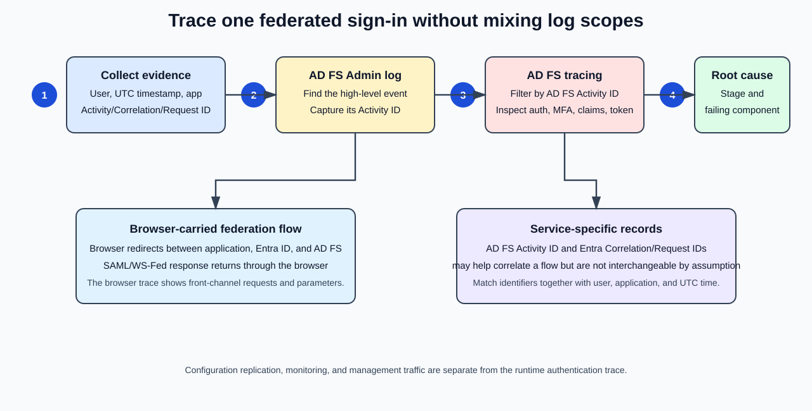

### Session Goals and Troubleshooting Sequence

#### Agenda

The session agenda covers the following topics:

ADFS Audit Logs
Enable Audit Logs
ADFS Debug Logs
Enable ADFS Debug Logs
Filter ADFS Debug Logs
Troubleshoot ADFS Issues
Claim Rules Processing


#### At the End of This Session, You'll Be Able To
Understand why ADFS Audit Logs are important
Learn how to enable ADFS Audit Logs
Understand why ADFS Debug Logs are important
Learn how to enable ADFS Debug Logs
Learn how to filter ADFS Debug Logs
Troubleshoot ADFS issues effectively
Understand and analyze claim rules processing
Analyze logon failures


### AD FS Audit Logs and Audit Levels
#### Overview
- ADFS Audit Logs are enabled by default with the Basic audit level.
- You can check the current audit level using the following PowerShell command:
```powershell
Get-AdfsProperties | Select AuditLevel
```


Table
Audit Level	PowerShell Syntax	DescriptionNone	Set-AdfsProperties -AuditLevel None	Auditing is disabled and no events will be logged.
Basic (Default)	Set-AdfsProperties -AuditLevel Basic	No more than 5 events will be logged for a single request.
Verbose	Set-AdfsProperties -AuditLevel Verbose	All events will be logged. This will log a significant amount of information per request.


#### Audit Levels
1. None

PowerShell Syntax

```powershell
Set-AdfsProperties -AuditLevel None
```


Description

Auditing is disabled.
No audit events are logged.
2. Basic (Default)

PowerShell Syntax

```powershell
Set-AdfsProperties -AuditLevel Basic
```


Description

Basic auditing information is collected.
No more than 5 events are logged for a single request.
3. Verbose

PowerShell Syntax

```powershell
Set-AdfsProperties -AuditLevel Verbose
```


Description

All audit events are logged.
Generates a significant amount of information for each request.
Recommended when troubleshooting authentication or claim issues.
Why ADFS Audit Logs Are Important

ADFS Audit Logs help administrators:

Track authentication activity
Monitor successful and failed logins
Investigate security incidents
Troubleshoot federation issues
Analyze claims processing
Review user access patterns
Correlate authentication events across servers
#### When to Use Each Audit Level
None

Use only when:

Auditing is not required.
You want to reduce event logging completely.

Generally not recommended in production environments.

Basic (Recommended Default)

Use when:

Monitoring normal operations.
Collecting standard authentication information.
Minimizing event log growth.
Verbose

Use when troubleshooting:

Authentication failures
Claims issues
Federation trust problems
SSO failures
Token issuance problems
Unexpected access denials

After troubleshooting, it is generally recommended to revert to:

```powershell
Set-AdfsProperties -AuditLevel Basic
```


to reduce unnecessary logging.

#### Quick Interview Question
How do you verify the current ADFS audit level?
```powershell
Get-AdfsProperties | Select AuditLevel
```

What is the difference between Basic and Verbose auditing?

Basic

Logs limited auditing information.
Up to approximately 5 events per request.

Verbose

Logs all available audit information.
Provides deep visibility into authentication and claims processing.
#### Summary

ADFS Audit Logs provide visibility into authentication and authorization activity within an AD FS environment.

The three audit levels are:

None     → No auditing
Basic    → Default auditing
Verbose  → Full auditing and troubleshooting


For day-to-day operations:

Basic Audit Level


For troubleshooting:

Verbose Audit Level


This forms the foundation for later topics such as:

AD FS Debug Logging
Claims Rule Processing
Authentication Troubleshooting
Logon Failure Analysis


### Enable AD FS Audit Logs
Using Group Policy or Local Policy
Add the AD FS Service account to "Generate security audits" under:
Security Settings
 └─ Local Policies
     └─ User Rights Management

Enable Audit Application Generated for both Success and Failure under:
Security Settings
 └─ Advanced Audit Policy Configuration
     └─ Audit Policies
         └─ Object Access

Using the AD FS Management Console
Open AD FS Management Console
Open Federation Service Properties
Enable:
Success Audits
and/or
Failure Audits

Increase Audit Verbosity (Optional)

You can raise the default audit level to Verbose using:

```powershell
Set-AdfsProperties -AuditLevel Verbose
```

#### Summary

To enable comprehensive ADFS auditing:

Grant the AD FS service account Generate security audits rights.
Enable Audit Application Generated (Success and Failure).
Enable Success/Failure Audits in the AD FS Management Console.
Optionally configure:

```powershell
Set-AdfsProperties -AuditLevel Verbose
```

to collect detailed audit events for troubleshooting authentication, claims, and federation issues.


ADFS Audit Log Events
| Event ID | Audit Event Type                    | Description                                                                                           |
### Audit and Diagnostic Event Reference
| **1200** | Application Token Success           | A request where a security token is issued successfully by the Federation Service.                    |
| **1201** | Application Token Failure           | A request where security token issuance failed on the Federation Service.                             |
| **1202** | Fresh Credential Validation Success | A request where fresh credentials are validated successfully by the Federation Service.               |
| **1203** | Fresh Credential Validation Error   | A request where fresh credential validation failed on the Federation Service.                         |
| **1204** | Password Change Request Success     | A transaction where the password change request was successfully processed by the Federation Service. |
| **1205** | Password Change Request Error       | A transaction where the password change request failed to be processed by the Federation Service.     |
| **1206** | Sign Out Success                    | Describes a successful sign-out request.                                                              |
| **1207** | Sign Out Failure                    | Describes a failed sign-out request.                                                                  |
| **1210** | Extranet Lockout                    | Describes an Extranet Lockout event.                                                                  |


Debug Log Events 

| Event ID | Debug Event Type                  | Purpose / Description                                                                                           |
| -------- | --------------------------------- | --------------------------------------------------------------------------------------------------------------- |
| **54**   | Claims Pipeline Event             | Logs claim rule processing and claim transformations through the AD FS claims pipeline.                         |
| **100**  | Federation Service Configuration  | Records AD FS service configuration operations and initialization details.                                      |
| **116**  | Token Issuance                    | Captures token issuance activity and related processing details.                                                |
| **120**  | Authentication Request Processing | Logs how incoming authentication requests are evaluated and processed.                                          |
| **246**  | Claims Rule Processing            | Provides detailed information about claim rule execution and claim issuance decisions.                          |
| **271**  | Authorization Processing          | Captures authorization checks and access control decisions.                                                     |
| **293**  | Attribute Store Queries           | Logs queries made to Active Directory or other attribute stores during authentication and claims processing.    |
| **299**  | Claims Issuance Details           | Records the final set of claims issued to the relying party application.                                        |
| **364**  | Token Processing Failure          | One of the most commonly used troubleshooting events. Logs detailed token issuance and authentication failures. |
| **500**  | Certificate Validation            | Captures certificate validation and trust-related operations.                                                   |
| **501**  | Certificate Errors                | Logs certificate-related failures, including trust chain and validity issues.                                   |


> [!NOTE]
> Event IDs and channels vary by AD FS version and enabled audit/tracing settings. Event 364 is commonly found in the **AD FS/Admin** channel as a token-service failure; do not classify it as a Debug-only event. Confirm the channel, provider, and message on the affected server.

Event 364 is frequently referenced during troubleshooting because it can contain detailed information about authentication, trust, token issuance, and claims-processing failures.


```powershell
Get-AdfsProperties | select auditlevel

gpedit.msc

```

Services.msc > ADFS Service > Account log on
this account is used on the 


### AD FS Debug and Tracing Logs
ADFS Debug Logs
Slide Content (Copied as Text)
AD FS Admin logs contain high level information but
Do not always provide the full context for an issue.
Errors often are displayed by the federated app/service but may originate in a misconfiguration on AD FS or a dependency call to another service.
AD FS Debug/Tracing logs provide full details by
Providing insights into the authentication flow (internally against AD DS, against LDAP or External Claims Provider, MFA Adapters) and where authentication may be broken.
Displaying the claims passed into the claims pipeline and detailing the results of each claim rule processed as part of the token request.
Displaying the decoded SAML2 request or response even without a Fiddler trace.
Serving as a troubleshooter for other service-related failures.
#### Explanation
#### AD FS Admin Logs vs AD FS Debug Logs

Many engineers make the mistake of looking only at the AD FS Admin log.

The Admin log is useful, but it only shows:

What failed


It often does not tell you:

Why it failed


For example:

AD FS Admin Log
Event ID 364
Token issuance failed.


This tells you that authentication failed.

However, it may not tell you:

Which claim rule failed
Which LDAP query failed
Which MFA adapter failed
Which certificate caused the failure
Which SAML claim was malformed
#### Why Debug Logs Are Important

AD FS Debug Logs provide deep visibility into the entire authentication process.

Instead of simply showing:

Authentication Failed


they show every step that occurred before the failure.

#### Authentication Flow Visibility

Debug logs allow you to trace the complete authentication journey.

Example:

User
  |
  v
AD FS
  |
  +--> Active Directory
  |
  +--> LDAP
  |
  +--> Claims Provider
  |
  +--> MFA Adapter
  |
  +--> Token Issuance


You can identify exactly where processing stopped.

#### AD DS Authentication Troubleshooting

Suppose a user cannot sign in.

Admin Logs:

Authentication Failed


Debug Logs:

AD Query Failed
LDAP Bind Failed
User Attribute Missing


Now you know the exact cause.

#### MFA Troubleshooting

A very common use case.

Example:

Password = Successful

MFA = Failed


Admin log may simply show:

Access Denied


Debug logs will show:

Invoking MFA Adapter
Adapter Returned Failure
Challenge Timeout


This immediately pinpoints the issue.

#### Claims Pipeline Troubleshooting

One of the most powerful uses of AD FS Debug Logs.

Remember the Claims Pipeline:

Incoming Claims
      |
#### Acceptance Rules
      |
#### Authorization Rules
      |
#### Issuance Rules
      |
Outgoing Claims


Debug logs reveal:

Incoming Claims
Claim Transformations
Claim Filtering
Claim Issuance


For every stage.

Example

Incoming Claim:

Department = IT


Rule:

If Department = IT
Issue Role = Administrator


Debug Log Output:

Incoming Claim:
Department=IT

Rule Executed:
Issue Role=Administrator

Outgoing Claim:
Role=Administrator


This makes claims troubleshooting much easier.

#### SAML Request and Response Analysis

Normally engineers use tools such as:

Fiddler
SAML Tracer
Browser Developer Tools


to decode SAML messages.

Debug logs often provide:

Decoded SAML Request
Decoded SAML Response


directly within the trace.

Example:

<saml:Assertion>
  <Attribute Name="Email">
    user@contoso.com
  </Attribute>
</saml:Assertion>


This saves significant troubleshooting time.

#### Common Troubleshooting Scenarios
Scenario 1: Application Fails

User reports:

Cannot access Salesforce


Admin Log:

Token issuance failed


Debug Log:

Missing Email Claim


Root Cause Found ✅

Scenario 2: MFA Failure

User reports:

MFA not working


Admin Log:

Authentication Failed


Debug Log:

MFA Adapter Timeout


Root Cause Found ✅

Scenario 3: LDAP Failure

User reports:

Access Denied


Admin Log:

Claim Issuance Failure


Debug Log:

LDAP Lookup Failed


Root Cause Found ✅

Admin Logs vs Debug Logs
Feature	Admin Logs	Debug LogsHigh-Level Events	✅	✅
Detailed Authentication Flow	❌	✅
Claims Pipeline Visibility	❌	✅
MFA Troubleshooting	Limited	✅
LDAP Troubleshooting	Limited	✅
Token Issuance Details	Limited	✅
SAML Request/Response Analysis	❌	✅
Root Cause Investigation	Limited	✅
#### Real-World Support Engineer Perspective

When troubleshooting AD FS:

Start with Admin Logs

Look for:

Event ID 364
Event ID 1200
Event ID 1201


These tell you:

Something failed

Then Use Debug Logs

Debug logs tell you:

What failed
Where it failed
Why it failed


This is why most advanced AD FS troubleshooting eventually relies on Debug/Tracing logs.

#### Interview Answer

AD FS Debug Logs provide detailed tracing information for the entire authentication and token issuance process. Unlike AD FS Admin Logs, which only provide high-level event information, Debug Logs show the complete authentication flow, including AD DS and LDAP lookups, MFA processing, claims pipeline execution, claim transformations, token issuance, and decoded SAML requests and responses. They are one of the most important tools for diagnosing AD FS authentication, federation, and authorization issues.


### Enable, Reproduce, Stop, and Export a Trace
AD FS Debug Verbose Logging

AD FS Debug Verbose Logging is not enabled by default.

To enable verbose logging, run:

```powershell
wevtutil set-log "AD FS Tracing/Debug" /level:5
```

Enable AD FS Tracing

To enable tracing, run:

```powershell
wevtutil set-log "AD FS Tracing/Debug" /enabled:true /quiet
```

If You're Not Sure Whether Debug Logging Is Disabled

Run the following commands in order:

```powershell
wevtutil set-log "AD FS Tracing/Debug" /enabled:false /quiet
```

```powershell
wevtutil set-log "AD FS Tracing/Debug" /level:5
```

```powershell
wevtutil set-log "AD FS Tracing/Debug" /enabled:true /quiet
```


This ensures that:

Tracing is disabled.
Verbose level is configured.
Tracing is re-enabled cleanly.
Disable and Export Debug Logs

To disable tracing:

```powershell
wevtutil sl "AD FS Tracing/Debug" /e:false /quiet
```


To export the debug logs:

```powershell
wevtutil export-log "AD FS Tracing/Debug" c:\temp\ADFS-Debug.evtx /ow:true
```

#### Explanation
#### What Does /level:5 Mean?
/level:5


enables the highest level of logging available for AD FS tracing.

This captures detailed information such as:

Authentication processing
Claims pipeline execution
LDAP lookups
Active Directory queries
MFA processing
Token issuance
SAML requests and responses
#### What Does /enabled:true Do?
/enabled:true


turns on AD FS tracing.

Without this setting:

AD FS will not collect debug events.

#### Why Disable Then Re-Enable?

Sometimes AD FS tracing is already enabled or has stale settings.

Running:

enabled:false


followed by:

enabled:true


ensures:

Clean configuration
Fresh logging session
Consistent troubleshooting data

#### Why Export Logs?

AD FS debug logs are often required when:

Troubleshooting claim-rule issues
Investigating authentication failures
Debugging MFA problems
Opening a Microsoft Support case
Analyzing SAML token issues

The exported file:

ADFS-Debug.evtx


can then be opened in:

Event Viewer


or shared with a support engineer.

#### Typical Troubleshooting Workflow
Start Logging
```powershell
wevtutil set-log "AD FS Tracing/Debug" /level:5
```
```powershell
wevtutil set-log "AD FS Tracing/Debug" /enabled:true /quiet
```

Reproduce the Problem

Example:

User attempts login
Token issuance fails
Federated application returns error

Stop Logging
```powershell
wevtutil sl "AD FS Tracing/Debug" /e:false /quiet
```

Export Logs
```powershell
wevtutil export-log "AD FS Tracing/Debug" c:\temp\ADFS-Debug.evtx /ow:true
```

Analyze

Review:

Event IDs
Claims processing
Authentication flow
SAML requests/responses
MFA adapter responses
LDAP queries
#### Quick Interview Answer

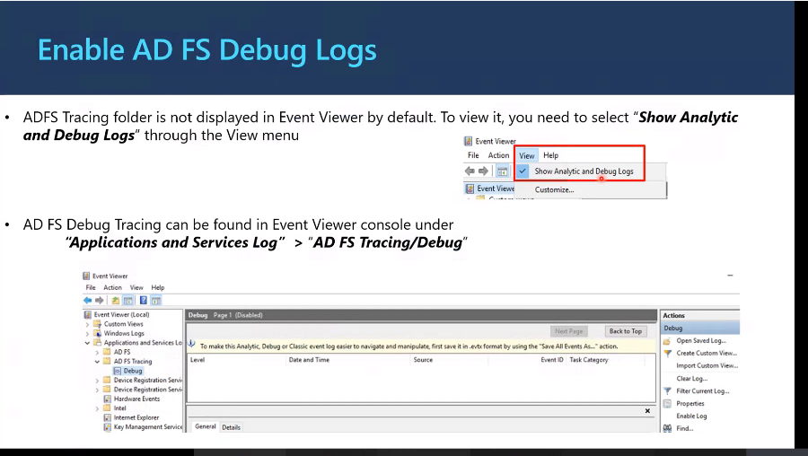


AD FS Debug Logs are disabled by default and must be explicitly enabled using wevtutil. Administrators typically set the tracing level to 5 (Verbose) and enable the AD FS Tracing/Debug log before reproducing an issue. After troubleshooting, tracing should be disabled and the logs exported to an .evtx file for analysis. Debug logs provide detailed information about authentication, claims processing, MFA, LDAP lookups, token issuance, and SAML transactions.

Note
AD FS Tracing script can also do the logging and exporting in one piece, but it exports more info and other details
[Microsoft CSS-Identity AD FS Diagnostics](https://github.com/CSS-Identity/ADFS-Diag) 

### Filter Noisy AD FS Traces
Slide Content (Copied as Text)

AD FS Tracing collects activities for all operations performed during the tracing period on any AD FS node and AD FS Proxy.

A lot of noise will be captured, especially on productive systems.

Filtering eases the analysis but often requires that the user/admin provides you with some additional information if possible.

The most common query you will be using is based on CorrelationID/ActivityID, similar to Azure AD (Microsoft Entra ID).

Correlation IDs can help correlate AD FS and Microsoft Entra ID records for browser-based flows.

> [!CAUTION]
> Do not assume every AD FS Activity ID, Microsoft Entra Correlation ID, Request ID, and `client-request-id` is identical. Depending on the protocol and client, an identifier may be propagated, but each service can also assign its own identifier. Correlate records with the user, application, precise UTC timestamp, and all available IDs.

#### Explanation
#### Why Do We Need to Filter AD FS Debug Logs?

When AD FS Debug Tracing is enabled, AD FS records everything happening in the federation service.

Examples include:

User Logins
Token Requests
Claims Processing
MFA Requests
Certificate Validation
LDAP Queries
Token Issuance
SAML Processing
WS-Federation Processing


On a busy AD FS farm, thousands of events can be generated within minutes.

Example:

AD FS Server

10,000 Users
     |
     +--> Hundreds of Requests Per Minute


As a result:

Debug Log = Massive Amount of Data


This is why filtering becomes essential.

What Is "Noise"?

Noise refers to log entries that are unrelated to the problem you are investigating.

Suppose only one user reports an issue:

elijah@contoso.com


During the same time:

Thousands of users
successfully authenticate


The logs contain:

Useful Events
+
Irrelevant Events
=
Noise


Without filtering:

Finding the root cause becomes difficult.

#### Information You Should Collect

Before reviewing traces, try to obtain:

Username
Timestamp
Application Name
Error Message
#### Correlation ID
#### Activity ID


The more information provided:

The easier the investigation

#### Correlation ID

The most important identifier in AD FS troubleshooting.

A Correlation ID is a unique GUID assigned to a specific authentication transaction.

Example:

Correlation ID:
9f20c74f-1234-4567-abcd-9a8f12345678


Every event generated during that transaction contains the same identifier.

Think of it as:

Tracking Number


for an authentication request.

#### Activity ID

Activity ID serves a similar purpose.

It allows administrators to follow a request through multiple processing stages.

Example:

User Login
    |
Authentication
    |
Claims Processing
    |
Token Issuance


Each step can be correlated using:

ActivityID

Why Correlation IDs Are So Powerful

Without Correlation ID:

10,000 Events


Need Manual Review

With Correlation ID:

10,000 Events
       |
Filter
       |
Single Authentication Flow


This significantly reduces troubleshooting time.

#### Browser-Based Authentication Flow

One useful feature is that Correlation IDs are maintained across:

Browser
     |
AD FS
     |
Microsoft Entra ID


This allows support engineers to trace authentication across services.

Example:

User Sign-In
      |
      v
Microsoft Entra ID Error
      |
#### Correlation ID
      |
      v
AD FS Debug Log


The same Correlation ID can often be found in both systems.

#### Real-World Troubleshooting Example

A user reports:

Cannot access Microsoft 365


Error page displays:

Correlation ID:
99f78abc-def0-1234-5678-987654321abc


You can:

Open AD FS Debug Logs
Search for:
99f78abc-def0-1234-5678-987654321abc

Review all related events

You might discover:

Claim Rule Failure


or

MFA Adapter Failure


or

Certificate Validation Error


immediately.

Typical Investigation Process
#### Step 1

Enable Debug Logs:

```powershell
wevtutil set-log "AD FS Tracing/Debug" /level:5
```
```powershell
wevtutil set-log "AD FS Tracing/Debug" /enabled:true
```

#### Step 2

Reproduce the issue.

#### Step 3

Collect:

#### Correlation ID
Timestamp
Username

#### Step 4

Filter Events

Search using:

#### Correlation ID
#### Activity ID

#### Step 5

Analyze:

Authentication Flow
Claims Rules
MFA Processing
Token Issuance
SAML Transactions

#### Example Architecture
User Browser
      |
      v
    AD FS
      |
      +--> Authentication
      |
      +--> Claim Rules
      |
      +--> MFA
      |
      +--> Token Issuance
      |
      v
 Microsoft Entra ID
      |
      v
 Application

      ^
      |
#### Correlation ID
Links Entire Flow

#### Key Takeaway

The biggest challenge with AD FS Debug Logs is not generating them. It is filtering them effectively.

The most commonly used filters are:

#### Correlation ID
#### Activity ID


Because they allow support engineers to isolate a single authentication transaction from thousands of unrelated events and quickly identify where authentication failed.


### Obtain an Activity ID from an AD FS Error Page
Slide Content (Copied as Text)
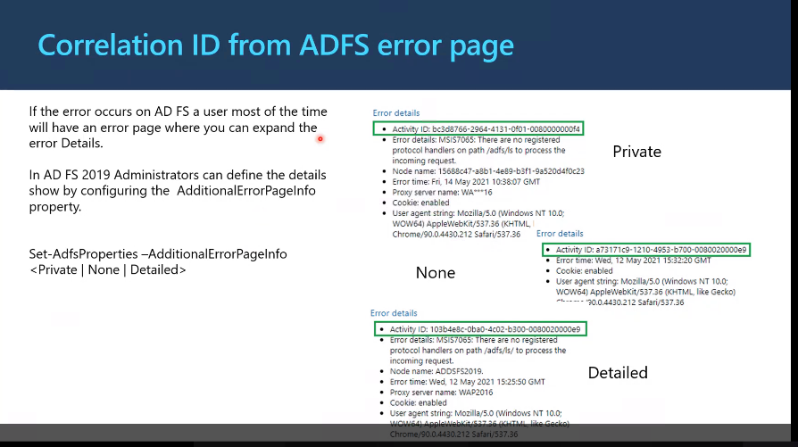
If the error occurs on AD FS, a user most of the time will have an error page where you can expand the Error Details.

In AD FS 2019, administrators can define the details shown by configuring the AdditionalErrorPageInfo property.

```powershell
Set-AdfsProperties -AdditionalErrorPageInfo <Private | None | Detailed>
```

#### Available Modes
Private

Displays:

#### Activity ID
Error details
Node name
Error time
Proxy server name
Cookie status
User agent
None

Displays:

Activity ID only
Detailed

Displays:

#### Activity ID
Error details
Node name
Error time
Proxy server name
Cookie status
User agent
#### Explanation
#### Why Is the Correlation ID Important?

When users encounter an AD FS authentication error, the error page usually contains an Activity ID.

Example:

Activity ID:
bc3d8766-2964-4131-bf01-0080000000f4


This Activity ID serves as a:

#### Correlation ID


that can be used to trace the authentication request throughout AD FS logs.

#### How Support Engineers Use It

When a user reports:

"I cannot access Microsoft 365"


or

"My federated application login is failing"


the first thing you should ask for is:

Screenshot of the AD FS error page


or

The Activity ID


Once you have the Activity ID:

AD FS Admin Logs
AD FS Debug Logs


can be filtered to show only events associated with that transaction.

#### AdditionalErrorPageInfo Modes
1. None
```powershell
Set-AdfsProperties -AdditionalErrorPageInfo None
```


What the user sees:

Activity ID only


Example:

Activity ID:
a73171c9-1210-4953-b700-0080020000e9

Advantages

✅ Minimal information disclosure

✅ More secure

Disadvantages

❌ Less troubleshooting information available

2. Private
```powershell
Set-AdfsProperties -AdditionalErrorPageInfo Private
```


The error page includes:

#### Activity ID
Error Details
Node Name
Error Time
Proxy Server Name
Cookie State
User Agent


This is often used when administrators want more diagnostic data while limiting excessive exposure.

3. Detailed
```powershell
Set-AdfsProperties -AdditionalErrorPageInfo Detailed
```


Provides the most troubleshooting information directly on the error page.

Example details:

#### Activity ID
Error Details
Node Name
Proxy Name
Timestamp
User Agent
Cookie Information


Useful during:

Testing
Troubleshooting
Pilot deployments
#### Typical Troubleshooting Flow
User Receives AD FS Error
          |
          v
Expand Error Details
          |
          v
Copy Activity ID
          |
          v
Search AD FS Logs
          |
          v
Locate Authentication Request
          |
          v
Identify Root Cause

#### Real-World Example

User receives:

MSIS7065:
There are no registered protocol handlers
on path /adfs/ls to process the incoming request.


The error page shows:

Activity ID:
103b4e8c-0ba0-4c02-b300-0080020000e9


An administrator can:

Open Event Viewer.
Open AD FS Admin or Debug Logs.
Search for:
103b4e8c-0ba0-4c02-b300-0080020000e9

Review the complete authentication flow for that specific request.

This dramatically reduces troubleshooting time compared to manually reviewing thousands of events.

#### Key Takeaway

The Activity ID (Correlation ID) displayed on an AD FS error page is one of the most valuable troubleshooting tools in AD FS.

User Error Page
       |
       v
#### Activity ID
       |
       v
AD FS Logs
       |
       v
Root Cause Analysis


Whenever troubleshooting AD FS:

Always ask for the Activity ID first.


It allows you to quickly correlate user-reported failures with the exact events recorded in AD FS logs.


### Correlate a Microsoft Entra Error
Slide Content (Copied as Text)
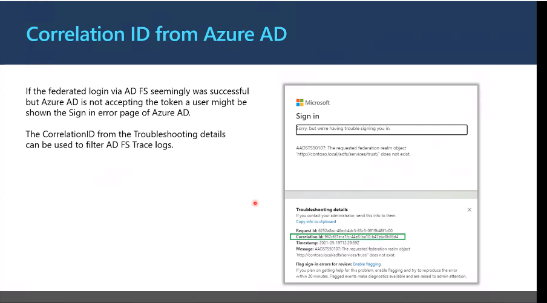
If the federated login via AD FS seemingly was successful but Azure AD is not accepting the token, a user might be shown the Sign-in error page of Azure AD.

The Correlation ID from the troubleshooting details can be used to filter AD FS Trace logs.

Example from Azure AD Error Page

Troubleshooting details

Request Id:
6253eaac-4fed-45d5-83c5-0919b48f1c00

Correlation Id:
96c3ef1e-a1fc-4468-bab0-b47e0cb93d4

Timestamp:
2021-05-19T12:29:39Z

Message:
AADSTS50107:
The requested federation realm object
'http://contoso.local/adfs/services/trust/'
does not exist.

#### Explanation
#### What Is Happening?

In a federated authentication flow:

User
  |
  v
Azure AD
  |
  v
AD FS
  |
Authentication
  |
Token Issued
  |
  v
Azure AD
  |
Application Access


Sometimes AD FS successfully authenticates the user and issues a token, but Azure AD rejects the token afterward.

To the user:

AD FS Login = Successful

Azure AD Login = Failed


This commonly results in an Azure AD sign-in error page.

#### Why Is the Correlation ID Important?

When Azure AD displays an error page, it usually includes:

Request ID
#### Correlation ID
Timestamp


The most important value is:

#### Correlation ID


because it allows administrators to trace the entire authentication transaction.

Think of it as:

Tracking Number


for the sign-in attempt.

Correlation ID Flow
User
   |
   v
Azure AD
   |
Correlation ID Generated
   |
   v
AD FS Federation Request
   |
   v
AD FS Logs


The same transaction can often be traced through:

Azure AD Sign-In Logs
AD FS Admin Logs
AD FS Debug Logs

using the Correlation ID and Timestamp.

Common Troubleshooting Scenario

A user reports:

I entered my password successfully,
but Microsoft 365 still failed to sign me in.


Azure AD displays:

AADSTS Error
#### Correlation ID
Timestamp


Instead of searching thousands of AD FS events:

200,000+ Debug Events


you can simply search for:

#### Correlation ID


and focus on the exact authentication request.

Example Error
AADSTS50107

The requested federation realm object
does not exist.


This typically indicates:

Federation configuration issue
Incorrect federation trust
Missing federation realm
Incorrect issuer configuration


Even though the user authenticated against AD FS, Azure AD could not validate the federation configuration.

Information You Should Always Collect

When investigating federation failures, ask for:

#### Correlation ID
Request ID
Timestamp
Username
Application Name


These values dramatically reduce troubleshooting time.

#### Troubleshooting Workflow
#### Step 1

User receives Azure AD error page.

#### Step 2

Collect:

#### Correlation ID
Request ID
Timestamp

#### Step 3

Review Azure AD Sign-In Logs.

#### Step 4

Review AD FS Debug Logs.

Filter on:

#### Correlation ID
Timestamp

#### Step 5

Determine where failure occurred:

AD FS Authentication
Claim Rules
Federation Trust
Token Issuance
Certificate Validation
Azure AD Federation Validation

#### Microsoft Entra ID vs AD FS Error Pages
Source	Information AvailableAD FS Error Page	Activity ID (Correlation ID), AD FS-specific errors
Azure AD Error Page	Correlation ID, Request ID, Timestamp, AADSTS Error Codes
AD FS Debug Logs	Full authentication and claims processing details
Azure AD Sign-In Logs	Cloud-side authentication and token validation results
#### Real-World Support Engineer Tip

If a user says:

I can authenticate through AD FS,
but Microsoft 365 still fails.


the first thing to request is:

#### Correlation ID
Timestamp


from the Azure AD error page.

Using those values, you can correlate:

Azure AD Logs
     +
AD FS Logs


to determine whether the issue was caused by:

Federation trust configuration
Claim issuance
Token validation
Certificate problems
Azure AD federation settings


#### Interview Answer
When a federated sign-in succeeds at AD FS but Azure AD rejects the resulting token, Azure AD typically presents a sign-in error page containing a Correlation ID, Request ID, and Timestamp. These identifiers can be used to correlate Azure AD sign-in logs with AD FS Admin and Debug logs, allowing administrators to trace the exact authentication request and quickly identify federation, claim, certificate, or token validation issues.


### Obtain a Client Request ID from Fiddler

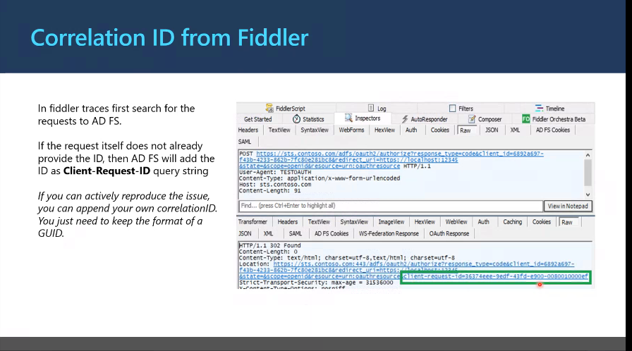

In Fiddler traces first search for the requests to AD FS.

If the request itself does not already provide the ID, then AD FS will add the ID as a:

client-Request-ID


query string.

If you can actively reproduce the issue, you can append your own correlation ID. You just need to keep the format of a GUID.

#### Explanation
#### Why Use Fiddler?

Sometimes:

No AD FS error page is displayed.
No Azure AD error page is displayed.
The user only reports that authentication fails.

In these situations, a Fiddler trace can be used to capture the authentication traffic between:

Browser
    |
    v
AD FS
    |
    v
Azure AD


and identify the request involved.

#### What Is a client-Request-ID?

AD FS frequently includes a parameter named:

client-request-id


Example:

```text
https://sts.contoso.com/adfs/oauth2/authorize?
```
client-request-id=f36374ee-9edf-43fd-e900-0080010000ef


This value is a GUID that uniquely identifies the authentication request.

Think of it as:

Tracking Number


for the sign-in transaction.

#### How to Find It in Fiddler
#### Step 1

Start a Fiddler trace.

#### Step 2

Reproduce the authentication issue.

#### Step 3

Search for requests sent to:

/adfs/


Examples:

/adfs/ls/
/adfs/oauth2/authorize
/adfs/services/trust

#### Step 4

Inspect the request URL.

Look for:

client-request-id=


Example:

client-request-id=f36374ee-9edf-43fd-e900-0080010000ef

#### How AD FS Uses the ID

Once the request reaches AD FS:

Browser
   |
client-request-id
   |
   v
AD FS
   |
   v
Authentication Processing


AD FS associates that identifier with the authentication flow.

As a result, you can later search:

AD FS Admin Logs
AD FS Debug Logs


using the same identifier.

#### Creating Your Own Correlation ID

A useful troubleshooting technique is to manually add your own GUID to the request.

Example:

client-request-id=12345678-1234-1234-1234-123456789abc


As long as the value remains in valid GUID format:

XXXXXXXX-XXXX-XXXX-XXXX-XXXXXXXXXXXX


AD FS can use it for request tracking.

#### Why Would You Do This?

Suppose:

Production AD FS Farm


generates:

Thousands of authentication requests
per minute


Finding your specific test request can be difficult.

If you inject a unique GUID:

aaaaaaaa-bbbb-cccc-dddd-eeeeeeeeeeee


you can later search AD FS logs for exactly that value.

This eliminates most troubleshooting noise.

Example Authentication Flow
Browser
    |
    | client-request-id
    v
AD FS
    |
Authentication
    |
Claims Rules
    |
Token Issuance
    |
    v
Application


The same identifier can be used to follow the request across the flow.

#### Real-World Troubleshooting Example

A user reports:

Federated login fails intermittently


No useful error page is provided.

You:

Capture a Fiddler trace.
Locate the AD FS authentication request.
Find:
client-request-id=
f36374ee-9edf-43fd-e900-0080010000ef

Search AD FS Debug Logs for:
f36374ee-9edf-43fd-e900-0080010000ef

Discover:
Claim Rule Failure


or

Certificate Validation Failure


or

MFA Adapter Failure


The root cause becomes much easier to identify.

#### Typical Troubleshooting Process
Capture
Fiddler Trace


↓

Locate
AD FS Request


↓

Copy
client-request-id


↓

Search
AD FS Debug Logs


↓

Analyze
Authentication
Claims
MFA
Token Issuance


↓

Identify Root Cause
#### Key Takeaway

When troubleshooting federation issues with Fiddler:

Look for requests sent to AD FS.
Search for the:
client-request-id


parameter.

Use that value to filter AD FS Debug Logs.
If necessary, generate your own GUID-based Correlation ID for easier tracing of test authentication requests.

This is one of the fastest ways to correlate a browser authentication request with the corresponding events in AD FS tracing logs.


### Recover an Activity ID from the AD FS Admin Log
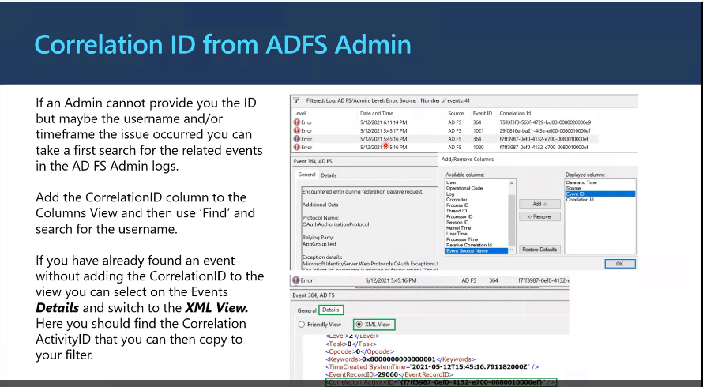

If an Admin cannot provide you the ID but maybe the username and/or timeframe the issue occurred, you can take a first search for the related events in the AD FS Admin logs.

Add the CorrelationID column to the Columns View and then use Find and search for the username.

If you have already found an event without adding the CorrelationID to the view, you can select on the event's Details and switch to the XML View.

Here you should find the Correlation ActivityID that you can then copy to your filter.

#### Explanation
#### When the User Cannot Provide a Correlation ID

In many troubleshooting cases, the user cannot provide:

#### Activity ID
#### Correlation ID
Screenshot


Instead, they may only know:

Username
Approximate Time
Application


Example:

User: elijah@contoso.com
Time: Around 3:45 PM
Issue: Unable to access Microsoft 365


In such cases, the AD FS Admin log becomes the starting point for your investigation.

#### Step 1: Search AD FS Admin Logs

Open:

Event Viewer
    |
    └── Applications and Services Logs
            |
            └── AD FS
                    |
                    └── Admin


Look for events occurring around the time of the issue.

Common events include:

364 - Token Issuance Failure
1200 - Application Token Success
1201 - Application Token Failure

#### Step 2: Add the Correlation ID Column

By default, Event Viewer often does not display the Correlation ID column.

To add it:

Event Viewer
     |
View
     |
Add/Remove Columns
     |
#### Correlation ID


After adding the column, you can see:

Date/Time
Event ID
#### Correlation ID


for each event.

#### Step 3: Search by Username

Use:

Find


and search for:

Username
UPN
Email Address


Example:

elijah@contoso.com


Once the relevant event is found, note the:

#### Correlation ID


associated with that event.

Example

Suppose you find:

Event ID: 364

User:
elijah@contoso.com


The event contains:

Correlation ID:
f7f39f87-0ef0-4132-e700-0080010000ef


This Correlation ID can now be used to trace the full authentication flow.

#### Alternative Method: XML View

Sometimes the Correlation ID column was not enabled when the event was discovered.

In that case:

Open the event.
Select:
Details

Switch to:
XML View

Locate the Correlation Activity ID

Within the XML you will typically find:

<Correlation ActivityID="{f7f39f87-0ef0-4132-e700-0080010000ef}" />


Example:

Correlation ActivityID:
f7f39f87-0ef0-4132-e700-0080010000ef


Copy this value.

#### Why Is the Activity ID Important?

The Activity ID becomes your primary filter.

Without it:

Thousands of Events


must be reviewed manually.

With it:

Thousands of Events
        |
        v
Single Authentication Flow


can be isolated immediately.

#### Typical Troubleshooting Workflow
User Reports Issue
        |
        v
No Correlation ID Available
        |
        v
Search AD FS Admin Logs
        |
        v
Locate User Event
        |
        v
Extract Correlation ActivityID
        |
        v
Search AD FS Debug Logs
        |
        v
Analyze Authentication Flow

#### Real-World Example

User reports:

Salesforce Login Failed


Known information:

Username:
elijah@contoso.com

Time:
3:45 PM


Administrator:

Opens AD FS Admin logs.
Searches around 3:45 PM.
Finds Event 364.
Opens XML View.
Extracts:
ActivityID:
f7f39f87-0ef0-4132-e700-0080010000ef

Uses that ActivityID to filter AD FS Debug logs.

Result:

Root Cause Found:
Missing Email Claim

#### Key Takeaway

If the user cannot provide a Correlation ID:

Search the AD FS Admin Logs using the username and timestamp.
Add the Correlation ID column or inspect the event's XML View.
Extract the Correlation ActivityID.
Use that ID to filter AD FS Debug logs and trace the entire authentication transaction.

User → AD FS Admin Log → ActivityID → AD FS Debug Log → Root Cause


This is one of the most common and effective AD FS troubleshooting techniques used by support engineers.


### Filter AD FS Events in Event Viewer
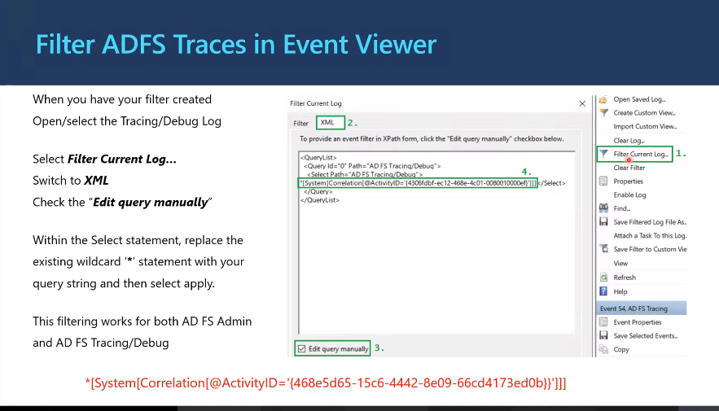

When you have your filter created:

Open/select the Tracing/Debug Log.

Select:

Filter Current Log...


Switch to the XML tab.

Check:

Edit query manually


Within the Select statement, replace the existing wildcard (*) statement with your query string and then select Apply.

This filtering works for both:

AD FS Admin


and

AD FS Tracing/Debug

Example Filter
*[System[Correlation[@ActivityID='{468e5d65-15c6-4442-8e09-66cd4173ed0b}']]]

#### Explanation
Why Filter AD FS Logs?

AD FS tracing can generate thousands of events in a short period.

Example:

Authentication Requests
Claim Processing
MFA Challenges
Token Issuance
LDAP Queries
Certificate Validation


Without filtering:

10,000+ Events


Finding one user's failure becomes extremely difficult.

#### Using the Activity ID

The most effective method is filtering by:

#### Activity ID


or

#### Correlation ID


Example:

468e5d65-15c6-4442-8e09-66cd4173ed0b


Every event generated as part of that authentication transaction will contain the same identifier.

Step-by-Step Process
#### Step 1

Open:

Event Viewer


Navigate to:

Applications and Services Logs
 └─ AD FS
     └─ Tracing
         └─ Debug

#### Step 2

Select:

Filter Current Log...

#### Step 3

Switch to the:

XML


tab.

#### Step 4

Enable:

Edit query manually

#### Step 5

Replace the existing query with:

*[System[Correlation[@ActivityID='{468e5d65-15c6-4442-8e09-66cd4173ed0b}']]]


Replace the GUID with your own:

#### Activity ID
or
#### Correlation ID

#### Step 6

Select:

Apply


Event Viewer now displays only events related to that authentication request.

#### Understanding the XML Query
*[System[Correlation[@ActivityID='{GUID}']]]

Components

System

Search the event system metadata


Correlation

Look at correlation information


ActivityID

Match this specific authentication transaction


GUID

Unique identifier for the authentication flow

Before Filtering
AD FS Debug Log

Event 1
Event 2
Event 3
Event 4
Event 5
...
Event 10,000


Finding a problem manually is time-consuming.

After Filtering
Event 364
Event 246
Event 299
Event 500


Only the events related to:

Activity ID:
468e5d65-15c6-4442-8e09-66cd4173ed0b


are shown.

#### Real-World Example

User reports:

Cannot access Microsoft 365


Error page provides:

Activity ID:
468e5d65-15c6-4442-8e09-66cd4173ed0b


You:

Open AD FS Debug Logs.
Apply the XML filter.
Search using the Activity ID.
Review only the associated events.

You quickly find:

Claim Rule Failure


or

MFA Adapter Failure


or

Token Issuance Failure


without reviewing unrelated events.

#### Works on Both Logs

The same filtering technique works for:

AD FS Admin Log


and

AD FS Tracing/Debug Log


This makes it easy to follow a request from:

High-Level Error
        ↓
Detailed Trace
        ↓
Root Cause

#### Troubleshooting Workflow
User Reports Error
        |
        v
Obtain Activity ID
        |
        v
Open AD FS Logs
        |
        v
Filter Current Log
        |
        v
XML Query
        |
        v
Apply Filter
        |
        v
Review Related Events Only
        |
        v
Identify Root Cause

#### Interview Answer

When troubleshooting AD FS, the most efficient way to isolate a single authentication transaction is to filter the AD FS Admin or Debug logs using the Activity ID (Correlation ID). In Event Viewer, open the log, select Filter Current Log, switch to the XML tab, enable Edit query manually, and use an XPath query such as:

*[System[Correlation[@ActivityID='{GUID}']]]


This returns only the events associated with that authentication request, significantly reducing noise and accelerating root-cause analysis.


## AD FS Claims Rule Language

### Purpose and Capabilities

Slide Content (Copied as Text)

The claims rule wizard provides templates for common claims rules.

Some scenarios require custom rules constructed with the Claims Rule Language (CRL).

The Claims Rule Language permits:

Modification of claim values
Concatenation of claim values
Conditional claim issuance
Etc.
#### Explanation
#### What is Claims Rule Language (CRL)?

Claims Rule Language (CRL) is the scripting language used in AD FS to create custom claim rules when the built-in claim rule templates are not sufficient.

Think of it as:

PowerShell for Claims


or

IF-THEN logic for authentication claims


CRL allows AD FS administrators to:

Read incoming claims
Transform claims
Create new claims
Modify claim values
Filter claims
Issue claims conditionally
#### Why Do We Need Claims Rule Language?

Most common scenarios can be configured using the Claim Rule Wizard.

Examples:

Send LDAP Attributes as Claims
Transform Incoming Claim
Pass Through Claims


These can be created using predefined templates.

However, complex business requirements often need custom logic.

Example:

If Department = IT
Issue Role = Administrator
Else
Issue Role = User


This requires Claims Rule Language.

#### Claims Rule Processing Flow
Incoming Claims
       |
       v
Claims Rule Language
       |
       v
Modify / Transform / Filter
       |
       v
Outgoing Claims
       |
       v
Application

1. Modification of Claim Values

CRL can change existing claim values before they are sent to the application.

Example

Incoming Claim:

Department = Information Technology


Transform to:

Department = IT


Result:

Original Value Modified

Example Rule Concept
If Department contains
"Information Technology"

Issue:

Department = IT

2. Concatenation of Claim Values

CRL can combine multiple claim values into a single claim.

Example

Incoming Claims:

GivenName = Elijah
Surname = Aremu


Output:

DisplayName = Elijah Aremu

Flow
GivenName
     +
Surname
     =
DisplayName


This is commonly used for:

Display Names
Email Addresses
Custom Attributes

3. Conditional Claim Issuance

One of the most powerful CRL capabilities.

AD FS can issue claims only when specific conditions are met.

Example

Incoming Claim:

Department = Finance


Rule:

If Department = Finance
Issue FinanceAccess = True


Output:

FinanceAccess = True

User from IT

Input:

Department = IT


Output:

No FinanceAccess Claim

#### Real-World Scenario

Company policy:

Only HR users may access Workday


Incoming Claims:

Department = HR


Rule:

If Department = HR
Issue Access = Allowed


Result:

Access Granted


Another User:

Department = Sales


Result:

Access Denied

Example Claims Pipeline
Incoming Claim
Department = IT
       |
       v
Claims Rule Language
       |
       v
IF Department = IT
Issue Role = Admin
       |
       v
Outgoing Claim
Role = Admin
       |
       v
Application

#### Common Uses of Claims Rule Language
Claim Transformation
email@contoso.com
      |
      v
EMAIL@CONTOSO.COM

Attribute Mapping
AD Attribute
      |
      v
Application Claim

Conditional Access Decisions
Department
Country
Group Membership


can be used to determine which claims are issued.

Building Custom Roles
Department = Finance
    |
    v
Role = FinanceAdmin

#### Why CRL Is Important for Troubleshooting

When troubleshooting AD FS:

Authentication succeeds
Application still fails


the issue is often related to:

Missing Claim
Incorrect Claim Value
Claim Transformation Error


Debug logs frequently show:

Incoming Claim
Rule Processed
Outgoing Claim


which helps identify broken CRL rules.

#### Claim Wizard vs Claims Rule Language
| Feature | Claim Rule Wizard | Claims Rule Language |
|---|---:|---:|
| Easy to configure | ✅ | ❌ |
| Predefined templates | ✅ | ❌ |
| Simple rule creation | ✅ | ✅ |
| Complex logic | ❌ | ✅ |
| Conditional processing | Limited | ✅ |
| Claim modification | Limited | ✅ |
| Claim concatenation | ❌ | ✅ |
| Advanced transformations | ❌ | ✅ |


#### Interview Answer
    Claims Rule Language (CRL) is the custom rule language used by AD FS to process, transform, and issue claims. While the Claim Rule Wizard provides templates for common claim operations, CRL allows administrators to create advanced logic such as modifying claim values, concatenating multiple claims into a single claim, and conditionally issuing claims based on user attributes. It is commonly used to implement application-specific authorization requirements and advanced claims transformations.


### Anatomy of a Custom Claim Rule
Slide Content (Copied as Text)
The “if statement” condition:
c:[Type == "http://schemas.microsoft.com/ws/2008/06/identity/claims/groupsid",
   Value =~ "^(?i)S-1-5-21-521979928-1127893261-3514755029-249602$"]

The special operator:
=>

The issuance statement:
issue(Type = "http://schemas.microsoft.com/authorization/claims/permit",
      Value = "PermitUsersWithClaim");

#### Explanation

A custom AD FS claim rule is typically made up of three parts:

Condition
   |
   v
Operator
   |
   v
Action (Issue Claim)


In simple terms:

IF something is true
THEN issue a claim

#### Part 1: The Condition
c:[Type == "http://schemas.microsoft.com/ws/2008/06/identity/claims/groupsid",
   Value =~ "^(?i)S-1-5-21-521979928-1127893261-3514755029-249602$"]


This is the IF statement.

It asks:

"Does the incoming claim match the specified Group SID?"

#### Breaking It Down
c:
c:


Represents an incoming claim.

Think:

Current Claim


being evaluated by AD FS.

Type ==
Type == "groupsid"


Checks whether the claim type is:

Group SID


Example:

Group SID = S-1-5-21-...

Value =~
Value =~


means:

Matches this pattern


using a regular expression.

The SID
S-1-5-21-521979928-1127893261-3514755029-249602


is an Active Directory Security Identifier (SID).

It represents a particular:

AD Group


For example:

Finance Users
ADFS Access Group
Administrators

#### What Is This Condition Doing?

The rule is checking:

Is the user a member of
this specific Active Directory group?

Example

User belongs to:

ADFS-Users
Finance
IT


One of those groups has the SID:

S-1-5-21-521979928-1127893261-3514755029-249602


Condition Result:

TRUE


Another user:

HR
Sales
Marketing


Does not belong to that group.

Condition Result:

FALSE

#### Part 2: The Special Operator
=>


This means:

THEN


It separates:

Condition


from

Action


Think of it as:

IF condition is true
THEN perform action

#### Part 3: The Issuance Statement
issue(
 Type = "http://schemas.microsoft.com/authorization/claims/permit",
 Value = "PermitUsersWithClaim"
);


This is the action AD FS performs.

If the condition evaluates to TRUE:

AD FS creates and issues a new claim.

Type
```text
http://schemas.microsoft.com/authorization/claims/permit
```


This is the claim type being generated.

Think:

Permission Claim

Value
PermitUsersWithClaim


This is the value of the claim.

AD FS sends:

Permit = PermitUsersWithClaim


to the application.

#### Complete Rule Logic

Putting it together:

IF User is Member of Group X
THEN Issue Permit Claim

Flow Diagram
User Login
     |
     v
Incoming Claims
     |
     v
Check Group SID
     |
 +---+---+
 |       |
Yes      No
 |       |
 v       v
Issue    Nothing
Permit   Issued
Claim

#### Real-World Example

Suppose an application should only be accessible by members of:

Finance-Portal-Users


AD Group SID:

S-1-5-21-521979928-1127893261-3514755029-249602


AD FS Rule:

IF user belongs to that group
THEN issue Permit claim

Finance User
Group Membership:
Finance-Portal-Users


Result:

PermitUsersWithClaim


issued.

Access granted.

Non-Finance User
Group Membership:
HR
Marketing


Result:

No Permit Claim


Application denies access.

#### Plain English Translation

The entire rule can be read as:

If the incoming user has a Group SID equal to
S-1-5-21-521979928-1127893261-3514755029-249602,

then issue an authorization claim with the value
"PermitUsersWithClaim".

#### Generic Claims Rule Structure

Most custom AD FS Claim Rules follow this pattern:

Condition
    =>
Issue Claim


Example:

IF Department = IT
   =>
Issue Role = Administrator


or

IF Country = UK
   =>
Issue Region = EMEA

#### Interview Answer

A custom AD FS Claims Rule consists of a condition, the => operator, and an issuance statement. The condition evaluates incoming claims, such as group membership, department, or email address. If the condition is true, the => operator instructs AD FS to execute the issuance statement and create a new outgoing claim. In the example shown, AD FS checks whether the user belongs to a specific Active Directory group SID and, if so, issues a permit claim that can be used by the application for authorization decisions.


### Claims Rule Language Samples
Slide Content (Copied as Text)
Permit everyone
=> issue(Type = "http://schemas.microsoft.com/authorization/claims/permit",
          Value = "true");

Issue a claim to everyone
=> issue(Type = "https://contoso.com/partner",
          Value = "Adatum");

Using a Single Condition
c:[Type == "https://contoso.com/role"]
 => issue(claim = c);

Using Multiple Conditions
c1:[Type == "https://contoso.com/role", Value == "Editors"]
 &&
c2:[Type == "https://contoso.com/email"]
 =>
 issue(claim = c1);

Allow users if they are member of a specific group
c:[Type == "http://schemas.microsoft.com/ws/2008/06/identity/claims/groupsid",
   Value =~ "^(?i)S-1-5-21-521979928-1127893261-3514755029-249602$"]
 =>
 issue(Type = "http://schemas.microsoft.com/authorization/claims/permit",
       Value = "PermitUsersWithClaim");

Deny users if they are member of a specific group
c:[Type == "http://schemas.microsoft.com/ws/2008/06/identity/claims/groupsid",
   Value =~ "^(?i)S-1-5-21-521979928-1127893261-3514755029-249602$"]
 =>
 issue(Type = "http://schemas.microsoft.com/authorization/claims/deny",
       Value = "DenyUsersWithClaim");

#### Explanation

These are common examples of how AD FS Claims Rule Language (CRL) is used to make authorization decisions and manipulate claims.

1. Permit Everyone
=> issue(Type = "http://schemas.microsoft.com/authorization/claims/permit",
          Value = "true");

What it means

There is no condition.

AD FS automatically issues:

Permit = True


for every user.

Plain English
Allow everyone.

Flow
User Logs In
      |
      v
Issue Permit=True
      |
      v
Application Grants Access

2. Issue a Claim to Everyone
=> issue(Type = "https://contoso.com/partner",
          Value = "Adatum");

What it means

Every authenticated user receives:

Partner = Adatum

Plain English
Tag every user with the value "Adatum".

Example

Output claim:

```text
https://contoso.com/partner = Adatum
```


Applications can use this value for routing or authorization.

3. Using a Single Condition
c:[Type == "https://contoso.com/role"]
 =>
 issue(claim = c);

What it means

Look for an incoming claim whose type is:

```text
https://contoso.com/role
```


If the claim exists:

Pass it through unchanged.

Example

Incoming claim:

Role = Administrator


Outgoing claim:

Role = Administrator

Plain English
If a role claim exists,
send it to the application.

4. Using Multiple Conditions
c1:[Type == "https://contoso.com/role",
    Value == "Editors"]
 &&
c2:[Type == "https://contoso.com/email"]
 =>
 issue(claim = c1);

What it means

AD FS checks two conditions:

Condition 1:

Role = Editors


AND

Condition 2:

Email claim exists


Both conditions must be true.

Example

Incoming claims:

Role = Editors
Email = elijah@contoso.com


Result:

Role = Editors


is issued.

If Email Is Missing
Role = Editors
Email = Missing


Result:

No Claim Issued

Plain English
If the user is an editor
and has an email address,
issue the role claim.

5. Allow Users in a Specific Group
Group SID Check
     =>
Permit Claim

What it means

AD FS checks if a user belongs to a particular AD security group.

Example

Group:

Finance-Portal-Users


SID:

S-1-5-21-521979928-1127893261-3514755029-249602


User is a member:

TRUE


AD FS issues:

PermitUsersWithClaim

Plain English
If user belongs to this group,
allow access.

Flow
User
 |
 v
Member of Group?
 |
 +---Yes----> Permit Claim
 |
 +---No-----> No Permit Claim

6. Deny Users in a Specific Group
Group SID Check
     =>
Deny Claim

What it means

Instead of permitting access, this rule explicitly issues:

DenyUsersWithClaim


when the user belongs to the specified group.

Example

Group:

Blocked-Users


User belongs to:

Blocked-Users


AD FS issues:

DenyUsersWithClaim

Plain English
If user belongs to this group,
deny access.

Flow
User
 |
 v
Member of Restricted Group?
 |
 +---Yes----> Deny Claim
 |
 +---No-----> Continue Processing

Common Pattern

Most custom AD FS claim rules follow:

Condition
     =>
Issue Claim


Examples:

IF Department = IT
=> Issue Role = Administrator

IF Country = UK
=> Issue Region = EMEA

IF Group = Finance
=> Permit Access

IF Group = BlockedUsers
=> Deny Access

#### Interview Answer

These sample Claims Rule Language statements demonstrate common AD FS claim-processing scenarios. Rules can issue claims to all users, pass through existing claims, evaluate single or multiple conditions, and make authorization decisions based on Active Directory group membership. Most custom claim rules follow the pattern Condition => Issue Claim, allowing AD FS to transform identity information into authorization decisions used by applications.


| Symbol | Operation | Example Rule |
|---------|-----------|-------------|
| `^` | Match the beginning of a string | `c:[type == "http://contoso.com/role", Value =~ "^director"] => issue(claim = c);`<br>Pass through any role claims that start with "director". |
| `$` | Match the end of a string | `c:[type == "http://contoso.com/email", Value =~ "contoso.com$"] => issue(claim = c);`<br>Pass through any email claims that end with "contoso.com". |
| `\|` | OR | `c:[type == "http://contoso.com/role", Value =~ "^director\|^manager"] => issue(claim = c);`<br>Pass through any role claims that start with "director" or "manager". |
| `(?i)` | Not case sensitive | `c:[type == "http://contoso.com/role", Value =~ "(?i)^director"] => issue(claim = c);`<br>Pass through any role claims that start with "director" regardless of case. |
| `x.*y` | "x" followed by "y" | `c:[type == "http://contoso.com/role", Value =~ "(?i)Seattle.*Manager"] => issue(claim = c);`<br>Pass through any role claims that contain "Seattle" followed by "Manager" regardless of case. |
| `+` | Match preceding character one or more times | `c:[type == "http://contoso.com/employeeId", Value =~ "^0+"] => issue(claim = c);`<br>Pass through any employeeId claims that start with at least one "0". |
| `*` | Match preceding character zero or more times | Similar to above, more useful in `RegExReplace()` scenarios. |


## AD FS Claims Processing Pipeline

Claims Rule Language becomes easier to troubleshoot when each rule is placed in its runtime stage. The following diagram separates incoming-claim acceptance, additional authentication, authorization, issuance transformation, and token creation.

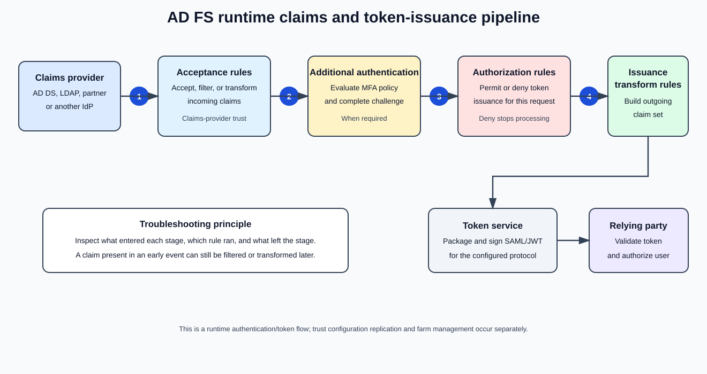

### Pipeline Overview

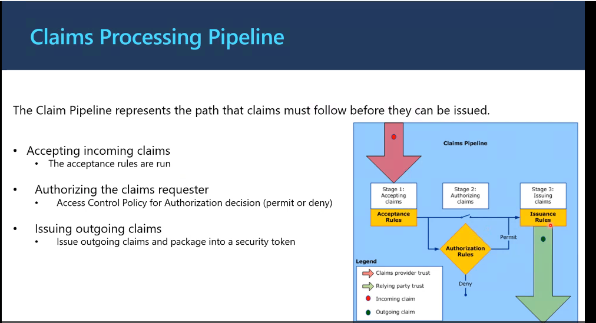

The Claim Pipeline represents the path that claims must follow before they can be issued.

Accepting incoming claims
The acceptance rules are run.
Authorizing the claims requester
Access Control Policy for Authorization decision (permit or deny).
Issuing outgoing claims
Issue outgoing claims and package into a security token.
#### Explanation

The Claims Processing Pipeline is one of the most important concepts in AD FS.

Whenever a user attempts to access a federated application, AD FS does not immediately issue a token.

Instead, the user's claims travel through a series of processing stages:

Incoming Claims
       |
       v
#### Acceptance Rules
       |
       v
#### Authorization Rules
       |
       v
#### Issuance Rules
       |
       v
Security Token
       |
       v
Application


Think of it as an airport security checkpoint.

Identity Check
     ↓
Access Check
     ↓
Boarding Pass Issued


AD FS follows a very similar process.

#### Stage 1: Accepting Incoming Claims
#### Purpose

The first step is to accept and validate incoming claims from a trusted identity source.

Examples of claim providers:

Active Directory
Another AD FS Farm
Microsoft Entra ID
LDAP Store
Third-Party Identity Provider

#### Acceptance Rules

Acceptance Rules determine:

Which incoming claims should AD FS trust?


AD FS evaluates each incoming claim.

Example

Incoming Claims:

Email = elijah@contoso.com
Department = IT
Phone = 123456789


Acceptance Rule:

Accept Email
Accept Department


Result:

Email = elijah@contoso.com
Department = IT


Phone Number is discarded.

Plain English
Take only the claims I trust.

#### Stage 2: Authorizing the Claims Requester
#### Purpose

Once AD FS accepts the claims, it determines whether the user is allowed to access the application.

This stage answers:

Should the user be allowed access?

#### Authorization Rules

Authorization Rules evaluate:

Group membership
User attributes
Access Control Policies
Custom claim rules

Result:

Permit


or

Deny

Example

User claim:

Department = Finance


Authorization Policy:

Allow only Finance users


Result:

Permit


Another user:

Department = HR


Result:

Deny

Flow
User
  |
  v
#### Authorization Rules
  |
 +-----+------+
 |            |
Permit      Deny
 |            |
 v            X
Continue    Stop

Plain English
Can this user access the application?

#### Stage 3: Issuing Outgoing Claims
#### Purpose

After authorization succeeds, AD FS creates the claims that will be sent to the application.

This is the final transformation stage.

#### Issuance Rules

Issuance Rules decide:

What claims should the application receive?


Applications usually don't need every AD attribute.

AD FS generates only the claims that the application requires.

Example

Active Directory Attributes:

Name
Email
Department
EmployeeID
Manager
Country


Application Needs:

Email
Department
Role


Issuance Rules generate:

Email = elijah@contoso.com
Department = IT
Role = Administrator

Plain English
Build the final identity information
for the application.

#### Packaging into a Security Token

After Issuance Rules run, AD FS packages the claims into a token.

Examples:

SAML Token
JWT Token
WS-Federation Token


Example token:

{
  "email": "elijah@contoso.com",
  "department": "IT",
  "role": "Administrator"
}


The application trusts AD FS and uses this token for authorization.

#### Complete Claims Processing Flow
               User
                 |
                 v
#### Claims Provider Trust
                 |
                 v
      ====================
        STAGE 1
      Accepting Claims
      ====================
                 |
#### Acceptance Rules
                 |
                 v

      ====================
        STAGE 2
      Authorizing Claims
      ====================
                 |
#### Authorization Rules
                 |
           +-----+-----+
           |           |
         Permit      Deny
           |           |
           v           X

      ====================
        STAGE 3
      Issuing Claims
      ====================
                 |
#### Issuance Rules
                 |
                 v
          Security Token
                 |
                 v
#### Relying Party Trust
          (Application)

#### Claims Provider Trust vs Relying Party Trust
#### Claims Provider Trust

Where claims originate.

Examples:

Active Directory
Entra ID
Partner AD FS
LDAP


Think:

Identity Source

#### Relying Party Trust

Where claims are sent.

Examples:

Microsoft 365
Salesforce
ServiceNow
Workday
SharePoint


Think:

Identity Consumer

#### Real-World Example

Suppose Elijah accesses:

```text
https://finance.contoso.com
```

#### Step 1: Accept Claims

AD FS receives:

Email = elijah@contoso.com
Department = Finance


Acceptance Rules:

Accept Email
Accept Department

#### Step 2: Authorize

Policy:

Only Finance Department users allowed


User:

Department = Finance


Result:

Permit

#### Step 3: Issue Claims

Issuance Rule:

Finance Users
→ FinancialAdmin Role


Outgoing Claims:

Email = elijah@contoso.com
Role = FinancialAdmin

Final Token
AD FS issues SAML token
        |
        v
Finance Application
        |
        v
Access Granted

#### Interview Answer

The AD FS Claims Processing Pipeline is the sequence of stages that claims pass through before a security token is issued. First, Acceptance Rules validate and accept incoming claims from a trusted identity provider. Next, Authorization Rules determine whether the user is permitted or denied access to the application. Finally, Issuance Rules create and transform outgoing claims, which are packaged into a security token such as SAML or JWT and sent to the relying party application. The pipeline ensures authentication, authorization, and claim transformation occur before access is granted.


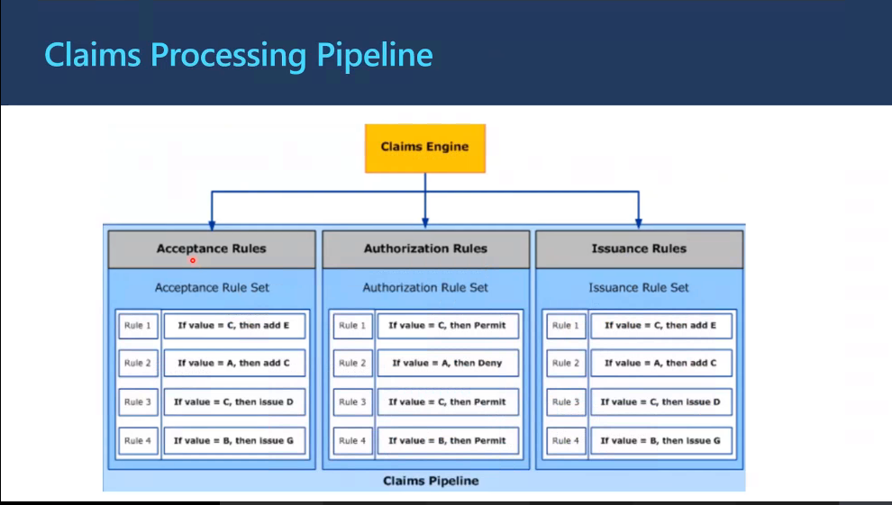


### Claims Engine and Rule-Set Order
Slide Content (Copied as Text)

The pipeline runs through several stages at which processing occurs.

Claims Provider Issuance Acceptance Rules
Filter/add/modify claims provided by the Claims Providers (AuthHandlers)
Global & RP AdditionalAuthenticationRules
Rules used to enforce Multifactor Authentication
AuthorizationRules
Rules to allow or deny a TokenIssuance
IssuanceTransformRules
Rules which define which claims will be issued in the outgoing token

At each stage, the rules are processed in a loop based on the ordering of the rules.

Results of a previous rule can be consumed by the next rule in the rule set.

#### Explanation

This slide takes the Claims Processing Pipeline a level deeper and shows the actual rule-processing stages that occur inside AD FS before a token is issued.

Think of it as:

Incoming Claims
      |
      v
Claims Provider Acceptance Rules
      |
      v
Additional Authentication Rules
      |
      v
#### Authorization Rules
      |
      v
Issuance Transform Rules
      |
      v
Outgoing Token

Stage 1: Claims Provider Issuance Acceptance Rules
#### Purpose

This stage processes claims received from:

Active Directory
LDAP
Another AD FS Farm
Microsoft Entra ID
Third-Party Identity Provider


The rules can:

Accept Claims
Modify Claims
Filter Claims
Create Claims

Example

Incoming Claim:

Email = elijah@contoso.com


Acceptance Rule:

Convert Email to UPN


Result:

UPN = elijah@contoso.com

Another Example

Incoming Claims:

Email
Department
Phone Number


Acceptance Rule:

Ignore Phone Number


Result:

Email
Department


Only approved claims continue through the pipeline.

Stage 2: Global & RP Additional Authentication Rules
#### Purpose

These rules determine whether additional authentication is required.

Most commonly:

Multi-Factor Authentication (MFA)

Global Rules

Apply to:

All Applications


Example:

Require MFA
for all external access

RP (Relying Party) Rules

Apply only to a specific application.

Example:

Require MFA
for Salesforce


but not for:

SharePoint

Example Flow
User Login
      |
      v
External Network?
      |
  Yes
      |
      v
Require MFA
      |
      v
Continue

Stage 3: Authorization Rules
#### Purpose

Authorization Rules determine whether AD FS should issue a token at all.

The question asked here is:

Should this user get access?

Possible Outcomes
Permit


or

Deny

Example

Rule:

Only Finance Users


User:

Department = Finance


Result:

Permit


Another User:

Department = Marketing


Result:

Deny

Flow
User Claims
      |
      v
#### Authorization Rules
      |
  +---+---+
  |       |
Permit   Deny
  |       |
  v       X
Continue Stop

Stage 4: Issuance Transform Rules
#### Purpose

Issuance Transform Rules define what will be placed into the final token.

This is the stage most administrators interact with.

Example

Incoming Claims:

GivenName = Elijah
Surname   = Aremu


Rule:

Combine Claims


Result:

DisplayName = Elijah Aremu

Another Example

Input:

Department = IT


Rule:

Issue Role = Administrator


Output:

Role = Administrator

Final Result

The application only receives the claims defined by the issuance rules.

Example:

Email
Role
Department


instead of every attribute stored in Active Directory.

Rule Processing Order

A very important concept:

Rules are processed sequentially.


AD FS does not run all rules simultaneously.

Example:

Rule 1
Rule 2
Rule 3
Rule 4


Execution:

Rule 1
   ↓
Rule 2
   ↓
Rule 3
   ↓
Rule 4

Why Rule Order Matters

Suppose:

Rule 1

Creates:

Department = IT

Rule 2

Checks:

If Department = IT
Issue Role = Admin


This works because:

Rule 1 runs first
Rule 2 consumes the result

Bad Ordering Example
Rule 2
Rule 1


Now:

Role Rule Executes First


The Department claim doesn't exist yet.

Result:

No Role Issued

Rules Can Consume Previous Results

One of the most powerful AD FS capabilities.

Example:

Rule 1
Email = elijah@contoso.com


creates:

Partner = Contoso

Rule 2

Reads:

Partner = Contoso


and creates:

Role = PartnerAdmin

Rule 3

Reads:

Role = PartnerAdmin


and issues:

Access = Approved

Complete Pipeline Example
User Logs In
      |
      v

Claims Provider Acceptance Rules
      |
Accept Email
Accept Department
      |
      v

Additional Authentication Rules
      |
Require MFA
      |
      v

#### Authorization Rules
      |
Department = IT ?
      |
Permit
      |
      v

Issuance Transform Rules
      |
Issue Role = Administrator
      |
      v

SAML/JWT Token
      |
      v

Application

#### Key Takeaway

The AD FS Claims Processing Pipeline is not a single step. It consists of four major rule-processing stages:

1. Claims Provider Acceptance Rules
2. Additional Authentication Rules
3. Authorization Rules
4. Issuance Transform Rules


Each stage processes claims in sequence, and the output of one rule can be used by subsequent rules. Understanding the order of execution is critical when troubleshooting claim issuance, MFA enforcement, and authorization failures in AD FS.


### Event Trace 1: Claims Provider Acceptance Rules
Slide Content (Copied as Text)
Stage: Acceptance Rules (ClaimsProvider)
Event 999:  "Acceptance Rule Set"
            (begin of the rule processing)

Event 139:  Input Claims from the pipeline

ForEach (Rule in Ruleset)
{
    Event 111: Current rule processed

    Event 151: List Claims available for Evaluation

    Event 128: Add Rule result to InputClaims

    Event 112: End of current Rule
               (EXIT event to 111)
}

Event 140: Rule Results added to the pipeline

Event 142: Exiting Claims Provider rule processing (Exit)

#### Explanation

This slide shows what happens inside AD FS Debug Logs during the Claims Provider Acceptance Rules stage of the Claims Processing Pipeline.

When debugging claim rules, these Event IDs help you determine:

What claims entered the stage
Which rule executed
What claims were evaluated
What new claims were created
What claims exited the stage

#### Event 999 - Acceptance Rule Set
Event 999


Marks the beginning of Acceptance Rule processing.

Think of it as:

START Acceptance Rules


Whenever you see Event 999, AD FS is about to run the Acceptance Rule Set associated with the Claims Provider.

Example
Event 999
Acceptance Rule Set


Meaning:

AD FS is entering the Acceptance Rules stage.

#### Event 139 - Input Claims from the Pipeline
Event 139


Shows the claims that entered the Acceptance Rule stage.

These are the claims received from:

Active Directory
Entra ID
LDAP
Another Federation Service

Example

Input Claims:

Email = elijah@contoso.com
Department = IT
UPN = elijah@contoso.com


Event 139 lets you see exactly what AD FS has available before any rule executes.

#### Event 111 - Current Rule Processed
Event 111


Identifies the rule that AD FS is currently evaluating.

Think:

Which rule is running right now?

Example

Rule:

Pass Through Email


Debug Log:

Event 111
Current Rule Processed


This tells you which claim rule AD FS entered.

#### Event 151 - Claims Available for Evaluation
Event 151


Displays every claim that the current rule can inspect.

This is one of the most useful events during troubleshooting.

Example

Claims available:

Email = elijah@contoso.com
Role = Employee
Department = IT


AD FS evaluates these claims against the rule conditions.

Question Answered by Event 151
Why didn't my rule fire?


Often the answer is:

Required claim wasn't present.


Event 151 helps validate this.

#### Event 128 - Add Rule Result to Input Claims
Event 128


Indicates that the rule created a new claim or modified an existing claim.

The rule output is added back into the working claim set.

Example

Input:

Department = IT


Rule:

IF Department = IT
THEN Role = Administrator


Result:

Role = Administrator


Event 128 records this new claim.

Why This Is Important

The newly created claim can now be used by:

Subsequent Rules


within the same rule set.

#### Event 112 - End of Current Rule
Event 112


Marks the completion of the current rule execution.

Think:

Rule Finished


Processing then returns to:

Event 111


for the next rule.

#### The Rule Loop

AD FS processes rules sequentially.

Rule 1
   |
   v
Rule 2
   |
   v
Rule 3
   |
   v
Rule 4


The slide represents this process:

111 -> 151 -> 128 -> 112


repeated for every rule.

#### Event 140 - Rule Results Added to the Pipeline
Event 140


Occurs after all Acceptance Rules have completed.

AD FS adds the final processed claims back into the pipeline.

Example

Input:

Email
Department


Rules Generated:

Role
Region


Output:

Email
Department
Role
Region


Event 140 shows the final result leaving the Acceptance Rule stage.

#### Event 142 - Exit Claims Provider Processing
Event 142


Marks the end of Claims Provider Acceptance processing.

Think:

End Acceptance Rules


AD FS now moves to the next stage of the Claims Pipeline.

#### Complete Flow Diagram
Event 999
START Acceptance Rules
        |
        v

Event 139
Input Claims Arrive
        |
        v

For Each Rule
{
    Event 111
    Current Rule

          |
          v

    Event 151
    Claims Available

          |
          v

    Event 128
    Rule Result Generated

          |
          v

    Event 112
    End Rule
}

        |
        v

Event 140
Results Added to Pipeline

        |
        v

Event 142
Exit Acceptance Processing

#### Real-World Troubleshooting Example

User reports:

Role claim missing


You inspect Debug Logs and find:

Event 139
Email = elijah@contoso.com
Department = IT

Event 151
Department = IT


available for evaluation.

Event 128
Role = Administrator


created successfully.

Event 140
Role = Administrator


present in output claims.

Conclusion:

Acceptance Rules worked correctly.


The problem must be in a later stage of the pipeline.

#### Key Takeaway

The Acceptance Rule processing stage can be traced using these Event IDs:

| Event ID | Purpose                         |
| -------- | ------------------------------- |
| **999**  | Begin Acceptance Rule Set       |
| **139**  | Input Claims Enter Pipeline     |
| **111**  | Current Rule Being Processed    |
| **151**  | Claims Available for Evaluation |
| **128**  | Rule Result Added to Claims     |
| **112**  | End of Current Rule             |
| **140**  | Final Results Added to Pipeline |
| **142**  | Exit Acceptance Rule Processing |

These events allow you to follow claim processing step-by-step and determine whether a claim was received, evaluated, transformed, and passed to the next stage of the AD FS Claims Pipeline.


### Event Trace 2: Additional Authentication Rules
Slide Content (Copied as Text)
Stage: AdditionalAuthenticationRules
Event 155: ENTER: RequiresSecondStageAuthentication

    Event 111: Start evaluating current rule (Enter)

    Event 151: List Claims available for Evaluation

    Event 128: Writing Result of Rule evaluation

    // if multiple rules are present loop through each

If MFA is required log:

    Event 155:
    "Additional authentication required triggered by additional auth policy rules"

Event 155 EXIT: RequiresSecondStageAuthentication

#### Explanation

This stage of the AD FS Claims Processing Pipeline is responsible for determining whether additional authentication is required.

In most environments, this means:

Multi-Factor Authentication (MFA)


AD FS evaluates the configured Additional Authentication Rules and decides whether a second authentication factor must be requested before token issuance continues.

#### Purpose of Additional Authentication Rules

This stage answers the question:

Does this user need MFA?


Examples:

Require MFA for external users

Require MFA for administrators

Require MFA for access to Salesforce

Require MFA when outside the corporate network


If the answer is:

No


processing continues.

If the answer is:

Yes


AD FS triggers MFA and requires a second authentication factor.

#### Event 155 - ENTER: RequiresSecondStageAuthentication
Event 155


Marks the beginning of Additional Authentication Rule processing.

Think:

START MFA Evaluation


When Event 155 appears, AD FS is entering the stage that determines whether additional authentication is necessary.

Example
Event 155

RequiresSecondStageAuthentication


Meaning:

AD FS has begun evaluating MFA requirements.

#### Event 111 - Start Evaluating Current Rule
Event 111


Indicates the current Additional Authentication Rule being processed.

Think:

Which MFA rule is currently running?

Example Rule
If User Is External
Require MFA


When AD FS evaluates that rule:

Event 111


appears.

#### Event 151 - Claims Available for Evaluation
Event 151


Displays all claims available to the MFA rule.

Examples:

User = elijah@contoso.com

Group = Finance

Location = External

Authentication Method = Forms


The rule evaluates these claims to determine whether MFA should be enforced.

#### Event 128 - Writing Result of Rule Evaluation
Event 128


Records the result of the MFA rule evaluation.

The rule may return:

Require MFA


or

No MFA Required

Example

Input:

Location = External


Rule:

External Users Must Use MFA


Result:

Require MFA


This decision is captured in Event 128.

#### Multiple Rules

The slide notes:

If multiple rules are present
loop through each


This means AD FS evaluates every configured MFA rule.

Example:

Rule 1
Require MFA for External Users

Rule 2
Require MFA for Administrators

Rule 3
Require MFA for Finance Application


AD FS processes them sequentially.

Processing Flow
Rule 1
   |
   v
Rule 2
   |
   v
Rule 3


The results are combined to determine the final authentication requirement.

Event 155 - MFA Required

If a rule determines MFA is necessary, you may see:

Event 155

"Additional authentication required
triggered by additional auth policy rules"


This is one of the most important events when troubleshooting MFA issues.

Meaning

AD FS has determined:

User must complete MFA


before token issuance can continue.

Example Scenario

User:

elijah@contoso.com


Signs in from:

Internet


Policy:

Require MFA for External Access


AD FS evaluates the rule and logs:

Event 155
Additional authentication required
triggered by additional auth policy rules


Result:

MFA Challenge Presented

Event 155 EXIT - RequiresSecondStageAuthentication
Event 155 EXIT


Marks the completion of the Additional Authentication Rule stage.

Think:

END MFA Evaluation


At this point AD FS knows whether the user:

Requires MFA


or

Does Not Require MFA


and moves to the next stage in the claims pipeline.

#### Complete Flow Diagram
Event 155
START MFA Evaluation
        |
        v

Event 111
Current Rule Evaluated
        |
        v

Event 151
Claims Available
        |
        v

Event 128
Rule Result
        |
        v

(Multiple Rules Repeat if Present)
        |
        v

Event 155
Additional Authentication Required
(Optional)
        |
        v

MFA Challenge
        |
        v

Event 155 EXIT
END MFA Evaluation

#### Real-World Troubleshooting Example
#### Problem

User reports:

I keep getting prompted for MFA.

#### Debug Log Review
Event 155 ENTER


MFA evaluation begins.

Event 151
Location = External


Claims available.

Event 128
Rule Result = Require MFA


Rule evaluated successfully.

Event 155
Additional authentication required triggered by additional auth policy rules


Root cause identified:

External Access MFA Policy


is triggering the MFA challenge.

#### Key Takeaway

The AdditionalAuthenticationRules stage determines whether a second factor of authentication is required.

| Event ID        | Purpose                          |
| --------------- | -------------------------------- |
| **155 (ENTER)** | Begin MFA Evaluation             |
| **111**         | Current MFA Rule Being Evaluated |
| **151**         | Claims Available for Evaluation  |
| **128**         | Result of Rule Evaluation        |
| **155**         | MFA Required by Policy           |
| **155 (EXIT)**  | End MFA Evaluation               |


These events are the primary events used to troubleshoot AD FS MFA enforcement, Additional Authentication Rules, and unexpected MFA prompts during the authentication process.


### Event Trace 3: Authorization Rules
Slide Content (Copied as Text)
Stage: Authorization Rules / Access Control Policies
Event 131: "Authorization Rule Sets" of the Relying Party (Enter)

Event 132: Input Claims from the pipeline

ForEach (Rule in Ruleset)
{
    Event 111: Current Rule processing

    Event 151: List Claims available for Evaluation

    Event 128: Add Rule result to InputClaims

    Event 112: End of current Rule processing
               (EXIT event to 111)
}

Event 133: Final Result of Authorization Rule evaluation (True / False)

Event 134: Exit the "Authorization Rules" (Exit)

#### Explanation

This stage is where AD FS makes the authorization decision.

The acceptance rules have already run.

The MFA rules have already run.

Now AD FS asks the most important question:

Should I issue a token for this user?


This stage determines whether access is:

Permit


or

Deny

Purpose of Authorization Rules

Authorization Rules evaluate:

Group Membership
User Attributes
Department
Role
Location
Custom Claims
Access Control Policies

Examples:

Allow only Finance Users

Allow only members of Admin Group

Deny external users

Allow access only if MFA succeeded

Event 131 - Authorization Rule Sets (Enter)
Event 131


Marks the beginning of Authorization Rule processing.

Think:

START Authorization Stage


Example:

Event 131

Authorization Rule Sets


Meaning:

AD FS is entering the authorization stage.

Event 132 - Input Claims from the Pipeline
Event 132


Shows all claims that reached the Authorization stage.

These claims come from previous stages:

#### Acceptance Rules
+
MFA Evaluation

Example

Available Claims:

Email = elijah@contoso.com

Department = Finance

Role = Employee

AuthenticationMethod = MFA


This is the data AD FS will use to make its authorization decision.

#### Event 111 - Current Rule Processing
Event 111


Shows which authorization rule AD FS is currently evaluating.

Think:

Which authorization rule is running?

Example Rule
Permit if Department = Finance


During execution:

Event 111


appears.

#### Event 151 - Claims Available for Evaluation
Event 151


Displays the claims available to the authorization rule.

Example

Claims:

Department = Finance

Email = elijah@contoso.com

Role = Employee


The rule now evaluates those claims.

Why Event 151 Is Important

This event answers questions such as:

Why was access denied?


Sometimes:

Required claim does not exist


or

Claim value is incorrect


Event 151 helps identify such issues.

#### Event 128 - Add Rule Result to Input Claims
Event 128


Occurs when an authorization rule generates a result.

Example:

Rule:

If Department = Finance
Issue Permit Claim


Generated:

Permit = True


Event 128 records that result.

#### Event 112 - End of Current Rule
Event 112


Marks completion of the current rule.

Think:

Current Rule Finished


AD FS then moves to the next rule.

#### Authorization Rule Loop

For every authorization rule:

Event 111
       |
       v

Event 151
       |
       v

Event 128
       |
       v

Event 112


This repeats until all authorization rules have been processed.

#### Event 133 - Final Authorization Result
Event 133


This is the most important event in the Authorization stage.

It shows the final authorization outcome.

Possible values:

TRUE


or

FALSE

TRUE
Authorization Successful


Result:

Token Issuance Continues

FALSE
Authorization Failed


Result:

Token Issuance Stopped


User is denied access.

Example

Authorization Rule:

Allow Finance Users


User:

Department = Finance


Result:

Event 133

TRUE


Access continues.

Another User:

Department = HR


Result:

Event 133

FALSE


Access denied.

#### Event 134 - Exit Authorization Rules
Event 134


Marks the end of Authorization Rule processing.

Think:

END Authorization Stage


At this point AD FS knows:

Permit
or
Deny

#### Complete Flow Diagram
Event 131
START Authorization Rules
        |
        v

Event 132
Input Claims
        |
        v

For Each Authorization Rule
{
    Event 111
    Current Rule

          |
          v

    Event 151
    Claims Available

          |
          v

    Event 128
    Rule Result

          |
          v

    Event 112
    End Rule
}

        |
        v

Event 133
Authorization Result
(TRUE/FALSE)

        |
        v

Event 134
END Authorization Stage

#### Real-World Troubleshooting Example
#### Problem

User reports:

Salesforce Access Denied

#### Debug Log Review
Event 132
Department = HR

Event 151

Claims available:

Department = HR

Authorization Rule
Permit only Finance Users

Event 133
FALSE

#### Conclusion
User failed Authorization Rule evaluation.


Root Cause:

User is not a member of the required department/group.

#### Key Takeaway

The Authorization stage decides whether AD FS will issue a token.

| Event ID | Purpose                                 |
| -------- | --------------------------------------- |
| **131**  | Enter Authorization Rule Set            |
| **132**  | Input Claims Arrive                     |
| **111**  | Current Authorization Rule              |
| **151**  | Claims Available for Evaluation         |
| **128**  | Rule Result Generated                   |
| **112**  | End Current Rule                        |
| **133**  | Final Authorization Result (TRUE/FALSE) |
| **134**  | Exit Authorization Stage                |


Event 133 is the most important event in this stage because it tells you whether AD FS ultimately decided to permit or deny token issuance.


### Event Trace 4: Issuance Transform Rules
Slide Content (Copied as Text)
Stage: IssuanceTransformRules
Event 143: "Issuance Rule Set" of the Relying Party (Enter)

Event 139: InputClaims from the pipeline

ForEach (Rule in Ruleset)
{
    Event 111: Current Rule processing

    Event 151: List Claims available for Evaluation

    Event 128: add claim to pipelines to pipeline or OutgoingClaimset

    Event 112: End of Rule processing
               (EXIT event to 111)
}

Event 140: Finalized Claimset after all issuance rules had been processed

Event 144: Exit the "Issuance Rules" of the Relying Party (Exit)

#### Explanation

This is the final stage of the AD FS Claims Processing Pipeline.

At this point:

✅ Claims have been accepted

✅ MFA requirements have been evaluated

✅ Authorization decisions have been made

Now AD FS must answer:

What claims should be included in the final token?


This stage creates the final set of claims that the application (Relying Party) will receive.

#### Purpose of Issuance Transform Rules

Issuance Transform Rules are responsible for:

Creating Claims
Transforming Claims
Filtering Claims
Concatenating Claims
Passing Through Claims


The output of this stage becomes:

SAML Token
JWT Token
WS-Federation Token


sent to the application.

#### Event 143 - Issuance Rule Set (Enter)
Event 143


Marks the beginning of the Issuance Transform Rule stage.

Think:

START Issuance Processing


Example:

Event 143

Issuance Rule Set


Meaning:

AD FS is starting to build the final outgoing claim set.

#### Event 139 - Input Claims from the Pipeline
Event 139


Displays all claims that arrived from previous stages.

These include claims that survived:

#### Acceptance Rules
MFA Evaluation
#### Authorization Rules

Example

Input Claims

Email = elijah@contoso.com

Department = IT

Group = Administrators


These claims are now available for issuance processing.

#### Event 111 - Current Rule Processing
Event 111


Represents the current Issuance Transform Rule being evaluated.

Think:

Which claim transformation rule is running?

Example Rule
If Department = IT

Issue Role = Administrator


When this rule executes:

Event 111


appears in the debug trace.

#### Event 151 - Claims Available for Evaluation
Event 151


Displays all claims available to the current issuance rule.

Example

Available Claims

Email = elijah@contoso.com

Department = IT

Group = Administrators


The rule uses these claims to determine what should be issued.

#### Event 128 - Add Claim to Pipeline or Outgoing Claim Set
Event 128


This is one of the most important events in issuance processing.

It indicates:

A new claim was generated


or

A claim was added to the outgoing token

Example

Input:

Department = IT


Rule:

If Department = IT
Issue Role = Administrator


Output:

Role = Administrator


Event 128 records the creation of this claim.

Example: Concatenation Rule

Input:

GivenName = Elijah

Surname = Aremu


Rule:

DisplayName = GivenName + Surname


Generated Claim:

DisplayName = Elijah Aremu


Event 128 records the newly created claim.

#### Event 112 - End of Current Rule
Event 112


Marks completion of the current issuance rule.

Think:

Current Rule Finished


Processing returns to:

Event 111


for the next rule.

#### Rule Processing Loop

For every issuance rule:

Event 111
      |
      v

Event 151
      |
      v

Event 128
      |
      v

Event 112


The process repeats until all issuance rules have executed.

#### Event 140 - Finalized Claim Set
Event 140


This event contains the most important output of the Issuance stage.

It shows:

All claims that will appear
in the final token.


Think:

Final Token Preview

Example

After all processing:

Email = elijah@contoso.com

Department = IT

Role = Administrator

DisplayName = Elijah Aremu


Event 140 shows this completed claim set.

Why Event 140 is Important

When troubleshooting:

Missing Claims
Incorrect Claims
Application Authorization Failures


Event 140 tells you exactly what AD FS is sending.

If the claim is absent from Event 140:

AD FS never issued it.


If the claim exists in Event 140:

AD FS issued it successfully.


The problem likely exists in the application.

#### Event 144 - Exit Issuance Rules
Event 144


Marks the end of issuance processing.

Think:

END Issuance Rules


AD FS now proceeds to:

Token Creation


and sends the token to the application.

#### Complete Flow Diagram
Event 143
START Issuance Rules
        |
        v

Event 139
Input Claims
        |
        v

For Each Rule
{
    Event 111
    Current Rule

          |
          v

    Event 151
    Claims Available

          |
          v

    Event 128
    New Claim Generated

          |
          v

    Event 112
    Rule Complete
}

        |
        v

Event 140
Final Claim Set

        |
        v

Event 144
END Issuance Rules

        |
        v

Token Created
        |
        v

Application Receives Token

#### Real-World Troubleshooting Example
#### Problem

User can authenticate successfully but Salesforce shows:

Access Denied
Role Claim Missing

Debug Log Analysis
Event 139
Department = IT


Input claim present.

Event 111

Rule:

Issue Role = Administrator


executed.

Event 128
Role = Administrator


generated.

Event 140
Email = elijah@contoso.com

Role = Administrator


present.

#### Conclusion
AD FS Successfully Issued Role Claim


Problem exists:

Inside Salesforce


not AD FS.

#### Key Takeaway

The IssuanceTransformRules stage determines exactly what claims appear in the final token.

| Event ID | Purpose                                      |
| -------- | -------------------------------------------- |
| **143**  | Enter Issuance Rule Set                      |
| **139**  | Input Claims Arrive                          |
| **111**  | Current Rule Being Processed                 |
| **151**  | Claims Available for Evaluation              |
| **128**  | Claim Added to Pipeline / Outgoing Claim Set |
| **112**  | End Current Rule                             |
| **140**  | Finalized Claim Set                          |
| **144**  | Exit Issuance Rules                          |


#### Most Important Event
Event 140


Because it shows the final claims AD FS will send to the application. When troubleshooting missing or incorrect claims, Event 140 is usually the first place to verify what actually made it into the token.

## Integrated Conclusion

This lesson spans three connected but distinct layers:

1. **Device identity and management:** Microsoft Entra registered, joined, and hybrid-joined states; AD DS, Group Policy, Intune, device registration, and synchronization.
2. **Runtime authentication and SSO:** Kerberos or NTLM for applicable on-premises resources; browser-carried SAML or WS-Federation federation; OAuth 2.0/OpenID Connect token flows; and PRT-backed cloud SSO where eligible.
3. **AD FS protection and diagnosis:** extranet lockout, auditing, tracing, correlation, claims evaluation, authorization, and token issuance.

Keep browser redirects and posted responses separate from back-channel service calls. Likewise, do not confuse runtime sign-in with configuration replication, monitoring, certificate maintenance, or administrative management. For a missing or incorrect outgoing claim, inspect the final issuance output—Event 140 in the trace described above—then continue at the relying application if the expected claim is present.
