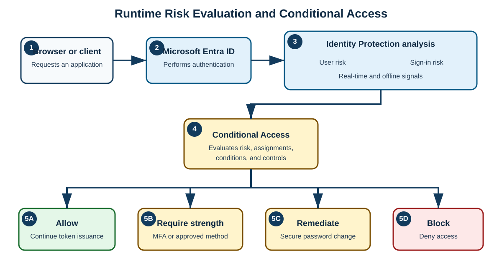
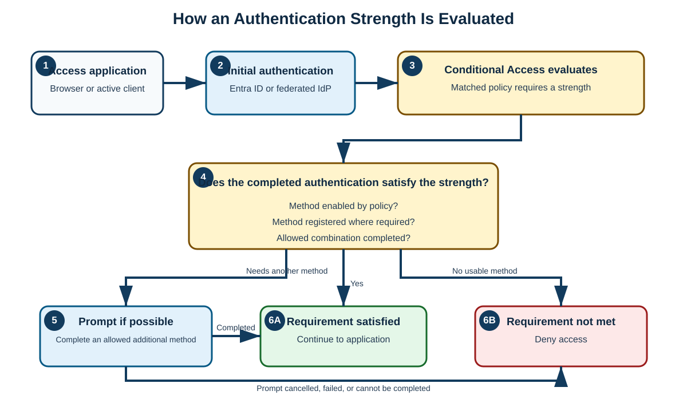

# Day 24: Microsoft Entra ID Protection and Conditional Access Authentication Strengths

Microsoft Entra ID Protection detects identity-related risk, helps administrators investigate it, and supports risk-based remediation. Conditional Access authentication strengths then let administrators require an appropriate class of authentication method—not merely “some form of multifactor authentication.” This lesson builds both topics from first principles, traces their runtime flows, and applies them in practical policies.

> [!IMPORTANT]
> Keep four paths separate:
>
> 1. **Runtime authentication:** the client or browser follows redirects, submits authentication, and carries protocol responses where the protocol requires it.
> 2. **Policy configuration:** administrators define risk conditions, grant controls, authentication methods, and exclusions.
> 3. **Risk analysis and monitoring:** Microsoft evaluates signals and exposes reports, alerts, and investigation data.
> 4. **Federation management:** administrators establish trust, exchange metadata or certificates, and maintain the configuration. This is not the same as a user's runtime sign-in.

## Identity Protection Foundations

### What Is Microsoft Entra ID Protection?

Microsoft Entra ID Protection is a cloud-based identity-security capability that helps organizations **detect, investigate, and remediate identity-based risk**. It uses Microsoft's threat intelligence, machine learning, and analysis of large volumes of signals to identify suspicious sign-ins and potentially compromised accounts.

Risk data can:

- Inform Microsoft Entra Conditional Access decisions.
- Support administrator investigations.
- Trigger user or administrator remediation.
- Be sent to a security information and event management (**SIEM**) platform for longer-term analysis and correlation.

In short, Identity Protection combines:

1. **Identity threat detection**
2. **Risk evaluation**
3. **Automated or manual response**

It is a security control intended to strengthen an organization's identity environment.

### Why Identity Protection Is Needed

Attackers commonly target identities through:

- Phishing
- Password spraying
- Credential stuffing
- Leaked passwords or credentials
- Sign-ins through anonymous virtual private network (**VPN**), proxy, or Tor infrastructure
- Token theft
- Malware-infected devices

Identity Protection helps identify risk before an attacker establishes persistent access. A detection is a signal for evaluation, however—not automatic proof that a user is malicious or compromised.

## Risk Concepts and Detections

### User Risk and Sign-In Risk

Identity Protection evaluates two related but distinct kinds of risk:

| Risk type | Question it answers | Scope | Typical response |
|---|---|---|---|
| **User risk** | “How likely is it that this identity is compromised?” | The user account over time | Secure password change, administrator investigation, or block |
| **Sign-in risk** | “How likely is it that this particular authentication attempt is not legitimate?” | One sign-in attempt | Require stronger authentication or block the sign-in |

#### User Risk

User risk represents the likelihood that a user account has been compromised. Microsoft continually evaluates relevant signals associated with the identity.

Examples include:

- Leaked credentials
- Threat-intelligence indicators
- Suspicious account activity
- Confirmed or suspected account compromise

**Example**

```text
User: elijah@contoso.com
Risk level: High
```

This means Microsoft has strong reason to believe the **account itself** may be compromised. It does not merely describe one unusual sign-in.

#### Sign-In Risk

Sign-in risk represents the likelihood that a specific authentication request was not made by the legitimate user.

Examples include:

- An anonymous IP address
- Password-spray activity
- Atypical or impossible travel signals
- Unfamiliar sign-in properties
- An IP address associated with malicious activity

**Example**

```text
User account: Legitimate
Current sign-in: Suspicious
```

The account might still be safe, but the current attempt contains suspicious signals.

> [!NOTE]
> Some risk detections are calculated in real time, while others are calculated offline after the sign-in. Therefore, a detection or updated risk state can appear after the original authentication attempt has finished.

### Risk Levels

Microsoft Entra ID Protection categorizes risk into three levels:

| Risk level | Beginner-friendly meaning |
|---|---|
| **Low** | Slight suspicion |
| **Medium** | Moderate confidence that risk exists |
| **High** | Strong evidence or confidence of compromise |

Conditional Access can use these levels as conditions. The organization must decide which levels are acceptable for each resource and user population.

### Common Risk Detections

| Detection | What it can indicate |
|---|---|
| **Leaked credentials** | Credentials associated with the user were found in a known leak. |
| **Password spray** | An attacker tried a small set of passwords across multiple accounts. |
| **Anonymous IP address** | A sign-in used Tor, an anonymizing VPN, or proxy infrastructure. |
| **Unfamiliar sign-in properties** | Device, browser, location, IP, or other properties differ from the user's established pattern. |
| **Atypical travel** | Sign-ins occurred from geographically unusual locations or in an unusual sequence. |
| **Impossible travel** | Signals suggest movement between locations that could not reasonably occur in the available time. |
| **Malicious IP address** | The source IP has a reputation or association with malicious activity. |
| **Verified threat actor IP** | The source IP is linked to a known threat actor. |

> [!CAUTION]
> A VPN, Tor exit node, new device, or unfamiliar location can have a legitimate explanation. Investigate context before confirming compromise. Conversely, successful multifactor authentication (**MFA**) does not automatically prove that a sign-in was safe.

## Runtime Risk Evaluation and Access Decisions



### End-to-End Sign-In Flow

1. A user uses a browser or application client to access a protected resource.
2. The browser or client is redirected to, or directly communicates with, Microsoft Entra ID for authentication.
3. Microsoft Entra ID evaluates the authentication request and relevant Identity Protection signals.
4. Identity Protection calculates applicable **sign-in risk** and updates **user risk** as signals warrant.
5. Conditional Access evaluates assignments, conditions, including risk, and grant or session controls.
6. Microsoft Entra ID allows access, requires an additional control, or blocks access.
7. If authentication succeeds and policy permits access, Microsoft Entra ID issues the applicable token or protocol response to the client for the target resource.

Possible outcomes include:

```text
Low risk    -> Allow access, if all other controls pass
Medium risk -> Require MFA or an approved authentication strength
High risk   -> Block access or require an approved remediation path
```

Another policy can require a secure password reset for user-risk remediation.

> [!IMPORTANT]
> The exact outcome depends on policy design. Risk does not bypass the rest of Conditional Access, and Identity Protection does not directly “push” an application token to an unrelated service. Browser-based protocols use browser-carried redirects and responses; active clients use their supported authentication endpoints and protocol exchanges.

### Conditional Access Integration

Conditional Access is the policy engine that turns risk signals into access decisions. A policy can combine:

- Included and excluded users
- Target resources
- User-risk or sign-in-risk levels
- Device, network, client, and other conditions
- Grant controls, such as an authentication strength
- Session controls

This enables automated protection without waiting for an administrator to respond to every event.

### Sign-In-Risk Policy

This policy asks:

> **Is this specific sign-in suspicious?**

Possible actions include:

- Require MFA.
- Require a specified authentication strength.
- Block access.

### User-Risk Policy

This policy asks:

> **Is this account likely to be compromised?**

Possible actions include:

- Require a secure password change.
- Block access.
- Require an approved remediation process.

> [!NOTE]
> Configure risk-based access through Conditional Access for modern deployments. Older “legacy Identity Protection policies” may still appear in historical material, but they should not be confused with current Conditional Access policy configuration.

### Self-Remediation and Administrator Remediation

Remediation can be performed by the user or by IT, depending on the risk type, policy, licensing, and available authentication methods.

**User self-remediation can include:**

1. Completing the authentication method required by a sign-in-risk policy.
2. Completing a secure password change when a user-risk policy requires it.
3. Registering or using an allowed method when policy and registration state permit it.

**Administrator remediation can include:**

1. Reviewing the risky user, risky sign-in, and underlying detections.
2. Confirming that a sign-in is safe when the evidence supports that conclusion.
3. Confirming that the user is compromised.
4. Resetting or revoking credentials and sessions through the appropriate administrative process.
5. Dismissing user risk only after investigation justifies it.

> [!WARNING]
> Do not simply notify a customer that an alert is a false positive. Record the evidence, use the appropriate **confirm safe** or **dismiss risk** action, and follow the organization's incident-handling procedure.

## Investigation and Practical Response

### Real-World Sign-In Example

Suppose Elijah normally signs in from:

- London
- Kigali
- A corporate VPN

One morning, Microsoft detects:

```text
Sign-in location: Russia
IP reputation: Malicious
Device: Unknown
```

Identity Protection might calculate:

```text
Sign-in risk: High
```

Before granting access, Conditional Access can:

```text
Require MFA
```

or:

```text
Block sign-in
```

The detection should still be investigated. Location alone is not proof of compromise, but the combination of an unknown device and malicious IP reputation increases concern.

### Administrator Reports

Administrators commonly investigate:

```text
Identity Protection
├─ Risky users
├─ Risky sign-ins
└─ Risk detections
```

Risky workload identities are handled in the workload-identity protection experience and have their own licensing and policy considerations; do not assume that a user-risk policy protects service principals.

These views answer different questions:

| View | Primary purpose |
|---|---|
| **Risky users** | Investigate identities whose accumulated signals indicate compromise. |
| **Risky sign-ins** | Investigate individual authentication attempts with one or more risk detections. |
| **Risk detections** | Inspect the underlying event or signal that contributed to risk. |

Data can also be exported through supported Microsoft Graph interfaces or diagnostic settings to a SIEM, Log Analytics workspace, storage account, or event-streaming solution. Export, retention, and monitoring are management paths; they are not steps in the user's runtime sign-in.

### Handling a Possible False Positive

A **false positive** is a legitimate user or sign-in that is incorrectly flagged as risky.

Use a structured investigation:

1. Verify the user's identity through an approved, independent channel.
2. Review time, location, IP reputation, device, client, authentication details, and related detections.
3. Check whether approved travel, a corporate VPN, a new device, or another known change explains the event.
4. Look for additional suspicious activity before deciding.
5. If the evidence shows the sign-in was legitimate, mark it safe or dismiss the risk through the appropriate workflow.
6. If compromise remains possible, contain the account and follow incident-response procedures.

### Licensing

Advanced Identity Protection capabilities generally require:

```text
Microsoft Entra ID P2
```

They can also be included in suites that contain P2 capabilities, such as eligible Microsoft 365 E5 offerings. Exact entitlement can vary by feature—especially for workload identities and integrated security products—so verify the current product terms before deployment.

### Identity Protection Interview Answer

**Microsoft Entra ID Protection is a risk-based identity-security solution that uses Microsoft's threat intelligence, machine learning, and identity signals to detect potentially compromised users and suspicious sign-ins. It evaluates user risk and sign-in risk, assigns levels such as Low, Medium, and High, and integrates with Conditional Access to require MFA or another authentication strength, trigger secure password remediation, or block access. It helps organizations respond to phishing, password spraying, leaked credentials, anonymous IP sign-ins, token-related threats, and other identity attacks.**

## Conditional Access Authentication Strengths

### What Is an Authentication Strength?

Conditional Access authentication strengths let administrators specify which authentication-method combinations are acceptable for a resource or scenario. Instead of merely requiring MFA, the policy can require a particular level of authentication security.

Use this Microsoft Entra admin-center location to manage the available strengths:

```text
Microsoft Entra ID > Authentication methods > Authentication strengths
```

A useful mental model is:

```text
Conditional Access
  -> Require authentication
  -> What kind of authentication is acceptable?
  -> Authentication strength
```

### Why Authentication Strengths Were Introduced

A traditional policy might say:

```text
Require MFA
```

However, not all MFA methods provide the same phishing resistance. Examples of methods and combinations seen in authentication deployments include:

- SMS one-time passcode (**OTP**)
- Voice call
- Microsoft Authenticator push notification
- Open Authentication (**OATH**) software or hardware token
- Microsoft Authenticator phone sign-in
- Fast Identity Online 2 (**FIDO2**) security key or passkey
- Windows Hello for Business (**WHfB**)
- Microsoft Entra certificate-based authentication (**CBA**)
- Platform credentials

Authentication strengths let administrators select methods appropriate to the sensitivity and risk of the requested resource.

## Built-In Authentication Strengths

Microsoft provides three built-in strengths. Built-in definitions are Microsoft-managed and cannot be edited.

### Multifactor Authentication Strength

This accepts supported method combinations that satisfy the ordinary MFA requirement.

Examples include:

- Password plus SMS
- Password plus voice call
- Password plus Microsoft Authenticator push
- Password plus an OATH token
- FIDO2 security key or passkey
- WHfB or platform credential
- Multifactor CBA
- Federated MFA

**Best suited to:**

- General users
- Standard applications
- Low- to medium-risk resources

### Passwordless MFA Strength

This requires supported MFA methods that do not require a password as part of the accepted authentication combination.

Examples include:

- Microsoft Authenticator phone sign-in
- FIDO2 security keys and passkeys
- WHfB or platform credentials
- Multifactor CBA

**Best suited to:**

- Passwordless initiatives
- Modern authentication deployments
- Improved user experience without passwords

### Phishing-Resistant MFA Strength

This is the strongest built-in authentication strength. It accepts supported methods that cryptographically bind authentication to the sign-in experience or otherwise meet Microsoft's phishing-resistant definition.

Examples include:

- FIDO2 security keys and passkeys
- WHfB or platform credentials
- Multifactor CBA

**Best suited to:**

- Administrators
- Privileged accounts
- Financial applications
- High-risk populations
- Sensitive data

> [!NOTE]
> The source notes listed CBA as phishing resistant but not passwordless. Microsoft's built-in mapping specifically includes **multifactor CBA** in MFA, passwordless MFA, and phishing-resistant MFA. Single-factor CBA does not satisfy these built-in MFA strengths.

### Strength Hierarchy

For a beginner-friendly comparison:

```text
Multifactor authentication -> Passwordless MFA -> Phishing-resistant MFA
Good                       -> Better           -> Strongest built-in option
```

This is a teaching hierarchy, not a claim that every method in one group is interchangeable with every method in another.

### Authentication-Method Comparison

| Authentication method or combination | MFA strength | Passwordless MFA strength | Phishing-resistant MFA strength |
|---|:---:|:---:|:---:|
| Password + SMS OTP | ✅ | ❌ | ❌ |
| Password + voice call | ✅ | ❌ | ❌ |
| Password + Authenticator push | ✅ | ❌ | ❌ |
| Password + software or hardware OATH token | ✅ | ❌ | ❌ |
| Microsoft Authenticator phone sign-in | ✅ | ✅ | ❌ |
| FIDO2 security key or passkey | ✅ | ✅ | ✅ |
| WHfB or platform credential | ✅ | ✅ | ✅ |
| CBA, multifactor | ✅ | ✅ | ✅ |
| CBA, single-factor | ❌ | ❌ | ❌ |

> [!IMPORTANT]
> A method must also be enabled for the user and registered where registration is required. An authentication strength does not itself register or enable a method.

## How Authentication Strength Is Evaluated



### Evaluation Sequence

1. The user accesses an application.
2. The user completes initial authentication with Microsoft Entra ID or a configured federated identity provider (**IdP**).
3. Conditional Access evaluates after initial authentication.
4. A matched policy requires an authentication strength.
5. Microsoft Entra checks whether the authentication already performed satisfies the required strength.
6. If another supported method can satisfy the requirement, the user can be prompted for it.
7. Access is allowed only when the requirement and all other applicable controls are satisfied; otherwise access is denied.

Microsoft Entra evaluates questions such as:

```text
Is the method allowed by the authentication-method policy?
Is the method registered where registration is required?
Does the completed method combination satisfy the required strength?
```

> [!IMPORTANT]
> Conditional Access is evaluated after initial authentication. Requiring phishing-resistant MFA does not necessarily prevent a user from first entering a password; it requires the completed sign-in to satisfy the phishing-resistant strength before access continues.

### Authentication Strength Compared with Require MFA

| Traditional grant control | Authentication-strength grant control |
|---|---|
| Requires MFA but accepts any supported combination that satisfies MFA | Requires one of the combinations included in the selected built-in or custom strength |
| Might allow password + SMS, voice, or push | Can narrow access to FIDO2/passkey, WHfB, multifactor CBA, or another approved set |
| Broad control | Granular control |

Do not select **Require multifactor authentication** and **Require authentication strength** together in the same Conditional Access policy. Use the built-in **Multifactor authentication strength** when the goal is equivalent to the normal MFA requirement.

## Policy Scenarios

### Scenario 1: Standard Users

**Policy**

```text
Users: All employees
Target resource: Microsoft 365
Grant control: Require authentication strength
Strength: Multifactor authentication
```

Accepted combinations can include:

- Password + Microsoft Authenticator
- Password + SMS
- Password + OATH token

The authentication-method policy, user registration, and other tenant settings still determine what is actually available.

### Scenario 2: Administrators

**Policy**

```text
Users: Global Administrators
Target resource: Microsoft Entra admin center
Grant control: Require authentication strength
Strength: Phishing-resistant MFA
```

Accepted methods can include:

- FIDO2 security key or passkey
- WHfB or platform credential
- Multifactor CBA

The following do not satisfy the built-in phishing-resistant strength:

- SMS
- Voice call
- Authenticator push

> [!WARNING]
> Test new policies in report-only mode, exclude emergency-access accounts as required by the organization's design, and confirm that targeted users have an allowed method before enforcement. Otherwise, administrators can lock themselves out.

### Scenario 3: High-Risk Users

Identity Protection and authentication strength can be combined:

```text
User risk: High
Grant control: Require phishing-resistant MFA
```

This can impose stronger authentication on a potentially compromised identity. However, strong authentication alone does not necessarily remediate **user risk**. If the objective is to remediate compromised credentials, design the policy and response process to include secure password change, containment, or administrator action as appropriate.

### Custom Authentication Strength

Administrators can create a custom authentication strength and define the exact supported method combinations allowed for a scenario.

**Example**

```text
Allow:
- FIDO2 security key
- Windows Hello for Business

Do not include:
- SMS
- Voice call
- Authenticator push
```

A custom strength narrows the accepted methods; it does not disable excluded methods tenant-wide. The authentication-method policy controls which methods users can use across Microsoft Entra ID, while the strength applies an additional restriction in the Conditional Access scenario.

## Federation with Microsoft Entra ID

The original scenarios included:

- Google Workspace federation with Microsoft Entra ID
- Okta federation with Microsoft Entra ID
- GitHub Enterprise federation with Microsoft Entra ID

In a typical inbound domain-federation model, the external system acts as the **IdP**, and Microsoft Entra ID relies on the external authentication result for the federated domain. In that specific exchange, Microsoft Entra is the relying party or service provider (**SP**). The two systems must have compatible federation configuration and trust.

### Keep Runtime and Configuration Flows Separate

**Runtime browser flow**

1. The user accesses a Microsoft Entra-integrated service.
2. Microsoft Entra discovers that the user's domain is federated.
3. The browser is redirected to the configured external IdP.
4. The user authenticates with that IdP.
5. The browser carries the signed federation response back to Microsoft Entra.
6. Microsoft Entra validates the response, then continues Conditional Access and token issuance for the target resource.

The browser carries the redirects and federation response in this passive flow. The external IdP does not simply open a separate server connection and push a user token to the Microsoft service.

**Configuration and management flow**

- Administrators configure domain federation and identifiers.
- Trust metadata, endpoints, signing certificates, issuer values, and claims are established and maintained.
- Certificate rollover, monitoring, and troubleshooting occur independently of an individual user's runtime sign-in.

> [!CAUTION]
> “Google Workspace federation,” “Okta federation,” and “GitHub Enterprise federation” can refer to different products, directions of trust, and protocols. Preserve these as integration scenarios, but verify the exact product edition, supported protocol—such as Security Assertion Markup Language (**SAML**) or OpenID Connect (**OIDC**)—and whether Microsoft Entra is the IdP or SP before implementation. Do not assume one configuration procedure applies to all three.

## Authentication Strengths Interview Answer

**Conditional Access authentication strengths allow administrators to control which authentication-method combinations can satisfy a Conditional Access policy. Microsoft Entra provides three built-in strengths: Multifactor authentication, Passwordless MFA, and Phishing-resistant MFA. Administrators can also define custom strengths. This capability helps enforce stronger methods for sensitive applications, privileged accounts, risky users, and external-access scenarios by ensuring that only approved authentication combinations satisfy the policy.**

## Lesson Summary

- Identity Protection detects and evaluates suspicious sign-ins and potentially compromised users.
- User risk describes the account over time; sign-in risk describes a particular authentication attempt.
- Conditional Access can use risk levels to allow access, require stronger authentication or remediation, or block access.
- Users and administrators can remediate risk, but potential false positives must be investigated rather than dismissed casually.
- Monitoring, export, policy configuration, and federation maintenance are separate from runtime authentication.
- Authentication strengths define which authentication-method combinations can satisfy a Conditional Access policy.
- The three built-in strengths are Multifactor authentication, Passwordless MFA, and Phishing-resistant MFA.
- Multifactor CBA, FIDO2/passkeys, and WHfB or platform credentials satisfy all three built-in strengths; weaker password-plus methods satisfy only ordinary MFA.
- In passive federation, the browser carries redirects and the signed response between the external IdP and Microsoft Entra.
- Test risk and authentication-strength policies carefully, protect emergency-access accounts, and ensure users have registered allowed methods before enforcement.
