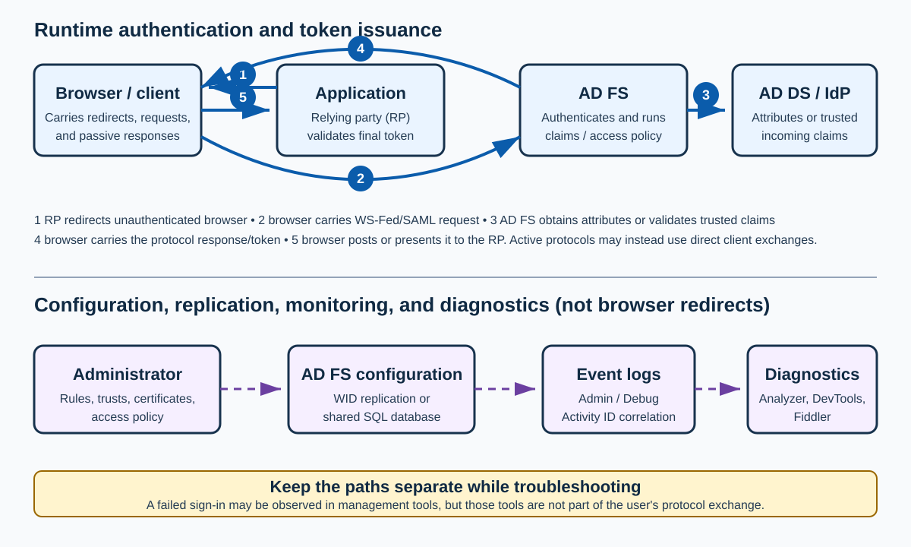

# Day 26: AD FS Claims, Federation Protocols, and End-to-End Troubleshooting

Active Directory Federation Services (**AD FS**) authenticates users, processes claims, applies access policy, and issues security tokens to relying applications. This lesson starts with the claims engine, then builds practical Claims X-Ray and Microsoft Entra ID relying-party rules, and finishes with end-to-end logging, browser tracing, WS-Federation (**WS-Fed**), and Security Assertion Markup Language (**SAML**) troubleshooting.

> [!IMPORTANT]
> Keep these paths separate throughout the lesson:
>
> 1. **Runtime authentication and token issuance:** a browser or client follows protocol redirects or direct exchanges; AD FS authenticates the principal, evaluates policy and claims, and returns a protocol response.
> 2. **Configuration and trust management:** administrators create trusts, endpoints, certificates, claim rules, OAuth clients, and access policies. This is not a user's sign-in flow.
> 3. **Directory and federation dependencies:** AD FS may query Active Directory Domain Services (**AD DS**) or validate a token from another security token service (**STS**). These are distinct from browser-carried messages.
> 4. **Replication, monitoring, and diagnostics:** Windows Internal Database (**WID**) or SQL configuration paths, Event Viewer, Diagnostics Analyzer, DevTools, and Fiddler observe or maintain the service; they do not carry the user's passive sign-in redirects.



## Learning Path

| Part | Focus | Outcome |
|---|---|---|
| **1. Claims foundations** | Claims, trusts, templates, rule sets, and engine execution | Explain where claims originate, how they move, and what `add` versus `issue` does. |
| **2. Claims X-Ray** | AD FS Help tools and a diagnostic relying party | Create and test a Claims X-Ray trust and inspect issued claims. |
| **3. Microsoft Entra ID claim rules** | Unique identifiers, domains, users, devices, MFA, and certificates | Generate and examine the claims required by the historical “Azure AD” relying-party trust. |
| **4. End-to-end troubleshooting** | Admin/debug logs, Activity IDs, Diagnostics Analyzer, DevTools, Fiddler, WS-Fed, and SAML | Follow one request across browser traffic and server logs without mixing runtime and management paths. |

> [!NOTE]
> The source uses the historical names **Azure Active Directory (Azure AD/AAD)** and **Azure AD Connect**. Current product names are **Microsoft Entra ID** and **Microsoft Entra Connect Sync**; historical trust names and claim identifiers are retained where operationally significant.

## Part 1: Claims Foundations and Rule Processing

In a claims-based identity model, claims are central to federation: they help determine the outcome of web-based authentication and authorization requests. This model enables organizations to project digital identity and entitlement information securely across organizational and security boundaries in a standardized form.

### Troubleshoot Claim-Rule Issues

**Learning objectives**
- Describe the claims engine and its processes.
- Identify where claims and claim rules originate.
- Explain AD FS claims management.
- Trace how the claims pipeline works.
- Distinguish the claim types and claim sets encountered during processing.

A claim rule is a unit of business logic. It evaluates one or more incoming claims, applies conditions—“if X, then Y”—and can produce one or more claims based on those conditions. Administrators use claim rules to control how claims move through the claims pipeline.

**Claim-rule execution in one sentence:** when claim rules are configured on a claims provider trust or relying party trust, the trust's rule sets invoke the claims engine to determine whether any claims should be issued and, if so, which claims.

#### The Claims Engine

The claims engine serves and processes claim requests for the Federation Service. It evaluates rule sets at three principal stages:

| Stage | Where it is configured | Purpose |
|---|---|---|
| **Acceptance transform rules** | Per claims provider trust, such as AD DS or another STS | Accept and transform incoming claims. Their output can be consumed by relying-party processing. |
| **Access-control policy** | Per relying party | Decide whether the requester may receive a token. Earlier versions exposed this as authorization rules. |
| **Issuance transform rules** | Per relying party | Select and transform the claims issued to the relying party. |

#### Claims-Engine Processing

For each rule set, the claims engine processes rules in order:

1. **Initialize the input claim set.** Accept incoming claims and copy them into the input claim set.
2. **Evaluate each rule in sequence.** A matching rule can use either `add` or `issue`:
   - `add` places a claim only in the **input claim set**, making it available to later rules in the same rule set.
   - `issue` places a claim in both the **input and output claim sets**, making it available to later rules and eligible to leave the current rule set.
3. **Return the output claim set.** The pipeline uses issued output claims as input to the next applicable rule set.

> [!IMPORTANT]
> `add` does **not** send a claim to the relying party. It creates an intermediate claim for later rules in the same rule set. Only claims in the output claim set—normally created with `issue`—continue beyond that rule set.

#### Where Do Claims Come From?

AD FS defines which claims are exchanged between federation partners, but every claim first needs a retrieved or calculated value. A claim value describing a user, group, device, or other entity generally comes from one of two sources:

1. **An attribute store:** for example, AD FS retrieves `Department = Sales` from an AD DS user account.
2. **A transformation:** for example, a rule transforms the incoming value `Group = Domain Admins` into `Role = Administrators` before issuing it.

#### AD FS Claims Management

The following components explain the federation relationships represented in AD FS management.

**Resource partner organization**

A federation partner represented by a relying party trust in the Federation Service. The resource partner publishes protected web applications that users in the account partner can access through claims-based security tokens.

**Management-console trust objects**

The “+” markers in the original AD FS management-console illustration identify components involved in claims management and federation relationships.

1. **Claims Provider Trust (CPT)**
   - **What it represents:** an identity provider that authenticates users and supplies claims to AD FS.
   - **Examples:** AD DS, another organization's AD FS server, or a third-party STS.
   - **Purpose:** receive and validate incoming claims, apply acceptance transform rules, and pass the processed claims into the AD FS claims pipeline.
   - **Memory aid:** this is the **source** of identity information.

   ```text
   User → Identity provider → Claims Provider Trust → AD FS
   ```

2. **Relying Party Trust (RPT)**
   - **What it represents:** an application or service that relies on AD FS for authentication.
   - **Examples:** Microsoft 365, SharePoint, Salesforce, or a custom web application.
   - **Purpose:** represent the claims-consuming application and associate its access-control and issuance transform rules.
   - **Memory aid:** this is the **consumer** of claims.

   ```text
   AD FS → Relying Party Trust → Application
   ```

   **Example**

User logs in to:

```text
https://portal.contoso.com
```

   AD FS issues:

   ```text
   Name = Elijah
   Department = IT
   Role = Administrator
   ```

   The application uses these claims to decide whether the user may access the site and which resources the user may view.

3. **Resource partner organization**
   - **What it represents:** the organization that owns and publishes the protected application or resource.
   - **Purpose:** host the application, trust claims from an account partner, and grant access based on the security token.

   **Example**

Company A employees access an application hosted by Company B.

```text
Company A (Account Partner)
          ↓
      AD FS
          ↓
Company B (Resource Partner)
          ↓
   Hosted Application
```

In this scenario:

Company A authenticates the user.
Company B hosts the application.
AD FS exchanges claims between them.
**AD FS trust-relationship overview**

The account partner owns the identities; the resource partner owns the application:

```text
+--------------------+
|  Account Partner   |
| (Identity Source)  |
+--------------------+
           |
           v
+--------------------+
| Claims Provider    |
| Trust              |
+--------------------+
           |
           v
+--------------------+
|      AD FS         |
| Claims Engine      |
+--------------------+
           |
           v
+--------------------+
| Relying Party      |
| Trust              |
+--------------------+
           |
           v
+--------------------+
| Resource Partner   |
| Web Application    |
+--------------------+
```

**Quick reference**

| Component | Purpose |
|---|---|
| Claims Provider Trust | Receives identities and claims from an identity source. |
| AD FS claims engine | Processes and transforms claims. |
| Relying Party Trust | Represents the application that consumes claims. |
| Resource partner organization | Owns the application or resource being accessed. |
| Claim rules | Transform, filter, and issue claims. |

> [!TIP]
> **Claims Provider Trust = source; Relying Party Trust = consumer; resource partner = application owner.**

**Claims Provider Trust**

**Definition from the original illustration**

In the AD FS Management snap-in, claims provider trusts are trust objects typically created in resource partner organizations to represent the organization in the trust relationship whose accounts will be accessing resources in the resource partner organization. A claims provider trust object consists of a variety of identifiers, names, and rules that identify this partner to the local Federation Service.

**Explanation**

A Claims Provider Trust (CPT) is an AD FS object that represents the identity provider that authenticates users and sends claims to AD FS.

In simple terms, the Claims Provider Trust answers: **Where did this identity and its claims come from?**

AD FS trusts this source to authenticate the user and provide identity information (claims).

**Federation example**

Imagine two companies:

- **Contoso** owns the employee accounts.
- **Fabrikam** hosts a web application.

A Contoso employee wants to access an application hosted by Fabrikam.

**Step 1: Authentication**

The user logs in using Contoso credentials.

```text
User → Contoso AD / AD FS
```

**Step 2: Claims Issued**

Contoso's AD FS creates claims such as:

```text
Name = Elijah
Department = IT
Role = Engineer
```

**Step 3: Claims Sent to Fabrikam**

Fabrikam's AD FS receives these claims through a Claims Provider Trust.

```text
Contoso AD FS → Claims Provider Trust → Fabrikam AD FS
```

**Step 4: Access Granted**

Fabrikam's application decides whether to grant access based on the received claims.

**What is stored in a Claims Provider Trust?**

A Claims Provider Trust contains four principal configuration categories:

1. **Identifiers:** unique values used to recognize the partner organization, such as:
```text
https://adfs.contoso.com/adfs/services/trust
```
```text
urn:contoso:adfs
```
2. **Certificates:** keys used to validate tokens signed by the partner.
3. **Endpoints:** URLs where protocol requests and responses are exchanged, such as:
```text
https://adfs.contoso.com/adfs/ls/
```
4. **Claim rules:** logic defining which incoming claims are accepted, how they are transformed, and which claims continue through the pipeline. For example:

```text
Incoming: Group = Domain Admins
Output:   Role = Administrators
```

**Resource partner vs. account partner**

The **account partner** owns the user accounts and authenticates users; the **resource partner** hosts the protected application:

```text
Account Partner (identity source)
    → Claims Provider Trust
    → AD FS
    → Relying Party Trust
    → Resource Partner application
```

**Claims Provider Trust vs. Relying Party Trust**

| Claims Provider Trust | Relying Party Trust |
|---|---|
| Represents the identity source | Represents the application |
| Receives incoming claims | Receives outgoing claims |
| The user is authenticated by this source | The user consumes this application |
| Uses acceptance transform rules | Uses access-control and issuance transform rules |
| Example: external AD FS or AD DS | Example: Microsoft 365, SharePoint, or Salesforce |

**Memory aid**

Think of AD FS as a translator:

```text
Claims Provider Trust → AD FS → Relying Party Trust
```

- The **Claims Provider Trust** identifies who tells AD FS about the user.
- **AD FS** processes and transforms claims.
- The **Relying Party Trust** represents the application that needs the identity.

**Concise definition**

A Claims Provider Trust in AD FS represents an identity provider that authenticates users and supplies claims to the Federation Service. AD FS trusts this provider, processes the incoming claims through acceptance transform rules, and then uses them to issue claims to relying party applications.

**How claims are issued**

**Definition from the original illustration**

When you write claim rules, the source of the incoming claims for the claim rules varies based on whether you are writing rules on a claims provider trust or a relying party trust. When you write claim rules for a claims provider trust, the incoming claims are the claims sent from the trusted claims provider to the Federation Service. When you write rules for a relying party trust, the incoming claims are the claims that are output by the claim rules of the applicable claims provider trust.

**Explanation**

This section explains where claims come from when AD FS processes claim rules.

The answer depends on where the rule is configured:

1. Claims Provider Trust Rules

When a claim rule is configured on a Claims Provider Trust, the incoming claims originate from the identity provider.

```text
Flow
User
  ↓
Active Directory / External IdP
  ↓
Claims Provider Trust
  ↓
AD FS Claim Rule
```

**Example**

A user logs in and AD sends:

```text
Name = Elijah
Department = IT
Group = Domain Admins
```

These become the incoming claims for the Claims Provider Trust rules.

AD FS can then transform them:

```text
Group = Domain Admins
           ↓
Role = Administrators
```

These transformed claims become the output of the Claims Provider Trust.

2. Relying Party Trust Rules

When a claim rule is configured on a Relying Party Trust, the incoming claims are no longer coming directly from Active Directory.

Instead, they come from the output of the Claims Provider Trust.

```text
Flow
AD DS
   ↓
Claims Provider Trust
   ↓
Output Claims
   ↓
Relying Party Trust
   ↓
Application
```

**Example**

Suppose the Claims Provider Trust outputs:

```text
Name = Elijah
Role = Administrators
Department = IT
```

These claims become the incoming claims for the Relying Party Trust.

The Relying Party Trust can then modify them further:

```text
Department = IT
        ↓
Issue Department = Information Technology
```

and send them to the application.

**Complete AD FS claim pipeline**

```text
User
 ↓
Active Directory
 ↓
Claims Provider Trust
 ↓
Acceptance Transform Rules
 ↓
Output Claims
 ↓
Access Control Policies
 ↓
Issuance Transform Rules
 ↓
Relying Party Trust
 ↓
Application
```

**Microsoft 365 example**

A user signs in to Microsoft 365 using AD FS.

**Step 1: Active Directory**

AD contains:

```text
Username = elijah
Department = IT
Group = Domain Admins
```

**Step 2: Claims Provider Trust**

AD FS receives:

```text
Department = IT
Group = Domain Admins
```

Rule transforms:

```text
Group = Domain Admins
      ↓
Role = Administrators
```

**Output**

```text
Department = IT
Role = Administrators
```

**Step 3: Relying Party Trust (Microsoft 365)**

AD FS processes additional rules:

```text
Department = IT
      ↓
Department = Information Technology
```

**Final issued claims**

```text
Department = Information Technology
Role = Administrators
```

**Step 4: Token Issued**

The token containing these claims is sent to Microsoft 365.

```text
AD FS
   ↓
Security Token
   ↓
Microsoft 365
```

Microsoft 365 uses those claims to determine what the user can access.

**Knowledge check**

**Question:** Where do incoming claims come from in a Claims Provider Trust?

✅ From the trusted identity provider (AD, another AD FS, external STS).

**Question:** Where do incoming claims come from in a Relying Party Trust?

✅ From the output claims generated by the Claims Provider Trust rules.

**Memory aid**

Think of AD FS as a factory:

```text
Raw claims → Claims Provider Trust → Processing → Relying Party Trust → Final token
```

- The Claims Provider Trust receives raw claims.
- The Relying Party Trust receives processed claims.
- The application consumes final claims from the security token.

#### The Claims Pipeline

The flow of claims is called the claims pipeline:

1. **Accept and transform incoming claims.** The Claims Provider Trust's acceptance transform rules determine which claims are trusted and how they are normalized.
2. **Authorize the requester.** The Relying Party Trust's access-control or issuance authorization rules determine whether the user may access the relying party.
3. **Transform and issue outgoing claims.** The issuance transform rules determine which claims are placed in the final token.

**How the claims pipeline works**

The claims pipeline is the sequence of processing steps that AD FS follows before issuing a security token to an application.

Think of it as a filtering and transformation process:

```text
Identity Provider
    → Acceptance Transform Rules
    → Issuance Authorization Rules
    → Issuance Transform Rules
    → Relying Party Application
```

**Step 1: Acceptance Transform Rules**
**Purpose**

Determine which incoming claims are accepted and optionally transform them.

**Input**

Claims can arrive from:

- Active Directory
- Another AD FS server
- An external identity provider (**IdP**)

**Example**

**Incoming claims**

```text
Name = Elijah
Department = IT
Group = Domain Admins
```

**Rule**

```text
If Group = Domain Admins
Then issue Role = Administrators
```

**Output**

```text
Name = Elijah
Department = IT
Role = Administrators
```

Only the accepted/transformed claims continue through the pipeline.

**Step 2: Issuance Authorization Rules**
**Purpose**

Determine whether the user is allowed to access the application.

This is the authorization stage.

**Example**

**Rule**

Permit access only if
```text
Department = IT
```

**User A**

```text
Department = IT
```

✅ Access Allowed

**User B**

```text
Department = HR
```

❌ Access Denied

No token is issued if authorization fails.

**Step 3: Issuance Transform Rules**
**Purpose**

Determine which claims are included in the final token sent to the application.

**Example**

**Current claims**

```text
Name = Elijah
Department = IT
Role = Administrators
```

Transform rule:

```text
Department = IT
       ↓
Department = Information Technology
```

**Final claims issued**

```text
Name = Elijah
Department = Information Technology
Role = Administrators
```

These claims are packaged into the security token and sent to the application.

**Complete end-to-end example**

Suppose Elijah signs in to a SharePoint application.

Initial Claims
```text
Name = Elijah
Department = IT
Group = Domain Admins
```

**Step 1: Acceptance Transform Rules**

```text
Group = Domain Admins
      ↓
Role = Administrators
```

**Output**

```text
Name = Elijah
Department = IT
Role = Administrators
```

**Step 2: Issuance Authorization Rules**

**Rule**

Allow access only to IT users

**Claim**

```text
Department = IT
```

✅ User Authorized

**Step 3: Issuance Transform Rules**

**Rule**

```text
Department = IT
       ↓
Department = Information Technology
```

**Final token**

```text
Name = Elijah
Department = Information Technology
Role = Administrators
```

**Token issued to**

SharePoint

```text
Visual Flow
User
 ↓
Identity Provider
 ↓
Claims Provider Trust
 ↓
[1] Acceptance Transform Rules
 ↓
[2] Issuance Authorization Rules
 ↓
[3] Issuance Transform Rules
 ↓
Relying Party Trust
 ↓
Application
```

**Easy memory trick**

| Stage | Question answered |
|---|---|
| Acceptance transform rules | Which claims should AD FS accept? |
| Issuance authorization rules / access-control policy | Is this user allowed to access the application? |
| Issuance transform rules | Which claims should be sent to the application? |
**One-line summary:** acceptance transform rules accept claims; authorization allows or denies the requester; issuance transform rules build the final claim set sent to the application.

**Choosing a claim-rule template**

Before recommending a template, answer these design questions:

- What claims will each trusted claims provider supply?
- Which claims do you trust from each provider?
- Which claims does each relying party require?
- Which claims is the organization willing to disclose to each relying party?
- Which users should have access to each relying party?

The answers guide both claim-rule design and the authorization strategy. Use the following quick reference to select a suitable template.

| Template | Use it to | Advantages | Limitations |
|---|---|---|---|
| **Pass Through or Filter an Incoming Claim** | Pass all values of one claim type unchanged, or allow only selected values. | Selects claims to accept or issue without changing them. | Cannot change the claim type or value. |
| **Transform an Incoming Claim** | Map an incoming claim to a different type or value. | Normalizes types or values and can replace an email suffix. | More complex string replacements require a custom rule. |
| **Send LDAP Attributes as Claims** | Read attributes from an LDAP attribute store and issue them to a relying party. | Works with AD DS or AD LDS and can issue multiple claims in one rule. | Requires an account lookup, which can affect performance; the template cannot use a custom LDAP filter. |
| **Send Group Membership as a Claim** | Issue one claim when a user belongs to a selected AD security group. | Fast group-claim processing without an account lookup. | The user must belong to a local AD group, and the template issues only one claim for the selected group. |
| **Send Claims Using a Custom Rule** | Implement logic beyond the standard templates using AD FS claim-rule language. | Supports SQL or custom attribute stores, custom LDAP filters, private personal identifiers (PPIDs), input-only claims, and conditions involving multiple incoming claims. | More difficult to configure and requires knowledge of claim-rule language. |
| **Permit or Deny Users Based on an Incoming Claim** | Authorize or deny users according to one incoming claim type and value. | Simplifies common authorization decisions. | Accepts only one claim type and one value and does not support value pattern matching. |
| **Permit All Users** | Allow every user to access the relying party. | Simple to configure. | Less secure and less selective than claim-based permit-or-deny rules. |

### The Role of Claim Rules

**Learning objectives**
- Define claim rules.
- Identify the available claim-rule templates.
- Explain how a claim-rule set works.

#### What Are Claim Rules?
A claim rule is business logic that evaluates incoming claims, applies conditions, and produces claims according to those conditions. Claim rules control how claims flow through the claims pipeline.

Claim rules provide the following benefits:
- Apply runtime business logic when trusting claims from claims providers.
- Define which claims are released to relying parties.
- Provide detailed claims-based authorization that permits or denies specific users.

**How are claim rules processed?** The claims engine examines the incoming claim set and applies each rule in sequence. Together, the engine and the rule set determine whether claims pass through unchanged, are filtered, or are transformed before the Federation Service issues them.

#### What Are Claim-Rule Templates?
AD FS includes a predefined set of claim rule templates that are designed to help you easily select and create the most appropriate claim rules for your particular business need. Claim rule templates are only used during the claim rule creation process.

The available templates are:

- Pass Through or Filter an Incoming Claim
- Transform an Incoming Claim
- Send LDAP Attributes as Claims
- Send Group Membership as a Claim
- Send Claims Using a Custom Rule
- Permit or Deny Users Based on an Incoming Claim
- Permit All Users

#### What Is a Claim-Rule Set?

A claim-rule set groups one or more ordered rules for a federated trust and defines how the claims engine processes claims for that trust.

When the Federation Service receives an incoming claim, the claims engine applies the appropriate rule set. The combined result of every ordered rule determines the claims issued for that trust.

Claim rules are processed from top to bottom within a rule set. Order matters because a claim added or issued by one rule can be evaluated by a later rule.

**Claim-rule set types**
A rule-set type identifies whether rules perform acceptance, issuance, or authorization. The trust type determines which rule sets are available.

| Rule-set type | Trust and purpose | Important behavior |
|---|---|---|
| **Acceptance transform** | Claims provider trust; specify which incoming claims are accepted and transformed. | For an external provider, its issuance output becomes this trust's input. The built-in Active Directory claims provider trust represents the local AD DS attribute source, processes claims for users authenticated by AD DS, and cannot be deleted. |
| **Issuance transform** | Relying party trust; specify the claims issued to the relying party. | Its initial input is the output of the acceptance transform rules. |
| **Issuance authorization** | Relying party trust; specify who may receive a token. | A user must receive the required permit outcome; without an applicable permit rule, access is denied. |
| **Delegation authorization** | Relying party trust; specify who may act as a delegate for another user. | The token still identifies the requester. Without a delegation authorization rule, no user can act as a delegate. |
| **Impersonation authorization** | Configured with Windows PowerShell; specify who may fully impersonate another user. | The relying party does not learn that the user is being impersonated. This is a powerful capability and must be tightly controlled. |

### The Role of the Claim Rules Engine

**Learning objectives**
- Analyze the claim-rule execution process.

#### The Claim Rules Execution Process
When claim rules are configured on a claims provider trust or relying party trust, the trust's rule sets act as gatekeepers. They invoke the claims engine to decide whether claims should be issued and which claims should appear in the output.

The following three-step cycle runs independently for each applicable stage of the claims pipeline.

**Step 1 - Initialization**

In the first step of the claim rules execution process, the claims engine accepts incoming claims by first adding them to the input claim set. An input claim set is analogous to a cache in memory that is used to temporarily store data only as long as a required process requires that data to be made available for retrieval. The input claim set data is discarded after the rule execution finishes.

**Adding claims to the input claim set**

The input claim set is created by the claims engine when it needs to temporarily store claim data in memory while it processes the logic associated with a claim rule set. The claims engine copies all of the incoming claims to the input claim set where they can be retrieved by the first rule in the rule set.
For example, in the illustration below, the claims engine reads the claims of A and B from the incoming claims and copies them to the input claim set. After they are in the input claim set, the claims engine retrieves and processes claims A and B as input for the logic in the first rule in the claim rule set.

All the rules in a claim rule set share the same input claim set. Each rule in that set can add to the shared input claim set, thus affecting all subsequent rules in the set.

**Understanding rule-set boundaries**

Both the Claims Provider Trust and the Relying Party Trust have separate input and output claim sets. Claims can therefore be processed in two places before they leave AD FS:

1. Claims enter the Claims Provider Trust's input claim set.
2. Acceptance transform rules process them and produce that trust's output claim set.
3. The pipeline supplies that output to the Relying Party Trust as its input claim set.
4. Relying-party rules process those claims and produce the final output claim set.

```text
http://schemas.xmlsoap.org/ws/2005/05/identity/claims/emailaddress.
```
```text
http://schemas.xmlsoap.org/ws/2005/05/identity/claims/upn.
```
```text
http://schemas.xmlsoap.org/claims/Group.
```

These are example claim-type URIs for email address, User Principal Name (**UPN**), and group.

**Step 2 - Execution**
In this step of the claim rules process, claim rules are processed when the claims engine chronologically steps through all of the rules within a particular rule set one at a time.
Each rule within a rule set only runs once and is executed in the order in which they appear from top to bottom as displayed in the Edit Claim Rules dialog box in the AD FS Management snap-in. The claim rule that is at the top of the rule set is processed first and then subsequent rules are processed until all of the rules have been run.
As defined in the claim rule language, a claim rule consists of two parts, condition and issuance statement. The claims engine first processes the condition part by using the data in the input claim set to determine whether the condition specified within the rule holds true for the claims contained in the input claim set (the claims that match the rule's condition are referred to as a matching claims).
If any matching claims are found, the claims engine executes the issuance statement of the rule for each set of the matching claims. The issuance statement of the rule can perform either of the following tasks with matching claims:
- Copy a matching claim into the output claim set.
- Transform fields and create a claim in the input set only, or in both the input and output sets.
- Use matching claims as keys for an attribute-store lookup, then create claims in the input set only or in both sets.

**The output claim set**

The output claim set is a location in memory that is initially empty and is important because the claims engine will only return claims that reside in the output claim set after the execution process completes. This means that any claims that reside only in the input claim set and not in the output claim set will be ignored when it comes time to calculate the final set of outgoing claims.

**Adding a claim to one or both sets**

| Statement | Input claim set | Output claim set | Lifetime and use |
|---|---:|---:|---|
| `add` | Yes | No | Intermediate claim available to later rules in the current rule set; discarded when that rule-set execution ends. |
| `issue` | Yes | Yes | Available to later rules and returned in the rule set's output. |

If a rule condition finds no match in the input claim set, its issuance statement does not run, and the rule adds nothing to either set.

For example:

1. The engine adds incoming claims A and B to the input claim set.
2. Rule 1 evaluates A and B.
3. Because A matches, Rule 1 uses `issue` to add a new claim C to both sets.
4. Rule 2 can now evaluate A, B, and C because all three are in the shared input set.

**Review**
A claim rule has two parts:

1. A **condition statement**
2. An **issuance statement**

If the condition is true, the issuance statement runs. If it is false, the engine moves to the next rule.

**How conditions are evaluated**

A condition examines the input claim set for a match. It can query `Type`, `Value`, `Issuer`, `OriginalIssuer`, and `ValueType`. The syntax `c:[query]` binds the variable `c` to a matching claim; the query can test multiple properties.

**Issuance-statement examples**

```text
c:[Type == "http://schemas.xmlsoap.org/ws/2005/05/identity/claims/emailaddress]
=> issue(Type="http://schemas.xmlsoap.org/ws/2005/05/identity/claims/emailaddress", Value = c.Value);
```

This rule receives an email-address claim and issues a new claim of the same type and value.

```text
c:[Type == "http://schemas.xmlsoap.org/ws/2005/05/identity/claims/givenname]
=> issue(http://schemas.xmlsoap.org/ws/2005/05/identity/claims/givenname", Value = IronMan);
```

This rule receives a given-name claim and issues `IronMan` as the new given-name value.

```text
EXISTS:([Type == "http://schemas.xmlsoap.org/claims/Group", Value == "S-1-5-21-1004336348-1177238915-682003330-512"] )
=> add(Type="http://schemas.xmlsoap.org/claims/Group", Value = "OfficeSupport");
```

This rule matches the on-premises group security identifier (**SID**) and adds an intermediate `Group = OfficeSupport` claim to the input claim set.

**What does `EXISTS` mean?**

In claim-rule language, `EXISTS` is an aggregate function similar to an `if` test. The preceding rule means: if the input set contains a group claim with SID `S-1-5-21-1004336348-1177238915-682003330-512`, add a group claim whose value is `OfficeSupport` to the input set.

Other aggregate functions include `NOT EXISTS` and `COUNT`.
**Step 3 - Execution Result**

The final stage of the claim rule set execution begins once all rules have been run within a given rule set and the final set of claims is present in the output claim set. At this point, the claims engine returns the context of the output claim set as the output of the rule set execution. From this point forward it is the claims pipeline that takes over and moves this final output to the next stage in its process.

**Sending the execution result**
When the claims engine processes a rule set, that rule set has its own dedicated locations in memory for its input and output claim sets. This means that the input and output claim sets used by one rule set are separate from the input and output claim sets used in another rule set.

After all three steps run for a given rule set, its output claim set becomes input to the next applicable rule set in the claims pipeline.

In this case, the output of the acceptance rules is used by the pipeline to flow the final set of claims produced by the acceptance rules to the second stage in the pipeline, which is the processing of authorization rules. At this point, the entire claim rules execution process (steps 1, 2, and 3 above) would run again for the authorization rule set. This cycle continues until the issuance rule set (the final stage in the pipeline) has been completed.

Once the finalized outgoing claims have been returned from the engine for the issuance rule set, they will be packaged into a token and the Federation Service will send the token back to the client.

**Processing authorization rules**

If the claim rule set that is being executed during step 2 of the claim rules execution process consists of Authorization rules (which have a different input and output claim sets than either acceptance or issuance rules), then those authorization rules will run to determine whether a token requester is authorized to obtain a security token for a given relying party from the Federation Service based on the requester's claims.

The goal of authorization rules is to issue a permit or deny claim based on whether the user is to be allowed to obtain a token for the given relying party or not. As shown in the following illustration, the output of the authorization execution is used by the pipeline to determine whether the issuance rule set is executed or not—based on presence or absence of the permit and/or deny claim—but the authorization execution output itself is not used as an input to the claim rule set.

```text
NOT EXISTS:([type == "http://schemas.xmlsoap.org/claims/Group", Value == "S-1-5-21-1004336348-1177238915-682003330-512"] )
=> issue(type = "http://schemas.microsoft.com/authorization/claims/deny", Value = "DenyUsersWithClaim");
```

This rule checks for the specified on-premises group SID and issues a deny claim when the input claim set does **not** contain that membership.

**Claims-pipeline process**

The claims pipeline process consists of three high-level stages. Each stage in this process initializes the claim rule engine to process claim rules that are specific to that stage. These stages include (in the order that they occur):

1. **Accept incoming claims.** Extract claims from the incoming token and remove claims that are not expected or trusted. The Claims Provider Trust's acceptance transform rules can pass through, transform, or create claims. This stage's output supplies data to the authorization and issuance stages.
2. **Authorize the requester.** Run the Relying Party Trust's issuance authorization or delegation authorization rules and issue the appropriate permit or deny result.
3. **Issue outgoing claims.** Run the Relying Party Trust's issuance transform rules, package the resulting claims into a security token, and return that token through the applicable client flow.

All three stages process claims, but each uses a distinct rule set. Acceptance rules are associated with the issuer of incoming claims; authorization and issuance rules are associated with the target relying party.

## Part 2: Troubleshoot Claim Rules with Claims X-Ray

Use the Claims X-Ray service to debug and troubleshoot claims issuance. It interacts with the AD FS deployment and displays the claims issued for an application scenario.

### AD FS Help Tools
**Learning objectives**
- Describe the AD FS Help tools, including the Claims X-Ray service.

#### Tools for Troubleshooting

The AD FS team has created multiple tools that are available online to help with troubleshooting different scenarios. These tools range from providing insights into what claims are being issued in a token to creating claim rules for successful federation with Azure AD.

The toolset includes:
- Diagnostic Analyzer
- Claims X-Ray
- Azure AD RPT Claim Rules
- JWT Decoder
- JSON Claims
- Troubleshooting guides

### Configure and Use Claims X-Ray
**Learning objectives**

- Use Claims X-Ray to debug claims issuance.
- Create the Claims X-Ray relying party trust in an AD FS deployment.
- Create the OAuth client when OAuth testing is required.

#### Claims X-Ray Overview

Claims X-Ray is a service for debugging claims issuance. It interacts with an AD FS deployment and displays the claims returned by the Federation Service for a selected authentication method and request type. You can then adjust policy until the token contains the required claims.

The lab configures Claims X-Ray as a relying party trust and reuses it in later exercises.

**Federation Services configuration**

To use Claims X-Ray, create its relying party trust. OAuth testing also requires the OAuth client. After setup, request a token, inspect its claims, and customize the trust's claim rules for the scenario under test.

Two setup approaches are described:

1. Run PowerShell commands to create the relying party trust and OAuth client.
2. Use the downloadable Relying Party Trust Management script to create both objects and copy claims between trusts. After tailoring Claims X-Ray rules, this approach can copy them to the real application trust.

**Create the Claims X-Ray relying party trust**

1. Sign in to the primary AD FS server.
2. Open an elevated Windows PowerShell or PowerShell ISE session.
3. Run the following script:

```powershell
$authzRules = "=>issue(Type = `"http://schemas.microsoft.com/authorization/claims/permit`", Value = `"true`"); "
$issuanceRules = "@RuleName = `"Issue all claims`"`nx:[]=>issue(claim = x); "
$redirectUrl = "https://adfshelp.microsoft.com/ClaimsXray/TokenResponse"
$samlEndpoint = New-AdfsSamlEndpoint -Binding POST -Protocol SAMLAssertionConsumer -Uri $redirectUrl
Add-AdfsRelyingPartyTrust -Name "ClaimsXray" -Identifier "urn:microsoft:adfs:claimsxray" -IssuanceAuthorizationRules $authzRules -IssuanceTransformRules $issuanceRules -WSFedEndpoint $redirectUrl -SamlEndpoint $samlEndpoint
```

To add OAuth functionality for Claims X-Ray, run the following commands:

> [!NOTE]
> OAuth is introduced here for configuration completeness but is reserved for advanced training.

```powershell
Add-AdfsClient -Name "ClaimsXrayClient" -ClientId "claimsxrayclient" -RedirectUri https://adfshelp.microsoft.com/ClaimsXray/TokenResponse
```

```powershell
if ([System.Environment]::OSVersion.Version.major -gt 6) { Grant-AdfsApplicationPermission -ServerRoleIdentifier urn:microsoft:adfs:claimsxray -AllowAllRegisteredClients -ScopeNames "openid","profile" }
```

**Claim issuance policy for Claims X-Ray**

The default Claims X-Ray relying party trust issues all claims. Later labs modify this policy.

**Test authentication with Claims X-Ray**

Use this procedure to verify the setup:

1. Navigate to Claims X-Ray at `adfshelp.microsoft.com`.
2. Enter the federation service name, such as `sts.contoso.com`.
3. Select the **Default Policy** authentication method.
4. Select the **SAML-P** token request type.
5. Select **Force fresh authentication**.
6. Select **Test Authentication** and sign in to AD FS.
7. Review the Claims X-Ray output. The original course image illustrated all claims returned by the default configuration.

## Part 3: Generate Microsoft Entra ID Claims with the RPT Rule Generator

For AD FS federation with Azure AD, the relying party trust must issue the claims required by the organization's identity configuration.

If any of the information is wrong, it will affect user login. We know this can be difficult to create yourself, so we'll help guide you through the process.

Just make sure that the Azure AD relying party trust is already in place.

### Azure AD RPT Claims Rule Generator

**Learning objectives**
- Explain the unique identifier.
- Supply Azure AD domain information.
- Send generated claims to Claims X-Ray for testing.

#### Unique Identifier

**Step 1**
**Unique identifier**

Select how Azure AD should identify users uniquely. Immutable ID is intended to remain stable for the object's lifetime and acts as the key linking an on-premises user with the corresponding Azure AD user.

**Step 2**
**User sign-in**

After selecting the identifier, select **Next**. Choose the attribute users enter as their Azure AD username. Azure AD Connect uses `userPrincipalName` by default, but an administrator might have configured an alternate ID such as email. Enter the value used by the organization's Azure AD Connect configuration.

**Step 3**
**Azure AD domain information**

After entering the sign-in details, select **Next** to open **Azure AD Domain Information**. Selecting **No** for multiple-domain information and then **Generate Claims** displays the Azure AD RPT claim rules.

**Generated claim rules**
In order to update the claims on your Azure AD trust, select the copy button and run the PowerShell script on the primary AD FS server to set the correct claims. The script will also make a backup of the current claim rules for safe keeping.
Next, you can find the individual claim rules required for an organization.
```text
@RuleName = "Issue UPN"
c:[Type == "http://schemas.microsoft.com/ws/2008/06/identity/claims/windowsaccountname"]
 => issue(store = "Active Directory", types = ("http://schemas.xmlsoap.org/claims/UPN"), query = "samAccountName={0};userPrincipalName;{1}", param = regexreplace(c.Value, "(?<domain>[^\\]+)\\(?<user>.+)", "${user}"), param = c.Value);
@RuleName = "Issue Immutable ID"
c:[Type == "http://schemas.microsoft.com/ws/2008/06/identity/claims/windowsaccountname"]
 => issue(store = "Active Directory", types = ("http://schemas.microsoft.com/LiveID/Federation/2008/05/ImmutableID"), query = "samAccountName={0};objectGUID;{1}", param = regexreplace(c.Value, "(?<domain>[^\\]+)\\(?<user>.+)", "${user}"), param = c.Value);
@RuleName = "Issue nameidentifier"
c:[Type == "http://schemas.microsoft.com/LiveID/Federation/2008/05/ImmutableID"]
 => issue(Type = "http://schemas.xmlsoap.org/ws/2005/05/identity/claims/nameidentifier", Value = c.Value, Properties["http://schemas.xmlsoap.org/ws/2005/05/identity/claimproperties/format"] = "urn:oasis:names:tc:SAML:1.1:nameid-format:unspecified");
@RuleName = "Issue accounttype for domain-joined computers"
c:[Type == "http://schemas.microsoft.com/ws/2008/06/identity/claims/groupsid", Value =~ "-515$", Issuer =~ "^(AD AUTHORITY|SELF AUTHORITY|LOCAL AUTHORITY)$"]
 => issue(Type = "http://schemas.microsoft.com/ws/2012/01/accounttype", Value = "DJ");
@RuleName = "Issue onpremobjectguid for domain-joined computers"
c1:[Type == "http://schemas.microsoft.com/ws/2008/06/identity/claims/groupsid", Value =~ "-515$", Issuer =~ "^(AD AUTHORITY|SELF AUTHORITY|LOCAL AUTHORITY)$"]
 && c2:[Type == "http://schemas.microsoft.com/ws/2008/06/identity/claims/windowsaccountname", Issuer =~ "^(AD AUTHORITY|SELF AUTHORITY|LOCAL AUTHORITY)$"]
 => issue(store = "Active Directory", types = ("http://schemas.microsoft.com/identity/claims/onpremobjectguid"), query = ";objectguid;{0}", param = c2.Value);
@RuleName = "Pass through primary SID"
c1:[Type == "http://schemas.microsoft.com/ws/2008/06/identity/claims/groupsid", Value =~ "-515$", Issuer =~ "^(AD AUTHORITY|SELF AUTHORITY|LOCAL AUTHORITY)$"]
 && c2:[Type == "http://schemas.microsoft.com/ws/2008/06/identity/claims/primarysid", Issuer =~ "^(AD AUTHORITY|SELF AUTHORITY|LOCAL AUTHORITY)$"]
 => issue(claim = c2);
@RuleName = "Pass through claim - insideCorporateNetwork"
c:[Type == "http://schemas.microsoft.com/ws/2012/01/insidecorporatenetwork"]
 => issue(claim = c);
@RuleName = "Pass Through Claim - Psso"
c:[Type == "http://schemas.microsoft.com/2014/03/psso"]
 => issue(claim = c);
@RuleName = "Issue Password Expiry Claims"
c1:[Type == "http://schemas.microsoft.com/ws/2012/01/passwordexpirationtime"]
 => issue(store = "_PasswordExpiryStore", types = ("http://schemas.microsoft.com/ws/2012/01/passwordexpirationtime", "http://schemas.microsoft.com/ws/2012/01/passwordexpirationdays", "http://schemas.microsoft.com/ws/2012/01/passwordchangeurl"), query = "{0};", param = c1.Value);
@RuleName = "Pass through claim - authnmethodsreferences"
c:[Type == "http://schemas.microsoft.com/claims/authnmethodsreferences"]
 => issue(claim = c);
@RuleName = "Pass through claim - multifactorauthenticationinstant"
c:[Type == "http://schemas.microsoft.com/ws/2017/04/identity/claims/multifactorauthenticationinstant"]
 => issue(claim = c);
@RuleName = "Pass through claim - certificate authentication - serial number"
c:[Type == "http://schemas.microsoft.com/ws/2008/06/identity/claims/serialnumber"]  => issue(claim = c);
@RuleName = "Pass through claim - certificate authentication - issuer"
c:[Type == "http://schemas.microsoft.com/2012/12/certificatecontext/field/issuer"]  => issue(claim = c);
```

The **Microsoft O365 Identity Platform** relying party trust requires claims tailored to the organization's federation configuration. Incorrect values can break sign-in. Microsoft recommends managing the trust with Azure AD Connect where possible; when Azure AD Connect does not manage AD FS, administrators must verify these rules manually. The following sections explain each claim and why it is required.

**Issue UPN**
A User Principal Name (UPN) is an attribute that is an internet communication standard for user accounts. A UPN consists of a UPN prefix (the user account name) and a UPN suffix (a DNS domain name). The prefix joins the suffix using the "@" symbol. For example, someone@example.com. A UPN must be unique among all security principal objects within a directory forest.
```text
@RuleName = "Issue UPN"
c:[Type == "http://schemas.microsoft.com/ws/2008/06/identity/claims/windowsaccountname"]
 => issue(store = "Active Directory", types = ("http://schemas.xmlsoap.org/claims/UPN"), query = "samAccountName={0};userPrincipalName;{1}", param = regexreplace(c.Value, "(?<domain>[^\\]+)\\(?<user>.+)", "${user}"), param = c.Value);
```

The rule looks up the user by `sAMAccountName` in the user's domain and returns the UPN attribute.

**UPNs in Active Directory**

In Active Directory, the default UPN suffix is the Domain Name System (**DNS**) name of the domain where the account was created. In most cases, this is the registered enterprise domain. An account created in `contoso.com`, for example, has a default UPN such as `username@contoso.com`.
However, you can add more UPN suffixes by using Active Directory domains and trusts.
For example, you may want to add labs.contoso.com and have the users' UPNs and email reflect that. They would then become username@labs.contoso.com.

**UPNs in Azure Active Directory**
Users sign in to Azure AD with the value in their userPrincipalName attribute. When you use Azure AD in conjunction with your on-premises Active Directory, user accounts are synchronized by using the Azure AD Connect service. By default the Azure AD Connect wizard uses the userPrincipalName attribute from the on-premises Active Directory as the UPN in Azure AD.

**Issue Immutable ID**

The Immutable ID, or source anchor, is intended to remain stable for the lifetime of an object. It identifies an on-premises object and its Azure AD counterpart as the same identity; the terms `ImmutableID` and source anchor are used interchangeably here.

```text
@RuleName = "Issue Immutable ID"
c:[Type == "http://schemas.microsoft.com/ws/2008/06/identity/claims/windowsaccountname"]
 => issue(store = "Active Directory", types = ("http://schemas.microsoft.com/LiveID/Federation/2008/05/ImmutableID"), query = "samAccountName={0};objectGUID;{1}", param = regexreplace(c.Value, "(?<domain>[^\\]+)\\(?<user>.+)", "${user}"), param = c.Value);
```

The rule looks up the user by `sAMAccountName` in the user's domain and returns the Immutable ID attribute.

By default, Azure AD Connect (version 1.1.486.0 and older) uses objectGUID as the sourceAnchor attribute. ObjectGUID is system-generated. You cannot specify its value when creating on-premises AD objects. The immutable id cannot be modified after creation. The attribute is used in the following scenarios.

> [!NOTE]
> The Immutable ID cannot be modified after creation.

It is used to:

- Link existing Azure AD objects to on-premises objects when a synchronization server is built or rebuilt after disaster recovery.
- Hard-match existing cloud-only identities to on-premises objects when moving to synchronized identity.
- Uniquely identify a federated user together with `userPrincipalName`.

**Issue nameidentifier**
Identifies the principal about which the token asserts information, such as the user of an application. This value is immutable and cannot be reassigned or reused, so it can be used to perform authorization checks safely.

```text
@RuleName = "Issue nameidentifier"
c:[Type == "http://schemas.microsoft.com/LiveID/Federation/2008/05/ImmutableID"]
 => issue(Type = "http://schemas.xmlsoap.org/ws/2005/05/identity/claims/nameidentifier", Value = c.Value, Properties["http://schemas.xmlsoap.org/ws/2005/05/identity/claimproperties/format"] = "urn:oasis:names:tc:SAML:1.1:nameid-format:unspecified");
```

The preceding rule finds the Immutable ID added to the input claim set and issues it as the user's `nameidentifier` (NameID) with the `unspecified` format.

**Issue accounttype for domain-joined computers**
The http://schemas.microsoft.com/ws/2012/01/accounttype claim must contain a value of DJ, which identifies the device as a domain-joined computer.

```text
@RuleName = "Issue accounttype for domain-joined computers"
c:[Type == "http://schemas.microsoft.com/ws/2008/06/identity/claims/groupsid", Value =~ "-515$", Issuer =~ "^(AD AUTHORITY|SELF AUTHORITY|LOCAL AUTHORITY)$"]
 => issue(Type = "http://schemas.microsoft.com/ws/2012/01/accounttype", Value = "DJ")
```

The `-515` suffix is the relative identifier in the SID of the Active Directory Domain Computers group.
This rule issues `accounttype = DJ` when the device belongs to the Domain Computers group, whose SID ends in `-515`. The claim tells Azure AD that the device is domain joined.

**Issue the on-premises computer account's objectGUID**
The http://schemas.microsoft.com/identity/claims/onpremobjectguid claim must contain the objectGUID value of the on-premises computer account.

```text
@RuleName = "Issue onpremobjectguid for domain-joined computers"
c1:[Type == "http://schemas.microsoft.com/ws/2008/06/identity/claims/groupsid", Value =~ "-515$", Issuer =~ "^(AD AUTHORITY|SELF AUTHORITY|LOCAL AUTHORITY)$"]
 && c2:[Type == "http://schemas.microsoft.com/ws/2008/06/identity/claims/windowsaccountname", Issuer =~ "^(AD AUTHORITY|SELF AUTHORITY|LOCAL AUTHORITY)$"]
 => issue(store = "Active Directory", types = ("http://schemas.microsoft.com/identity/claims/onpremobjectguid"), query = ";objectguid;{0}", param = c2.Value);
```

**Pass through the primary SID for a Windows Server 2019 domain-joined computer**
```text
@RuleName = "Pass through primary SID"
c1:[Type == "http://schemas.microsoft.com/ws/2008/06/identity/claims/groupsid", Value =~ "-515$", Issuer =~ "^(AD AUTHORITY|SELF AUTHORITY|LOCAL AUTHORITY)$"]
 && c2:[Type == "http://schemas.microsoft.com/ws/2008/06/identity/claims/primarysid", Issuer =~ "^(AD AUTHORITY|SELF AUTHORITY|LOCAL AUTHORITY)$"]
 => issue(claim = c2);
```

This rule verifies the Domain Computers group SID and the presence of the computer's primary SID, then issues that primary SID as an outgoing claim.

**Pass through `insideCorporateNetwork`**
This example looks for the insidecorporatenetwork claim and issues it as an outgoing claim. This claim tells Azure that a user is inside the corporate network.

> [!NOTE]
> The multifactor authentication service setting **Skip multifactor authentication for requests from federated users on my intranet** trusts the AD FS `insideCorporateNetwork` claim to identify a request as internal. Review the security implications before enabling this behavior.

**Pass through the PSSO claim**
```text
@RuleName = "Pass Through Claim - Psso"
c:[Type == "http://schemas.microsoft.com/2014/03/psso"]
 => issue(claim = c);
```

This rule passes through the persistent single sign-on (**PSSO**) claim.

> [!NOTE]
> AD FS can set a persistent SSO cookie when a device is registered or when a user selects **Keep me signed in**. AD FS rejects and deletes an invalid persistent SSO cookie.

**Issue password-expiry claims**
```text
RuleName = "Issue Password Expiry Claims"
c1:[Type == "http://schemas.microsoft.com/ws/2012/01/passwordexpirationtime"]
 => issue(store = "_PasswordExpiryStore", types = ("http://schemas.microsoft.com/ws/2012/01/passwordexpirationtime", "http://schemas.microsoft.com/ws/2012/01/passwordexpirationdays", "http://schemas.microsoft.com/ws/2012/01/passwordchangeurl"), query = "{0};", param = c1.Value);
```

This rule passes through the password expiration time, the number of days until expiration, and the URL users visit to change their password.

**Pass through `authnmethodsreferences`**
```text
@RuleName = "Pass through claim - authnmethodsreferences"
c:[Type == "http://schemas.microsoft.com/claims/authnmethodsreferences"]
 => issue(claim = c);
```

This rule passes through the claim describing the primary authentication method used with AD FS.

**AD FS multifactor authentication**
AD FS supports additional authentication methods such as Certificate Authentication, Azure MFA integration and other third party authentication methods. The following are claims that need to be issued to Azure in order for Azure to know that the end-user performed an additional authentication method on the server.

**Pass through `multifactorauthenticationinstant`**
```text
@RuleName = "Pass through claim - multifactorauthenticationinstant"
c:[Type == "http://schemas.microsoft.com/ws/2017/04/identity/claims/multifactorauthenticationinstant"]
 => issue(claim = c);
```

This rule sends the time at which the user completed multifactor authentication (**MFA**).

**AD FS user-certificate authentication**

AD FS supports certificates for user authentication. The following claims convey certificate details to Azure AD.

**Pass through the certificate serial number**

```text
@RuleName = "Pass through claim - certificate authentication - serial number"
c:[Type == "http://schemas.microsoft.com/ws/2008/06/identity/claims/serialnumber"]  => issue(claim = c);
```

This rule sends the serial number of the certificate used for user authentication.

**Pass through the certificate issuer**

```text
@RuleName = "Pass through claim - certificate authentication - issuer"
c:[Type == "http://schemas.microsoft.com/2012/12/certificatecontext/field/issuer"] => issue(claim = c);
```

This rule sends the issuer of the certificate used for user authentication.

**Pass through the primary SID for a Windows Server 2019 domain-joined computer**

```text
@RuleName = "Pass through primary SID"
c1:[Type == "http://schemas.microsoft.com/ws/2008/06/identity/claims/groupsid", Value =~ "-515$", Issuer =~ "^(AD AUTHORITY|SELF AUTHORITY|LOCAL AUTHORITY)$"]
 && c2:[Type == "http://schemas.microsoft.com/ws/2008/06/identity/claims/primarysid", Issuer =~ "^(AD AUTHORITY|SELF AUTHORITY|LOCAL AUTHORITY)$"]
 => issue(claim = c2);
```

#### Azure AD Domain Information

Selecting **Yes** and then **Next** opens the **Multiple Azure AD Domain Information** page. The generator needs the domain name, root domain, and authentication type for each domain. You can upload a comma-separated values (**CSV**) file—the recommended approach—or enter the information manually.

To generate and upload the CSV:

1. Ensure that the Azure Active Directory PowerShell modules are installed.
2. Open a PowerShell session.
3. Run the following commands to create `output.csv` from the tenant's domain information:

```powershell
Import-Module MSOnline; Connect-MsolService
Get-MsolDomain | Select-Object Name, RootDomain, Authentication | ConvertTo-Csv -NoTypeInformation | % {$_.Replace('"','')} | Out-File output.csv
```

4. Sign in to Azure AD when prompted.
5. Browse to and upload `output.csv`.
6. If a domain is changing from managed to federated, indicate that change in the uploaded or manually entered data.

For manual entry, add or modify one row per organizational domain. Use the plus sign to add rows, and provide the domain name, root domain name, and authentication type (`Federated` or `Managed`). Leave **Root Domain Name** empty when the entry itself is the root domain. Then select **Generate Claims**.

**Azure AD RPT claim rules**

For multiple federated domains, the generator creates a regular expression (**regex**) that sets the correct issuer ID from the supplied domain information:

```text
(?i)(^([^@]+)@)(?<domain>(contoso\.com))$
```

**Issue `accounttype = User` when the principal is not a computer**

The http://schemas.microsoft.com/ws/2008/06/identity/claims/issuerid claim must contain the Uniform Resource Identifier (URI) of any of the verified domain names that connect with the on-premises federation service (AD FS or partner) issuing the token. In AD FS, you can add issuance transform rules that look like the following ones in that specific order, after the preceding ones. Note that one rule to explicitly issue the rule for users is necessary. In the following rules, a first rule that identifies user versus computer authentication is added.
```text
@RuleName = "Issue AccountType with the value USER when it is not a computer account"
NOT EXISTS([Type == "http://schemas.microsoft.com/ws/2012/01/accounttype", Value == "DJ"])
 => add(Type = "http://schemas.microsoft.com/ws/2012/01/accounttype", Value = "User");
```

This rule adds `accounttype = User` to the input claim set when `accounttype = DJ` is absent.

**Issue `issuerid` when the principal is not a computer**
```text
@RuleName = "Issue issuerid when it is not a computer account"
c1:[Type == "http://schemas.xmlsoap.org/claims/UPN"]
&&
c2:[Type == "http://schemas.microsoft.com/ws/2012/01/accounttype", Value == "User"]
 => issue(Type = "http://schemas.microsoft.com/ws/2008/06/identity/claims/issuerid",
Value = regexreplace(c1.Value, "(?i)(^([^@]+)@)(?<domain>(contoso\.com))$", "http://${domain}/adfs/services/trust/"));
```

This rule looks for a UPN and `accounttype = User`, then issues an issuer ID such as `http://{ADFSServiceName}/adfs/services/trust`.

**Issue the issuer ID for domain-joined computer authentication**

```text
@RuleName = "Issue issuerid for DJ computer auth"
c1:[Type == "http://schemas.microsoft.com/ws/2012/01/accounttype", Value == "DJ"]
=> issue(Type = "http://schemas.microsoft.com/ws/2008/06/identity/claims/issuerid",
Value ="http://contoso.com/adfs/services/trust/")
```

This rule checks for `accounttype = DJ`, then issues the configured issuer ID.

#### Test Claims with Claims X-Ray

This lab applies selected rules from the preceding examples to Claims X-Ray so that you can inspect the resulting output:

1. Sign in to the primary AD FS server and open **AD FS Management**.
2. Open the ClaimsXray relying party trust's issuance transform rules.
3. Remove the current **Issue all claims** rule.
4. Replace it with these three rules: **Issue UPN**, **Issue nameidentifier**, and **Pass through claim - insideCorporateNetwork**.

## Part 4: Troubleshoot End-to-End Token Issuance

AD FS has a lot of moving pieces, touches many different technologies, and has several requirements for operation. This can give rise to various issues. This module is designed to get you started on gathering data to troubleshoot these issues.

This part of the training will introduce you to the typical tools and techniques that we use every day to troubleshoot token issuance. Learn more about these topics before moving on as this will be the foundation of your experience at troubleshooting Microsoft Active Directory Federation Services.

### Follow the Data

**Learning objectives**
- Locate the AD FS Admin and Trace/Debug logs.
- Run the AD FS Diagnostics Analyzer.
- Capture HTTP web traffic with Microsoft Edge DevTools and Telerik Fiddler.
- Correlate browser traffic with event logs by using correlation IDs, Activity IDs, or client request IDs.

#### Administrative Event Logging

**Scenario 1**

The customer has deployed a new AD FS 2019 farm. Navigating to the IdP-initiated sign-on page produces an error.
**Background**
The AD FS IdP-initiated sign-on page is a built-in web interface for token issuance. It lets users navigate to the sign-on URL, authenticate with AD DS credentials, and request a security token for a configured relying party. The exact token type depends on that relying party and its protocol. The AD FS Admin event log provides the first server-side evidence for troubleshooting page failures.
In later versions of AD FS, this feature can be turned on or off with `Set-AdfsProperties`. The lab text says the page should initially be disabled, but the preserved command below sets the property to `$True`, which **enables** it.

> [!WARNING]
> Verify the intended lab state before running this command. Use `$False` only if the exercise truly requires the page to be disabled; the original command semantics are preserved here for review.

```powershell
Set-AdfsProperties -EnableIdpInitiatedSignOnPage $True
```

**Step 1**

1. Sign in to the AD FS server.
2. Open a browser.
3. Navigate to the IdP-initiated sign-on page.
4. Observe the error.

**Step 2**

1. Copy the error details into Notepad and record the Activity ID.
2. Open **Event Viewer** from Start.
3. In the left navigation tree, expand **Windows Logs**.

**Step 3**

Windows event logs show the sequence and severity of events that led to a state or failure. The principal Windows logs are **System**, **Security**, and **Application**; common severity levels are **Information**, **Warning**, **Error**, and **Critical**. The Actions pane can save, clear, filter, and search logs.

1. Expand **Applications and Services Logs**.
2. Expand **AD FS**, and select **Admin**.
3. Right-click the event-list column header.

**Step 4**

1. Select **Add/Remove Columns**.
2. Add **Correlation ID** and move it to the top of the displayed-column list.

**Step 5**

1. Confirm that Event Viewer displays the Correlation ID/Activity ID.
2. In the Actions pane, select **Find**, paste the Activity ID, and select **Find Next**.
3. Locate Event 364. Its stack trace contains the same error details and more diagnostic context:

   ```text
   Microsoft.IdentityServer.Web.IdPInitiatedSignonPageDisabledException:
   MSIS7012: An error occurred while processing the request. Contact your administrator for details.
   ```

The exception confirms that the requested IdP-initiated sign-on page is disabled.

**Summary**
Continue to the next lab to learn more.

#### AD FS Trace/Debug Event Logging

The customer has deployed a new AD FS 2019 farm and receives an error on the IdP-initiated sign-on page. The Admin log may identify the failure; the Trace/Debug log provides a much more detailed execution path.
**Background**
The Trace log is where detailed messages are logged and will be the most useful log when troubleshooting. Since a lot of trace log information can be generated in a short amount of time, which can impact system performance, the trace logs are disabled by default.

> [!CAUTION]
> Do not leave trace/debug logging enabled. It is high volume and can affect server performance. Enable it only long enough to reproduce the issue, then disable it and save the logs.

**Step 1**

1. Enable AD FS trace logging, following the Microsoft documentation for AD FS auditing and logging.
2. Return to the AD FS sign-on page and reproduce the error.
3. Record the Activity ID.

**Step 2**

1. Disable AD FS trace logging.
2. Use **Save All Events As** to save the log to the Documents folder.
3. Open the saved log and select **Filter Current Log**.

**Step 3**

1. Select the **XML** tab.
2. Select **Edit query manually**.
3. Replace the asterisk with this filter, substituting the recorded Activity ID:

   ```xml
   *[System[Correlation[@ActivityID='{PLACE YOUR ACTIVITY ID HERE}']]]
   ```

**Step 4**

Select **OK**. The saved trace now shows only events correlated with the reproduced request, making it easier to see how AD FS processed the request and where it failed.

**Summary**
For more information on how to filter event logging check this resource.

**Scenario: use AD FS Trace logs**
**Background**
The Trace log is where detailed messages are logged and will be the most useful log when troubleshooting. Since a lot of trace log information can be generated in a short amount of time, which can impact system performance, the trace logs are disabled by default.
This scenario demonstrates how verbose Trace/Debug data can reveal failures that do not appear clearly in the Admin log.
**Step 1**

1. Open Event Viewer.
2. Right-click **Applications and Services Logs**, select **View**, and then select **Show Analytic and Debug Logs**. Additional nodes appear in the navigation tree.

**Step 2**

1. Expand **AD FS Tracing**.
2. Right-click **Debug** and select **Enable Log**.

**Step 3**
1. Return to the AD FS sign-on page, reproduce the error, and record the Activity ID.
2. Disable trace logging.
3. Use **Save All Events As** to save the log to the Documents folder, and then open it.
4. Compare the detailed Trace/Debug events with the Admin log. The extra events expose more of the AD FS processing flow and can reveal complex failures.

**Step 4**

Customer log files can contain thousands of events, so filtering is essential:

1. Select **Filter Current Log** in the Actions pane.
2. Select the **XML** tab and **Edit query manually**.
3. Replace the asterisk with the Activity ID filter shown above.
4. Insert the recorded Activity ID and select **OK**.

The result contains only events for the reproduced request. For additional syntax, consult Microsoft's documentation on advanced XML filtering in Windows Event Viewer.

**Summary**

Access failures often generate many Admin and Debug events. AD FS links events for one request by using an Activity ID, a globally unique identifier (**GUID**). For passive-requestor applications, the ID is created when the token-issuance request is presented through the web flow. For WS-Trust, it identifies the direct request sent to the claims provider.
To aid in the troubleshooting process, AD FS also logs the caller ID event whenever the token-issuance process fails on an AD FS server. This event contains the claim type and value of one of the following claim types, assuming that this information was passed to the Federation Service as part of a token request:

By default, AD FS in Windows Server 2016 has a basic level of auditing enabled. With basic auditing, administrators will see 5 or less events for a single request. This marks a significant decrease in the number of events administrators have to look at, in order to see a single request. The auditing level can be raised or lowered using the PowerShell cmdlet:
The table below explains the available auditing levels.
| Audit level | PowerShell syntax | Description |
|---|---|---|
| None | `Set-AdfsProperties -AuditLevel None` | Auditing is disabled; no audit events are logged. |
| Basic (default) | `Set-AdfsProperties -AuditLevel Basic` | No more than five events are logged for one request. |
| Verbose | `Set-AdfsProperties -AuditLevel Verbose` | All events are logged; this can produce significant volume. |

#### AD FS Diagnostics Analyzer

**Background**

Use the AD FS Help Diagnostics Analyzer to troubleshoot the sign-on page, inspect health-check output, review AD FS configuration, and examine claims provider and relying party trusts. Manual review of every setting is time-consuming; the analyzer uses the ADFSToolbox PowerShell module to automate basic checks, visualize results, and suggest remediation.

At a high level:

1. Set up ADFSToolbox on the primary AD FS server or Web Application Proxy (**WAP**) server.
2. Run diagnostics and upload the result file to AD FS Help.
3. Review the analysis and remediate identified issues.

**Step 1: Set up the ADFSToolbox module on the AD FS server**

To run the Diagnostics Analyzer, you must install the ADFSToolbox PowerShell module. If the AD FS server has connectivity to the internet, you can install the ADFSToolbox module directly from the PowerShell Gallery. If it has no internet connectivity, you can install it manually.

Run the following in an elevated PowerShell session:

```powershell
Install-Module -Name ADFSToolbox -Force
Import-Module ADFSToolbox -Force
```

**Step 2: Run the diagnostics cmdlet**

The module uses remote PowerShell sessions to run diagnostics across AD FS servers in the farm:

```powershell
Export-AdfsDiagnosticsFile
```

In an AD FS farm on Windows Server 2016 or later, the command reads the server list from AD FS configuration and attempts the tests on each server. If that list is unavailable—for example, in a Windows Server 2012 R2 farm—the tests run on the local machine. To provide an explicit server list:

```powershell
Export-AdfsDiagnosticsFile -ServerNames @("adfs1.contoso.com", "adfs2.contoso.com")
```

The command creates a JavaScript Object Notation (**JSON**) file in the current directory, named `AdfsDiagnosticsFile-<timestamp>.json`; for example, `AdfsDiagnosticsFile-07312019-184201.json`.

**Step 3: Upload the diagnostics file**

1. Open `https://aka.ms/adfsdiagnosticsanalyzer`.
2. Browse to the generated JSON file.
3. Select **Upload**.

**Step 4: View diagnostics analysis and resolve any issues**

| Result section | Meaning |
|---|---|
| **Failed** | Tests that failed and require investigation. |
| **Warning** | Conditions unlikely to cause broad authentication failure but that should be addressed promptly. |
| **Passed** | Tests that completed successfully with no action item. |
| **Not run** | Tests that could not run because required information was missing. |
| **Not applicable** | Tests that did not apply to the server being evaluated. |

Each result includes the **Test Name**, **Description**, operation **Details**, and recommended **Resolution steps**.

The ADFSToolbox module must be manually copied to the AD FS or WAP servers. Follow the instructions below.

1. On an internet-connected machine, open an elevated PowerShell session and install ADFSToolbox.
2. Copy the `ADFSToolbox` folder from `%SYSTEMDRIVE%\Program Files\WindowsPowerShell\Modules\` to the same path on the AD FS or WAP server.
3. On the AD FS server, open an elevated PowerShell session and import the module.

**Step 5: View the AD FS Configuration**

The AD FS configuration database stores all the configuration data that represents a single instance of Active Directory Federation Services (AD FS) (that is, the Federation Service). The AD FS configuration database defines the set of parameters that a Federation Service requires to identify partners, certificates, attribute stores, claims, and various data about these associated entities.
The AD FS Configuration Tab displays the data from the AD FS Configuration Database.

**Step 6: View the AD FS Relying Party Trust and Claims Provider Trust.**

The analyzer displays the account and resource partners configured in AD FS. AD FS can act as either an account partner or a resource partner, and claims provider trusts identify the incoming identity sources.

An account partner is the organization in the federation trust relationship that physically stores user accounts in an AD FS–supported attribute store. The account partner is responsible for collecting and authenticating a user's credentials, building up claims for that user, and packaging the claims into security tokens. These tokens can then be presented across a federation trust to enable access to Web-based resources that are located in the resource partner organization.
In other words, an account partner represents the organization for whose users the account-side federation server issues security tokens. The federation server in the account partner organization authenticates local users and creates security tokens that the resource partner uses in making authorization decisions.

#### Microsoft Edge
**Capture web traffic with Microsoft Edge DevTools**

Microsoft Edge includes Chromium-based Developer Tools (**DevTools**) for inspecting and debugging web traffic and applications.

**Scenario**

**Background**
Continue troubleshooting the disabled IdP-initiated sign-on page, this time observing the failure in a network trace. The Network panel can confirm whether resources were uploaded or downloaded and expose each request's headers, content, size, status, and timing.

**Step 1: Add a SAML browser extension**

Browser extensions can add protocol-specific inspection. The original lab recommends **SAML Chrome Panel** from the Chrome Web Store for use in Edge.

**Step 2: Open DevTools**

Use any of these methods:

- Right-click the page and select **Inspect**.
- Select **Settings and more (...) > More tools > Developer tools**.
- Press **F12** or **Ctrl+Shift+I** on Windows/Linux, or **Command+Option+I** on macOS.

**Step 3: Start the network trace**

Open the **Network** panel, preserve the log if redirects must remain visible, and reproduce the AD FS token-issuance failure. Inspect the redirects, request parameters, response status, and Activity or correlation identifiers.

**Summary**
Microsoft Edge DevTools can simplify investigation of user-authentication failures and claims-aware application issues by showing the browser-carried portion of the protocol flow.

Reactivate the AD FS IdP-initiated sign-on page with the following cmdlet:
```powershell
Set-AdfsProperties -EnableIdpInitiatedSignOnPage $True
```

#### Telerik Fiddler
**Capture web traffic with Telerik Fiddler**

Fiddler captures HTTP and HTTPS traffic. Reviewing that traffic can show where the claim-issuance interaction breaks down.

Download and install Fiddler from its official source.

**Procedure overview**

Install Fiddler, capture the relevant traffic, secure the trace, remove captured credentials or tokens, and apply the tool's general troubleshooting guidance.

> [!CAUTION]
> HTTP archives and Fiddler traces can contain cookies, tokens, credentials, personal data, and application payloads. Capture the minimum required data, restrict access, sanitize before sharing, and delete the trace according to organizational policy.

AD FS has many dependencies and moving parts. The Admin and Debug logs, Diagnostics Analyzer, DevTools, and Fiddler provide complementary evidence for token-issuance investigations. The next lesson applies that evidence to WS-Fed and SAML.

### Authentication Protocols, SAML, and Token Parameters

**Learning objectives**
- Explain the relationship among sign-in protocols, authentication methods, and token types.
- Trace WS-Fed and SAML authentication flows and decode a SAML token.
- Recognize and troubleshoot common token-issuance failures.

#### Protocol Foundations

This section examines WS-Fed and SAML in more detail.

**WS-Federation protocol overview**

An airport provides a useful analogy for three concepts:

| Identity concept | Airport analogy | Technical meaning |
|---|---|---|
| **Sign-in protocol** | The expected sequence—check in, pass security, reach the gate, and board. | The message pattern and parameters used to move among the application, browser/client, and identity provider. |
| **Authentication method** | Showing an ID or passport to prove who you are. | The method AD FS uses to verify the principal, such as forms authentication, Windows Integrated Authentication, certificate authentication, or MFA. |
| **Token** | The boarding pass accepted at the gate. | A signed security artifact containing claims that the relying party validates and consumes. |

For every investigation, ask: **Which sign-in protocol is in use? Which authentication method verified the user? Which token type was returned?**

> [!TIP]
> Start by recognizing the protocol and message direction. Analyze individual parameter values only after the overall flow is clear.

**WS-Fed passive sign-in**

WS-Fed defines how a browser is redirected from an unauthenticated application to AD FS and how the resulting response returns through the browser. For example:

```text
https://sts.cloudready.ms/adfs/ls/?wa=wsignin1.0&wtrealm=https%3a%2f%2fclaimsweb.cloudready
```

| Parameter | Meaning |
|---|---|
| `wa=wsignin1.0` | Requests a WS-Fed sign-in operation. |
| `wtrealm` | Identifies the target application and must correspond to the relying party configuration. |
| `wctx` | Carries application context that should be returned after authentication. |
| `wct` | Carries the time associated with the request. |

Parameters such as `wa`, `wtrealm`, `wctx`, and `wct` identify a WS-Fed passive sign-in request. Their order is not significant. Required parameters vary by profile and request, so verify them against the application and AD FS configuration rather than assuming every listed parameter is mandatory.

In the source example, the user authenticates with forms-based authentication. AD FS then issues the WS-Fed response containing a SAML 1.1 security token; the browser carries that response back to the original application, typically by an automatic HTTP POST.

**Security Assertion Markup Language protocol overview**

SAML can refer to both a sign-in protocol and an assertion/token format. An unauthenticated visit to `https://myapp.contoso.com` might cause the browser to carry a SAML request to AD FS:
```text
https://sts.contoso.com/adfs/ls/?SAMLRequest=...&RelayState=...&SigAlg=...&signature=...
```
| Parameter | Meaning |
|---|---|
| `SAMLRequest` | A Base64-encoded XML request. |
| `RelayState` | Application state that should be returned after authentication. |
| `SigAlg` | The signature algorithm used for a signed redirect-bound request. |
| `Signature` | The request's digital signature. |

These parameter names identify a SAML protocol exchange.

**SAML sign-in request**

For example, an unauthenticated visit to `https://application.com` can redirect the browser to:

```text
https://login.contoso.com/adfs/ls/?SAMLRequest=jZFRT4MwFIX%2FCun7KC3OjWaQ4PbgkqlkoA%2B%2BmAKdN...&RelayState=kq9a0343kas90q3rfaef...
```

The following is a source example of a basic SAML request.

> [!WARNING]
> The preserved compact sample appears malformed (`AuthnRequestxmlns` lacks whitespace), and the accompanying parameter list may mix implementation-specific fields with standard SAML fields. Validate production XML, bindings, and required attributes against the applicable SAML and AD FS documentation.

```xml
<samlp:AuthnRequestxmlns="urn:oasis:names:tc:SAML:2.0:metadata"ID="id6c1c178c166d486687be4aaf5e482730"Version="2.0" IssueInstant="2013-03-18T03:28:54.1839884Z"xmlns:samlp="urn:oasis:names:tc:SAML:2.0:protocol"><Issuer xmlns="urn:oasis:names:tc:SAML:2.0:assertion">https://www.contoso.com</Issuer></samlp:AuthnRequest>
```
| Field | Source requirement | Description |
|---|---|---|
| `ID` | Required | AD FS copies this value to `InResponseTo` in the response. It must not start with a number; prefixing a GUID with `id` is one common strategy. |
| `Version` | Required | Set to `2.0`. |
| `IssueInstant` | Required | A UTC date/time in round-trip (`o`) format. The source states that AD FS expects this type but does not otherwise evaluate the value. |
| `AssertionConsumerServiceURL` | Optional | If supplied, it must match the configured redirect/consumer URL. |
| `ForceAuthn` | Optional | When `true`, forces reauthentication even if an AD FS session exists. |
| `IsPassive` | Required in the source's implementation-specific list | Requests silent authentication with an existing session cookie. Verify this field against the actual binding and implementation because it is not shown in the compact XML sample. |

**Issuer**

The Issuer element in an AuthnRequest must exactly match one of the ServicePrincipalNames in the cloud service in AD FS. Typically, this is set to the App ID URI that is specified during application registration.

```xml
<Issuer xmlns="urn:oasis:names:tc:SAML:2.0:assertion">https://www.contoso.com</Issuer>
```

**NameIDPolicy**

This element requests a particular name ID format in the response and is optional in AuthnRequest elements sent to AD FS.

```xml
<NameIDPolicy Format="urn:oasis:names:tc:SAML:2.0:nameid-format:persistent"/>
```

If NameIDPolicy is provided, you can include its optional Format attribute. The Format attribute can have only one of the following values; any other value results in an error:

- `urn:oasis:names:tc:SAML:2.0:nameid-format:persistent` issues a pairwise identifier.
- `urn:oasis:names:tc:SAML:1.1:nameid-format:emailAddress` issues an email-address NameID.
- `urn:oasis:names:tc:SAML:1.1:nameid-format:unspecified` lets AD FS choose UPN or email format; if `SPNameQualifier` is supplied, AD FS includes it in the response.

AD FS ignores the `AllowCreate` attribute.

**RequestedAuthnContext**

The RequestedAuthnContext element specifies the desired authentication methods. It is optional in AuthnRequest elements sent to AD FS.
AD FS supports `AuthnContextClassRef` values such as `urn:oasis:names:tc:SAML:2.0:ac:classes:Password`.

**SAML sign-in response**

When the SAML sign-in protocol is used, AD FS will always issue a SAML 2.0 token back to your browser, which you then automatically POST back to the application.
The following response is broken down after the sample:

```xml
<samlp:Response ID="_a4958bfd-e107-4e67-b06d-0d85ade2e76a" Version="2.0" IssueInstant="2013-03-18T07:38:15.144Z" Destination="https://contoso.com/identity/inboundsso.aspx" InResponseTo="id758d0ef385634593a77bdf7e632984b6" xmlns:samlp="urn:oasis:names:tc:SAML:2.0:protocol">  <Issuer xmlns="urn:oasis:names:tc:SAML:2.0:assertion"> https://login.microsoftonline.com/82869000-6ad1-48f0-8171-272ed18796e9/</Issuer>  <ds:Signature xmlns:ds="https://www.w3.org/2000/09/xmldsig#">    ...  </ds:Signature>  <samlp:Status>    <samlp:StatusCode Value="urn:oasis:names:tc:SAML:2.0:status:Success" />  </samlp:Status>  <Assertion ID="_bf9c623d-cc20-407a-9a59-c2d0aee84d12" IssueInstant="2013-03-18T07:38:15.144Z" Version="2.0" xmlns="urn:oasis:names:tc:SAML:2.0:assertion">    <Issuer>https://login.microsoftonline.com/82869000-6ad1-48f0-8171-272ed18796e9/</Issuer>    <ds:Signature xmlns:ds="https://www.w3.org/2000/09/xmldsig#">      ...    </ds:Signature>    <Subject>      <NameID>Uz2Pqz1X7pxe4XLWxV9KJQ+n59d573SepSAkuYKSde8=</NameID>      <SubjectConfirmation Method="urn:oasis:names:tc:SAML:2.0:cm:bearer">        <SubjectConfirmationData InResponseTo="id758d0ef385634593a77bdf7e632984b6" NotOnOrAfter="2013-03-18T07:43:15.144Z" Recipient="https://contoso.com/identity/inboundsso.aspx" />      </SubjectConfirmation>    </Subject>    <Conditions NotBefore="2013-03-18T07:38:15.128Z" NotOnOrAfter="2013-03-18T08:48:15.128Z">      <AudienceRestriction>        <Audience>https://www.contoso.com</Audience>      </AudienceRestriction>    </Conditions>    <AttributeStatement>      <Attribute Name="http://schemas.xmlsoap.org/ws/2005/05/identity/claims/name">        <AttributeValue>testuser@contoso.com</AttributeValue>      </Attribute>      <Attribute Name="http://schemas.microsoft.com/identity/claims/objectidentifier">        <AttributeValue>3F2504E0-4F89-11D3-9A0C-0305E82C3301</AttributeValue>      </Attribute>      ...    </AttributeStatement>    <AuthnStatement AuthnInstant="2013-03-18T07:33:56.000Z" SessionIndex="_bf9c623d-cc20-407a-9a59-c2d0aee84d12">      <AuthnContext>        <AuthnContextClassRef> urn:oasis:names:tc:SAML:2.0:ac:classes:Password</AuthnContextClassRef>      </AuthnContext>    </AuthnStatement>  </Assertion></samlp:Response>
```

**Response**

The Response element includes the result of the authorization request. AD FS sets the ID, Version and IssueInstant values in the Response element.
It also sets the following attributes:
- **Destination:** after successful sign-on, the service provider's configured redirect URI.
- **InResponseTo:** the ID of the `AuthnRequest` that initiated the response.

**Issuer**
AD FS sets the Issuer element to the Identifier of the relying party https://sts.windows.net/

For example, a response with Issuer element could appear like the following sample:

```xml
<Issuer>https://sts.windows.net/82869000-6ad1-48f0-8171-272ed18796e9/</Issuer>
```

**Status**
The Status element conveys the success or failure of sign-on. It includes the StatusCode element, which contains a code or a set of nested codes that represents the status of the request. It also includes the StatusMessage element, which contains custom error messages that are generated during the sign-on process.

**Assertion**
In addition to the ID, IssueInstant and Version, AD FS sets the following elements in the Assertion element of the response.
**Issuer**
AD FS signs the assertion in response to a successful sign-on. The Signature element contains a digital signature that the cloud service can use to authenticate the source to verify the integrity of the assertion.

To generate this digital signature, AD FS uses the signing key in the IDPSSODescriptor element of its metadata document.

```xml
<ds:Signature xmlns:ds="https://www.w3.org/2000/09/xmldsig#">digital_signature_here</ds:Signature>
```

**Subject**
This specifies the principal that is the subject of the statements in the assertion. It contains a NameID element, which represents the authenticated user. The NameID value is a targeted identifier that is directed only to the service provider that is the audience for the token. It is persistent - it can be revoked, but is never reassigned. It is also opaque, in that it does not reveal anything about the user and cannot be used as an identifier for attribute queries.
The Method attribute of the SubjectConfirmation element is always set
to urn:oasis:names:tc:SAML:2.0:cm:bearer.
```xml
<Subject>
<NameID>Uz2Pqz1X7pxe4XLWxV9KJQ+n59d573SepSAkuYKSde8=</NameID>
<SubjectConfirmation Method="urn:oasis:names:tc:SAML:2.0:cm:bearer">
<SubjectConfirmationData InResponseTo="id758d0ef385634593a77bdf7e632984b6" NotOnOrAfter="2013-03-18T07:43:15.144Z" Recipient="https://contoso.com/identity/inboundsso.aspx"/></SubjectConfirmation>
</Subject>
```

**Conditions**
This element specifies conditions that define the acceptable use of SAML assertions.

```xml
<Conditions NotBefore="2013-03-18T07:38:15.128Z" NotOnOrAfter="2013-03-18T08:48:15.128Z">
<AudienceRestriction>
<Audience>https://www.contoso.com</Audience>
</AudienceRestriction>
</Conditions>
```

The NotBefore and NotOnOrAfter attributes specify the interval during which the assertion is valid.
The value of the NotBefore attribute is equal to or slightly (less than a second) later than the value of IssueInstant attribute of the Assertion element. AD FS does not account for any time difference between itself and the cloud service (service provider), and does not add any buffer to this time.
The value of the NotOnOrAfter attribute is 70 minutes later than the value of the NotBefore attribute.

**Audience**
This contains a URI that identifies an intended audience. AD FS sets the value of this element to the value of Issuer element of the AuthnRequest that initiated the sign-on. To evaluate the Audience value, use the:

```xml
<AudienceRestriction>
<Audience>https://www.contoso.com</Audience>
</AudienceRestriction>
```

Like the Issuer value, the Audience value must exactly match one of the service principal names that represents the cloud service in AD FS. However, if the value of the Issuer element is not a URI value, the Audience value in the response is the Issuer value prefixed with spn.

**AttributeStatement**
This contains claims about the subject or user. The following excerpt contains a sample AttributeStatement element. The ellipsis indicates that the element can include multiple attributes and attribute values:

```xml
<AttributeStatement>
<Attribute Name="http://schemas.xmlsoap.org/ws/2005/05/identity/claims/name">
<AttributeValue>testuser@contoso.com</AttributeValue>
</Attribute>
<Attribute Name="http://schemas.microsoft.com/identity/claims/objectidentifier">
<AttributeValue>3F2504E0-4F89-11D3-9A0C-0305E82C3301</AttributeValue>
</Attribute>
...
</AttributeStatement>
```
- **Name claim:** the `http://schemas.xmlsoap.org/ws/2005/05/identity/claims/name` attribute contains the authenticated user's UPN, such as `testuser@managedtenant.com`.
- **ObjectIdentifier claim:** the `http://schemas.microsoft.com/identity/claims/objectidentifier` attribute contains the directory object's Object ID, an immutable, globally unique, reuse-safe identifier.

**AuthnStatement**
This element asserts that the assertion subject was authenticated by a particular means at a particular time.
The AuthnInstant attribute specifies the time at which the user authenticated with AD FS.
The AuthnContext element specifies the authentication context used to authenticate the user.
```xml
<AuthnStatement AuthnInstant="2013-03-18T07:33:56.000Z" SessionIndex="_bf9c623d-cc20-407a-9a59-c2d0aee84d12">
<AuthnContext>
<AuthnContextClassRef> urn:oasis:names:tc:SAML:2.0:ac:classes:Password</AuthnContextClassRef>
</AuthnContext>
</AuthnStatement>
```

**SAML logout request**
A service can send a LogoutRequest message to AD FS to indicate that a session has been terminated. The following excerpt shows a sample LogoutRequest element:
```xml
<samlp:LogoutRequest
    ID="idaa6ebe6839094fe4abc4ebd5281ec780"
    Version="2.0"
    IssueInstant="2013-03-28T07:10:49.6004822Z"
    xmlns:samlp="urn:oasis:names:tc:SAML:2.0:protocol">
  <Issuer xmlns="urn:oasis:names:tc:SAML:2.0:assertion">https://www.workaad.com</Issuer>
  <NameID xmlns="urn:oasis:names:tc:SAML:2.0:assertion">Uz2Pqz1X7pxe4XLWxV9KJQ+n59d573SepSAkuYKSde8=</NameID>
</samlp:LogoutRequest>
```
**LogoutRequest**
The LogoutRequest element sent to AD FS requires the following attributes:
- **ID:** identifies the sign-out request. It must not start with a number; prefixing a GUID with `id` is a common approach.
- **Version:** required and set to `2.0`.
- **IssueInstant:** a Coordinated Universal Time (**UTC**) value in round-trip (`o`) format.

**Issuer**
The Issuer element in a LogoutRequest must exactly match one of the Relying Party Identifiers in the in AD FS. Typically, this is set to the App ID URI that is specified during application registration.
The value of the NameID element must exactly match the NameID of the user that is being signed out.

**SAML logout response**
AD FS sends a LogoutResponse in response to a LogoutRequest element. The following excerpt shows a sample LogoutResponse:
```xml
<samlp:LogoutResponse
    ID="_f0961a83-d071-4be5-a18c-9ae7b22987a4"
    Version="2.0"
    IssueInstant="2013-03-18T08:49:24.405Z"
    InResponseTo="iddce91f96e56747b5ace6d2e2aa9d4f8c"
    xmlns:samlp="urn:oasis:names:tc:SAML:2.0:protocol">
  <Issuer xmlns="urn:oasis:names:tc:SAML:2.0:assertion">https://sts.windows.net/82869000-6ad1-48f0-8171-272ed18796e9/</Issuer>
  <samlp:Status>
    <samlp:StatusCode Value="urn:oasis:names:tc:SAML:2.0:status:Success" />
  </samlp:Status>
</samlp:LogoutResponse>
```
**LogoutResponse**
AD FS sets the ID, Version and IssueInstant values in the LogoutResponse element. It also sets the InResponseTo element to the value of the ID attribute of the LogoutRequest that elicited the response.

**Issuer**
To evaluate the value of the Issuer element, use the value of the App ID URI provided during application registration.

**Status**
AD FS uses the `StatusCode` element inside `Status` to indicate sign-out success or failure. A failed sign-out can also include custom error messages.

#### Identity Protocol Soup

You have now separated sign-in protocols, authentication methods, token types, and SAML message components. The original course closes with Microsoft's TechReady **Protocol Soup** video series, which demonstrates these protocols in action—and its light-hearted reminder not to be late for tea.

### Glossary

| Term | Description |
|---|---|
| **Account partner organization** | A federation partner represented by a claims provider trust in the Federation Service. It contains the users who access web applications in the resource partner. |
| **Account federation server** | The account partner's federation server. It authenticates users, extracts relevant attributes and group memberships, packages them as claims, and signs a security token returned to the user for local or partner use. |
| **AD FS configuration database** | Stores configuration for one Federation Service. It can use SQL Server or Windows Internal Database (WID) on the listed Windows Server versions. The source notes `Fsconfig.exe` for SQL configuration and the AD FS Federation Server Configuration Wizard for WID. |
| **Claims provider** | The organization that provides claims to its users; see *account partner organization*. |
| **Claims provider trust** | An AD FS trust object, typically in a resource partner, representing the organization whose accounts access its resources. It contains identifiers, names, and rules that identify that partner to the local Federation Service. |
| **Local claims provider trust** | A trust object representing Active Directory Lightweight Directory Services (AD LDS) or a third-party LDAP-based directory in an AD FS farm. It contains identifiers, names, and rules for that directory. |
| **Federation metadata** | The SAML 2.0-defined and WS-Federation-extended format used to exchange trust configuration between a claims provider and a relying party. |
| **Federation server** | A Windows Server configured in the federation-server role. It issues tokens and participates in a Federation Service. |
| **Federation server proxy** | A Windows Server configured as an intermediary between an Internet client and a Federation Service behind the corporate firewall. |
| **Primary federation server** | In a WID farm, the first federation server has the read/write configuration copy; other servers replicate changes to local read-only copies. The term does not apply to a SQL-backed farm, where all federation servers can read and write the shared database. |
| **Relying party** | The organization that receives and processes claims; see *resource partner organization*. |
| **Relying party trust** | An AD FS trust object representing either a federation partner or one web application. It contains identifiers, names, and rules identifying that partner or application to the local Federation Service. In account-partner organizations it can represent the organization whose accounts access resource-partner resources; in resource-partner organizations it represents the trust between AD FS and a web application. |
| **Resource federation server** | The resource partner's federation server. It validates an account federation server's token, applies claim rules, generates and signs a new token containing the desired outgoing claims, and returns it through the applicable client flow to the web application. |
| **Resource partner organization** | A federation partner represented by a relying party trust. It publishes web applications that users in the account partner can access and participates in issuing claims-based security tokens for those resources. |
