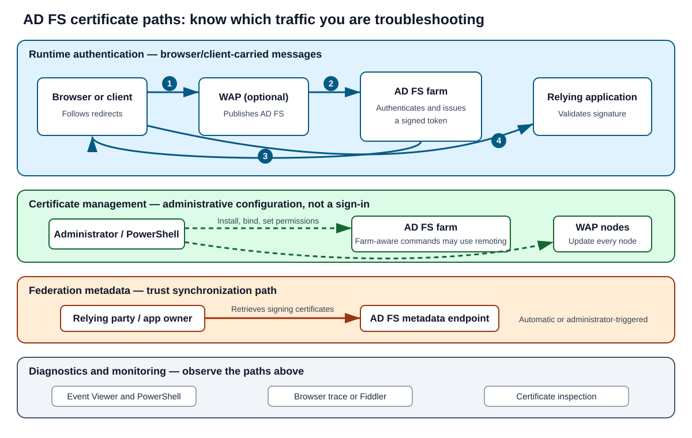

# Day 31: Troubleshooting and Replacing AD FS Certificates

Active Directory Federation Services (**AD FS**) depends on certificates to protect web traffic, identify services, and prove that issued tokens are authentic. This lesson explains how to recognize and troubleshoot Secure Sockets Layer (**SSL**, now more accurately called Transport Layer Security or **TLS**) certificate failures, replace service communication and SSL certificates, and resolve token-signing certificate mismatches.

> [!IMPORTANT]
> Keep these paths separate while troubleshooting:
>
> 1. **Runtime authentication:** a browser or client follows redirects to AD FS, then carries the federation response back to the relying application. A Web Application Proxy (**WAP**) can publish AD FS to external clients.
> 2. **Trust and certificate configuration:** administrators install certificates, bind them to AD FS or WAP, configure trusts, and grant private-key access. These management actions are not user sign-in traffic.
> 3. **Federation metadata exchange:** a relying party can retrieve AD FS federation metadata to learn about a new token-signing certificate. This is a configuration synchronization path, not the browser-carried token response.
> 4. **Diagnostics and monitoring:** Event Viewer, PowerShell, browser traces, and Fiddler observe configuration or runtime traffic; they do not replace the authentication flow.



## Learning Outcomes and Lesson Map

After completing this lesson, you should be able to:

- Identify common AD FS SSL certificate and token-signing certificate symptoms.
- Apply structured troubleshooting steps to certificate-related AD FS failures.
- Request, install, and update service communication and SSL certificates.
- Explain how AD FS 2016 farm-wide behavior differs from per-node work.
- Diagnose a token-signing certificate mismatch between AD FS and a relying party.

| Part | Focus | Outcome |
|---|---|---|
| **1** | SSL/TLS symptoms and common fixes | Diagnose trust, expiry, revocation, private-key, and binding issues. |
| **2** | Service communication and SSL certificate replacement | Replace certificates on AD FS and WAP while accounting for version and binding mode. |
| **3** | Token-signing certificate troubleshooting | Validate rollover, metadata updates, thumbprints, and the certificate embedded in a token. |

## Certificate Foundations

Every federation server needs the appropriate certificates before it can participate in AD FS communications. These certificates secure communication and support authentication between internet clients, federation servers, WAP servers, and relying applications. They expire and must be replaced on a planned schedule.

| Certificate or key material | Main purpose | Where it matters |
|---|---|---|
| **SSL/TLS certificate** | Secures HTTPS web-service traffic between clients and AD FS or WAP. | AD FS HTTPS bindings, WAP, browsers, and client applications |
| **Service communication certificate** | Represents the Federation Service for service communications. It is commonly configured to use the same certificate as SSL/TLS. | AD FS service configuration |
| **Token-signing certificate** | Uses its private key to sign security tokens issued by AD FS. | AD FS signs; relying parties validate the signature with the public certificate. |
| **Verification certificate** | The public-key portion of the token-signing certificate associated with the trust policy. | Relying parties use it to verify tokens. |

> [!NOTE]
> The source material uses **SSL certificate** throughout. Modern Windows and browsers use TLS, but the AD FS cmdlet and user-interface terminology may still say “SSL.” This lesson therefore uses **SSL/TLS** where helpful without changing command names.

The SSL/TLS certificate must be trusted by client computers. In a production deployment, use a certificate issued by a certification authority (**CA**) trusted by both internal and external AD FS clients.

### Learning Resources

- [AD FS certificates overview video (06:54)](https://youtu.be/UHdcgjjTGMs). The original course notes that closed captions can be accessed with the controls at the bottom-right of the video player.
- [Certificate requirements for federation servers](https://docs.microsoft.com/en-us/windows-server/identity/ad-fs/design/certificate-requirements-for-federation-servers)
- [AD FS: How to replace SSL, service communications, token-signing, and token-decrypting certificates](http://social.technet.microsoft.com/wiki/contents/articles/2554.ad-fs-how-to-replace-the-ssl-service-communications-token-signing-and-token-decrypting-certificates.aspx)

## Part 1: Troubleshoot SSL/TLS Certificate Issues

### Recognize the Symptoms

| Symptom | What it suggests | Where to investigate |
|---|---|---|
| Event ID **249** or **387** appears on an AD FS server. | AD FS detected a certificate or binding problem. | AD FS event logs, certificate stores, and bindings |
| A browser displays an invalid- or expired-certificate warning while opening an application. | The HTTPS certificate may be expired, untrusted, mismatched to the hostname, or served through an incorrect binding. | Browser certificate details, trust chain, hostname, expiry, AD FS/WAP binding |
| A client application cannot connect to an AD FS HTTPS endpoint. | The certificate may be expired or revoked, or the application may not trust the issuing CA. | Client error, revocation access, certificate chain, endpoint binding |

> [!TIP]
> An application-side federation error does not automatically mean the HTTPS certificate is at fault. First determine whether the failure occurs while establishing TLS, while AD FS authenticates the user, or after the application validates an issued token.

### Check the Common Causes

Work through these checks in order:

1. **Confirm certificate identity and validity.**
   - Verify the subject or Subject Alternative Name (**SAN**) covers the federation service name.
   - Check the validity period, issuing CA chain, and revocation status.
2. **Check every AD FS farm node.**
   - Install the same SSL/TLS certificate, including its private key, on each required farm server.
   - Store it in **Local Computer > Personal**.
3. **Check private-key permissions.**
   - Ensure the AD FS service account has **Read** access to the certificate's private key.
4. **Check every WAP node.**
   - Install the same public-facing SSL/TLS certificate and private key on each WAP server that requires it.
5. **Check the active bindings.**
   - A valid certificate in the store does not help if AD FS or WAP is still bound to an old thumbprint.

### Inspect and Set Certificate Bindings

Use the following commands from an elevated PowerShell session as appropriate.

#### AD FS Servers

Set the AD FS SSL/TLS certificate:

```powershell
Set-AdfsSslCertificate -Thumbprint "CERTIFICATETHUMBPRINT"
```

List the current AD FS SSL/TLS certificate configuration:

```powershell
Get-AdfsSslCertificate
```

The original material also gives this command:

```powershell
Get-AdfsSslCertificate -Thumbprint "CERTIFICATETHUMBPRINT"
```

> [!WARNING]
> **Verify before use:** the standard `Get-AdfsSslCertificate` syntax lists the configured AD FS SSL certificates and may not accept `-Thumbprint` on the target Windows Server version. The source command is preserved above, but check the locally installed cmdlet syntax:
>
> ```powershell
> Get-Help Get-AdfsSslCertificate -Full
> ```

#### WAP Servers

Set the WAP SSL/TLS certificate:

```powershell
Set-WebApplicationProxySslCertificate -Thumbprint "CERTIFICATETHUMBPRINT"
```

List the current WAP SSL/TLS certificate configuration:

```powershell
Get-WebApplicationProxySslCertificate
```

The original material also gives this command:

```powershell
Get-WebApplicationProxySslCertificate -Thumbprint "CERTIFICATETHUMBPRINT"
```

> [!WARNING]
> **Verify before use:** the standard `Get-WebApplicationProxySslCertificate` syntax may not accept `-Thumbprint`. Preserve the source command for reference, but confirm the syntax on the WAP server:
>
> ```powershell
> Get-Help Get-WebApplicationProxySslCertificate -Full
> ```

#### Understand the Scope

| Server and version | Where to run the change | Why |
|---|---|---|
| **AD FS 2016 and later** | Start on the primary AD FS server, subject to the binding mode described later. | `Set-AdfsSslCertificate` can update the farm by using PowerShell remoting. |
| **Earlier AD FS versions** | The source directs administrators to run the applicable change on each AD FS server. | Do not assume farm-wide propagation. Verify the supported procedure for the exact version. |
| **WAP, all versions** | Run the WAP certificate command on every WAP node. | WAP certificate configuration is node-specific. |

### Practice Lab Review

The original simulation asks learners to execute commands, review the result, and reproduce a real-life troubleshooting scenario by searching through the lab and completing fields shown in screenshots. It describes this as **DFM training “Try yourself”**: a simulation of system steps using screenshots and fields for the learner to complete.

#### Lab 1: List the AD FS Certificate Configuration

**Prompt:** Enter the command that lists the certificate thumbprint on the AD FS server.

```powershell
Get-AdfsSslCertificate
```

- Screenshot reference from the original lab: `VETnLjdzzlUN3QdM-LAB11.PNG`
- Acceptable response: `Get-AdfsSslCertificate`
- Original lab feedback: **Correct**, with an option to **Take Again**

#### Lab 2: List the WAP Certificate Configuration

**Prompt:** Enter the command that lists certificate settings on the WAP server.

```powershell
Get-WebApplicationProxySslCertificate
```

- Screenshot reference from the original lab: `5ZQslHV0Xy3-KX1H-LAB22.png`
- Acceptable response: `Get-WebApplicationProxySslCertificate`
- Original lab feedback: **Correct**, with an option to **Take Again**

#### Lab 3: Connect to Microsoft Entra ID

**Prompt:** From the AD FS server, connect to Azure Active Directory (**AAD**, now Microsoft Entra ID) with `Connect-MsolService`, authenticating as the example user `user@mylab.com`.

```powershell
Connect-MsolService
```

- Example account: `user@mylab.com`
- Screenshot reference from the original lab: `Qvifawylr72muvTH-LAB%2523%2523.png`
- Acceptable response: `Connect-MsolService`
- Original lab feedback: **Correct**, with an option to **Take Again**

> [!NOTE]
> `Connect-MsolService` prompts for authentication; the username is not included in the source command. The MSOnline module is legacy, so confirm current Microsoft guidance before designing a new operational process.

#### Lab 4: Update Federated-Domain Certificate Information

**Prompt:** Update the federated domain's token-signing certificate information.

```powershell
Update-MsolFederatedDomain -DomainName domain.com -SupportMultipleDomain
```

- Screenshot reference from the original lab: `pX8urb7CqW2jmP3S-LAB%2524%2524.png`
- Acceptable response: `Update-MsolfederatedDomain -DomainName domain.com -SupportMultipleDomain`
- Original lab feedback: **Correct**, with an option to **Take Again**

Add the following parameter when more than one federated domain is in use:

```powershell
-SupportMultipleDomain
```

- Screenshot reference from the original lab: `DVoXPd_jDeN6lEhx-LAB%252422.png`
- Acceptable response: `-SupportMultipleDomain`

## Part 2: Update Service Communication and SSL/TLS Certificates

### Request and Prepare the Certificate

An AD FS server requires a server-authentication certificate and a token-signing certificate. The trust policy also uses the token-signing certificate's public-key portion as a verification certificate.

The SSL/TLS certificate for an AD FS farm normally comes from a trusted third-party CA, such as DigiCert or Verisign. It is a conventional web-server certificate, comparable to one used by Internet Information Services (**IIS**). Depending on the deployment, it may be:

- A single-name certificate
- A SAN certificate
- A wildcard certificate

Whichever form is chosen, it must be valid and trusted by the relevant internal and external AD FS clients.

> [!NOTE]
> The source repeats this CA and certificate-type guidance twice and attributes both copies to **Avani Sadana**. The exact duplicate has been consolidated here; its attribution and all technical detail remain represented.

The SSL/TLS and service communication certificates are typically configured to use the same certificate. Doing so reduces replacement complexity and maintenance.

#### Preparation Checklist

1. Request a new certificate from a trusted third-party CA.
2. Plan to use the same certificate for SSL/TLS and service communication if that matches the deployment design.
3. Import the new certificate **with its private key** on all AD FS farm servers and all applicable WAP servers.
4. Install it in **Local Computer > Personal**.
5. Record the new certificate thumbprint.
6. Complete all required bindings and service configuration.
7. Validate the deployment.
8. Remove old certificates only after the replacement is complete and validated.

> [!CAUTION]
> Do not remove the old certificate before all nodes, bindings, relying parties, and rollback requirements have been checked.

### Replace the Service Communication Certificate

Perform this operation on the primary AD FS server by using either the management console or PowerShell.

#### Option 1: AD FS Management Console

1. Open **AD FS Management**.
2. Go to **AD FS > Service > Certificates**.
3. Select **Set Service Communications Certificate**.
4. Select the new certificate.

#### Option 2: PowerShell

List certificates in the local computer's Personal store:

```powershell
dir cert:\localmachine\my
```

Record the new SSL/TLS certificate thumbprint, then set it as the service communication certificate:

```powershell
Set-AdfsCertificate -CertificateType "Service-Communications" -Thumbprint "CERTIFICATETHUMBPRINT"
```

The original material split the same command over two lines:

```powershell
Set-AdfsCertificate -CertificateType "Service-Communications"
-Thumbprint "CERTIFICATETHUMBPRINT"
```

> [!WARNING]
> **Verify before use:** in PowerShell, a newline normally ends a command unless continuation syntax is used. Run the single-line version, or use valid PowerShell continuation, rather than copying the source's two independent lines.

The source recommends consulting these topics for more information:

- How to Replace the SSL, Service Communications, Token-Signing, and Token-Decrypting Certificates
- How to Update Certificates for AD FS

### Replace the AD FS SSL/TLS Certificate

The required command and execution scope depend on the Windows Server version and certificate-authentication binding mode.

| Scenario from the source | Server scope | Command | Important note |
|---|---|---|---|
| Windows Server 2012 R2 and earlier | All AD FS servers in the farm | `Set-AdfsSslCertificate -Thumbprint "CERTIFICATETHUMBPRINT"` | Verify that this cmdlet and procedure are supported on the exact older version. |
| Windows Server 2016, default certificate-authentication binding | Primary AD FS server; default client-certificate port **49443** | `Set-AdfsSslCertificate -Thumbprint "CERTIFICATETHUMBPRINT"` | No separate `Set-AdfsAlternateTlsClientBinding` run is needed after this command. |
| Windows Server 2016, alternate TLS client binding | Primary AD FS server; port **443**, for example `certauth.sts.contoso.com` | `Set-AdfsAlternateTlsClientBinding -Thumbprint "CERTIFICATETHUMBPRINT"` | This configures the required SSL certificate bindings. |

> [!WARNING]
> **Version-sensitive source claim:** the original lesson says to use `Set-AdfsSslCertificate` on Windows Server 2012 R2 and earlier. Cmdlet availability and certificate-binding procedures differ by AD FS version. Preserve this instruction for course context, but verify it against the target server's installed cmdlets and Microsoft documentation before making a production change.

For the default binding mode:

```powershell
Set-AdfsSslCertificate -Thumbprint "CERTIFICATETHUMBPRINT"
```

For alternate TLS client binding on port 443:

```powershell
Set-AdfsAlternateTlsClientBinding -Thumbprint "CERTIFICATETHUMBPRINT"
```

`Set-AdfsSslCertificate` and `Set-AdfsAlternateTlsClientBinding` are described in the source as multi-node operations that use PowerShell remoting to configure secondary servers in supported AD FS 2016 scenarios.

> [!IMPORTANT]
> Port **49443** or the alternate hostname on port **443** is associated with TLS client-certificate authentication. It is distinct from an ordinary browser's passive sign-in redirects and from administrative PowerShell remoting between farm nodes.

The original lesson points learners to:

- Managing SSL Certificates in AD FS and WAP in Windows Server 2016
- AD FS Support for Alternate Hostname Binding for Certificate Authentication

Its original interface also included two **Select to zoom in/out** controls for supporting images.

### Replace the SSL/TLS Certificate on WAP

On **every WAP server** in the farm, run:

```powershell
Set-WebApplicationProxySslCertificate -Thumbprint "CERTIFICATETHUMBPRINT"
```

Then confirm that each WAP node presents the expected certificate to an external client and can communicate with the federation service.

### Validate the Replacement

Use this post-change checklist:

- Confirm that the expected certificate appears in **Local Computer > Personal** on every required node.
- Confirm that the certificate has a private key and that the AD FS service account can read it.
- Use the relevant `Get-*SslCertificate` cmdlet to inspect active configuration.
- Test the federation service name from internal and external client paths.
- Check the served certificate's hostname, validity period, chain, and revocation status.
- Review AD FS and WAP event logs for new errors.
- Test an actual relying-party sign-in.
- Remove old certificates only after successful validation and any required rollback window.

## Part 3: Troubleshoot Token-Signing Certificate Issues

### Recognize the Symptoms

Common symptoms include:

- Event ID **385** or **316** on the AD FS server.
- Users receive an application-side error when accessing an AD FS-integrated application.

In the second case, AD FS can successfully issue a token, yet the application rejects it because:

- The certificate used to sign the token is expired.
- The signing certificate does not match the certificate configured at the application.

The relying application—also called a **service provider (SP)** or relying party—validates the token's signature with the trusted public certificate. A mismatch causes validation to fail even though user authentication and token issuance at AD FS succeeded.

### Understand Rollover and Relying-Party Updates

The source states that token-signing certificates expire once a year by default and that automatic rollover generates a new certificate. Treat the actual dates and rollover settings on the target farm as authoritative.

| Check | Why it matters | Typical action |
|---|---|---|
| Certificate expiration date | An expired signing certificate can no longer provide the expected trust. | Monitor validity and plan for rollover. |
| AD FS primary signing certificate | AD FS signs with the active primary certificate. | Confirm the expected certificate is primary. |
| Relying-party certificate | The relying party must trust the public certificate corresponding to the signing key. | Update the application or partner. |
| Federation metadata refresh | Metadata-aware relying parties can learn the new token-signing certificate automatically. | Ask the partner or application owner to retrieve fresh metadata. |
| Manual trust configuration | Some products do not consume metadata automatically. | Follow the vendor's certificate-update procedure. |

> [!IMPORTANT]
> Automatic rollover in AD FS does not guarantee that every relying party has refreshed its trust. AD FS certificate generation and relying-party metadata consumption are separate operations.

For Office 365 in the workflow represented by the original lesson, connect with the legacy MSOnline module and force the federated-domain update:

```powershell
Connect-MsolService
Update-MsolFederatedDomain -DomainName domain.com -SupportMultipleDomain
```

Use `-SupportMultipleDomain` when more than one federated domain is being used. For a manually configured application, contact the vendor or application owner for its supported certificate-update procedure.

### Follow a Structured Troubleshooting Procedure

#### Step 1: Check Validity and Thumbprints

1. Open the AD FS management console.
2. Identify the token-signing certificate configured as **Primary**.
3. Select **View Certificate**.
4. Review its validity period and thumbprint.
5. Compare that thumbprint with the certificate configured by the service provider.

If the values differ, determine whether:

- AD FS rolled over to a new certificate.
- The relying party failed to retrieve updated federation metadata.
- Someone manually configured the wrong certificate.
- The token was issued by a different AD FS node or environment than expected.

#### Step 2: Capture the Runtime Federation Response

To determine which certificate was represented in the issued token:

1. Launch Fiddler before reproducing the problem.
2. Reproduce the failed authentication.
3. Locate the federation response sent to the service provider. The source uses Office 365 (**O365**) as its example.
4. Inspect the token and locate the `<X509Data>` element.

> [!IMPORTANT]
> In a passive SAML or WS-Federation flow, the federation response is normally carried through the user's browser to the service provider. Fiddler captures this browser/client traffic. Do not describe that response as a direct AD FS-to-application server call. By contrast, a relying party's metadata retrieval may be server-to-server or an administrator-driven configuration action.

The original token fragment is:

```xml
<X509Data><X509Certificate>MIIC4jCCAcqgAwIBAgIQMFsofhKngJxHHFcTltv0KDANBgkqhkiG9w0BAQsFADAtMSswKQYDVQQDEyJBREZTIFNpZ25pbmcgLSBmcy5zZWV0aGV0b2tlbi5pbmZvMB4XDTIwMDYwNTEwMDUwMVoXDTIxMDYwNTEwMDUwMVowLTErMCkGA1UEAxMiQURGUyBTaWduaW5nIC0gZnMuc2VldGhldG9rZW4uaW5</X509Certificate></X509Data>
```

#### Step 3: Inspect the Embedded Certificate

The original procedure says to:

1. Copy the content inside `<X509Certificate>`.
2. Send or paste it into a text file.
3. Save the file as `certificate.cer`.
4. Review the certificate details, including validity.
5. Verify that it matches the service provider's configuration.

> [!WARNING]
> **Verify the conversion method:** `<X509Certificate>` contains Base64-encoded certificate data. Merely saving the text with a `.cer` extension does not necessarily decode it into a binary DER certificate. Use an approved certificate-decoding method, preserve evidence securely, and never expose private keys. The source procedure is retained above, but its conversion detail should be tested in the target toolset.

### Token-Signing Troubleshooting Matrix

| Observation | Likely interpretation | Next action |
|---|---|---|
| AD FS does not issue a token. | The problem occurs before token-signature validation. | Investigate authentication, policy, claims, endpoints, and AD FS logs. |
| AD FS issues a token, but the SP rejects it after rollover. | The SP may still trust the old signing certificate. | Refresh metadata or update the SP manually. |
| AD FS primary thumbprint differs from the SP configuration. | Trust configuration is out of sync. | Confirm the intended rollover and update the SP safely. |
| Captured `<X509Certificate>` differs from the expected certificate. | The observed token was signed in a different certificate context or environment. | Confirm endpoint, farm, primary certificate, and capture. |
| Certificate matches, but validation still fails. | The issue may involve token format, audience, issuer, time, claims, or another validation rule. | Read the SP error and correlate it with AD FS events and the captured response. |
| Browser reports a TLS warning before sign-in completes. | This is probably an SSL/TLS trust or binding issue, not token signing. | Return to Part 1. |

## Quick Command Reference

| Purpose | Command |
|---|---|
| List AD FS SSL/TLS configuration | `Get-AdfsSslCertificate` |
| Set AD FS SSL/TLS certificate | `Set-AdfsSslCertificate -Thumbprint "CERTIFICATETHUMBPRINT"` |
| List WAP SSL/TLS configuration | `Get-WebApplicationProxySslCertificate` |
| Set WAP SSL/TLS certificate | `Set-WebApplicationProxySslCertificate -Thumbprint "CERTIFICATETHUMBPRINT"` |
| List local computer Personal-store certificates | `dir cert:\localmachine\my` |
| Set AD FS service communication certificate | `Set-AdfsCertificate -CertificateType "Service-Communications" -Thumbprint "CERTIFICATETHUMBPRINT"` |
| Set alternate TLS client binding | `Set-AdfsAlternateTlsClientBinding -Thumbprint "CERTIFICATETHUMBPRINT"` |
| Connect with the legacy MSOnline module | `Connect-MsolService` |
| Update federated-domain settings | `Update-MsolFederatedDomain -DomainName domain.com -SupportMultipleDomain` |

## Key Takeaways

- AD FS certificate troubleshooting starts by identifying whether the failure is in HTTPS transport, authentication and token issuance, or relying-party token validation.
- Every required AD FS and WAP node needs the correct certificate, private key, permissions, and active binding.
- Service communication and SSL/TLS commonly use the same certificate, but they remain distinct configuration roles.
- Version and binding mode determine whether a certificate command is farm-wide, per-node, or appropriate at all.
- Token-signing rollover succeeds end to end only when relying parties trust the new public certificate.
- Browser-carried federation responses, server-side metadata retrieval, PowerShell administration, replication, logging, and monitoring are different paths and should be investigated separately.
- Always validate production commands against the installed Windows Server version and cmdlet help, especially where the original course command is version-sensitive or syntactically questionable.
