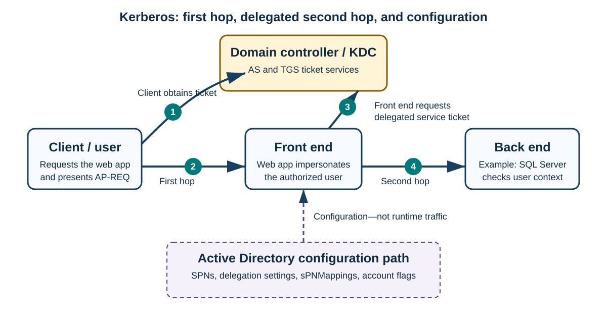
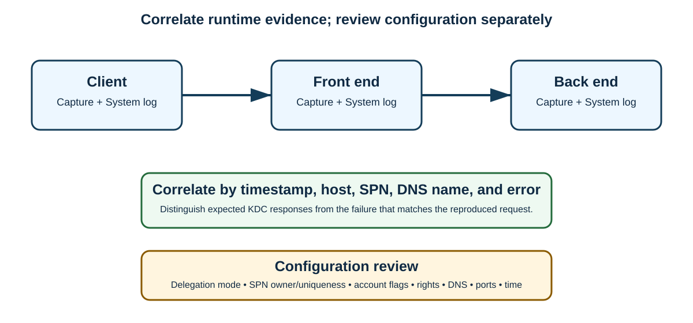

# Day 33: Kerberos Principal Names, SPN Configuration, Delegation, and Troubleshooting

Kerberos authentication depends on names, tickets, service identities, and carefully scoped delegation. This beginner-friendly lesson builds from User Principal Names (**UPNs**) and Service Principal Names (**SPNs**) to the Kerberos “double hop,” delegation models, diagnostic evidence, common errors, and a repeatable troubleshooting workflow.

> [!IMPORTANT]
> Keep these paths separate:
>
> 1. **Runtime authentication:** a client locates a Key Distribution Center (**KDC**), requests tickets, and presents a service ticket to the target service.
> 2. **Delegated runtime access:** a front-end service obtains and presents a ticket to a back-end service on the user's behalf.
> 3. **Configuration and directory data:** administrators manage SPNs, `sPNMappings`, account flags, user rights, and delegation settings in Active Directory (**AD**). This is not runtime ticket traffic.
> 4. **Monitoring and troubleshooting:** event logs and packet captures observe the runtime flow; they do not perform authentication.



## Learning Path

This material corresponds to the “Auth Providers — Specialist: Troubleshoot SPN Configuration and Delegation Issues” module, Lesson 3 of 15. Its two major parts are concepts and troubleshooting.

| Part | Lessons and sections | Outcome |
|---|---|---|
| **1. Concepts** | Principal names; UPN; SPN; Kerberos service mapping; delegation function and types; SPN issues | Explain where principal names are stored and used, summarize SPN mappings, and distinguish delegation models. |
| **2. Troubleshooting** | SPN methods and tools; common delegation issues; delegation troubleshooting | Recognize Kerberos errors, collect useful evidence, and isolate SPN or delegation failures. |

The source labels the detailed course sequence as follows:

| Course position | Lesson | Primary section |
|---|---|---|
| **Lesson 5 of 15** | What is a Principal Name? | UPN, SPN, and Kerberos service mapping |
| **Lesson 6 of 15** | What is Kerberos Delegation? | Function and types of delegation |
| **Lesson 7 of 15** | Service Principal Name issues | Common SPN issues |
| **Lesson 9 of 15** | Troubleshooting Service Principal Name issues | Diagnostic methods and tools |
| **Lesson 10 of 15** | Delegation issues | Common delegation issues |
| **Lesson 11 of 15** | Troubleshooting Kerberos Delegation issues | End-to-end troubleshooting |

After completing the lesson, you should be able to:

- Explain what a principal name is and where it is stored and used.
- Describe UPNs and SPNs, including their Active Directory attributes.
- Summarize how `sPNMappings` allows selected service classes to use `HOST`.
- Identify the function and types of Kerberos delegation.
- Examine common SPN and delegation problems.
- Use appropriate tools and methods to identify and troubleshoot those problems.

## Part 1: Principal Names and Kerberos Foundations

### How the KDC Uses Principal Names

On a domain controller, the Kerberos KDC provides two ticket services:

- the **Authentication Service (AS)**, which handles the initial AS request; and
- the **Ticket-Granting Service (TGS)**, which handles requests for service tickets.

A client finds a KDC by querying Domain Name System (**DNS**) for Kerberos service (**SRV**) records such as `_kerberos`. AS and TGS requests contain principal names for the requester and the target resource. Kerberos tickets issued by the KDC are valid for 10 hours by default in the environment described by the source.

Kerberos uses two principal-name forms in this lesson:

| Name | Identifies | Example | AD attribute |
|---|---|---|---|
| **User Principal Name (UPN)** | A user account | `useralias@contoso.com` | `userPrincipalName` |
| **Service Principal Name (SPN)** | A service instance running under a user or computer account | `HOST/server.contoso.com` | `servicePrincipalName` |

### User Principal Names

Only user accounts have a UPN defined on the account. In **Active Directory Users and Computers**, open the user, select the **Account** tab, and inspect the two fields that combine to form **User logon name**.

Key properties:

- A UPN must be unique across the entire forest. If the KDC lookup returns more than one account for the same UPN, authentication can fail for every user sharing that UPN.
- `userPrincipalName` is a **single-valued** attribute.
- AD stores the UPN but does not append a separate Kerberos realm to the attribute. The realm is inferred from the user's domain.
- Realm names are conventionally displayed in uppercase.

The source illustrates Kerberos principal notation as:

```text
test@contoso.com@CONTOSO.COM
```

Read it as “user `test@contoso.com` in realm `CONTOSO.COM`.” The directory UPN itself is `test@contoso.com`; the final `@CONTOSO.COM` is an explicit realm representation, not a second suffix stored in `userPrincipalName`.

> [!NOTE]
> The realm suffix is implicit in normal Active Directory storage and lookup.

The original course included a zoomable screenshot of sample UPN data in Active Directory Users and Computers.

#### Lab 1: Derive a UPN

**Instructions**

1. Read the supplied identity data.
2. Type the correct response in the text-entry field.
3. Select **Submit**. The lab must be completed successfully before Section 2.

| Field | Value |
|---|---|
| User name | Tom Smith |
| Alias | `tsmith` |
| User's domain | `tailspintoys.com` |
| Correct UPN | `tsmith@tailspintoys.com` |

### Service Principal Names

An SPN—sometimes pronounced “spin”—associates a Kerberos service instance with the AD account whose key can decrypt that service's ticket.

Key properties:

- SPNs may be assigned to **user or computer accounts**.
- An SPN must be unique across the entire AD forest.
- `servicePrincipalName` is a **multi-valued** attribute, so one AD object can hold multiple SPNs.
- AD does not store the Kerberos realm as part of an SPN in a purely Windows forest. Forest-wide uniqueness is therefore essential.

Examples shown for one domain-controller object are:

```text
HOST/DC1
HOST/DC1.contoso.com
```

With an explicit realm for explanation, these represent:

```text
HOST/DC1@CONTOSO.COM
HOST/DC1.contoso.com@CONTOSO.COM
```

Read the first as “service `HOST` on principal `DC1` in Kerberos realm `CONTOSO.COM`,” and the second as the same service on the fully qualified principal `DC1.contoso.com`.

> [!CAUTION]
> The source states that SPNs are case-sensitive. In Windows administration, SPN matching and `setspn` operations are generally treated as case-insensitive, although consistent casing remains good practice. Verify application-specific behavior before relying on letter case as a differentiator; never attempt to make two SPNs unique only by changing case.

#### Common Kerberos Service Classes

| Service class | Purpose and typical owner | `HOST` substitution note |
|---|---|---|
| `KRBTGT` | Locates the KDC for a Kerberos realm. It should appear only on KDCs/domain controllers. | Not described as a `HOST` substitute. |
| `HOST` | Generic service class, normally defined as part of a computer object. | Base class used for mapped services. |
| `CIFS` | Common Internet File System file shares; normally a computer or network-attached storage (**NAS**) appliance. | A query can resolve through the computer's `HOST` SPN via `sPNMappings`. |
| `LDAP` | Lightweight Directory Access Protocol server. In AD, this should be on a domain controller. | Not highlighted as a substitution example in the source. |
| `HTTP` | Account under which a web service runs; the owner may be a computer or user account. | If no explicit `HTTP` SPN exists, mapping can allow the computer's `HOST` SPN. |
| `MSSQLSvc` | Account running Microsoft SQL Server; the owner may be a computer or user account. | No substitution claim is made here. |

The original module included a zoomable screenshot of sample SPN data from a domain controller.

**IIS example.** On an Internet Information Services (**IIS**) server whose application pool runs as **Network Service**, an explicit `HTTP` SPN may not appear on the IIS computer object. A network trace can show the KDC resolving the request through the computer's `HOST` SPN because of `sPNMappings`.

#### Knowledge Check: HTTP Resolves to HOST

**Question:** You request an HTTP service ticket, no explicit HTTP SPN exists, and the ticket you receive resolves to `HOST`. What is the issue?

| Option | Result |
|---|---|
| The HTTP SPN is missing from the user account. | Incorrect |
| The HTTP SPN is missing from the machine account. | Incorrect |
| No issue: HTTP is listed in `sPNMappings` as a service for which `HOST` can substitute. | **Correct** |
| No issue: HTTP was “protocol transitioned” to `HOST`. | Incorrect |

**Conclusion:** This can be normal `sPNMappings` behavior; it is not Kerberos protocol transition.

#### Lab 2: Derive a HOST SPN

**Instructions**

1. Use the supplied service, machine, and domain.
2. Enter the SPN and select **Submit**.
3. Complete the lab successfully, then select **Continue** to move to Section 3.

| Field | Value |
|---|---|
| Service name | `HOST` |
| Machine name | `webserver42` |
| Machine domain | `tailspintoys.com` |
| Correct and accepted response | `HOST/webserver42.tailspintoys.com` |

### Kerberos Service Mapping with sPNMappings

Windows permits `HOST` to substitute for selected SPN service classes. The mapping is controlled by the `sPNMappings` attribute and can be inspected or modified with **ADSI Edit** at the following object in the Configuration partition:

```text
CN=Directory Services,CN=Windows NT,CN=Services,CN=Configuration,DC=example,DC=com
```

For example, a `HOST` Kerberos ticket can authenticate the **Alerter** service. Review the actual `sPNMappings` value to determine every service that can use a `HOST` ticket.

> [!WARNING]
> `sPNMappings` is forest configuration. Treat changes as administrative configuration work, not as a runtime authentication step, and validate the impact before editing it.

## Part 2: Kerberos Delegation

### Why Delegation Exists

Kerberos delegation allows an application to impersonate an authenticated user when accessing a resource on another server. The front-end service reuses the user's security context for back-end access.

A typical scenario contains:

1. A user who needs data from SQL Server through a web application.
2. An impersonating account: either the web application's service/application-pool account or the web server's computer account.
3. A first hop from the client to the web server.
4. A second hop from the web server to SQL Server.

The front end connects to SQL Server through its service identity but accesses the resource under the impersonated user's security context. The source says that delegation can theoretically continue for unlimited hops; in practice, every hop must satisfy the selected delegation model, ticket, service, trust, and configuration requirements.

The source also states that the impersonating user or service account needs the **Impersonate a client after authentication** user right.

> [!NOTE]
> The original lesson represented this scenario with `ICON2.png` and `icon.png`. The diagram above replaces those placeholders with an explicit, accessible flow.

### Delegation Models at a Glance

| Model | Configuration location or UI choice | Initial client authentication | Scope | Security position |
|---|---|---|---|---|
| **Full/unconstrained delegation** | **Trust this user for delegation to any service** | Kerberos | Any reachable service permitted by trust and environment | Least secure; generally avoided in production |
| **Classic Kerberos constrained delegation (KCD)** | Front-end account; **Trust this user for delegation to specified services only: Use Kerberos only** | Kerberos | Named back-end services | Preferred over unconstrained delegation |
| **Constrained delegation with protocol transition** | Front-end account; **Use any authentication protocol** | May begin with a non-Kerberos protocol | Named back-end services | Constrained, but enables protocol transition |
| **Resource-based constrained delegation (RBCD)** | Back-end resource account | Depends on design | Back end decides which front ends may delegate | Supports cross-domain/forest scenarios under stated requirements |

> [!IMPORTANT]
> **S4U2Self** and **S4U2Proxy** are protocol operations, not independent radio-button “types” that should be confused with the entire configuration model. S4U2Self obtains a service ticket to the front-end service on behalf of a user; S4U2Proxy uses an appropriate ticket to request a service ticket to an allowed back-end service.

### Full or Unconstrained Delegation

In the account's **Delegation** tab, select:

```text
Trust this user for delegation to any service
```

This allows the service account to access remote resources while impersonating a user, within the same domain, in other domains, and even across forest trusts where the environment permits it.

Requirements and guidance from the source:

- The user account must not have **Account is sensitive and cannot be delegated** set.
- The user must authenticate to the front-end server with Kerberos.
- This model may be used temporarily when troubleshooting a custom application whose authentication flow is unknown.
- After discovering the actual flow, move the design to constrained delegation.
- Because access cannot be restricted to nominated services, this is the least secure method and is not typically implemented in production.

#### Lab 3: Choose the Delegation Setting

Use the information above to select the appropriate radio setting. Select **Apply** to validate it. If correct, scroll down and select **Continue** to move to the next delegation type.

### Classic Kerberos Constrained Delegation

Introduced in Windows Server 2003, KCD restricts the services that the impersonating account can access. In the account's **Delegation** tab, select:

```text
Trust this user for delegation to specified services only:
Use Kerberos only
```

Unlike unconstrained delegation, the front-end service account can impersonate the user only to nominated services on specific servers.

The source lists these requirements:

- Minimum Windows Server 2003 domain functional level (**DFL**).
- The user account must not have **Account is sensitive and cannot be delegated** set.
- The user must authenticate to the front-end using Kerberos.
- All delegation accounts must exist in the same AD domain.
- Once constrained delegation is used, it must be used throughout the delegation path.
- The source says it “does not require [a] forwardable Ticket-Granting Ticket (TGT).”

> [!CAUTION]
> The last statement needs context: S4U delegation still depends on ticket flags and KDC policy, and S4U2Proxy commonly requires suitable forwardable ticket evidence. Verify the exact KCD/S4U mode and ticket flags in a trace rather than applying the statement universally.

The original course included a zoomable screenshot of sample constrained-delegation data in Active Directory.

### S4U2Proxy

Kerberos as described by RFC 1510 includes proxy-ticket behavior in which the client requests tickets on a service's behalf. Microsoft's **Service for User to Proxy (S4U2Proxy)** extension allows a service to obtain a back-end ticket on the client's behalf according to AD configuration.

The source associates S4U2Proxy with the UI selection:

```text
Trust this user for delegation to specified services only:
Use any authentication protocol
```

More precisely, **Use any authentication protocol** enables protocol transition, usually combining S4U2Self with S4U2Proxy; S4U2Proxy is also fundamental to constrained delegation's back-end ticket request.

### Constrained Delegation with Protocol Transition

Protocol transition lets a Kerberos-capable service obtain a Kerberos service ticket for a user even when that user did not initially authenticate to the service with Kerberos credentials.

#### S4U2Self

**Service for User to Self (S4U2Self)** can initialize a Windows identity for a valid AD user ID without requiring the user's password. This enables transition from another authentication protocol into Kerberos.

The source lists these requirements:

- Minimum Windows Server 2003 DFL.
- The user account must not have **Account is sensitive and cannot be delegated** set.
- All delegation accounts must exist in the same AD domain.
- Service accounts should have the **Act as part of the operating system** user right.
- Once constrained delegation is used, use it throughout the entire path.

> [!CAUTION]
> The source also says that the account performing protocol transition “will need” **Act as part of the operating system**. This is high privilege and is not a universal modern KCD requirement. Verify the application's documented requirements and use least privilege rather than granting it automatically.

The original course included a zoomable screenshot of constrained delegation with protocol-transition data in AD.

### Resource-Based Constrained Delegation

RBCD moves authorization to the **back-end service account** rather than configuring only the front-end account. With a forest trust in place, it can enable constrained delegation across domain and forest boundaries.

The source lists these requirements:

- The back-end forest has a Windows Server 2012 schema.
- The user account does not have **Account is sensitive and cannot be delegated** set.
- The front-end server runs Windows Server 2012.
- A Windows Server 2012 domain controller exists in the front-end domain.
- A Windows Server 2012 domain controller exists in the back-end domain.
- Domain controllers in the referral path run at least Windows Server 2008/2008 R2, with hotfix **2665790** deployed to those domain controllers.

> [!NOTE]
> These requirements reflect the source material and may be version-specific. Confirm current support and patch guidance for the operating systems in your environment.

#### Knowledge Check: Preferred Delegation Model

**Question:** What is the preferred type of delegation?

| Option | Result |
|---|---|
| Kerberos Constrained Delegation | **Correct** |
| Kerberos Full/Unconstrained Delegation | Incorrect |
| S4U2Proxy | Incorrect as the course's requested model name |
| Kerberos Constrained Delegation with Protocol Transition | Incorrect for this general question |

**Conclusion:** Kerberos constrained delegation is preferred to unconstrained delegation because it limits the permitted back-end services.

## Part 3: Common SPN and Delegation Failures

### Three SPN Failure Categories

| Category | Typical cause | Required direction |
|---|---|---|
| **Duplicate SPN** | Load balancing or a changed service logon identity leaves the same SPN on multiple objects. | Find every owner and remove the incorrect registration. |
| **Unknown or missing SPN** | An application cannot use a mapped `HOST` SPN and cannot create its own SPN. | An administrator must register the correct SPN with `setspn`. |
| **Unavailable SPN** | A security principal exists across a trust, but DNS cannot resolve its domain or network barriers prevent access to remote domain controllers. | Repair DNS and domain-controller connectivity across the trust. |

These conditions can prevent Kerberos authentication.

#### Quick Checks

- **What service handles an Authentication Service request?** The Kerberos Key Distribution Center.
- **How is an SPN stored?** As the multi-valued `servicePrincipalName` attribute.

### Common Delegation Failure Conditions

Most problems that break Kerberos authentication can also break delegation:

- a missing or duplicate SPN;
- DNS failure or an incorrect response, such as the wrong Internet Protocol (**IP**) address;
- a large Kerberos ticket when the environment is not configured for the required `MaxTokenSize`;
- ports blocked by firewalls or routers;
- missing service-account privileges or user-right assignments;
- front-end and back-end services in different domains with unsuitable classic constrained-delegation configuration;
- time skew between the client and target server.

## Part 4: Collect Diagnostic Evidence

Good troubleshooting starts by gathering enough evidence to determine the failure's nature.



### Tool 1: Kerberos Event Logging

Microsoft guidance: [Enable Kerberos event logging](https://docs.microsoft.com/en-us/troubleshoot/windows-server/identity/enable-kerberos-event-logging).

The source provides this registry configuration:

```text
Key: HKEY_LOCAL_MACHINE\SYSTEM\CurrentControlSet\Control\Lsa\Kerberos\Parameters
Value name: LogLevel
Value type: REG_DWORD
Value data: 0x1
Output: Events are written to the System event log.
```

> [!WARNING]
> Logging is a monitoring action. It does not modify the runtime ticket flow, though enhanced logging can generate noise and should be managed according to operational guidance.

### Tool 2: Simultaneous Network Captures

Capture packets on the client and server at the same time while reproducing the issue. For delegation, the strongest evidence usually comes from synchronized captures on the client, front end, and back end.

Resources retained from the source:

- [Network_Capture script](https://github.com/ToddMaxey/Network_Capture)
- [Wireshark configuration](https://github.com/ToddMaxey/WireShark_Configuration)
- [`etl2pcapng`](https://github.com/microsoft/etl2pcapng)
- [`Convert-Etl2Pcapng` PowerShell wrapper](https://github.com/microsoft/Convert-Etl2Pcapng)

## Part 5: Interpret Kerberos Errors

Do not treat every error-shaped response as the root cause. Match the message to the failed request, host, SPN, and timestamp.

| Error | Meaning in this lesson | Common causes or context | Action |
|---|---|---|---|
| `KDC_ERR_PREAUTH_REQUIRED` | Expected response to an initial AS request when the Windows client omitted pre-authentication data. The response advertises encryption types and, for Advanced Encryption Standard (**AES**), salts used to derive password keys. | Normal Microsoft Kerberos exchange. | Normally ignore; it is part of ticket acquisition. |
| `KDC_ERR_S_BADOPTION` | Requested ticket options or delegation flags cannot be honored. The client may retry with other flags and succeed. | Delegation configuration, account restrictions, unsupported requested options. | Ignore unless investigating delegation or unless it correlates with the failure. |
| `KDC_ERR_S_PRINCIPAL_UNKNOWN` | KDC cannot uniquely locate the requested service principal. | Missing or duplicate SPN; incorrect server name/DNS suffix; canonical-name (**CNAME**) alias behavior; non-FQDN names across forests. | Inspect application naming, DNS, and SPN ownership. |
| `KRB_AP_ERR_MODIFIED` | Target cannot decrypt the service ticket. | SPN belongs to the wrong account, or the service and KDC have different account-password/key state. | Confirm the service identity, SPN owner, and password/key synchronization. |

The original module included a zoomable Wireshark screenshot of `KDC_ERR_PREAUTH_REQUIRED`.

> [!IMPORTANT]
> `KDC_ERR_S_BADOPTION` does not uniquely prove one cause. The source's final question maps it to **Account is sensitive and cannot be delegated**, which is one relevant cause in that scenario, but ticket flags and other delegation restrictions can produce the same KDC error.

### KDC_ERR_S_PRINCIPAL_UNKNOWN Details

Potential causes include:

- a missing SPN;
- the same SPN registered on more than one AD object;
- the client using an incorrect server name or DNS suffix;
- the client following a DNS CNAME but forming the SPN from the resulting address (**A**) record name; or
- a short, non-fully-qualified name that must resolve across AD forest boundaries.

**Recommendation:** investigate the server names used by both application client and server. This generally points to client, server, DNS, or SPN configuration.

### KRB_AP_ERR_MODIFIED Example

```text
Log Name: System
Source: Microsoft-Windows-Security-Kerberos
Date: 5/4/2022 4:20:00 PM
Event ID: 4
Task Category: None
Level: Error
Keywords: Classic
User: N/A
Computer: DC.contoso.com

Description: The Kerberos client received a KRB_AP_ERR_MODIFIED error
from the server adfsgmsa$. The target name used was HTTP/sts.contoso.com.
This indicates that the target server failed to decrypt the ticket provided
by the client. This can occur when the target server principal name (SPN)
is registered on an account other than the account the target service is
using. Ensure that the target SPN is only registered on the account used
by the server. This error can also happen if the target service account
password is different than what is configured on the Kerberos Key
Distribution Center for that target service. Ensure that the service on
the server and the KDC are both configured to use the same password. If
the server's name is not fully qualified, and the target domain
(contoso.com) is different from the client domain (contoso.com), check if
there are identically named server accounts in these two domains, or use
the fully qualified name to identify the server.
```

The event's last sentence reproduces the source exactly, although both domain placeholders are `contoso.com`; verify the intended cross-domain values when applying that advice.

## Part 6: Troubleshoot SPNs

### Query a Specific SPN

Use `setspn -Q` to find the object that owns a specific SPN:

```powershell
setspn -Q <spn-name>
setspn -Q HTTP/sts.contoso.com
```

If the SPN exists, the result identifies the AD object on which it is set.

> [!NOTE]
> The source used typographic en dashes (`–Q` and `–X`). The executable syntax above uses the required ASCII hyphen (`-`) while preserving the command's intended semantics.

### Search the Forest for Duplicates

```powershell
setspn -X
```

This queries the forest for duplicate SPNs. Compare its output with the SPN in the relevant event or trace.

Do not become distracted by unrelated duplicates. Focus on the users, computers, service accounts, and group managed service accounts (**gMSAs**) participating in the failed flow.

### Remediate Ownership Problems

1. Determine the target name. It may be a server name, service account, or gMSA—the source calls this a “group manager service account,” but the standard expansion is **group Managed Service Account**.
2. Query the SPN to find its current owner.
3. Identify the account under which the target service actually runs.
4. Remove improper duplicate registrations or place the SPN on the correct computer, user, or gMSA.
5. Use `setspn.exe` for the change, or use ADSI Edit when appropriate.
6. Re-query to confirm that the SPN is unique and correctly owned.

> [!WARNING]
> Do not remove or add an SPN merely because it appears in output. Confirm the service identity and planned owner first; an incorrect change can break another service.

## Part 7: Troubleshoot Delegation End to End

### Review Configuration Before Capturing

Before reproducing the issue, verify:

- the chosen delegation model and every allowed back-end service;
- whether **Account is sensitive and cannot be delegated** is set;
- SPN uniqueness and ownership;
- required account rights;
- domain/forest placement and trust assumptions;
- front-end and back-end operating-system/domain-controller requirements.

This is configuration review, not runtime traffic.

### Capture the Failed Runtime Flow

For a delegated flow, start synchronized traces on the client, front end, and back end. Review Kerberos entries in each machine's System log as well.

On the first hop—the client—use this procedure:

1. Start a network-capture utility.
2. Open an elevated Command Prompt.
3. Run:

   ```batch
   ipconfig /flushdns
   nbtstat -R
   klist purge
   ```

4. Reproduce the problem once.
5. Stop and save all captures, preserving timestamps and host identity.

These commands flush the DNS resolver cache, reload the NetBIOS name cache from the local `LMHOSTS` file, and purge cached Kerberos tickets. They alter client caches to make the reproduction cleaner; they do not fix the underlying configuration by themselves.

### Work Through the Failure Matrix

| Symptom or condition | Evidence to inspect | Next action |
|---|---|---|
| Missing or duplicate SPN | `KDC_ERR_S_PRINCIPAL_UNKNOWN`, `setspn -Q`, `setspn -X` | Confirm involved accounts; fix only the relevant ownership or duplicate. |
| DNS failure or wrong IP | DNS queries and responses in the trace; local `HOSTS` file | Confirm a DNS response and correct address. Use fully qualified domain names (**FQDNs**) for SPN-related host entries, not only short names. |
| Large Kerberos ticket | Ticket/token size and affected server configuration | Follow [Group Policy guidance for the `MaxTokenSize` registry entry](https://docs.microsoft.com/en-us/troubleshoot/windows-server/group-policy/group-policy-add-maxtokensize-registry-entry). |
| Firewall or router blocks | Requests leave one host but no reply returns | Verify routes and required ports at each hop. |
| Missing service-account privilege | Local or Group Policy user-right assignments | Review **Security Settings → Local Policies → User Rights Assignment → Enable computer and user accounts to be trusted for delegation**. |
| Cross-domain constrained-delegation mismatch | Account domains, trusts, delegation model, DC requirements | Confirm whether classic KCD or RBCD supports the design and whether all prerequisites are met. |
| Time skew | Timestamps and time-service state on client and target | Correct time synchronization before retesting. |

The source's final cross-domain example says “User and ADFS server.” Here, **AD FS** means **Active Directory Federation Services**, not “Active Directory Services.” Confirm that the user and AD FS server's domain placement is compatible with the configured constrained-delegation model.

### Final Knowledge Check

**Scenario:** While troubleshooting Kerberos delegation, the System event log records:

```text
KDC_ERR_S_BADOPTION
```

**Course answer:** The account is marked **Account is sensitive and cannot be delegated**.

**Operational interpretation:** That account flag can cause this result, but `KDC_ERR_S_BADOPTION` more broadly means that the KDC cannot satisfy requested options or delegation flags. Correlate the error with account settings, ticket flags, SPNs, and the exact failed hop before concluding.

## Quick Reference

| Need | Command, location, or clue |
|---|---|
| Query one SPN | `setspn -Q HTTP/sts.contoso.com` |
| Find duplicate SPNs | `setspn -X` |
| Purge client Kerberos tickets | `klist purge` |
| Flush client DNS cache | `ipconfig /flushdns` |
| Reload NetBIOS names from `LMHOSTS` | `nbtstat -R` |
| Enable Kerberos event logging | `HKLM\SYSTEM\CurrentControlSet\Control\Lsa\Kerberos\Parameters\LogLevel = 0x1` (`REG_DWORD`) |
| Find `sPNMappings` | `CN=Directory Services,CN=Windows NT,CN=Services,CN=Configuration,...` |
| Expected initial AS response | `KDC_ERR_PREAUTH_REQUIRED` |
| SPN lookup or uniqueness problem | `KDC_ERR_S_PRINCIPAL_UNKNOWN` |
| Ticket-decryption or key mismatch | `KRB_AP_ERR_MODIFIED` |
| Delegation option cannot be honored | `KDC_ERR_S_BADOPTION` |

## Key Takeaways

1. A UPN identifies a user; an SPN identifies a service instance and the account that owns its Kerberos key.
2. UPNs are single-valued and SPNs are multi-valued, but both must be unique where the KDC searches for them.
3. `sPNMappings` explains why selected service classes, including the source's HTTP example, may resolve through `HOST`.
4. Delegation is a separate second-hop runtime flow; AD configuration enables it but does not carry its tickets.
5. Prefer constrained delegation to unconstrained delegation, and distinguish classic KCD, protocol transition, S4U operations, and RBCD.
6. Diagnose from synchronized runtime evidence, then compare it with SPN, DNS, account, rights, trust, port, ticket-size, and time configuration.
7. Treat expected Kerberos responses as context, not automatic root causes, and never change an SPN before confirming the service's true logon identity.
