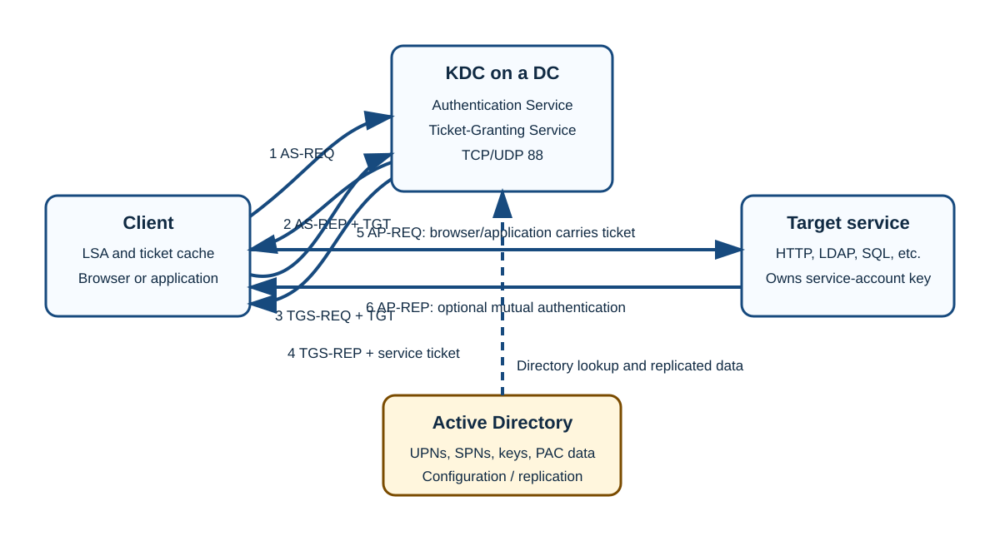
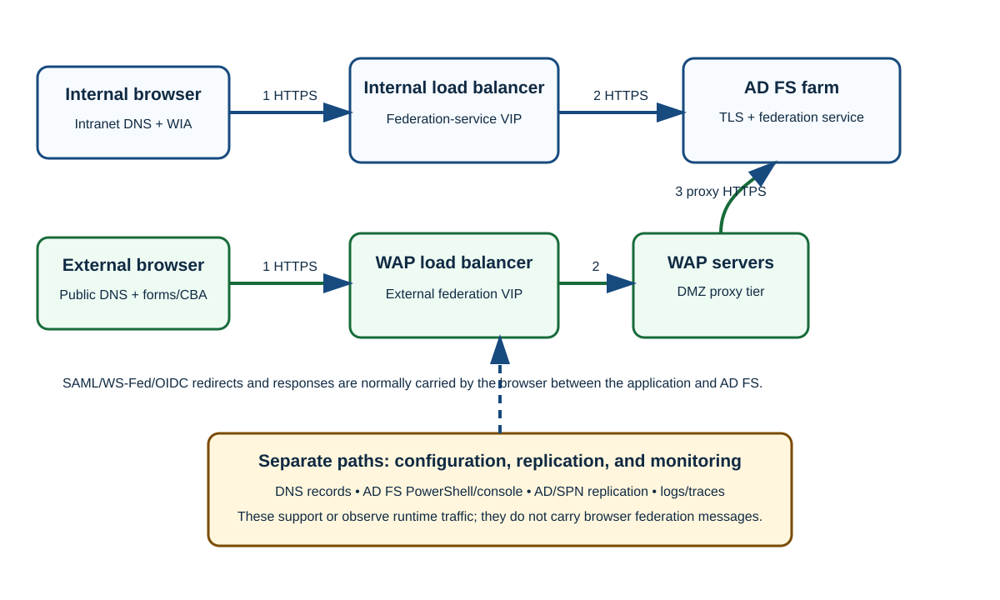

# Day 34: Kerberos, AD FS DNS, and Browser Authentication Troubleshooting

This beginner-friendly lesson connects three topics that are often troubleshot together: **Kerberos authentication**, **Domain Name System (DNS) routing for Active Directory Federation Services (AD FS)**, and **browser-based Windows Integrated Authentication (WIA)**. Start with the ticket flow, learn how names and network paths affect it, and then use a repeatable evidence-based workflow instead of guessing.

> [!IMPORTANT]
> Keep four kinds of traffic and activity separate:
>
> 1. **Runtime authentication:** clients request Kerberos tickets and present them to services.
> 2. **Browser-carried federation:** the browser carries redirects, requests, and SAML/WS-Federation responses between an application and AD FS; this is not normally a direct application-to-AD FS back-channel exchange.
> 3. **Configuration and replication:** administrators configure DNS, SPNs, delegation, AD FS, certificates, and browser policy; Active Directory (AD) replicates directory data. These are not runtime sign-in messages.
> 4. **Monitoring and management:** event logs, packet captures, PowerShell, consoles, and health checks observe or manage the environment; they do not authenticate the user.

## Learning Path and Outcomes

The source combines three Cloud Academy link-based modules. Their original course positions are retained for orientation.

| Module | Original position | Main outcome |
|---|---:|---|
| Troubleshooting Kerberos authentication issues | Lesson 3 of 18; detailed lessons 5–14 | Explain Kerberos and troubleshoot tickets, SPNs, delegation, DNS, networking, and time. |
| DNS requirements and common issues | Lesson 3 of 10; detailed lessons 4–6 | Apply AD FS DNS practices, analyze resolution, and determine whether DNS is the cause. |
| Troubleshoot internet-browser misconfiguration | Lesson 3 of 10; detailed lessons 5–6 | Explain WIA and isolate client-, server-, or relying-party configuration failures. |

After completing the lesson, you should be able to:

- Describe the background and purpose of Kerberos.
- Define a Key Distribution Center (**KDC**), User Principal Name (**UPN**), and Service Principal Name (**SPN**).
- Explain Kerberos tickets, keys, dependencies, authentication flow, service-ticket use, and mutual authentication.
- Identify and troubleshoot SPN and Kerberos delegation failures.
- Apply AD FS DNS best practices and isolate name-resolution paths.
- Explain browser User-Agent handling and configure WIA on the client and AD FS sides.
- Distinguish browser-carried federation messages from server, directory, management, replication, and monitoring paths.

### Prerequisites

The source expects:

- basic DNS knowledge;
- familiarity with Kerberos authentication troubleshooting; and
- the article [Kerberos Explained in a Little Too Much Detail](https://syfuhs.net/a-bit-about-kerberos).

---

## Part 1: Kerberos from First Principles to Troubleshooting

### Kerberos in One Sentence

Kerberos is a network authentication protocol that uses time-limited tickets so that principals communicating over an untrusted network can prove their identities without repeatedly sending a password.

Kerberos originated at the Massachusetts Institute of Technology (**MIT**). The source lists these related Request for Comments (**RFC**) documents:

| RFC | Subject | Verification note |
|---|---|---|
| RFC 1510 | Kerberos Network Authentication Service (V5) | Obsoleted by **RFC 4120**, not RFC 4210. The source said “superseded by RFC 4210”; preserve that note only as a source error. |
| RFC 3244 | Microsoft Windows 2000 Kerberos change-password and set-password protocols | Relevant to password-management interoperability. |
| RFC 4559 | SPNEGO-based Kerberos and NTLM HTTP authentication in Microsoft Windows | Describes HTTP Negotiate behavior. |

> [!NOTE]
> **Simple and Protected GSS-API Negotiation Mechanism (SPNEGO)** lets a client and server negotiate an authentication mechanism, commonly Kerberos or NT LAN Manager (**NTLM**) in Windows environments.

### Core Components and Dependencies

An AD domain is the practical equivalent of a Kerberos realm, and the AD database holds the principals for that realm. Kerberos realm names are case-sensitive in the Kerberos specification; AD conventionally represents its realm as the uppercase DNS domain name, such as `CONTOSO.COM`.

| Component | Role |
|---|---|
| **KDC** | Trusted third party implemented on AD domain controllers (**DCs**). |
| **Authentication Service (AS)** | Performs initial authentication and issues a Ticket-Granting Ticket (**TGT**). |
| **Ticket-Granting Service (TGS)** | Accepts a TGT and issues a service ticket for a target SPN. |
| **UPN** | Identifies a user principal, such as `test@contoso.com`. |
| **SPN** | Identifies a service instance and maps it to the AD account whose key can decrypt its ticket. |
| **TGT** | Lets a principal request service tickets in a realm. |
| **Service ticket** | Lets a principal authenticate to one named service. |

Kerberos depends on:

- healthy AD infrastructure and replication;
- DNS—and, in legacy situations, Windows Internet Name Service (**WINS**)—resolution;
- synchronized time, normally within five minutes;
- network connectivity to KDCs, including TCP or UDP port 88;
- unique SPNs across the forest; and
- correct account keys and service identities.

Tickets typically have a 10-hour lifetime in the environment described by the source. A client caches a ticket in memory and normally reuses it rather than returning to the KDC until renewal or expiration is required.

### UPNs, SPNs, and Their AD Attributes

#### User Principal Names

AD user objects typically have one UPN:

```text
test@contoso.com
```

The `userPrincipalName` attribute is single-valued, and the value must be unique across the forest. The source illustrates an explicitly qualified Kerberos form:

```text
test@contoso.com@CONTOSO.COM
```

Read this as the account `test@contoso.com` in the Kerberos realm `CONTOSO.COM`. AD stores `test@contoso.com`; the object's domain supplies the realm context.

#### Service Principal Names

User or computer objects can hold SPNs. The `servicePrincipalName` attribute is multi-valued, but every SPN must be unique across the entire forest.

```text
HOST/DC
HOST/DC1.contoso.com
MSSQLSvc/SQL1.contoso.com:1433
```

An SPN can include a port, as in the Microsoft SQL Server example. The realm is inferred from the account's domain and is not stored as part of these values.

When AD is installed, built-in SPNs are normally registered on computer objects because computers commonly host the resources being accessed. Administrators can inspect SPNs with ADSI Edit, LDP, LDIFDE, or `setspn`.

Some service classes can resolve through the `HOST` SPN even when the exact SPN is not visibly registered. Inspect the `sPNMappings` attribute on:

```text
CN=Directory Services,CN=Windows NT,CN=Services,CN=Configuration,DC=<forest-root>,DC=<forest-root>
```

> [!CAUTION]
> The source says “only the first portion” of an SPN is stored. More precisely, AD stores the complete SPN value shown in `servicePrincipalName`—including host and optional port—but not a separately appended Kerberos realm.

#### Managing SPNs

Searching, adding, and deleting SPNs can be done with ADSI Edit, `ldifde.exe`, `ldp.exe`, or `setspn.exe`. `setspn` is usually the simplest.

| Task | Command | Meaning |
|---|---|---|
| Find forest-wide duplicates | `SetSPN -F -X` | Searches the forest for duplicate SPNs. |
| Find a pattern | `SetSPN -F -Q */SQL1*` | Finds matching values such as `HOST/SQL1`, `HOST/SQL1.contoso.com`, or `MSSQLSvc/SQL1:5500`. |
| Add safely | `SetSPN -S MSSQLSvc/SQL1.contoso.com:1433 contoso\SQL-Svc` | Checks for a duplicate before adding. Prefer `-S` to legacy `-A`. |
| Delete | `SetSPN -D MSSQLSvc/SQL1.contoso.com:1433 contoso\SQL-Svc` | Removes that SPN from the named account. |

```powershell
SetSPN -F -X
SetSPN -F -Q */SQL1*
SetSPN -S MSSQLSvc/SQL1.contoso.com:1433 contoso\SQL-Svc
SetSPN -D MSSQLSvc/SQL1.contoso.com:1433 contoso\SQL-Svc
```

> [!TIP]
> For one exact target, the source also uses `setspn -Q HTTP/sts.contoso.com`. Confirm both the returned owner and whether any duplicate exists.

### Tickets and Cryptographic Keys

The KDC knows the relevant account-derived keys and is therefore trusted by both client and service. Tickets do **not** contain the user's plaintext password.

| Key | Purpose |
|---|---|
| **User/long-term key** | Derived from a user or computer password; proves account possession during initial authentication. Some documents call it a system or service key. |
| **Session key** | Generated by the KDC during each TGT or service-ticket issuance; shared by the appropriate parties for proof and, where applicable, protection. |
| **KDC service key** | Derived from the domain's `krbtgt` account and used to protect TGTs. Read-only domain controllers (**RODCs**) have separate `krbtgt` accounts to limit compromise impact. |
| **Inter-realm key** | Shared across a trust so KDCs in different realms can support cross-realm authentication. |

> [!CAUTION]
> “Password” is sometimes used as shorthand for the account's long-term key. Modern Kerberos derives protocol keys from the password; it does not use or store the plaintext password in a ticket.

### The End-to-End Ticket Flow



The KDC does not contact the target service to deliver a service ticket. The client gets the ticket, caches it, and later presents it to the service.

#### Phase 1: Obtain a TGT

1. **Build the request.** The user enters credentials. The Local Security Authority (**LSA**) derives the account key, collects the UPN and domain, and prepares preauthentication data—typically a timestamp protected with the client key.
2. **Locate a KDC.** The client uses DNS Kerberos service (**SRV**) records such as `_kerberos` and sends a `KRB_AS_REQ`.
3. **Validate the principal.** The KDC locates the account in AD, validates preauthentication, and checks time skew.
4. **Build the TGT.** The KDC creates a client/TGS session key. The TGT contains a copy plus authorization data, including Security Identifiers (**SIDs**) and group information in the Privilege Attribute Certificate (**PAC**), and is protected with the `krbtgt` key. Client-readable reply data is protected with the client's long-term key.
5. **Return the reply.** The KDC sends `KRB_AS_REP`, including the TGT and the client's usable copy of the session key.
6. **Cache it.** The client stores the TGT and session key until logoff, expiration, or renewal. A renewable TGT may remain represented in the cache after initial expiry.

> [!WARNING]
> The source states that the LSA performs this operation with `DES-CBC-MD5` and that Windows Vista and later initially omit preauthentication. Treat the algorithm statement as historical and environment-dependent: modern Windows commonly negotiates AES and may support RC4 for compatibility. The initial no-preauthentication request followed by `KDC_ERR_PREAUTH_REQUIRED` is a normal discovery exchange in many traces.

> [!WARNING]
> The source says the `krbtgt` account password should “NEVER” be reset and the account should never be moved or enabled. It should indeed remain disabled and tightly protected, but Microsoft-supported incident-recovery procedures intentionally reset its password—commonly twice with replication allowed between resets. Never reset it casually; follow current Microsoft guidance and change control.

The source also notes that older domain-functional-level upgrades changed `krbtgt` credentials to support AES128 and AES256. Verify this historical behavior against the exact Windows Server version before planning any change.

#### Phase 2: Obtain a Service Ticket

A principal needs a TGT for the target AD domain before its TGS can issue a service ticket. Cross-domain access can create TGTs or referral tickets for more than one domain—for example, a `contoso.com` user reaching `corp.contoso.com`.

1. **Build an authenticator.** The client protects an authenticator containing the principal identity and current time with the TGT session key. It collects the target SPN, target domain, and cached TGT.
2. **Send the request.** The client locates a KDC and sends `KRB_TGS_REQ`.
3. **Validate it.** The TGS decrypts the TGT with its key, retrieves the TGT session key, decrypts the authenticator, and validates identity and time.
4. **Resolve the service.** The KDC searches `servicePrincipalName` in the domain. If necessary, it searches a global catalog and returns a referral along the trust path for another domain.
5. **Create the ticket.** The KDC generates a service-session key. It puts a copy and PAC authorization data in the service ticket, encrypts the ticket for the service account, and protects the client-readable reply with the TGT session key.
6. **Return and cache it.** `KRB_TGS_REP` gives the client the service ticket and its copy of the service-session key. The client caches both until logoff or ticket expiration.

> [!CAUTION]
> The source labels the phase-2 network packet as `KRB_AS_REQ` in one place. That is a typo: a service-ticket request is `KRB_TGS_REQ`.

One host can require multiple tickets. Accessing LDAP and HTTP on the same server normally creates separate service tickets because the service classes differ. `sPNMappings` may allow an applicable class to map through `HOST`; verify the actual mapping rather than assuming HTTP always does.

#### Phase 3: Present the Service Ticket

For HTTP:

1. The browser sends an initial HTTP request.
2. The server can reply `401 Unauthorized` with `WWW-Authenticate: Negotiate`.
3. The browser sends another request carrying a `KRB_AP_REQ`, which embeds the service ticket and a fresh authenticator protected with the service-session key.
4. The service decrypts the ticket with its account key and obtains the service-session key.
5. It decrypts and validates the authenticator.
6. If mutual authentication is requested, the service returns `KRB_AP_REP`, commonly embedded in the protocol response.
7. The client decrypts the reply with the service-session key and validates the returned timestamp-related data, proving the server also possessed the session key.

Flags may request use of the session key and mutual authentication. The service ticket is carried inside the application protocol; Kerberos does not create a separate direct KDC-to-service delivery path.

### Kerberos Delegation Models

The source names:

- **unconstrained delegation**;
- **constrained delegation**; and
- **constrained delegation with protocol transition**.

Delegation adds a second runtime hop: client → front end → back end. Failures can arise from the same conditions as ordinary Kerberos plus delegation-specific policy or ticket flags.

Common causes include:

1. missing or duplicate SPNs;
2. wrong DNS responses or IP addresses;
3. oversized Kerberos tickets and an unsuitable `MaxTokenSize`;
4. firewall or router blocks;
5. missing service-account user rights;
6. front-end and back-end services in different domains without correct constrained delegation;
7. time skew between client and target; and
8. an incorrect delegation configuration or nondelegable account.

The user right **Enable computer and user accounts to be trusted for delegation** is under **Security Settings → Local Policies → User Rights Assignment**. Grant it only where the selected delegation design requires it.

### A Repeatable Kerberos Troubleshooting Workflow

#### Collect Evidence at the Same Time

1. Review the delegation and SPN configuration first.
2. Capture traffic simultaneously on the client, front-end server, and back-end server when delegation is involved.
3. Review System event logs on client and server.
4. At the first hop, start the capture and then run:

```cmd
ipconfig /flushdns
nbtstat -R
klist purge
```

5. Reproduce the problem once and timestamp the attempt.
6. Correlate DNS, KDC, application, and event-log evidence.

Useful tooling mentioned in the source:

- Kerberos event logging;
- simultaneous network packet capture;
- Wireshark display configuration;
- `etl2pcapng`; and
- `Convert-Etl2Pcapng`.

To enable verbose Kerberos logging:

```text
Path: HKEY_LOCAL_MACHINE\SYSTEM\CurrentControlSet\Control\Lsa\Kerberos\Parameters
Value: LogLevel
Type: REG_DWORD
Data: 0x1
Destination: SYSTEM event log
```

> [!IMPORTANT]
> Kerberos debug logging is a monitoring path. Disable or return it to the organization's normal baseline after collection because verbose logging can add noise.

#### Interpret Common Errors

| Error | Meaning in context | Action |
|---|---|---|
| `KDC_ERR_PREAUTH_REQUIRED` | Often the expected response to an initial AS request without preauthentication; also advertises supported encryption information and AES salt data. | Ignore only when the client immediately retries successfully. Investigate loops or terminal failures. |
| `KDC_ERR_S_BADOPTION` | Requested ticket or delegation flags cannot be honored. A retry with other flags may succeed. | Usually noise outside delegation work; investigate when delegation is failing. |
| `KDC_ERR_S_PRINCIPAL_UNKNOWN` | KDC cannot resolve the requested service principal uniquely. Missing/duplicate SPNs, names, suffixes, aliases, CNAME behavior, or cross-forest short names may be involved. | Inspect the application's target name and query the exact SPN forest-wide. |
| `KRB_AP_ERR_MODIFIED` | The target cannot decrypt the ticket. The SPN may be on the wrong account, or the service's key/password may not match AD/KDC data. | Confirm SPN ownership and service identity/key synchronization. |
| `KRB_AP_ERR_SKEW` | Clock difference exceeds the permitted window. | Correct the time hierarchy and synchronization. |
| `KRB_AP_ERR_TKT_NYV` | Presented ticket is not yet valid. | Check time and ticket validity. |
| `KRB_AP_ERR_TKT_EXPIRED` | Presented ticket has expired. | Correct time if needed and obtain a fresh ticket. |

The two errors emphasized by the source are `KDC_ERR_S_PRINCIPAL_UNKNOWN` and `KRB_AP_ERR_MODIFIED`.

##### Sample Event 4

```text
Log Name: System
Source: Microsoft-Windows-Security-Kerberos
Date: 5/4/2022 4:20:00 PM
Event ID: 4
Task Category: None
Level: Error
Keywords: Classic
User: N/A
Computer: DC.contoso.com
Description:
The Kerberos client received a KRB_AP_ERR_MODIFIED error from the server
adfsgmsa$. The target name used was HTTP/sts.contoso.com. This indicates
that the target server failed to decrypt the ticket provided by the client.
```

The original event explanation says to ensure that:

- the target SPN exists only on the account actually used by the service;
- the service and KDC agree on the account key/password;
- a non-fully-qualified name is not matching an identically named account in another domain; and
- the fully qualified domain name (**FQDN**) is used when needed.

For `KDC_ERR_S_PRINCIPAL_UNKNOWN`:

```cmd
setspn -Q HTTP/sts.contoso.com
setspn -X
```

Review returned owners and relevant duplicates. Remove an improper duplicate or place the SPN on the correct computer, user, or group Managed Service Account (**gMSA**) with `setspn.exe` or, where justified, ADSI Edit.

For `KRB_AP_ERR_MODIFIED`, identify whether the event's target is a server, service account, or gMSA, and then query the implicated SPN and the actual runtime service identity.

#### Network, Packet-Size, and Protocol Checks

RFC 4120 requires a KDC to accept TCP requests and listen on port 88; Windows Vista and later normally favor TCP in relevant situations. Trace both client and KDC perspectives to see whether a request left and a response returned.

Fragmented UDP can be dropped across a virtual private network (**VPN**). This matters only when Kerberos is using UDP.

The token size grows with group SIDs and `sidHistory`. The source gives:

```text
HKEY_LOCAL_MACHINE\System\CurrentControlSet\Control\Lsa\Kerberos\Parameters\MaxTokenSize=dword:ffff
```

It also warns that values above 65,535 have caused compatibility problems:

- older SMS Administrator versions had trouble near 100,000 bytes; and
- IPsec Internet Key Exchange (**IKE**) did not allow a security blob larger than 66,536 bytes.

Control the UDP threshold with:

```text
HKEY_LOCAL_MACHINE\System\CurrentControlSet\Control\Lsa\Kerberos\Parameters\MaxPacketSize=dword:0
```

The source says `0` disables UDP for the Kerberos client, while a higher value such as `750` permits UDP up to that size and uses TCP above it.

> [!CAUTION]
> Registry behavior and recommended token-size defaults vary by Windows version. Preserve these source values for diagnosis, but verify current Microsoft documentation and test application compatibility before changing production systems.

#### DC Locator: Find the Closest Available DC

Efficient DC localization avoids slow cross-site AD traffic, limits unnecessary wide-area-network (**WAN**) use, and improves failover.

The source's example has Redmond and Denver, each with two DCs. A mission-critical application in Redmond queried `contoso.com` A records and chose the first available DC. Failover worked, but traffic sometimes crossed to Denver and became slow. Correct DC Locator behavior should prefer Redmond's DC1 or DC2, using Denver's DC3 or DC4 only when local DCs are unavailable.

DC Locator uses DNS plus AD Sites and Subnets:

1. Query `_ldap._tcp.dc._msdcs.contoso.com` SRV records.
2. Receive the domain's DC records.
3. Select by SRV priority and weight.
4. Resolve the selected DC's A record.
5. Contact the DC.
6. The DC maps the client's IP address to an AD site.
7. If the DC is in the same site, it returns the site name; the client caches the site and DC.
8. If not, the DC reports the client's site and that it is not closest.
9. The client queries a site-specific name such as `_ldap._tcp.denver._sites.dc._msdcs.contoso.com`.
10. It selects, resolves, and contacts a DC in that site.

If a selected DC is unreachable, the client tries another according to SRV priority and weight. If the site is already cached and the active DC fails, discovery can start with the site-specific stage.

The cached site is visible at:

```text
HKLM\System\CurrentControlSet\Services\Netlogon\Parameters\DynamicSiteName
```

Force discovery rather than reading the local cache:

```cmd
nltest.exe /dsgetdc:domainname.com /force
```

Third-party applications can use Microsoft's `DsGetDcName` API:

<http://msdn.microsoft.com/en-us/library/ms675983(v=vs.85).aspx>

> [!IMPORTANT]
> DC Locator is effective only when AD Sites and Subnets are maintained correctly. DNS queries are runtime discovery; editing sites, subnets, and SRV registrations is configuration.

#### DNS and Time Checks

Kerberos SRV records begin with `_kerberos`. Missing records can prevent ticket acquisition.

Normally:

- a domain member synchronizes with a DC in its domain; and
- domain DCs ultimately follow the DC holding the Primary Domain Controller emulator (**PDCe**) role.

The default five-minute tolerance helps limit replay attacks. Use Kerberos event logging and packet captures to correlate time errors rather than changing clocks blindly.

Reference: [Kerberos authentication overview in Windows Server](https://docs.microsoft.com/en-us/windows-server/security/kerberos/kerberos-authentication-overview)

---

## Part 2: AD FS DNS, Availability, and Path Isolation

### What DNS Must Accomplish

DNS is a hierarchical, decentralized naming system that maps names to IP addresses. Like a directory, it lets a client resolve a name such as `bing.com` before connecting to the resulting destination.

For AD FS, the same federation-service name can intentionally resolve differently based on network location.



| Origin or feature | Required resolution |
|---|---|
| Internal clients | Federation-service name → internal AD FS load balancer or AD FS server. |
| External clients | Federation-service name → Web Application Proxy (**WAP**) load balancer or WAP server. |
| WAP in a demilitarized zone (**DMZ**) | Federation-service name → internal AD FS load balancer or AD FS server, using suitable DMZ DNS or a controlled local HOSTS entry. |
| WIA | The source requires a DNS **A** record rather than a canonical-name (**CNAME**) alias for the federation-service name. |
| Certificate-based authentication (**CBA**) on 443 | `certauth.<federation-service-name>` → federation server or WAP. |
| Device registration or modern authentication to on-premises resources from pre-Windows 10 clients | `enterpriseregistration.<UPN-suffix>` for every UPN suffix → federation server or WAP. |

Internal runtime traffic should traverse the internal load balancer to AD FS. External runtime traffic should enter through the perimeter and WAP load-balancer tier. WAP then proxies to the AD FS farm. DNS configuration itself is a management path.

### Determine Whether AD FS Is Reachable

#### Test the IdP-Initiated Sign-On Page

Use:

```text
https://<federation-name>/adfs/ls/IdPInitiatedSignOn.html
```

First check whether the Identity Provider (**IdP**) initiated sign-on page is enabled:

```powershell
Get-AdfsProperties | Format-List EnableIdpInitiatedSignonpage
```

Enable or disable it with:

```powershell
Set-AdfsProperties -EnableIdpInitiatedSignonpage $true
Set-AdfsProperties -EnableIdpInitiatedSignonpage $false
```

> [!NOTE]
> A successful page test proves reachability to that endpoint; it does not by itself validate every relying party, WIA, DNS view, certificate, or federation flow.

#### Inspect DNS with NSLOOKUP

`nslookup` queries DNS and reports the mapping between a name and IP address:

```cmd
nslookup adfs.contoso.com
```

Use it to determine whether the federation name resolves to the expected internal or external address. If an internal name resolves to a load balancer, temporarily bypassing the load balancer with a local HOSTS entry can isolate one AD FS server.

#### Use the HOSTS File for a Local Test

The Windows HOSTS file can override normal name resolution for one workstation:

```text
C:\Windows\System32\Drivers\etc\hosts
```

1. Open Notepad as Administrator.
2. Open the original HOSTS file.
3. Add the test IP and federation FQDN.
4. Save the file.
5. Test from only that workstation.
6. Remove the test entry when finished.

This avoids proposing an organization-wide DNS change during initial isolation.

> [!IMPORTANT]
> `nslookup` queries DNS directly and may still show the DNS answer after a HOSTS override. `ping` uses the system resolver and can display the locally resolved IP, even if Internet Control Message Protocol (**ICMP**) echo is blocked:

```cmd
ping adfs.contoso.com
```

The source's example shows `nslookup` continuing to report the external IP while `ping` displays the internal IP from HOSTS.

> [!WARNING]
> A HOSTS override changes only local resolution; it does not repair DNS. Document it, use an FQDN, and remove it after the test.

---

## Part 3: Browser WIA and Federation Request Troubleshooting

### WIA and AD FS

Windows Integrated Authentication provides single sign-on (**SSO**) for suitable intranet applications. AD FS uses AD as its identity and credential source and integrates through protocols such as Lightweight Directory Access Protocol (**LDAP**), Security Assertion Markup Language (**SAML**), WS-Federation (**WS-Fed**), OAuth 2.0, and OpenID Connect (**OIDC**).

With WIA, a domain user signs in to Windows and the browser responds to an HTTP Negotiate challenge using Kerberos or NTLM. By default, AD FS enables WIA for browser authentication requests classified as intranet. If WIA fails, AD FS can fall back to forms-based authentication when that method is enabled.

Internal requests reach AD FS; external requests normally reach WAP and use forms-based or certificate authentication according to policy.

> [!CAUTION]
> Saying the client “sends credentials in the Authorization header” can be misleading. With Negotiate, the header carries an authentication token, not the user's plaintext password.

Relevant source references include “Explained: Windows Authentication in ASP.NET 2.0” and “Microsoft Edge identity support and configuration.”

### Verify Global Authentication Policy

In the AD FS console, open **Authentication Methods**, select **Edit** under **Primary Authentication**, and inspect **Intranet**.

With PowerShell:

```powershell
Get-AdfsGlobalAuthenticationPolicy
```

### User-Agent Classification

The HTTP `User-Agent` header identifies the requesting product and helps servers handle interoperability. The source associates it with RFC 1945.

Generic format:

```http
User-Agent: <product>/<product-version> <comment>
```

Browser-style format:

```http
User-Agent: Mozilla/5.0 (<system-information>) <platform> (<platform-details>) <extensions>
```

Examples:

```http
User-Agent: Mozilla/5.0 (Windows NT 6.1; Win64; x64; rv:47.0) Gecko/20100101 Firefox/47.0
User-Agent: Mozilla/5.0 (X11; Linux x86_64) AppleWebKit/537.36 (KHTML, like Gecko)
```

AD FS compares a browser's User-Agent with `WiaSupportedUserAgents`. If it is not considered WIA-capable, AD FS falls back to forms-based authentication.

Inspect the list:

```powershell
Get-AdfsProperties | Select-Object -ExpandProperty WiaSupportedUserAgents
```

The source provides these full replacement examples.

#### AD FS on Windows Server 2012 R2 or Earlier

```powershell
Set-AdfsProperties -WIASupportedUserAgents @(
  "MSIE 6.0",
  "MSIE 7.0; Windows NT",
  "MSIE 8.0",
  "MSIE 9.0",
  "MSIE 10.0; Windows NT 6",
  "Windows NT 6.3; Trident/7.0",
  "Windows NT 6.3; Win64; x64; Trident/7.0",
  "Windows NT 6.3; WOW64; Trident/7.0",
  "Windows NT 6.2; Trident/7.0",
  "Windows NT 6.2; Win64; x64; Trident/7.0",
  "Windows NT 6.2; WOW64; Trident/7.0",
  "Windows NT 6.1; Trident/7.0",
  "Windows NT 6.1; Win64; x64; Trident/7.0",
  "Windows NT 6.1; WOW64; Trident/7.0",
  "Windows NT 10.0; WOW64; Trident/7.0",
  "MSIPC",
  "Windows Rights Management Client",
  "Edg/",
  "Edge/"
)
```

#### AD FS on Windows Server 2016 or Later

```powershell
Set-AdfsProperties -WIASupportedUserAgents @(
  "MSIE 6.0",
  "MSIE 7.0; Windows NT",
  "MSIE 8.0",
  "MSIE 9.0",
  "MSIE 10.0; Windows NT 6",
  "Windows NT 6.3; Trident/7.0",
  "Windows NT 6.3; Win64; x64; Trident/7.0",
  "Windows NT 6.3; WOW64; Trident/7.0",
  "Windows NT 6.2; Trident/7.0",
  "Windows NT 6.2; Win64; x64; Trident/7.0",
  "Windows NT 6.2; WOW64; Trident/7.0",
  "Windows NT 6.1; Trident/7.0",
  "Windows NT 6.1; Win64; x64; Trident/7.0",
  "Windows NT 6.1; WOW64; Trident/7.0",
  "Windows NT 10.0; WOW64; Trident/7.0",
  "MSIPC",
  "Windows Rights Management Client",
  "=~Windows\s*NT.*Edg.*"
)
```

> [!WARNING]
> These commands replace the entire supported list. Edge Chromium matching differs between AD FS versions. Export the current value, verify current Microsoft guidance, and test before applying either source example.

References:

- [Understand User-Agent strings](https://docs.microsoft.com/en-us/previous-versions/windows/internet-explorer/ie-developer/compatibility/ms537503(v=vs.85)?redirectedfrom=MSDN)
- [User-Agent header — MDN](https://developer.mozilla.org/en-US/docs/Web/HTTP/Headers/User-Agent)
- Microsoft Learn: “Configure browsers to use Windows Integrated Authentication (WIA) with AD FS”

### Isolate the WIA Failure

Ask first: is the failure at the client, AD FS/WAP, KDC/directory, network, or relying-party application?

| Symptom or area | Likely checks |
|---|---|
| SPN failure | Query `HTTP/<federation-name>`, check duplicates, and verify the AD FS service account. |
| Channel Binding Token (**CBT**) failure | Look for TLS inspection, Fiddler, or reverse-proxy TLS bridging. |
| Browser prompts | Verify Integrated Windows Authentication and Local Intranet classification. |
| Wrong requested method | Inspect WS-Fed or SAML request parameters from the application. |
| HTTP 400, headers too long | Examine Kerberos token/group size and HTTP header limits. |
| Forms page instead of WIA | Check network location, AD FS policy, and User-Agent support. |

The source points to “ADFS HTTP Error 400: The size of the request headers is too long”:

<https://supportability.visualstudio.com/AzureAD/_wiki/wikis/AzureAD/356556/ADFS-HTTP-Error-400-The-size-of-the-request-headers-is-too-long>

#### SPN Misconfiguration

An SPN uniquely associates a service instance with the logon account whose key can decrypt its ticket.

For AD FS:

1. The browser requests a ticket for `HTTP/sts.contoso.com`.
2. The KDC—not the browser directly—queries AD to resolve the SPN to the AD FS service account.
3. The KDC issues the service ticket if the name resolves correctly.
4. A missing, duplicate, or wrongly owned SPN can produce `KRB5KDC_ERR_S_PRINCIPAL_UNKNOWN` or a decrypt failure.

```cmd
setspn -Q HTTP/sts.contoso.com
```

The source's punctuation `setspn - Q, Http/STS.contoso.com` is malformed; the command above preserves the intended semantics.

#### Channel Binding Tokens and Extended Protection

A CBT binds authentication to the Transport Layer Security (**TLS**) channel and helps defend against man-in-the-middle relay. AD FS can require, allow, or not require the binding. Kerberos or NTLM authentication over HTTPS occurs after the TLS channel is established.

The source says `ExtendedProtectionTokenCheck` defaults to `Allow`. If a tool or proxy decrypts and re-encrypts TLS, the channel evidence may not match, causing WIA failure and a `401` prompt.

Possible intermediaries include:

- Fiddler;
- a TLS-inspecting device; and
- a reverse proxy performing TLS bridging.

The source proposes:

```powershell
Set-AdfsProperties -ExtendProtectionTokenCheck None
```

> [!WARNING]
> This weakens relay protection and should not be a default “solution.” Use it only as a controlled diagnostic or after a documented security decision. Prefer correcting the intermediary, trust, certificate, or supported proxy design.

#### Internet Explorer and Intranet-Zone Behavior

The expected flow is:

1. Internet Explorer (**IE**) requests the AD FS page.
2. AD FS returns `401` with `WWW-Authenticate: Negotiate`.
3. With **Enable Integrated Windows Authentication** enabled under **Internet Options → Advanced → Security**, the browser negotiates Kerberos or NTLM.
4. Silent negotiation normally occurs only for sites classified in the Local Intranet zone.

Two primary blockers are therefore:

- Integrated Windows Authentication is disabled; or
- the AD FS URL is not in the Local Intranet zone.

##### Test Seamless Sign-In

1. On a Windows 10 client, open **Internet Options**.
2. Select **Security → Local intranet → Sites → Advanced**.
3. Add the AD FS URL, then close and confirm the dialogs.
4. Browse to:

```text
https://sts.contoso.com/adfs/ls/idpinitiatedsignon.aspx
```

5. Select **Sign-In**.
6. Confirm that the user signs in without a credential prompt.

> [!NOTE]
> The DNS section used `IdPInitiatedSignOn.html`, while this source procedure uses `idpinitiatedsignon.aspx`. Endpoint availability differs by AD FS version and configuration; verify the correct endpoint rather than silently substituting one.

##### Configure the Intranet Zone with Group Policy

In Group Policy Management:

1. Go to **User Configuration → Policies → Administrative Templates → Windows Components → Internet Explorer → Internet Control Panel → Security Page**.
2. Enable **Site to Zone Assignment List**.
3. Enter the AD FS federation-service base URL with value `1` for Local Intranet.
4. Under **Security Page → Intranet Zone**, enable **Log-on options** and choose **Automatic log-on with current username and password**.
5. Optionally create this preference under **User Configuration → Preferences → Windows Settings → Registry**:

| Setting | Value |
|---|---|
| Action | `Update` |
| Hive | `HKEY_CURRENT_USER` |
| Key path | `Software\Microsoft\Windows\CurrentVersion\Internet Settings\ZoneMap\Domains\YOURDOMAIN.COM\adfs` |
| Value name | `https` |
| Type | `REG_SZ` |
| Data | `1` |

6. Apply the Group Policy Object (**GPO**) to the intended machine or organizational unit (**OU**).
7. On a target domain machine, run:

```cmd
gpupdate /force
```

8. Retest AD FS sign-in on a machine receiving the policy.

### Check the Relying Party's Requested Authentication Method

An application can explicitly request a method that prevents WIA. Use a Fiddler trace or browser developer tools—typically opened with **F12**, not the source's “F5”—to inspect the browser-carried request.

> [!IMPORTANT]
> The application usually redirects the browser to AD FS. The browser carries the WS-Fed or SAML request parameters; inspecting them does not imply a direct runtime application-to-AD FS call.

#### WS-Federation `wauth`

Inspect the WS-Fed sign-in request for `wauth`.

```text
wauth=urn:oasis:names:tc:SAML:1.0:am:password
```

| Requested method | `wauth` URI |
|---|---|
| Username/password | `urn:oasis:names:tc:SAML:1.0:am:password` |
| TLS/SSL client authentication | `urn:ietf:rfc:2246` |
| Windows Integrated Authentication | `urn:federation:authentication:windows` |

Reference: Microsoft Learn, `[MS-MWBF]: Appendix A: Product Behavior`.

#### SAML `AuthnContextClassRef`

In a SAML authentication request, inspect `samlp:AuthnContextClassRef`. For example:

```xml
<samlp:RequestedAuthnContext>
  <saml:AuthnContextClassRef>
    urn:oasis:names:tc:SAML:2.0:ac:classes:Password
  </saml:AuthnContextClassRef>
</samlp:RequestedAuthnContext>
```

The source lists these standard values:

```text
urn:oasis:names:tc:SAML:2.0:ac:classes:Kerberos
urn:oasis:names:tc:SAML:2.0:ac:classes:PasswordProtectedTransport
urn:oasis:names:tc:SAML:2.0:ac:classes:Password
urn:oasis:names:tc:SAML:2.0:ac:classes:Smartcard
urn:oasis:names:tc:SAML:2.0:ac:classes:SecureRemotePassword
urn:oasis:names:tc:SAML:2.0:ac:classes:TLSClient
urn:oasis:names:tc:SAML:2.0:ac:classes:X509
urn:oasis:names:tc:SAML:2.0:ac:classes:unspecified
```

References retained from the source:

- [Specifying an authentication method in SAML Web Browser SSO passive authentication](https://msdn.microsoft.com/en-us/library/ee895365.aspx#Specifying%20an%20Authentication%20Method%20in%20SAML%20Web%20Browser%20SSO%20Passive%20Authentication)
- Microsoft identity platform: “Single sign-on SAML protocol”
- [Authentication Handler Overview](https://docs.microsoft.com/en-us/previous-versions/adfs-2.0/ee895365(v=msdn.10)?redirectedfrom=MSDN#Specifying%20an%20Authentication%20Method%20in%20SAML%20Web%20Browser%20SSO%20Passive%20Authentication)
- [Configure SAML2 AuthnContextClassRef in authncontext.strength](https://developer.ubisecure.com/docs/display/KNB/Configure+SAML2+AuthnContextClassRef+in+authncontext.strength+file)

If the application's requested authentication context causes the WIA outcome, work with the application vendor to change the request. If it cannot be changed, the behavior is expected for that request.

#### Microsoft Online Services Relying Party

For the Microsoft Online Services relying party—such as Microsoft 365—the trusted-realm `PromptLoginBehavior` controls translation of `prompt=login`.

| Value | Behavior |
|---|---|
| `TranslateToFreshPasswordAuth` | Default Microsoft Entra ID behavior: sends `wauth` and `wfresh` to AD FS instead of `prompt=login`. |
| `NativeSupport` | Sends `prompt=login` unchanged to AD FS. |
| `Disabled` | Sends none of those prompt translations to AD FS. |

The source recommends validating this in Azure Support Center (**ASC**) at **Tenant explorer → domain → federation tab**.

```powershell
Get-MSOLDomainFederationSettings -DomainName <your_domain_name> | Format-List *
```

The source ends with this template:

```powershell
Set-MSOLDomainFederationSettings -DomainName <your_domain_name> `
  -PromptLoginBehavior <TranslateToFreshPasswordAuth|NativeSupport|Disabled> `
  -SupportsMFA <TRUE|TRUE∣FALSE> `
  -PreferredAuthenticationProtocol <WsFed|SAMLP>
```

> [!CAUTION]
> Verify before use. The placeholder `TRUE|TRUE∣FALSE` is internally inconsistent and contains two different vertical-bar characters; it likely intended `<TRUE|FALSE>`. The MSOnline module is also legacy in many tenants. Preserve this source command as a reference, but confirm the current Microsoft Entra-supported tool and parameters before changing federation.

Further source references:

- Microsoft Learn: “AD FS prompt=login”
- Microsoft Learn: “Active Directory Federation Services (AD FS) FAQ”

---

## Final Diagnostic Checklist

Work from the user's symptom toward the responsible layer:

1. **Name:** Does the browser use the intended federation FQDN, and does the requested SPN exactly match it?
2. **DNS path:** Does internal resolution reach AD FS and external resolution reach WAP?
3. **Network path:** Do TCP/TLS and Kerberos port 88 exchanges receive replies?
4. **Time:** Are client, service, and KDC inside the permitted skew?
5. **Ticket path:** Do `AS_REQ/AS_REP`, `TGS_REQ/TGS_REP`, and `AP_REQ/AP_REP` appear where expected?
6. **Identity:** Is the SPN unique and owned by the account actually running the service?
7. **Delegation:** Are front-end and back-end identities, allowed services, rights, and domains correctly scoped?
8. **Browser:** Is WIA enabled, the site in Local Intranet, and the User-Agent supported?
9. **TLS/CBT:** Is an inspecting intermediary breaking channel binding?
10. **Application request:** Does `wauth`, `AuthnContextClassRef`, or `prompt=login` demand a different method?
11. **Evidence:** Do synchronized captures and event logs agree?
12. **Change control:** Can the hypothesis be tested locally—such as with HOSTS—before changing production DNS, SPNs, registry, or AD FS security settings?

The key conclusion is simple: isolate the layer, preserve the distinction between runtime and configuration paths, collect evidence from both ends at the same time, and change only the component proven to be wrong.
