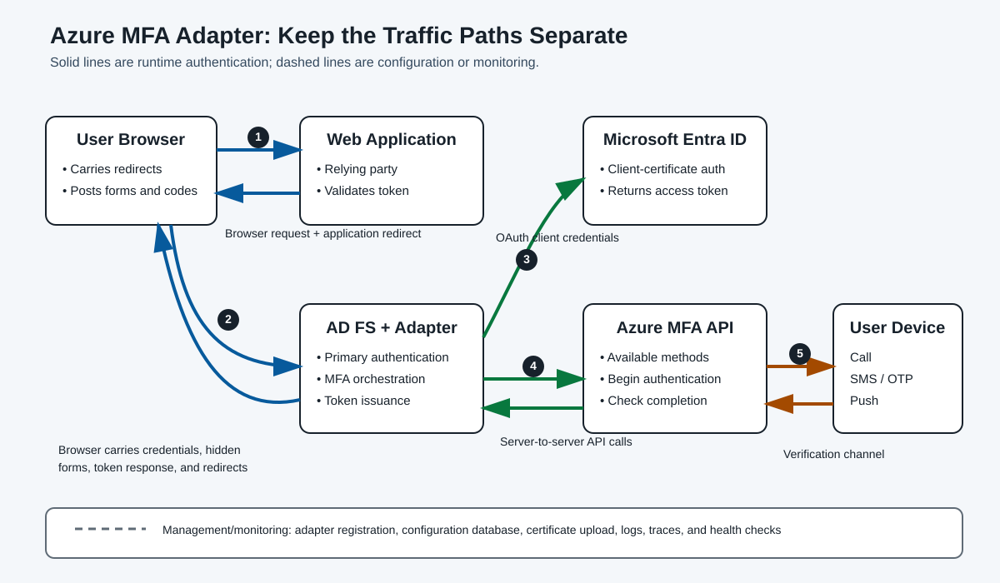
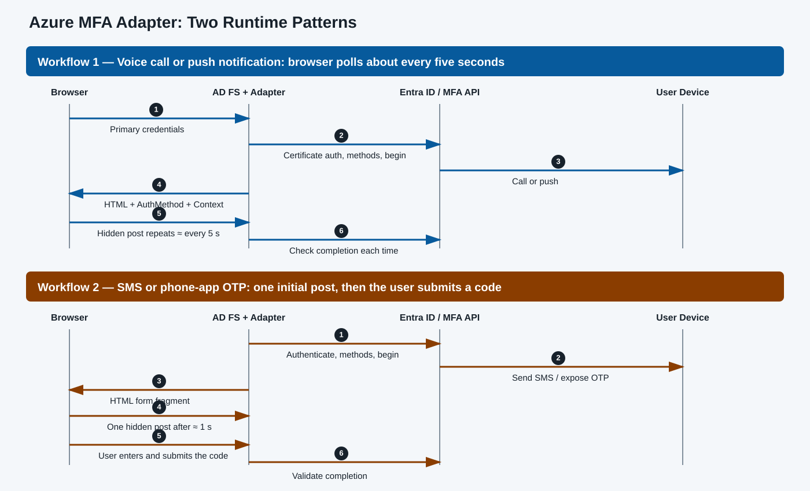

# Day 36: AD FS MFA Adapters—Architecture, Azure Workflows, and Troubleshooting

This beginner-friendly lesson explains how a multifactor authentication (**MFA**) adapter extends Active Directory Federation Services (**AD FS**), how the built-in Azure MFA adapter works, and how to diagnose its most common failures. Follow the sequence from concepts to configuration, runtime flows, evidence collection, and issue-specific fixes.

> [!IMPORTANT]
> Keep these paths separate while reading traces:
>
> 1. **Browser-carried federation traffic:** the browser follows redirects and posts forms between the claim-aware application and AD FS. The application and AD FS do not normally exchange these browser messages directly.
> 2. **Server-to-server runtime traffic:** the AD FS server authenticates to Microsoft Entra ID and calls the Azure MFA service application programming interface (**API**). The browser does not carry these API calls.
> 3. **User verification traffic:** the MFA service sends a voice call, text message, or push notification to the user's registered device.
> 4. **Configuration and management:** administrators register adapters, store configuration in the AD FS configuration database, upload certificate credentials, and restart services. These are not per-sign-in messages.
> 5. **Monitoring:** AD FS logs, Microsoft Entra security token service (**ESTS**) logs, Azure MFA logs, Fiddler, and network captures observe the flow; they do not perform authentication.



## Learning Path and Outcomes

The original Cloud Academy material was divided into two parts:

| Part | Lessons | Focus |
|---|---|---|
| 1. AD FS MFA adapter fundamentals | What an MFA adapter is; main functions | Recognize adapter types and understand how a custom adapter is built, registered, and debugged. |
| 2. Azure MFA adapter and troubleshooting | Azure MFA workflows; common issues | Analyze Azure MFA behavior and use a repeatable troubleshooting method. |

After completing this lesson, you should be able to:

- define an MFA adapter and its role at an identity provider (**IdP**);
- identify the main AD FS MFA adapter types;
- distinguish the principal adapter classes and functions named in the source;
- explain how a custom adapter is registered and reloaded;
- configure the Azure MFA adapter as an additional authentication method;
- compare the supported Azure MFA runtime workflows;
- distinguish browser-carried messages from AD FS–to-cloud API calls;
- collect and correlate useful troubleshooting evidence; and
- diagnose connectivity, loading, tenant ID, redirect-loop, locale, and certificate-renewal problems.

### Prerequisites and Scope

The source expects:

- basic knowledge of federation authentication flows; and
- basic familiarity with Visual Studio.

The course focuses on custom/third-party adapters and the Azure MFA adapter. It also mentions two lab exercises: one to build an MFA adapter lab and another to simulate common issues. The source does not include the promised custom-adapter implementation lab or detailed class definitions; it names only the runtime functions discussed later. This lesson preserves that boundary rather than inventing missing implementation details.

---

## Part 1: MFA Adapter Fundamentals

### What Is an MFA Adapter?

Users signing in to Azure or Microsoft 365 may complete MFA through a phone call, Short Message Service (**SMS**) code, or the Microsoft Authenticator mobile app. AD FS can similarly integrate with:

- the Azure MFA service;
- a third-party MFA provider; or
- an MFA provider developed by your organization.

The integration component is an **MFA adapter**: an authentication component implemented at the IdP that helps the IdP perform and verify multifactor authentication.

After primary authentication succeeds, an adapter generally must:

1. Return an interactive web page that explains the next action—for example, that a push notification or phone call is being sent—or prompts for an SMS code.
2. Start MFA, often by calling an external provider API such as the Azure MFA service.
3. Check whether the user completed MFA successfully.

### Adapter Types

| Adapter type | Description | Course coverage |
|---|---|---|
| **Custom MFA adapter** | An adapter developed by your organization or a third party against interfaces exposed by AD FS. | Covered |
| **Azure MFA adapter** | Built into AD FS beginning with Windows Server 2016. | Covered in depth |
| **On-premises MFA Server AD FS adapter** | A component of the Microsoft on-premises MFA Server product. | Mentioned only; it is no longer available to new customers, and cases for existing customers are rare. |

> [!WARNING]
> The source states that AD FS MFA adapters operate only in passive, interactive authentication scenarios. They do not operate for active protocols such as WS-Trust against an endpoint such as `/usernamemixed`. If an AD FS policy requires MFA for such an active endpoint, access can be blocked because the client cannot complete the adapter's interactive UI.

### Runtime Responsibilities and Named Functions

The source identifies these adapter functions:

| Function | Role described or implied by the runtime flow |
|---|---|
| `IsAvailableForUser` | Determines whether the authentication method is available for the current user. The source misspelled this as `IsAvailaleForUser`. |
| `BeginAuthentication` | Starts the MFA interaction and returns the appropriate form fragment or instructions. |
| `TryEndAuthentication` | Processes a later browser submission and checks whether MFA has completed. |

The Azure MFA adapter is not source-visible in this material, but its observed behavior shows that it implements equivalent responsibilities.

### Passive Federation at a Glance

In the passive flow:

1. A user browses to a claim-aware application.
2. The application redirects the **browser** to AD FS.
3. AD FS performs primary authentication.
4. The adapter performs additional authentication.
5. AD FS issues a token—described in the source as a Security Assertion Markup Language (**SAML**) token—and redirects the **browser** back to the application.
6. The application validates the token, creates its session, and sets browser cookies.

> [!NOTE]
> Steps 2 and 5 are browser-carried redirects or form responses. They are not normally direct application-to-AD FS server calls. Calls from the Azure MFA adapter to Microsoft Entra ID and the Azure MFA API are separate server-to-server HTTPS traffic.

### Custom Adapter Lifecycle

AD FS lets a developer implement the required interfaces and register a custom adapter. The custom or third-party dynamic-link library (**DLL**) must be installed in the Global Assembly Cache (**GAC**) on **every** AD FS server in the farm.

Whenever the AD FS service restarts, it reloads MFA adapter configuration data from the AD FS configuration database. `Export-AdfsAuthenticationProviderConfigurationData` can inspect the database-held configuration, while `Import-AdfsAuthenticationProviderConfigurationData` can change it before a reload.

#### Custom Adapter Command Reference

Run these examples from an appropriately elevated environment. Replace all placeholder names and paths.

| Goal | Command or cmdlet |
|---|---|
| Add a DLL to the GAC | `gacutil.exe /if "Path of MFA Adapter .dll file"` |
| List the GAC entry | `gacutil.exe /l "Name of your .dll file"` |
| Remove the exact GAC entry | `gacutil.exe /u "MFAadapter, Version=1.0.0.0, Culture=neutral, PublicKeyToken=2f41653665c215aa, processorArchitecture=MSIL"` |
| Register the provider | `Register-AdfsAuthenticationProvider` |
| Unregister the provider | `Unregister-AdfsAuthenticationProvider` |
| Inspect the provider | `Get-AdfsAuthenticationProvider` |
| Export/import configuration | `Export-AdfsAuthenticationProviderConfigurationData` / `Import-AdfsAuthenticationProviderConfigurationData` |

```powershell
gacutil.exe /if "Path of MFA Adapter .dll file"
gacutil.exe /l "Name of your .dll file"
gacutil.exe /u "MFAadapter, Version=1.0.0.0, Culture=neutral, PublicKeyToken=2f41653665c215aa, processorArchitecture=MSIL"

$typeName = "MFAadapter.MyAdapter, MFAadapter, Version=1.0.0.0, Culture=neutral, PublicKeyToken=2f41653665c215aa, processorArchitecture=MSIL"

Register-AdfsAuthenticationProvider -TypeName $typeName -Name "Your MFA Adapter" -ConfigurationFilePath "Config file path"
Unregister-AdfsAuthenticationProvider -Name "Your MFA Adapter"
Get-AdfsAuthenticationProvider -Name "Your MFA Adapter"

Export-AdfsAuthenticationProviderConfigurationData -Name "Your MFA Adapter" -FilePath "Config file path"
Import-AdfsAuthenticationProviderConfigurationData -Name "Your MFA Adapter" -FilePath "Config file path"
```

> [!CAUTION]
> These commands preserve the source's intended semantics, but they are templates, not copy-and-run production commands. Verify the adapter vendor's assembly name, version, public key token, processor architecture, configuration schema, installation procedure, and supported `gacutil.exe` version before use. Restarting AD FS affects authentication availability, so plan farm changes accordingly.

### Source Resources

- [Build a custom authentication method for AD FS](https://learn.microsoft.com/en-us/windows-server/identity/ad-fs/development/ad-fs-build-custom-auth-method)
- [Configure AD FS and Microsoft Entra multifactor authentication](https://learn.microsoft.com/en-us/windows-server/identity/ad-fs/operations/configure-ad-fs-and-azure-mfa)
- [Microsoft MFA Server with AD FS (previous versions)](https://learn.microsoft.com/en-us/previous-versions/entra/identity/authentication/howto-mfaserver-adfs-windows-server)

---

## Part 2: Configure the Azure MFA Adapter

### Built-In Support and Authentication Roles

Beginning with AD FS on Windows Server 2016, the Azure MFA adapter is built in; it does not require the manual provider registration used by the on-premises MFA Server adapter.

The source states that Azure MFA and custom MFA adapters can be used for both primary and secondary authentication beginning with Windows Server 2016. Using Azure MFA as primary authentication requires additional steps and is outside this lesson's scope. See [Azure MFA as primary authentication](https://learn.microsoft.com/en-us/windows-server/identity/ad-fs/operations/configure-ad-fs-and-azure-mfa#azure-mfa-as-primary-authentication).

### Configuration Lab: Additional Authentication

> [!IMPORTANT]
> Complete this setup in a lab before using the later troubleshooting exercises. The certificate is generated on each AD FS server in the farm.

The source labels both its second and third actions “Step 2.” They are normalized below as three sequential steps.

#### Step 1: Generate a Certificate on Each AD FS Server

```powershell
$certBase64 = New-AdfsAzureMfaTenantCertificate -TenantID "<tenantID>"
```

This creates the self-signed client certificate used by the Azure MFA adapter and captures its Base64 value.

#### Step 2: Add the Credential to the Azure MFA Client Service Principal

Before running this command:

1. Install the `MSOnline` PowerShell module.
2. Connect by using `Connect-MsolService`.
3. Use an account with the required administrative permissions; the source specifies a Global Administrator account.

```powershell
Connect-MsolService

New-MsolServicePrincipalCredential `
    -AppPrincipalId 981f26a1-7f43-403b-a875-f8b09b8cd720 `
    -Type asymmetric `
    -Usage verify `
    -Value $certBase64
```

The application ID `981f26a1-7f43-403b-a875-f8b09b8cd720` identifies the Azure MFA client service principal used throughout the source.

> [!CAUTION]
> `MSOnline` is the module used by the source material. Confirm its current support status and the current Microsoft-documented procedure before a production change; do not silently substitute a different management API because command and permission semantics may differ.

#### Step 3: Configure the AD FS Farm

```powershell
Set-AdfsAzureMfaTenant `
    -TenantId "<tenant ID>" `
    -ClientId 981f26a1-7f43-403b-a875-f8b09b8cd720
```

This configures Azure MFA for the farm and imports the adapter configuration into the AD FS configuration database.

See the official [AD FS server configuration steps](https://learn.microsoft.com/en-us/windows-server/identity/ad-fs/operations/configure-ad-fs-and-azure-mfa#configure-the-ad-fs-servers).

### Azure MFA Configuration Command Reference

```powershell
 # Generate a new self-signed Azure MFA adapter certificate.
$certBase64 = New-AdfsAzureMfaTenantCertificate -TenantID "TenantID/TenantName"

 # Add the certificate credential to the Azure MFA client service principal.
New-MsolServicePrincipalCredential `
    -AppPrincipalId 981f26a1-7f43-403b-a875-f8b09b8cd720 `
    -Type asymmetric `
    -Usage verify `
    -Value $certBase64

 # Inspect credentials on the Azure MFA client service principal.
Get-MsolServicePrincipalCredential `
    -AppPrincipalId 981f26a1-7f43-403b-a875-f8b09b8cd720 `
    -ReturnKeyValues 1

 # Store the tenant/client configuration in the AD FS configuration database.
Set-AdfsAzureMfaTenant `
    -TenantId "TenantID/TenantName" `
    -ClientId 981f26a1-7f43-403b-a875-f8b09b8cd720

 # Export the configuration currently stored for the adapter.
Export-AdfsAuthenticationProviderConfigurationData `
    -Name AzureMfaAuthentication `
    -FilePath "path"
```

> [!CAUTION]
> `TenantID/TenantName` and `path` are placeholders. Use a consistent tenant identifier that matches the generated certificate subject, as explained in Issue 3.

---

## Part 3: Understand the Azure MFA Runtime Workflows

### Supported Methods and Workflow Groups

The source lists four Azure MFA methods:

| Source method name | User interaction | Workflow group |
|---|---|---|
| `TwoWayVoiceMobile` | User answers and approves a phone call. | Polling |
| `PhoneAppNotification` | User approves a push notification. | Polling |
| `OneWaySMS` | User enters a received SMS code. | User-entered code |
| `PhoneAppOTP` | User enters a one-time password (**OTP**) from the phone app. | User-entered code |

`TwoWayVoiceMobile` and `PhoneAppNotification` have nearly identical adapter behavior. `OneWaySMS` and `PhoneAppOTP` form the second group.



### Workflow 1: Voice Call or Push Notification

1. **Browser → application:** The user opens a claim-aware web application.
2. **Application → browser → AD FS:** Because no application session exists, the application redirects the browser to AD FS.
3. **Browser ↔ AD FS:** The user submits credentials, and AD FS verifies primary authentication.
4. **AD FS → Microsoft Entra ID:** The adapter authenticates with its self-signed client certificate. This is the OAuth 2.0 client credentials flow; Microsoft Entra ID returns an access token.
5. **AD FS → Azure MFA API:** The adapter places that access token in the Hypertext Transfer Protocol (**HTTP**) `Authorization` header and calls `GetAvailableUserAuthenticationMethods`. The response contains the user's default method and other available methods.
6. **AD FS → Azure MFA API:** The adapter calls `BeginTwoWayAuthenticationRequest`. The service starts the phone call or push notification. AD FS returns the browser a Hypertext Markup Language (**HTML**) form fragment containing `AuthMethod` and `Context`.
7. **MFA service ↔ user's phone:** The user receives and approves the call or push.
8. **Browser → AD FS:** While approval is pending, page JavaScript sends a hidden form post containing `AuthMethod` and `Context` about every five seconds.
9. **AD FS → Azure MFA API:** For each hidden post, the adapter calls `EndTwoWayAuthentication` to check the status. Polling continues until timeout or a success/failure response.
10. **AD FS → browser → application:** On success, the adapter emits an authentication-method claim. AD FS issues the SAML token and redirects the browser back. The application validates the token, sets its browser session cookies, and signs the user in.

Example claim:

```text
Claim name: http://schemas.microsoft.com/ws/2008/06/identity/claims/authenticationmethod
Value:      http://schemas.microsoft.com/ws/2012/12/authmethod/phoneappnotification
```

### Workflow 2: SMS Code or Phone-App OTP

1. **Browser → application:** The user opens the claim-aware web application.
2. **Application → browser → AD FS:** The application redirects the unauthenticated browser to AD FS.
3. **Browser ↔ AD FS:** The user submits credentials, and AD FS verifies them.
4. **AD FS → Microsoft Entra ID:** The adapter authenticates with its client certificate and receives an access token.
5. **AD FS → Azure MFA API:** The adapter calls `GetAvailableUserAuthenticationMethods`.
6. **AD FS → Azure MFA API:** The adapter calls `BeginTwoWayAuthenticationRequest`; the Azure MFA service sends the SMS code or makes the phone-app OTP available. AD FS returns an HTML form fragment to the browser.
7. **Browser → AD FS:** About one second later, JavaScript sends one hidden form post containing `AuthMethod` and `Context`; unlike Workflow 1, this initial post does not repeat.
8. **AD FS → Azure MFA API:** The adapter calls `EndTwoWayAuthentication` to confirm that the code was sent or made available.
9. **User → browser → AD FS:** The user enters the SMS code or phone-app OTP. The browser posts the code with a new `AuthMethod` and `Context` set.
10. **AD FS → Azure MFA API:** The adapter calls `EndTwoWayAuthentication` again to validate completion. On success, it emits the authentication-method claim.
11. **AD FS → browser → application:** AD FS issues the SAML token and redirects the browser to the application. After validation, the application creates a session and sets cookies.

### State, Tokens, and Certificates

- The adapter authenticates to Microsoft Entra ID before calling the Azure MFA API.
- The source says the access token is valid for one hour, so client authentication is not repeated while that token remains valid.
- The server-side authentication is the OAuth 2.0 client credentials flow, using a client ID and client certificate. It is not the user's browser federation flow.
- AD FS is a stateless service. It places encoded MFA state—such as the User Principal Name (**UPN**), available methods, and MFA session ID—into `AuthMethod` and `Context` values in the returned HTML form fragment.
- The browser silently returns those values in hidden form posts. They are not visible in the normal page interface, but Fiddler or browser developer tools can inspect them.
- The client certificate is self-signed, generated during configuration, valid for two years according to the source, and not renewed automatically. If it expires or becomes invalid, MFA fails.

### Capture Browser-Side and AD FS–Side Traffic

Browser-side Fiddler capture is straightforward and reveals passive redirects, form fragments, `AuthMethod`, and `Context`. Capturing decrypted HTTPS calls from AD FS to cloud endpoints requires additional setup.

#### AD FS Server-Side Fiddler Procedure

1. Set the WinHTTP proxy from an elevated prompt:

   ```powershell
   netsh winhttp set proxy 127.0.0.1:8888
   ```

2. Sign in with the AD FS service account, or use `runas` to open a command environment under that account.
3. Launch Fiddler in the service-account context and configure HTTPS decryption if it is not already configured.
4. Restart the AD FS service so it uses the changed proxy setting.
5. Reproduce the issue and inspect the server-side trace.
6. After removing the proxy, restart the AD FS service again so the removal takes effect.

> [!WARNING]
> A debugging proxy that decrypts HTTPS introduces certificate trust, credential exposure, privacy, and service-availability considerations. Use it only with authorization in a controlled environment, protect the capture, and remove both the proxy and temporary trust afterward. The source does not provide the proxy-removal command; verify the approved local procedure rather than guessing.

Use different MFA methods when testing because the hidden-form timing and `EndTwoWayAuthentication` pattern differ between the two workflow groups.

---

## Part 4: A Repeatable Troubleshooting Method

### Choose Evidence That Matches the Suspected Path

You do not need every data source for every incident.

| Evidence | Path observed | Best use |
|---|---|---|
| Network trace on AD FS | Domain Name System (**DNS**), Transmission Control Protocol (**TCP**), and Transport Layer Security (**TLS**) from AD FS to an MFA API | Find name-resolution, handshake, proxy, firewall, or cipher problems. |
| Client-side Fiddler trace | Browser-carried passive federation | Inspect redirects and the HTML form fragment returned by the adapter. |
| AD FS-side Fiddler trace | Decrypted server-to-server HTTPS | Inspect AD FS calls to the Azure MFA API. |
| AD FS Admin and Debug logs | Local AD FS processing | Find adapter load errors, function entry/exit, exceptions, and call stacks. |
| Microsoft Entra ESTS logs | Adapter authentication to Microsoft Entra ID | Examine certificate-based client authentication; query through Kusto or the internal tools named in the source. |
| Azure MFA logs | MFA delivery and user action | Investigate a missing call, SMS, or push notification; the source names ASC or Jarvis queries. |
| Authentication-provider metadata | AD FS management state | Confirm provider names and basic registered metadata. |
| Exported adapter configuration | Configuration database state | Verify the configuration that AD FS has loaded. |

> [!NOTE]
> The source names Kusto, ASC, Jarvis, and LogsMiner as environment-specific investigation tools but does not define their access, schemas, or query syntax. Use only tools available and authorized in your environment.

### Inspect Provider Metadata and Configuration

```powershell
Get-AdfsAuthenticationProvider | Format-List Name
Get-AdfsAuthenticationProvider -Name AzureMfaAuthentication

Export-AdfsAuthenticationProviderConfigurationData `
    -Name AzureMfaAuthentication `
    -FilePath "path"
```

Replace `AzureMfaAuthentication` with another adapter name when appropriate.

### Make Production Debug Logs Manageable

Production farms may contain multiple AD FS servers and many concurrent sign-ins. Use this sequence:

1. If possible, add a temporary `HOSTS` entry on the client to target one AD FS server and reproduce the issue there. This reduces the debug-log scope to one server.
2. Record the sign-in's correlation identifier.
3. Filter AD FS events with the correlation identifier:

   ```text
   *[System[Correlation[@ActivityID='{correlation ID}']]]
   ```

4. Search for keywords such as `ENTER:` and `Exit:` to identify the active AD FS function.
5. Read the surrounding context and call stack; do not stop at the error text.

Example function-entry evidence:

```text
ENTER: RequiresSecondStageAuthentication
Entering ExternalAuthenticationHandler.Process() Identifier: AzureMfaAuthentication
```

The following source examples mean that `TryEndAuthentication` ran and AD FS called the Azure MFA API's `EndTwoWayAuthentication` operation to check progress:

```text
ProcessInProgress: labuser01@azurehybrid.tk (Upn: labuser01@azurehybrid.tk, AltId: ) Calling EndTwoWayAuthentication, ContextId: 12c6a683-e9f2-4cd4-9b9d-c8801e279563, ActivityId: 909b04d6-0f68-4dcc-8e51-8c36bce20ce7, SessionId: 250209d2-125d-4874-b181-8c6873fd01d9.

TryEndAuthentication: labuser01@azurehybrid.tk (Upn: labuser01@azurehybrid.tk, AltId: ) Total duration: 157, ContextId: 12c6a683-e9f2-4cd4-9b9d-c8801e279563, ActivityId: 909b04d6-0f68-4dcc-8e51-8c36bce20ce7.
```

> [!TIP]
> Collect related evidence at approximately the same timestamp and preserve the correlation, activity, context, session, or request identifiers. That is how browser, AD FS, ESTS, and MFA evidence becomes one end-to-end timeline.

---

## Part 5: Troubleshoot Common Issues

### Quick Triage Matrix

| Symptom | Likely area | First evidence | Typical corrective direction |
|---|---|---|---|
| `Exception calling SAS`; connection failure | AD FS outbound network/TLS | Network trace and AD FS logs | Allow required endpoints; correct TLS/ciphers. |
| Adapter fails while AD FS starts | DLL/GAC/provider registration | AD FS Admin log and `gacutil /l` | Install/register on every farm node. |
| Immediate failure and HTTP 401 | Tenant/certificate mismatch | Exported config and local certificate | Align `TenantId` with certificate subject. |
| Repeating registration redirects | AD FS MFA policy plus `onload.js` proof-up redirect | Client Fiddler trace and `onload.js` | Break the circular dependency; use Conditional Access for Microsoft Entra/Microsoft 365 apps. |
| “No style sheet ... default locale” | Adapter LCID versus service-account locale | Provider metadata/vendor info and culture check | Align supported locale identifier. |
| MFA stops near certificate expiry | Certificate lifecycle | AD FS warning, credential listing, ESTS evidence | Renew and upload correctly; verify use. |

### Issue 1: Network Connectivity to Microsoft Entra ID or an MFA API

#### Symptom and Evidence

The AD FS page may show:

```text
Exception calling SAS
```

AD FS Admin or Debug logs may report:

```text
Unable to connect to the remote server.
```

This indicates a possible connectivity problem between AD FS and Microsoft Entra ID, the Azure MFA API, or—for a custom adapter—a third-party MFA API.

#### Possible Causes

- A firewall or proxy blocks `login.microsoftonline.com`, described by the source as the Microsoft Entra authentication endpoint.
- A firewall or proxy blocks `adnotifications.windowsazure.com`, described by the source as an Azure MFA service endpoint.
- The third-party MFA API is blocked.
- TLS 1.2 is not being used.
- The configured cipher suites are not accepted by Microsoft Entra ID or the MFA API.

#### Troubleshoot and Fix

1. Capture a network trace on the AD FS server.
2. Check, in order, DNS resolution, TCP establishment, and the TLS handshake.
3. Review AD FS Admin and Debug logs at the same timestamp.
4. Unblock the required destination through the firewall or proxy.
5. Enable TLS 1.2 and cipher suites supported by the target service.

> [!CAUTION]
> Cloud endpoint inventories can change. Treat the two hostnames above as source evidence, not necessarily a complete current allowlist. Verify the current official endpoint documentation before changing production firewall rules.

### Issue 2: Adapter Not Configured or Loaded Correctly

#### Symptom

When the AD FS service restarts, its Admin log reports that it:

```text
Failed to load ADFS MFA Adapter.
```

#### Possible Causes

- A custom or third-party adapter DLL was not placed in the GAC on one secondary AD FS server.
- The DLL was removed from the GAC.
- The assembly exists but cannot be loaded.
- The adapter was not installed or registered correctly.

#### Troubleshoot and Fix

1. Restart the AD FS service in an approved maintenance window; adapters reload only when the service restarts.
2. Review the AD FS Admin log during startup.
3. Verify the assembly:

   ```powershell
   gacutil.exe /l "Name of your .dll file"
   ```

4. If the DLL is absent, install it on the affected server.
5. Reinstall and register the custom or third-party adapter according to the vendor procedure.
6. Repeat the check on every AD FS farm node.

See [Gacutil.exe (Global Assembly Cache Tool)](https://learn.microsoft.com/en-us/dotnet/framework/tools/gacutil-exe-gac-tool).

### Issue 3: Azure MFA Adapter `TenantId` Is Incorrect

#### Symptom

The user fails immediately after entering a password. The page shows `Exception calling SAS`, and the AD FS Admin log contains:

```text
The remote server returned 401 error.
```

#### Cause

AD FS uses `TenantId` from the adapter configuration to locate the Azure MFA certificate in the local computer certificate store. A failure can occur when that value does not match the certificate subject—for example, the configuration uses an `onmicrosoft.com` tenant name while the certificate uses the tenant globally unique identifier (**GUID**), or vice versa. The source notes that this often appears after certificate renewal.

Source example:

```xml
<ConfigurationData xmlns:xsi="http://www.w3.org/2001/XMLSchema-instance"
                   xmlns:xsd="http://www.w3.org/2001/XMLSchema">
  <TenantId>contoso.onmocrosoft.com</TenantId>
  <ClientId>981f26a1-7f43-403b-a875-f8b09b8cd720</ClientId>
  <Environment>Public</Environment>
</ConfigurationData>
```

> [!WARNING]
> The source spells the example domain `contoso.onmocrosoft.com`. This likely intends `contoso.onmicrosoft.com`, but it is preserved above as source data. Verify the real tenant identifier; do not copy this example.

#### Troubleshoot and Fix

1. Collect AD FS Admin and Debug logs.
2. Export the active configuration:

   ```powershell
   Export-AdfsAuthenticationProviderConfigurationData `
       -Name AzureMfaAuthentication `
       -FilePath "path"
   ```

3. Compare `TenantId` with the Azure MFA certificate subject in the local computer certificate store.
4. The source also mentions a `getazuremfaconfig` PowerShell module as a more direct way to check both configuration and certificate, but provides no authoritative link or usage. Verify its origin and trustworthiness before installing or running it.
5. Correct the tenant value:

   ```powershell
   Set-AdfsAzureMfaTenant `
       -TenantId "TenantID/TenantName" `
       -ClientId 981f26a1-7f43-403b-a875-f8b09b8cd720
   ```

### Issue 4: Azure MFA Registration Redirect Loop

#### Conditions

The loop occurs when all of these are true:

1. The user has not registered for MFA.
2. The Azure MFA adapter is in use.
3. AD FS enforces MFA for the Microsoft 365/Microsoft Entra ID relying-party trust.
4. The AD FS `onload.js` file was modified to redirect an unregistered user to the Azure MFA registration, or “proof-up,” page.

#### Why It Loops

Without the `onload.js` modification, an unregistered user receives an error on the AD FS sign-in page. The customization tries to improve that outcome by redirecting the user to proof-up, but it creates a circular dependency:

1. AD FS requires MFA before issuing a token to Microsoft Entra ID.
2. The user cannot satisfy MFA because registration is incomplete.
3. `onload.js` redirects the browser to the Microsoft Entra MFA proof-up page.
4. Proof-up requires Microsoft Entra authentication.
5. Microsoft Entra redirects the browser to federated AD FS authentication.
6. AD FS again requires the MFA that the user has not registered.
7. The cycle repeats.

> [!IMPORTANT]
> These are browser-carried redirects between AD FS and Microsoft Entra endpoints. They are not repeated direct server-to-server token calls between the Microsoft Entra relying party and AD FS.

#### Troubleshoot and Fix

1. Capture a client-side Fiddler trace and follow each redirect.
2. Inspect whether the `onload.js` customization is active.
3. Do not use this AD FS-enforced Azure MFA pattern for the Microsoft Entra ID/Microsoft 365 relying-party trust.
4. Use Microsoft Entra Conditional Access policies to control MFA for Microsoft Entra ID and Microsoft 365 applications, as recommended by the source.

The JavaScript discussed by the source is associated with [Configure AD FS and Microsoft Entra multifactor authentication](https://learn.microsoft.com/en-us/windows-server/identity/ad-fs/operations/configure-ad-fs-and-azure-mfa).

### Issue 5: Default Locale Mismatch with a Custom Adapter

#### Symptom

The AD FS sign-in page and Admin log show:

```text
No style sheet is configured in the active theme for default locale [en-US/1033].
```

#### Cause

A third-party adapter declares `AvailableLcids` in its metadata. Each locale identifier (**LCID**) tells AD FS which languages the adapter supports. The error occurs when none of those LCIDs matches the locale used under the AD FS service-account context.

#### Troubleshoot and Fix

1. Ask the adapter vendor for the supported languages and LCIDs.
2. Compare them with the AD FS service account's current culture. Sign in as that account, or open PowerShell through `runas` as that account, and run:

   ```powershell
   [System.Threading.Thread]::CurrentThread.CurrentCulture
   ```

3. Ask the vendor whether an additional matching LCID can be enabled in the adapter configuration.
4. The source's more common solution is to modify the AD FS service account's locale information through the registry so it matches a supported adapter LCID.

> [!CAUTION]
> The source does not provide the registry path or the referenced “More information” link. Do not guess. Obtain the vendor's or Microsoft's documented procedure, back up relevant settings, and test the change before production use.

### Issue 6: Azure MFA Certificate Renewal

#### Questions to Answer

- Is the self-signed Azure MFA adapter certificate renewed automatically?
- How can administrators monitor its expiration?
- What is the correct renewal process?
- How can administrators prove that AD FS is using the new certificate?

The source answers the first question clearly: **the certificate is not renewed automatically**. AD FS Admin and Debug logs warn when it is nearing expiration, and monitoring tools can watch the Admin log and notify administrators.

#### Renewal Decision Table

| Current certificate state | Source procedure | Timing described by source |
|---|---|---|
| Already expired | Generate without `-Renew`; the old certificate is removed. | New certificate is valid immediately. |
| Not yet expired | Generate with `-Renew`, then add the new credential to the Azure MFA client service principal. | New certificate becomes valid after one day (24 hours); upload it within that day or MFA may stop. |

If the current certificate has expired:

```powershell
New-AdfsAzureMfaTenantCertificate -TenantID "TenantID/TenantName"
```

If it has not expired:

```powershell
New-AdfsAzureMfaTenantCertificate -TenantID "TenantID/TenantName" -Renew
```

Preserve these additional source cautions:

1. Check the previous certificate subject and use the same tenant ID or tenant name. A mismatch can stop MFA.
2. The source says that, in the non-expired case, the customer must add the new certificate to the Microsoft Entra Azure MFA client service principal within one day.
3. The source also says to delete the old certificate before generating a new one in that case; otherwise the cmdlet may return `Object reference not set to instance of an object`. It identifies this as a potential bug and cites [MicrosoftDocs/windows-powershell-docs issue 2178](https://github.com/MicrosoftDocs/windows-powershell-docs/issues/2178).
4. After the old certificate expires and is no longer used, it can be removed safely.

> [!WARNING]
> The “delete the old certificate before renewal” instruction may conflict with safe rollover expectations and could create an outage if applied incorrectly. Preserve it as a source troubleshooting note, but verify the current official Microsoft renewal procedure, certificate-store target, overlap behavior, and farm-wide steps before deleting any certificate.

#### Verify Which Certificate AD FS Uses

Normally, monitor Event ID 547 in the AD FS Admin log, as described by the official procedure. The source observed that Event 547 did not appear in some cases.

When the event is absent:

1. Query ESTS logs around the authentication timestamp.
2. Filter with:
   - MFA client application ID `981f26a1-7f43-403b-a875-f8b09b8cd720`;
   - the tenant ID; and
   - the approximate timestamp.
3. Use the resulting `CorrelationID` or `RequestID` to query ASC/LogsMiner.
4. Inspect the result to determine which certificate AD FS used during client authentication.

This final check observes the **AD FS server-to-Microsoft Entra runtime authentication**, not browser redirects, configuration replication, or certificate management.

---

## Final Diagnostic Checklist

1. Identify whether the failing path is browser-carried, AD FS–to-cloud, device delivery, configuration, or monitoring.
2. Confirm that the scenario is passive and interactive; do not expect an MFA adapter UI on active WS-Trust endpoints such as `/usernamemixed`.
3. Record the user, time, farm node, MFA method, correlation/activity IDs, and exact error.
4. Check provider metadata and export the configuration that AD FS actually loaded.
5. For a custom adapter, verify the DLL and registration on every farm node.
6. Trace DNS, TCP, TLS, and proxy behavior from the AD FS server to the required API.
7. Correlate browser, AD FS, ESTS, and Azure MFA evidence instead of reading one error in isolation.
8. Compare `TenantId`, certificate subject, service-principal credential, validity period, and actual certificate use.
9. Check hidden-form timing: repeated five-second polling for call/push, but a one-second initial post followed by user code entry for SMS/OTP.
10. Look for an `onload.js` proof-up loop when AD FS enforces MFA for the Microsoft Entra/Microsoft 365 relying party.
11. Compare adapter `AvailableLcids` with the service-account culture.
12. Plan service restarts, proxy changes, and certificate rollover to avoid authentication outages.

The key troubleshooting habit is to build one timestamped story: what the browser carried, what AD FS processed, what the adapter called, what the MFA service delivered, and which configuration and certificate were active.
