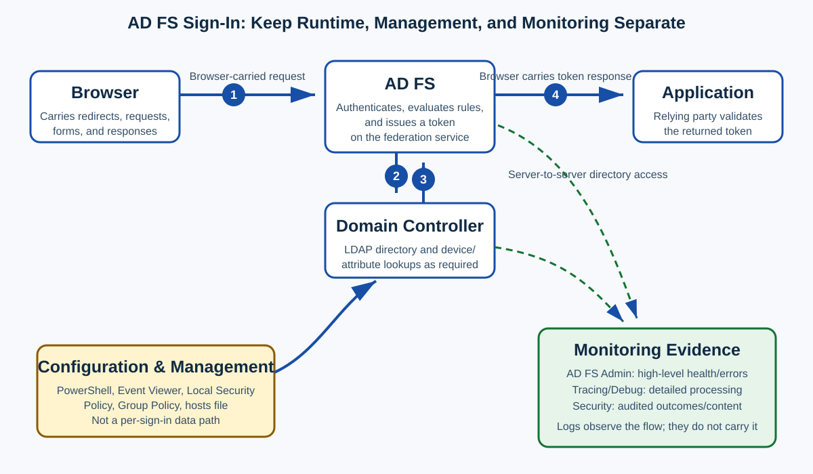
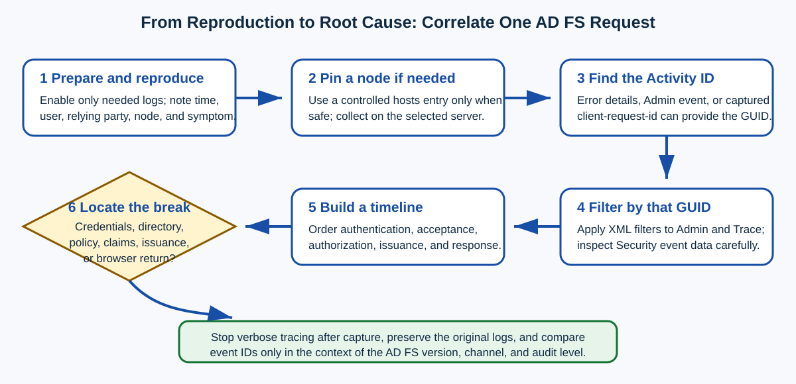
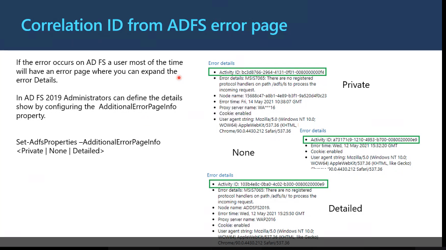
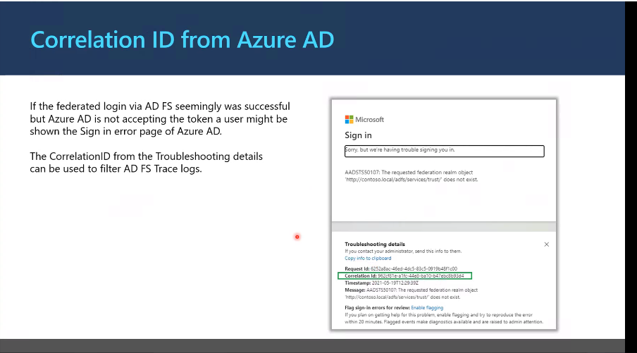
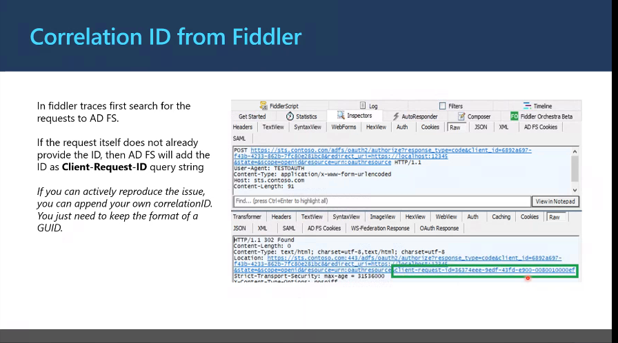
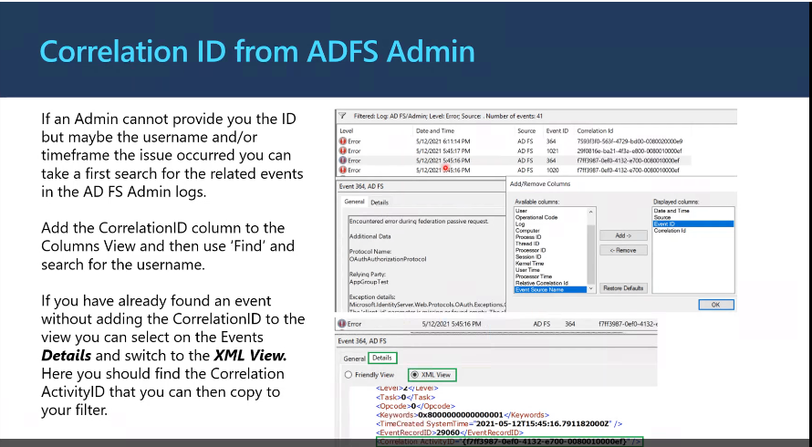
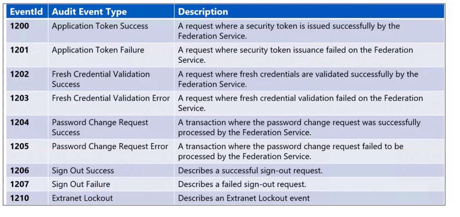
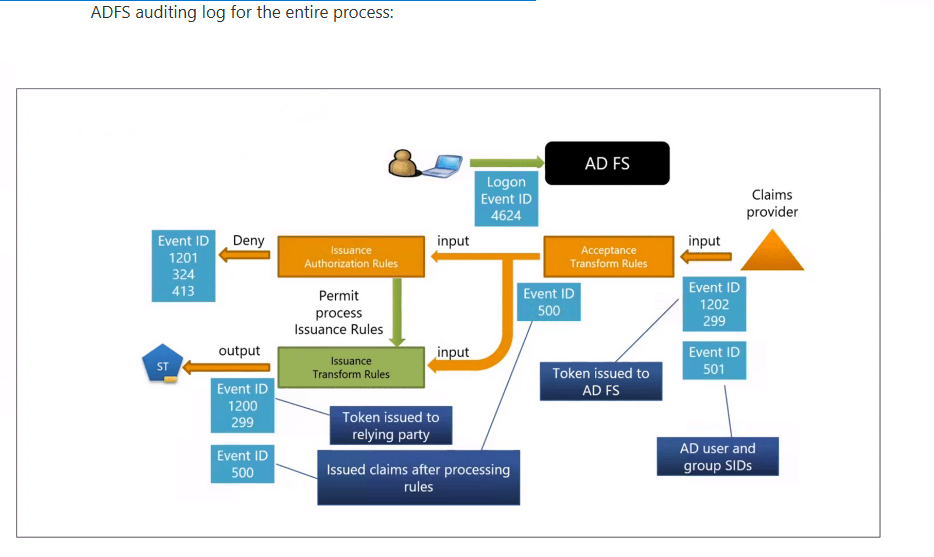

# Day 38: Collecting, Correlating, and Analyzing AD FS Logs

This beginner-friendly lesson explains how to enable, collect, filter, and interpret Active Directory Federation Services (**AD FS**) logs. You will move from the three main log channels to a safe capture workflow, then follow one request through authentication, claim processing, authorization, token issuance, and the response.

> [!IMPORTANT]
> Keep these paths and activities separate:
>
> 1. **Browser-carried federation traffic:** the browser follows redirects and submits requests or forms between a relying party and AD FS. These messages are not normally a direct relying-party-to-AD FS back-channel exchange.
> 2. **Server-to-server runtime traffic:** AD FS may query a domain controller (**DC**) over Lightweight Directory Access Protocol (**LDAP**) for device or directory attributes.
> 3. **Configuration and management:** administrators use PowerShell, Event Viewer, Local Security Policy, Group Policy, or a hosts file. These actions configure or inspect the environment; they are not per-sign-in messages.
> 4. **Replication:** Active Directory and AD FS farm configuration replication distribute state independently of the sign-in being diagnosed.
> 5. **Monitoring:** Admin, Tracing/Debug, and Security logs record evidence. They observe the flow but do not perform authentication or carry the token.



## Learning Path and Outcomes

The original link-based course placed this material at **Lesson 3 of 14** and divided it into two parts. Its overview appeared at Lessons 4 and 8, and its detailed lessons ran from Lessons 5 through 10.

| Part | Original detailed lessons | Focus |
|---|---|---|
| **1. Collect AD FS logs** | Lesson 5: Admin and Debug; Lesson 6: auditing; Lesson 7: collection | Enable and review the Admin, Tracing/Debug, and Security logs; simplify collection in a multi-server farm. |
| **2. Filter and analyze AD FS logs** | Lesson 9: trace filtering; Lesson 10: analysis | Find an Activity ID, filter related events, and follow the token-issuance process. |

After completing this lesson, you should be able to:

- identify where to review the AD FS Admin log;
- enable and review detailed AD FS tracing;
- configure AD FS auditing and the supporting Windows audit policy;
- collect focused evidence when a farm contains several AD FS servers;
- find an Activity ID and apply Event Viewer Extensible Markup Language (**XML**) filters;
- explain when each log is useful; and
- follow the AD FS token-issuance process through trace and audit events.

### Prerequisite

You should understand basic federation authentication and authorization flows. In particular, remember that the browser usually carries redirects and protocol responses between the relying party and AD FS.

### Terminology

| Term | Meaning in this lesson |
|---|---|
| **Relying party (RP)** | An application or service that relies on AD FS to authenticate a user and issue claims. |
| **Claim** | A statement about a subject, such as a username, group, or authentication method. |
| **Token** | A signed security artifact containing claims that the relying party can validate. |
| **Activity ID** | A globally unique identifier (**GUID**) used to correlate events for an AD FS operation. |
| **Instance ID** | An additional identifier that can appear in audit event data; its exact use depends on the event and AD FS version. |
| **Home realm discovery** | The step that determines which identity provider or authentication path should handle a user. |

---

## Part 1: Enable and Collect AD FS Logs

### Choose the Right Log

Start with the least verbose source that can answer the question, then escalate only when necessary.

| Log | Event Viewer location | Default state described by the source | Best use | Cost or caution |
|---|---|---|---|---|
| **Admin** | **Applications and Services Logs > AD FS > Admin** | Enabled | High-level service health, warnings, failures, and a starting Activity ID | Less detail than a trace |
| **Tracing/Debug** | Under the AD FS tracing channel after analytic/debug logs are shown | Disabled | Detailed request processing, claim rules, authorization, and token issuance | Can generate large volumes quickly and affect performance |
| **Security/auditing** | **Windows Logs > Security** | Depends on Windows version, AD FS audit level, policy, and AD FS event settings | Authentication and token outcomes, request/response data, claims, password-update issues, and device-registration results | May contain sensitive information; verbose auditing creates many events |

> [!TIP]
> Record the exact test time, username, relying party, client location, symptom, and AD FS node before reproducing a problem. These details remain useful even if no correlation identifier is available.

### Review the Admin Log

The Admin log provides high-level information about issues and is enabled by default in the environment described by the source.

1. Open **Event Viewer**.
2. Expand **Applications and Services Logs**.
3. Expand **AD FS**.
4. Select **Admin**.
5. Locate events near the reproduction time and inspect their details for the username, relying party, error, and Activity ID.

### Enable and Review the Tracing/Debug Log

The Debug log contains detailed messages and is often the most useful source for deep troubleshooting. Because tracing can produce a large amount of data in a short time, enable it only for a controlled capture and disable it afterward.

#### Set the Trace Verbosity

Run the command that matches the installed AD FS generation from an elevated command prompt. The first command is for AD FS 3.0 and later; the second is for AD FS 2.0:

```powershell
wevtutil sl "AD FS Tracing/Debug" /l:5

wevtutil sl "AD FS 2.0 Tracing/Debug" /l:5
```

> [!NOTE]
> `wevtutil sl` configures an event log, and `/l:5` sets the source's requested verbosity. Verify the exact channel name on the target server because installed AD FS versions can expose different channel names. The original source wrote `tracing\debug`; Event Viewer paths and `wevtutil` channel names conventionally use `/`.

#### Show and Enable the Channel

1. Open **Event Viewer**.
2. Right-click **Applications and Services Logs**.
3. Select **View > Show Analytic and Debug Logs**. Additional nodes appear in the left pane.
4. Expand **AD FS Tracing**.
5. Right-click **Debug**, and then select **Enable Log**.
6. Reproduce the issue once.
7. Save the relevant events and disable verbose tracing after the capture.

> [!WARNING]
> Trace data can include identifiers, claims, endpoints, and other sensitive context. Protect exported logs, restrict access, and follow the organization's retention and redaction rules.

### Configure AD FS Auditing

Security auditing can help investigate:

- password-update behavior;
- request and response logging;
- request content and headers;
- device-registration results;
- credential validation; and
- whether AD FS issued a token.

Auditing requires more than one setting. The AD FS audit level controls how much AD FS emits, Windows audit policy permits application-generated audit events, and the AD FS console enables success and failure audits.

> [!NOTE]
> The source first says that auditing of the AD FS service account is disabled by default, then says that Windows Server 2016 AD FS enables **Basic** auditing by default. These statements describe different versions or layers of the audit setup: do not infer effective Security logging from the AD FS audit level alone. Verify every layer below on the actual server.

#### Understand the Audit Levels

Windows Server 2016 AD FS has **Basic** auditing enabled by default according to the source. Basic auditing normally produces five or fewer events for one request, reducing the number of events an administrator must review.

| Level | Purpose |
|---|---|
| **None** | Turns off AD FS auditing at this layer. |
| **Basic** | Records a compact set of events for each request; this is the Windows Server 2016 default described by the source. |
| **Verbose** | Records all available audit events and can generate a significant amount of information per request. |

Review the current properties:

```powershell
Get-AdfsProperties
```

Set one audit level at a time from an elevated PowerShell session:

```powershell
Set-AdfsProperties -AuditLevel None
Set-AdfsProperties -AuditLevel Basic
Set-AdfsProperties -AuditLevel Verbose
```

> [!CAUTION]
> The source presented the parameter as `none/basic/verbose`. That slash-separated text lists alternatives; it is **not** a literal value to paste into the command. Choose exactly one supported value.

#### Grant the Service Account the Audit Right

1. Select **Start > Programs > Administrative Tools > Local Security Policy**.
2. Go to **Security Settings > Local Policies > User Rights Assignment**.
3. Open **Generate security audits**.
4. On the **Local Security Setting** tab, verify that the AD FS service account is listed.
5. If it is absent, select **Add User or Group**, add the account, and select **OK**.

> [!NOTE]
> The original source called this folder “User Rights Management.” In Windows policy interfaces, the setting is normally under **User Rights Assignment**. Use the label shown by the target operating system or centrally managed Group Policy Object (**GPO**).

#### Enable the Required Windows Audit Policy

Use the path appropriate to the server's audit-policy configuration.

**If advanced audit policy is not enabled:**

1. Go to **Security Settings > Local Policies > Audit Policy**.
2. Open **Audit object access**.
3. Enable **Success** and **Failure**.

**If advanced audit policy is enabled:**

1. Go to **Security Settings > Advanced Audit Policy Configuration > System Audit Policies - Local Group Policy > Object Access**.
2. Open **Audit Application Generated**.
3. Enable **Success** and **Failure**.

Close Local Security Policy, open an elevated command prompt, and refresh policy:

```powershell
gpupdate /force
```

Check the effective Object Access audit category:

```powershell
auditpol /get /category:"Object Access"
```

> [!IMPORTANT]
> Local settings can be overwritten by domain GPOs. `gpupdate /force` is a management operation, and Group Policy distribution is a configuration path—not runtime federation traffic. Confirm the effective policy after refresh.

#### Enable Success and Failure Audits in AD FS

1. Open **AD FS Management** from **Start > Programs > Administrative Tools**.
2. In the **Actions** pane, select **Edit Federation Service Properties**.
3. Open the **Events** tab.
4. Select **Success audits** and **Failure audits**.
5. Select **OK**.
6. Reproduce a test and confirm that expected events appear in **Windows Logs > Security**.

#### Audit-Configuration Checklist

| Layer | What to verify | Evidence |
|---|---|---|
| AD FS properties | `AuditLevel` is appropriate | `Get-AdfsProperties` |
| User right | AD FS service account can generate security audits | **Generate security audits** policy |
| Windows audit policy | Application-generated/Object Access success and failure auditing are effective | `auditpol /get /category:"Object Access"` |
| AD FS service settings | Success and failure audit check boxes are selected | AD FS Management **Events** tab |
| Result | Security events appear for a controlled request | Event Viewer **Windows Logs > Security** |

### Collect Logs in a Multi-Server Farm

If several AD FS servers can receive the request, the source suggests using the client-side hosts file to direct a controlled test to one server and collecting logs there.

#### What the Hosts File Does

The hosts file is a local file stored on the computer that maps domain or NetBIOS names to IP addresses. Windows can consult it during name resolution before querying Domain Name System (**DNS**). If no local mapping exists, normal DNS resolution continues; if name resolution ultimately fails, the connection cannot be made.

The file is located at:

```text
C:\Windows\System32\drivers\etc\hosts
```

#### Pin a Controlled Test to One AD FS Server

1. Run **Notepad as administrator**.
2. Open the `hosts` file. In the Open dialog, select **All Files** so the extensionless file is visible.
3. Add a line containing the target AD FS server's IP address and the **federation service name**:

```text
192.0.2.10 fs.contoso.com
```

4. Do **not** put `#` in front of the entry; `#` makes the line a comment.
5. Save the file.
6. Confirm that the name resolves to the intended address.
7. Reproduce the issue and collect logs from that node.
8. Remove the temporary entry after testing and restore normal resolution.

> [!WARNING]
> This technique changes only that client's name resolution. It may bypass a load balancer, Web Application Proxy, health checks, or the normal network path. Use it only when the client can safely reach the selected node and the node presents a certificate valid for the federation service name. It does not change farm configuration or replicate anything.

#### Collection Decision Table

| Situation | Collection approach |
|---|---|
| Node is already known | Capture Admin, Trace, and relevant Security events on that node. |
| Load balancer can identify the selected node | Use its telemetry and collect from the identified node without changing client resolution. |
| Node is unknown and direct access is approved | Temporarily pin the federation service name in the test client's hosts file. |
| Web Application Proxy or external path is part of the symptom | Do not bypass it blindly; collect proxy and AD FS evidence for the actual path. |
| Problem may involve more than one node | Compare time-synchronized logs across nodes rather than assuming one-node evidence is complete. |

---

## Part 2: Filter and Analyze AD FS Logs

AD FS tracing records activities for operations performed during the capture period on an AD FS node and, where applicable, an AD FS proxy. Filtering makes analysis manageable, but it works best when the user or administrator supplies a precise time, username, relying party, and correlation identifier.



### Find the Activity ID

An Activity ID connects events that belong to the same AD FS operation. Depending on where the failure surfaced, use one of the following sources.

#### AD FS Error-Page Details

When an error occurs on AD FS, the browser may display an AD FS error page whose details contain the Activity ID.

In AD FS 2019, the source configures the amount of additional information with:

```powershell
Set-AdfsProperties -AdditionalErrorPageInfo Private
Set-AdfsProperties -AdditionalErrorPageInfo None
Set-AdfsProperties -AdditionalErrorPageInfo Detailed
```

Choose **one** supported value; the source's `Private\None\detailed` notation listed alternatives rather than one literal parameter.



> [!WARNING]
> Detailed error pages can expose information useful to an attacker. Use the least disclosure appropriate to the environment, especially on an externally reachable federation service.

#### Microsoft Entra ID Troubleshooting Details

If a federated sign-in reaches Microsoft Entra ID (formerly Azure Active Directory) but Microsoft Entra ID rejects the token, its troubleshooting details can provide a correlation ID and timestamp.



> [!CAUTION]
> The source states that the Microsoft Entra correlation ID is the same as the AD FS trace Activity ID in this scenario. Do not treat equality as universal across every protocol and service hop. Record both identifiers and the timestamp, then verify the relationship in the actual capture.

#### Captured Browser Request

In a Fiddler capture, the Activity ID may appear as `client-request-id` in a request sent by the **browser to AD FS**:

```text
client-request-id: <GUID>
```



> [!IMPORTANT]
> Fiddler is monitoring browser-carried traffic. It is not evidence that the relying-party server directly called AD FS. Captures may expose credentials, cookies, tokens, and personal data; collect and store them securely.

#### AD FS Admin Event

Search the AD FS Admin log near the reproduction time. A matching event can contain the username and correlation Activity ID in its details.



### Filter the Admin and Debug Logs

Once you have the Activity ID, use an Event Viewer XML query. Replace the placeholder GUID—including its braces—with the actual value:

```xml
*[System/Correlation/@ActivityID="{xxxxxxxx-xxxx-xxxx-xxxx-xxxxxxxxxxxx}"]
```

Apply the filter:

1. Open the AD FS **Admin** or **Tracing/Debug** log.
2. Select **Filter Current Log**.
3. Open the **XML** tab.
4. Select **Edit query manually**.
5. Replace the default `*` with the corrected query.
6. Substitute the actual Activity ID and apply the filter.

This correlation filter works for both the AD FS Admin and AD FS Tracing logs when events populate `System/Correlation/@ActivityID`.

### Filter the Security Log

Security events often store correlation information inside `EventData` rather than `System/Correlation`. The source supplies this initial filter:

```xml
*[EventData[Data and (Data='ActivityID')]]
```

It then supplies this filter after obtaining an Instance ID:

```xml
*[EventData[Data='Activity ID' or Data='Instance ID']]
```

> [!WARNING]
> These two source filters compare event-data **values** to the literal labels `ActivityID`, `Activity ID`, or `Instance ID`; they do not insert a specific GUID. Event schemas vary, so inspect one event's XML and filter the correct named field or actual value. Preserve the source queries as starting points, but verify them before relying on the result.

#### Original Fiddler Lab Example

The source's “FidlerLab” example—correctly spelled **Fiddler Lab**—uses this Activity ID:

```text
3cc71c24-3e83-4d19-0c01-0080020000fc
```

Its trace query is:

```xml
*[System/Correlation/@ActivityID="{3cc71c24-3e83-4d19-0c01-0080020000fc}"]
```

### Analyze the Tracing/Debug Log

The Debug log can expose the token-issuance pipeline: input claims, acceptance transform rules, authorization, relying-party issuance rules, and the response. The following sequence preserves the source's **AD FS 2019 example**.

> [!IMPORTANT]
> Event IDs and exact ordering can vary by Windows Server version, patch level, protocol, authentication method, policy, and log verbosity. Interpret them in sequence and in their event text; do not diagnose from an ID alone.

#### Token-Issuance Sequence

| Step | What AD FS does | Evidence described by the source |
|---:|---|---|
| 1 | Receives the request and performs home realm discovery. | Trace the selected identity/authentication path. |
| 2 | Checks enabled authentication methods and chooses one. | Confirm that the expected method is available and selected. |
| 3 | Captures input claims before acceptance transformation. | The first **Event ID 1000** contains input claims; inspect **Details**. |
| 4 | Authenticates the device as needed, creates an LDAP connection to a DC, and retrieves attributes. | Separate this server-to-server directory access from browser traffic. |
| 5 | Begins acceptance transform rules. | **Event ID 999** contains the rule content in the source example. |
| 6 | Processes claims through the rule. | **Event ID 111** identifies the claim being processed; **Event ID 128** shows the claim after the rule. |
| 7 | Completes the identity provider (**IdP**) issuance policy. | **Event ID 142** marks completion; the preceding **Event ID 140** contains overall output claims. |
| 8 | Processes the issuance authorization policy. | Again, **111** shows the claim being processed and **128** the output claim. |
| 9 | Summarizes whether authorization evaluated true or false. | Use this area for access-denied failures. |
| 10 | Processes the relying-party claim issuance policy. | **111** and **128** again show claim processing and output; **Event ID 144** finishes issuance-policy processing. |
| 11 | Sends the response. | Confirm that the pipeline reached response generation. The browser then carries the protocol response to the relying party in passive federation. |

#### Read Each Stage as a Question

1. **Home realm:** Did AD FS select the intended identity source?
2. **Authentication:** Was the expected method enabled and chosen?
3. **Input:** Were the expected incoming claims present?
4. **Directory/device lookup:** Did the required LDAP connection and attribute retrieval succeed?
5. **Acceptance transformation:** Did incoming claims become the expected accepted claims?
6. **Authorization:** Did policy permit token issuance?
7. **Relying-party issuance:** Were the outgoing claims created correctly?
8. **Response:** Did AD FS actually build and send the federation response?

#### Investigate `MSIS7068: Access denied`

If the AD FS sign-in page shows:

```text
MSIS7068: Access denied
```

and the Admin log reports:

```text
The federation service could not authorize token issuance for caller.
```

filter the Debug log by Activity ID and inspect issuance-authorization processing. Compare the input claims, every relevant rule, the `111`/`128` claim transitions, and the final true/false authorization summary. A successful primary authentication does not imply that authorization policy allowed issuance.

### Analyze the Security/Auditing Log

Use auditing primarily to determine whether AD FS successfully sent or failed to issue a token and, when the configured audit level permits it, to inspect request, response, and claim content.

#### Event Reference from the Source

The following image summarizes common AD FS audit events for token issuance, credential validation, password changes, sign-out, and extranet lockout:



Read the event pairs as **success and failure outcomes**. For example, Event 1200 represents token-issuance success in the source environment, while Event 1201 represents token-issuance failure. The event tells you the outcome, but the correlated Admin and Debug events usually provide the detail needed to explain why it happened.

| Event ID | Meaning given in the source | How to use it safely |
|---:|---|---|
| **4624** | User sign-in succeeded. | This is a Windows successful-logon event. Correlate time, account, logon type, process, and server; it does not by itself prove token issuance. |
| **4625** | User sign-in failed. | This is a Windows failed-logon event. Read status/substatus and correlate it with AD FS events. |
| **1200** | AD FS successfully issued the token to the relying party. | Treat as a token-issuance success marker in the source's environment. In passive flows, the browser carries the response to the relying party. |
| **1201** | AD FS failed to issue a token. | Treat as a failure marker, then use correlated Admin and Trace events to find the failing stage. |
| **1202** | AD FS validated the credentials. | Confirm the event provider, channel, text, Activity ID, and server version. |
| **1203** | Fresh credential validation failed. | Inspect the authentication method and failure details; a credential-validation failure occurs before successful token issuance. |
| **1204** | A password-change request succeeded. | Use this when investigating password-change activity rather than an ordinary token request. |
| **1205** | A password-change request failed. | Correlate the failure with password policy, connectivity, account state, and the detailed event message. |
| **1206** | A sign-out request succeeded. | This confirms that AD FS processed the sign-out request; it does not guarantee that every application session or cookie was removed. |
| **1207** | A sign-out request failed. | Review the protocol, endpoint, relying party, and accompanying Admin or Debug events. |
| **1210** | An extranet lockout event occurred. | Investigate the account, source, lockout mode, observation window, and related AD DS authentication evidence. |
| **299** | The token was “issued to AD FS successfully.” | This wording is preserved from the source but is ambiguous; verify the event text and direction before drawing a conclusion. |
| **500** | Claims in the issued token. | The source separately says Event 500 contains the token and issued claims. Confirm against the actual event schema. |
| **501** | Detailed claims. | The source associates this event with claim details in one passage. Confirm version and audit level. |

> [!CAUTION]
> The source assigns detailed claims to **both Event 500 and Event 501** in different passages. This may reflect different AD FS versions, audit modes, or an inconsistency in the source. Preserve both observations, but trust the event provider, message text, XML payload, server version, and configured audit level in the target environment.

#### Build the Audit Timeline

The next image maps audit evidence to a simplified claims-processing path. It shows authentication evidence entering AD FS, acceptance transform rules processing incoming claims, issuance authorization deciding whether the request is permitted, issuance transform rules creating outgoing claims, and the resulting security token being issued to the relying party.



Use the diagram from **right to left**:

1. The claims provider supplies incoming identity information.
2. **Acceptance transform rules** normalize or transform the incoming claims.
3. **Issuance authorization rules** decide whether the requester is allowed to receive a token.
4. If authorization denies the request, investigate the failure events and authorization-rule output.
5. If authorization permits the request, **issuance transform rules** create the claims intended for the relying party.
6. AD FS issues the security token, and the browser carries it to the relying party in a passive federation flow.

> [!IMPORTANT]
> This is a conceptual correlation diagram, not a promise that every request will produce every displayed event or that the events will always appear in exactly this order. The image also associates Event 299 with more than one point and uses the phrase “token issued to AD FS.” Verify the provider, message text, XML payload, Activity ID, AD FS version, protocol, and audit level before deciding what an event means in your environment.

For the source's example, look for this progression:

1. **4624** for a successful Windows logon, or **4625** for a failed one.
2. **1202** for credential validation.
3. **299** for the source's intermediate token-related milestone.
4. **501** for detailed claims where that event schema applies.
5. **1201** if AD FS failed to issue a token, or **1200** if it successfully issued one to the relying party.
6. **500** for the issued token's claims where that event schema applies.

Do not assume that every request generates every event. Audit level, Windows version, authentication method, protocol, and where the failure occurred all affect the evidence.

---

## End-to-End Troubleshooting Procedure

Use this repeatable process rather than searching every event indiscriminately.

1. **Define the symptom.** Record the user, client, relying party, federation service name, exact time with time zone, error text, and whether the request is internal or external.
2. **Map the traffic path.** Identify browser-carried messages, proxy/load-balancer hops, AD FS node, directory lookups, and relying-party return.
3. **Check time and node selection.** Ensure clocks are comparable and determine which server handled the request.
4. **Start with the Admin log.** Look for a high-level error and Activity ID.
5. **Prepare a focused capture.** Enable only the required Debug and audit settings; consider controlled hosts-file pinning only if safe.
6. **Reproduce once.** Avoid mixing multiple attempts in the same time window.
7. **Capture identifiers.** Record the AD FS Activity ID, any Instance ID, Microsoft Entra correlation ID, request ID, and timestamps without assuming they are identical.
8. **Filter Admin and Trace.** Use the corrected `System/Correlation/@ActivityID` XML query.
9. **Inspect Security event XML.** Locate the actual field/value before building an `EventData` query.
10. **Build the pipeline timeline.** Follow home realm, authentication, input claims, LDAP/device work, acceptance, authorization, issuance, and response.
11. **Compare outcomes.** Reconcile trace evidence with audit events such as 1200/1201 and 500/501.
12. **Stop and preserve.** Disable verbose tracing, export original logs, remove temporary hosts entries, and store evidence securely.

### Troubleshooting Matrix

| Symptom | First evidence | Next check | Common interpretation |
|---|---|---|---|
| No useful high-level error | AD FS Admin log and exact time/node | Enable a focused Debug capture | Admin logging may not expose the failing internal stage. |
| No Debug events | Channel visibility, enabled state, and trace level | Verify the installed channel name and reproduce after enabling | Tracing may still be disabled or the request reached another node. |
| No Security audit events | `Get-AdfsProperties`, user right, `auditpol`, AD FS Events tab | Check effective GPO and reproduce | One of the required auditing layers is missing. |
| Events appear on another server | Load-balancer/proxy telemetry | Collect across nodes or safely pin a test | The original capture targeted the wrong farm member. |
| Activity-ID filter returns nothing | Braces, GUID, channel, time, and event XML | Search by time/user and inspect `System/Correlation` | The ID came from another hop, the query is malformed, or the event uses another field. |
| Security filter returns too much or nothing | Raw event XML | Filter the actual named field/value | The source's literal-label query does not target a specific GUID. |
| `MSIS7068` / caller not authorized | Correlated Debug events | Issuance-authorization claims and true/false summary | Authentication may have succeeded but authorization denied issuance. |
| 4624 exists but application sign-in fails | AD FS 1200/1201 and response stage | Claims, token issuance, browser return, relying-party validation | Windows logon success does not prove a valid token reached or was accepted by the application. |
| AD FS issued a token but cloud rejects it | AD FS Activity ID, cloud correlation ID, timestamps | Token claims, signature/certificate, audience, issuer, and cloud details | The failure occurred after local issuance; identifiers may differ by hop. |

## Quick Reference

### Commands

| Goal | Command |
|---|---|
| Set AD FS 3.0+ trace level from the source | `wevtutil sl "AD FS Tracing/Debug" /l:5` |
| Set AD FS 2.0 trace level from the source | `wevtutil sl "AD FS 2.0 Tracing/Debug" /l:5` |
| Review AD FS properties | `Get-AdfsProperties` |
| Set Basic auditing | `Set-AdfsProperties -AuditLevel Basic` |
| Refresh policy | `gpupdate /force` |
| Review Object Access audit policy | `auditpol /get /category:"Object Access"` |
| Filter Admin/Trace by Activity ID | `*[System/Correlation/@ActivityID="{GUID}"]` |

### What Each Log Answers

| Question | Best starting log |
|---|---|
| What high-level AD FS error occurred? | Admin |
| Which claim rule or authorization stage failed? | Tracing/Debug |
| Were credentials or a Windows logon accepted? | Security, correlated with AD FS logs |
| Did AD FS report token issuance success or failure? | Security/auditing, especially 1200/1201 in the source environment |
| What claims entered, changed, or left the pipeline? | Tracing/Debug and, when available, audit events 500/501 |

## Conclusion

Effective AD FS troubleshooting depends on correlation, not event-counting. Begin with the Admin log, capture Debug and Security evidence only as needed, isolate the server that handled the request, and follow one Activity ID through authentication, claim transformation, authorization, issuance, and response.

Finally, treat event IDs as version- and context-dependent evidence. In the source environment, Event 1200 represented successful token issuance, Event 1201 represented failure, and Event 500 showed the claims in the token; the source also associated Event 501 with detailed claims. Always confirm those meanings in the actual event text and XML before reaching a conclusion.
