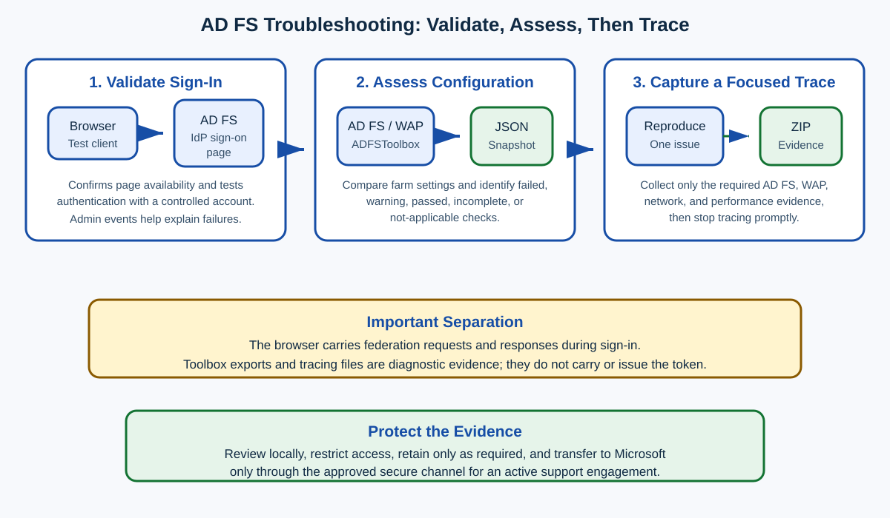

# Day 39: Validating and Troubleshooting AD FS

Active Directory Federation Services (**AD FS**) can fail for several different reasons: the sign-in page may be disabled, a farm setting may be incorrect, or a request may fail only while it is being processed. This lesson introduces three tools that answer different troubleshooting questions:

1. **The IdP-initiated sign-on page** checks whether the federation service is available and whether a controlled user can authenticate.
2. **ADFSToolbox diagnostics** capture configuration information and run health checks across AD FS and Web Application Proxy (**WAP**) servers.
3. **The AD FS diagnostic tracing script** collects detailed evidence while an issue is reproduced.



> [!IMPORTANT]
> These tools serve different purposes. The browser carries federation requests and responses during an interactive sign-in. ADFSToolbox exports configuration evidence, while the tracing script observes and records activity. Diagnostic files do not carry or issue the user's token.

## Learning Outcomes

By the end of this lesson, you should be able to:

- identify the URL of the AD FS IdP-initiated sign-on page;
- verify whether the page is enabled and enable it when appropriate;
- test a controlled authentication attempt and locate related Admin events;
- install or manually copy the ADFSToolbox module;
- export diagnostics from an AD FS farm or WAP server;
- understand failed, warning, passed, incomplete, and not-applicable results;
- download and prepare the AD FS diagnostic tracing script;
- run the tracing script interactively or from a console;
- reproduce an issue during a short, controlled trace; and
- recognize the principal files produced by the tracing script.

## Lesson at a Glance

| Part | Tool | Main question answered | Typical output |
|---|---|---|---|
| **1** | IdP-initiated sign-on page | Is AD FS reachable, and can this user authenticate? | Browser result and AD FS Admin events |
| **2** | ADFSToolbox | Are important AD FS or WAP settings unhealthy or inconsistent? | JSON diagnostics and analysis results |
| **3** | AD FS diagnostic tracing | What happened while the failure was reproduced? | Event logs, traces, configuration snapshots, and a ZIP archive |

---

## Part 1: AD FS IdP-Initiated Sign-On Page

### What the Page Is

An identity provider (**IdP**) authenticates a user and sends identity claims to a relying party. The AD FS IdP-initiated sign-on page is a built-in validation page that can start a sign-in from AD FS rather than from an application.

The page can help an administrator:

- confirm that the AD FS service is responding;
- test whether authentication succeeds for a controlled account; and
- review available SAML 2.0 relying parties where the relevant configuration allows them to appear.

A typical URL is:

```text
https://sts.contoso.com/adfs/ls/idpinitiatedsignon.aspx
```

Replace `sts.contoso.com` with the federation service name. Use the service name—not an individual server name—unless a controlled troubleshooting exercise explicitly requires otherwise.

> [!NOTE]
> The page was enabled by default in Windows Server 2012 R2 AD FS. The source states that it is disabled by default in AD FS on Windows Server 2016 and later. Always verify the actual farm setting instead of assuming its state from the operating-system version.

### Common Symptom

In a newly deployed AD FS 2016 or later farm, browsing to the URL may display an error because the IdP-initiated sign-on page is disabled. This does not automatically mean that the whole federation service is unavailable; the endpoint may simply not be enabled.

### Check the Current Setting

1. Open an elevated Windows PowerShell session on an AD FS server.
2. Run:

```powershell
Get-AdfsProperties
```

3. Locate `EnableIdpInitiatedSignonPage`.

| Value | Meaning |
|---|---|
| `$false` | The IdP-initiated sign-on page is disabled. |
| `$true` | The page is enabled and should be tested through its URL. |

### Enable the Page

If the organization permits use of the page, run:

```powershell
Set-AdfsProperties -EnableIdpInitiatedSignonPage $true
```

The command normally produces no success message. Verify the resulting state:

```powershell
Get-AdfsProperties
```

> [!TIP]
> Configuration and validation are separate steps. Running `Set-AdfsProperties` changes the farm configuration; opening the page in a browser validates the resulting behavior.

### Test Authentication

1. Open a browser.
2. Navigate to the IdP-initiated sign-on URL.
3. Confirm that the expected sign-in prompt appears.
4. Enter credentials for an approved test account.
5. Confirm whether sign-in succeeds.
6. If it fails, open **Event Viewer** and inspect:

```text
Applications and Services Logs > AD FS > Admin
```

Record the exact time, username, client location, federation service name, error text, and Activity ID when available.

### What the Test Proves

| Result | What it suggests | What it does not prove |
|---|---|---|
| Page opens | The endpoint is enabled and reachable through the tested path. | Every relying party, authentication method, proxy path, or claim rule is healthy. |
| User signs in | AD FS authenticated that user through the selected method. | Every application will accept the issued token. |
| Page fails to open | The page may be disabled, unreachable, or failing. | AD FS is completely unavailable. |
| Authentication fails | The test produced a useful failure to correlate in logs. | The password alone is necessarily the cause. |

> [!CAUTION]
> This page is a validation aid, not a complete application test. Application-initiated sign-in can involve additional relying-party settings, claim rules, access-control policies, certificates, proxies, and protocol behavior.

---

## Part 2: AD FS Help Diagnostic Analyzer and ADFSToolbox

### Why Use ADFSToolbox?

AD FS supports many authentication, certificate, endpoint, trust, device-registration, database, and WAP settings. Checking every setting manually is slow and can lead to missed differences between farm members.

ADFSToolbox can collect configuration data and run diagnostics across AD FS and WAP servers. The source workflow creates a JavaScript Object Notation (**JSON**) file that can be analyzed to identify likely configuration problems and suggested remediation.

### Important Update About the Online Analyzer

The original course instructed administrators to upload the JSON file to the AD FS Help Diagnostics Analyzer website and select **UPLOAD A NEW DIAGNOSTIC**. That online portal has since been retired. Current Microsoft guidance provides offline tools instead:

- [AD FS Help Diagnostics Analyzer](https://learn.microsoft.com/en-us/windows-server/identity/ad-fs/troubleshooting/ad-fs-diagnostics-analyzer)
- [AD FS offline tools](https://learn.microsoft.com/en-us/windows-server/identity/ad-fs/operations/offline-tools)
- [Microsoft ADFSToolbox repository](https://github.com/microsoft/adfsToolbox)

> [!WARNING]
> Do not upload diagnostic data to an unknown or retired portal. Diagnostic exports can contain server names, configuration details, certificates, endpoints, and other sensitive information. Follow current Microsoft guidance and the organization's data-handling policy.

### Install from the PowerShell Gallery

Use this method when the AD FS or WAP server is allowed to reach the PowerShell Gallery.

1. Open an elevated Windows PowerShell session on the AD FS or WAP server.
2. Install the module:

```powershell
Install-Module -Name ADFSToolbox -Force
```

3. Import it:

```powershell
Import-Module ADFSToolbox -Force
```

> [!NOTE]
> The source wrote `Install -Module-Name ADFSToolbox -force`. The corrected PowerShell syntax is `Install-Module -Name ADFSToolbox -Force`.

### Install Manually

Use this method when the target AD FS or WAP server has no internet access.

1. On a trusted computer with internet access, open an elevated Windows PowerShell session.
2. Install or save the ADFSToolbox module.
3. Copy the complete ADFSToolbox module folder from:

```text
%SYSTEMDRIVE%\Program Files\WindowsPowerShell\Modules\
```

4. Place it in the same module path on the AD FS or WAP server.
5. On the target server, open an elevated Windows PowerShell session.
6. Import the module:

```powershell
Import-Module ADFSToolbox -Force
```

7. Confirm that the required commands are available:

```powershell
Get-Command -Module ADFSToolbox
```

### Export Diagnostics

The course-era command for collecting diagnostics across the servers known to the farm is:

```powershell
Export-AdfsDiagnosticsFile
```

For lower farm behavior levels, or when the farm's recorded server list is inaccurate, the source provides:

```powershell
Export-AdfsDiagnosticsFile -ServerNames @(
    "adfs1.contoso.com",
    "adfs2.contoso.com"
)
```

> [!IMPORTANT]
> ADFSToolbox versions can expose different parameter names and behaviors. Before running a copied example, inspect the installed version:
>
> ```powershell
> Get-Help Export-AdfsDiagnosticsFile -Full
> ```
>
> For example, newer documentation may use `-AdfsServers` instead of the source's `-ServerNames`.

### Locate and Protect the Result

In the source workflow, the JSON file is created in the directory from which the command runs. Its name follows this pattern:

```text
AdfsDiagnosticsFile-<timestamp>.json
```

Example:

```text
AdfsDiagnosticsFile-07312019-184201.json
```

Move the result to an access-controlled folder, record which server and module version produced it, and analyze it with the current approved offline workflow.

### Understand the Five Result Categories

| Category | Meaning | Recommended response |
|---|---|---|
| **Failed** | A test detected a configuration or health problem. | Review the test details and suggested resolution first. |
| **Warning** | A test found a concern that may not broadly stop authentication. | Assess the risk and correct it as soon as practical. |
| **Passed** | The test completed successfully and found no action item. | Retain as supporting evidence; do not treat it as proof that every sign-in path is healthy. |
| **Missing information** | The test could not run because required information was unavailable. | Determine which permission, dependency, server, or input was missing, then rerun if needed. |
| **Not applicable** | The test was intentionally skipped because it did not apply to that server or configuration. | Confirm that the test truly does not apply; no remediation is normally required. |

Expand an individual result to read:

- what the test examined;
- which server or setting it evaluated;
- why it received that status; and
- what remediation the tool recommends.

> [!TIP]
> Start with failed tests, then warnings and missing-information results. Passed tests help narrow the investigation, while not-applicable results explain intentional gaps in coverage.

---

## Part 3: AD FS Diagnostic Tracing

### What the Script Collects

The `ADFS-tracing.ps1` script is designed to collect evidence that can help Microsoft Customer Support Services (**CSS**) investigate AD FS or WAP problems. Depending on the selected options and installed script version, the package can include:

- AD FS, WAP, application, system, security, and device-registration event logs;
- AD FS and WAP configuration snapshots;
- certificate-store information;
- HTTP, TLS, DNS, network, Netlogon, Kerberos, and NTLM evidence;
- running services, processes, patches, routes, and environment details;
- performance counters; and
- localized event metadata.

The output is written to a destination selected when the script starts. When collection finishes, the script normally creates a ZIP archive named with the server name, date, and time. If archive creation fails, the collected files remain in a `temporary` subfolder beneath the selected destination.

### Privacy and Support Boundaries

The collected data can contain personally identifiable information (**PII**) or sensitive operational data, including:

- IP addresses;
- computer and domain names;
- usernames;
- claims and authentication details;
- certificates and endpoints; and
- network or configuration information.

> [!WARNING]
> The script does not require an internet connection and does not automatically send data to Microsoft. Send collected data to Microsoft only for an active support engagement and only through the approved secure file-transfer channel. Restrict local access and follow the organization's retention and deletion requirements.

### Download and Prepare the Script

The current public repository is [CSS-Identity/ADFS-Diag](https://github.com/CSS-Identity/ADFS-Diag).

1. On the repository page, select the green **Code** button.
2. Download the ZIP file.
3. Extract it to a controlled folder on each server that must be traced.
4. Confirm that `ADFS-tracing.ps1` and the `helpermodules` folder are both present.
5. Review the script, README, release information, and digital trust requirements before execution.
6. Open an elevated Windows PowerShell session in the extracted folder.

### Run Interactively

Run the script without parameters:

```powershell
.\ADFS-tracing.ps1
```

The source describes a forms-based interface that prompts for the output path and collection options. The exact interface depends on the script version.

A controlled interactive capture follows this sequence:

1. Select the destination folder.
2. Choose whether to collect AD FS tracing, network tracing, and performance counters.
3. Start collection.
4. Wait for the message confirming that tracing is running.
5. Reproduce the issue once and as quickly as practical.
6. Follow the displayed instruction to stop tracing.
7. Wait while the script gathers remaining data and compiles the package.
8. Confirm that the ZIP archive or fallback `temporary` folder was created.

Additional windows can appear during Microsoft System Information (**MSINFO**) collection. Do not close them prematurely unless the script documentation instructs you to do so.

### Understand the Source Parameters

The course describes four parameters. Script versions can rename them, so use the help included with the downloaded version as the authority.

| Source parameter | Source description | Beginner-friendly meaning |
|---|---|---|
| `Path` | Absolute destination path. If omitted, the script enters interactive mode and ignores the other source parameters. | Where the diagnostic files and final archive are stored. |
| `TraceEnabled` | `$true` or `$false`; the source says the script prompts when omitted. | Enables detailed AD FS runtime tracing in the course-era script. The source accidentally repeats the network-trace wording for this parameter. |
| `NetTraceEnabled` | `$true` or `$false`; the script prompts when omitted. | Enables a network trace for connectivity, TLS, proxy, or protocol investigation. |
| `PerfCounter` | `$true` or `$false`; the script prompts when omitted. | Enables performance-counter collection when resource or latency behavior matters. |

Inspect the installed script's syntax before using non-interactive parameters:

```powershell
Get-Help .\ADFS-tracing.ps1 -Full
```

The source-era console pattern is:

```powershell
.\ADFS-tracing.ps1 `
    -Path "C:\ADFS-Tracing" `
    -TraceEnabled $true `
    -NetTraceEnabled $true `
    -PerfCounter $true
```

> [!CAUTION]
> The current repository may use switch names such as `-Tracing`, `-NetworkTracing`, or `-PerfTracing` instead of the older names above. Do not mix syntax from different releases.

### Keep the Capture Focused

Before starting:

- define the symptom and expected result;
- record the exact user, relying party, client, server path, and time zone;
- synchronize clocks or document any differences;
- decide whether AD FS tracing, network tracing, or performance counters are truly required;
- confirm that enough disk space is available; and
- prepare a safe test account and reproduction procedure.

During capture:

- reproduce only the target problem;
- avoid unrelated sign-ins where possible;
- keep the tracing window short;
- record the start and stop times; and
- note which AD FS or WAP server handled the request.

After capture:

- stop every enabled trace;
- verify that the archive can be opened;
- preserve an original copy;
- restrict access;
- review the collection before transfer; and
- securely remove temporary evidence when retention is no longer required.

### Choose the Right Diagnostic Approach

| Symptom or goal | Start with | Escalate to |
|---|---|---|
| IdP page does not open | `Get-AdfsProperties`, browser error, AD FS Admin log | Focused AD FS tracing |
| One user cannot authenticate | Controlled sign-in and Admin/Security events | Correlated tracing and directory evidence |
| Farm configuration may be inconsistent | ADFSToolbox diagnostics | Manual comparison of failed or incomplete checks |
| External access fails through WAP | WAP Admin/Session logs and health | WAP plus AD FS tracing for the actual path |
| TLS or certificate validation fails | Bound certificates, CAPI2, Schannel, HTTP bindings | Focused network and TLS tracing |
| Intermittent latency or resource issue | Time-correlated event logs and performance data | Short performance and network capture |
| Microsoft support requests a package | Approved diagnostic script and scope | Secure transfer within the active case |

## End-to-End Beginner Workflow

1. **Define the failure.** Record who, what, where, and when.
2. **Use the least invasive test.** Check service reachability and the IdP page where appropriate.
3. **Read the Admin log.** Look for a high-level error and Activity ID.
4. **Assess configuration.** Export ADFSToolbox diagnostics when the issue may involve farm settings.
5. **Review the result categories.** Prioritize failed, warning, and missing-information checks.
6. **Plan a focused trace.** Select only the required collectors.
7. **Reproduce once.** Keep the capture window small.
8. **Stop and package.** Confirm the ZIP or fallback folder exists.
9. **Correlate the evidence.** Match timestamps, servers, users, relying parties, and Activity IDs.
10. **Protect the data.** Analyze locally and transfer only through approved channels.

## Conclusion

Good AD FS troubleshooting progresses from simple validation to focused evidence collection. The IdP-initiated sign-on page answers whether a controlled authentication can begin and complete. ADFSToolbox evaluates configuration and health. The tracing script captures detailed evidence during a reproducible failure.

The original source ends with the statement, “This scenario describes how to build a custom authentication method for AD FS in Windows Server.” That sentence does not match the diagnostic-tracing lesson and appears to belong to another course section. It is preserved here for transparency, but it should not be interpreted as the objective of this lesson.

## Appendix: Diagnostic Tracing Output File Catalogue

The following table transcribes the five attached screenshots into searchable text. Exact duplicate rows repeated across screenshots—`Hostname-netsh-http-show-cacheparam.txt`, `Hostname-reg-schannel_NET_strong_crypto.txt`, `Get-AdfsFarmInformation.txt`, and `Get-AdfsWebApiApplication.txt`—are consolidated once. Filenames and descriptions can vary by script release, enabled options, server role, and installed Windows features.

| Category | Filename | Description |
|---|---|---|
| Event logs | `AD FS Tracing-Debug.evtx` | Contains verbose diagnostics, including claim-processing and exception details. |
| Event logs | `AD FS-Admin.evtx` | AD FS administrative log containing high-level errors and informative events. |
| Event logs | `Application.evtx` | Windows Application event log. |
| Event logs | `DRS-Admin.evtx` | Device Registration Service Admin event log. |
| Event logs | `Device Registration Service Tracing-Debug.evtx` | Device Registration Service diagnostic events. |
| Event logs | `Microsoft-Windows-CAPI2-Operational.evtx` | CryptoAPI events used to analyze certificate-validation issues. |
| Event logs | `Security.evtx` | Windows Security event log. The source limits collection to one hour or the duration of the trace session. |
| Event logs | `Microsoft-Windows-WebApplicationProxy-Session.evtx` | WAP Session/Debug events when applicable. |
| Event logs | `Microsoft-Windows-WebApplicationProxy-Admin.evtx` | WAP Admin events when applicable. |
| Event logs | `System.evtx` | Windows System event log. |
| Performance | `Hostname-<ADFSBackend/ADFSProxy>-perf_.blg` | Performance-counter information collected for the duration of the trace. |
| System inventory | `Hostname-ADFS-fileversions.txt` | Installed AD FS binary file versions. |
| Certificates | `Hostname-Certificates-CA.txt` | Enumeration of the computer's intermediate certificate-authority store described by the source. |
| Certificates | `Hostname-Certificates-My.txt` | Enumeration of the computer's Personal certificate store. |
| Certificates | `Hostname-Certificates-Root.txt` | Enumeration of the computer's Trusted Root Certification Authorities store. |
| Certificates | `Hostname-Certificates-NTAuth.txt` | Enumeration of the computer's NTAuth store. |
| Certificates | `Hostname-Certificates-ADFSTrustedDevices.txt` | Enumeration of the ADFSTrustedDevices store collected after the trace. |
| System inventory | `Hostname-environment-variables-AFTER.txt` | System environment variables recorded after collection. |
| Policy | `Hostname-GPReport.html` | Group Policy settings applied to the user and computer running the script. |
| Name resolution | `Hostname-hosts.txt` | Entries from the local hosts file. |
| Network | `Hostname-ipconfig-all-AFTER.txt` | TCP/IP configuration for the computer's network adapters. |
| AD FS configuration | `Hostname-Microsoft.IdentityServer.ServiceHost.Exe.Config` | AD FS service configuration file. |
| System inventory | `Hostname-msinfo32-AFTER.nfo` | MSINFO report containing operating-system configuration and installed modules or DLLs. |
| Name resolution | `Hostname-netsh-dnsclient-show-state-AFTER.txt` | DNSSEC and DirectAccess client configuration. |
| Name resolution | `Hostname-DNSClient-Cache.txt` | DNS client cache entries for resolved resources. |
| HTTP | `Hostname-netsh-http-show-cacheparam.txt` | HTTP caching configuration. |
| HTTP | `Hostname-netsh-http-show-cachestate.txt` | HTTP caching status. |
| HTTP | `Hostname-netsh-http-show-iplisten.txt` | Configured HTTP IP listeners, if any. |
| HTTP | `Hostname-netsh-http-show-servicestate.txt` | Currently registered web-application endpoints and HTTP service state. |
| HTTP | `Hostname-netsh-http-show-sslcert.txt` | HTTP SSL certificate-binding configuration. |
| HTTP | `Hostname-netsh-http-show-timeout.txt` | HTTP driver timeout settings. |
| HTTP | `Hostname-netsh-http-show-urlacl.txt` | HTTP URL reservations. |
| Firewall | `Hostname-netsh-int-advf-show-global.txt` | Global Windows Firewall settings. |
| Network | `Hostname-netsh-int-ipv4-show-dynamicport-tcp.txt` | IPv4 TCP dynamic-port range definition. |
| Network | `Hostname-netsh-int-ipv4-show-dynamicport-udp.txt` | IPv4 UDP dynamic-port range definition. |
| Network | `Hostname-netsh-int-ipv6-show-dynamicport-tcp.txt` | IPv6 TCP dynamic-port range definition. |
| Network | `Hostname-netsh-int-ipv6-show-dynamicport-udp.txt` | IPv6 UDP dynamic-port range definition. |
| Proxy | `Hostname-winhttp-proxy.txt` | System WinHTTP proxy configuration. |
| Network | `Hostname-NetTCPConnection.txt` | Currently established TCP connections. |
| Network | `Hostname-network.cab` | Netsh trace report; the source notes that creation was disabled to improve trace performance from November 2021. |
| Network | `Hostname-network.etl` | Binary network trace collected during the session. |
| Domain discovery | `Hostname-netsh-dsgetdc-USERDNSDOMAIN-AFTER.txt` | Domain-controller location query output captured after tracing. |
| Domain discovery | `Hostname-nltest-dsgetdc-USERDNSDOMAIN-BEFORE.txt` | Domain-controller location query output captured before tracing. |
| Name resolution | `Hostname-nslookup-USERDNSDOMAIN-AFTER.txt` | Deprecated source output containing name resolution for the signed-in user's domain. |
| Registry and TLS | `Hostname-reg-ciphers policy registry.txt` | TLS cipher configuration deployed through Group Policy. |
| Registry and TLS | `Hostname-reg-Cryptography registry.txt` | Registry export of TLS/SSL cryptography configuration. |
| Registry and Netlogon | `Hostname-reg-NETLOGON-port-and-other-params.txt` | Export of Netlogon service registry settings. |
| Registry and AD DS | `Hostname-reg-NTDS-port-and-other-params.txt` | Export of NTDS registry settings and properties. |
| Registry and RPC | `Hostname-reg-RPC-ports-and-general-config.txt` | Export of RPC client port and general registry configuration. |
| Registry and TLS | `Hostname-reg-schannel.txt` | Schannel parameters related to TLS/SSL configuration. |
| Registry and .NET | `Hostname-reg-schannel_NET_strong_crypto.txt` | .NET Framework strong-cryptography configuration. |
| Registry and .NET | `Hostname-reg-schannel_NET_WOW_strong_crypto.txt` | 32-bit .NET Framework strong-cryptography configuration on a 64-bit system. |
| Network | `Hostname-route-print-AFTER.txt` | Local computer IP routing table captured after collection. |
| System inventory | `Hostname-services-running-AFTER.txt` | Currently running services. |
| System inventory | `Hostname-tasklist-AFTER.txt` | Currently running processes/tasks. |
| System inventory | `Hostname-WindowsPatches.htm` | Installed Windows updates. |
| Authentication trace | `dcloc_krb_ntlmauth.etl` | Binary domain-controller locator, Kerberos, and NTLM authentication trace. |
| AD FS configuration | `Get-AdfsAccessControlPolicy.txt` | Configured AD FS access-control policies. |
| AD FS configuration | `Get-AdfsAdditionalAuthenticationRule.txt` | Global multifactor-authentication claim rules, if configured. |
| AD FS OAuth/OIDC | `Get-AdfsApplicationGroup.txt` | Configured OAuth 2.0/OpenID Connect application groups. |
| AD FS OAuth/OIDC | `Get-AdfsApplicationPermission.txt` | Configured application permissions for OAuth/OpenID Connect client applications. |
| AD FS configuration | `Get-AdfsAttributeStore.txt` | Configured attribute stores, such as AD DS, LDAP, SQL, or custom stores. |
| AD FS authentication | `Get-AdfsAuthenticationProvider.txt` | Installed authentication providers. |
| AD FS authentication | `Get-AdfsAuthenticationProviderWebContent.txt` | Web customizations for authentication providers, if configured. |
| AD FS authentication | `Get-AdfsAzureMfaAdapterconfig.txt` | Azure MFA Adapter configuration, if present. |
| AD FS certificates | `Get-AdfsCertificate.txt` | Configured token-signing, token-decrypting, and service-communications certificates. |
| AD FS certificates | `Get-AdfsCertificateAuthority.txt` | AD FS certificate-enrollment authority configuration used in Windows Hello for Business scenarios. |
| AD FS claims | `Get-AdfsClaimDescription.txt` | Configured claim descriptions. |
| AD FS trusts | `Get-AdfsClaimsProviderTrust.txt` | Detailed claims-provider trust configuration. |
| AD FS trusts | `Get-AdfsClaimsProviderTrustGroup.txt` | Claims-provider trust groups, if configured. |
| AD FS OAuth/OIDC | `Get-AdfsClient.txt` | Registered OAuth 2.0 clients. |
| AD FS device registration | `Get-AdfsDeviceRegistration.txt` | Device Registration Service settings. |
| AD FS device registration | `Get-AdfsDeviceRegistrationUpnSuffix.txt` | Registered device-registration domain suffixes; the source compares this with `Get-AdfsRegistrationHosts`. |
| AD FS configuration | `Get-AdfsDirectoryProperties.txt` | Discovered UPN suffixes and NetBIOS names allowed to authenticate in the source's Windows Server 2019-or-later context. |
| AD FS endpoints | `Get-AdfsEndpoint.txt` | Enabled and disabled AD FS endpoints. |
| AD FS farm | `Get-AdfsFarmInformation.txt` | AD FS farm nodes in a Windows Server 2016/2019 farm deployment. |
| AD FS authentication | `Get-AdfsGlobalAuthenticationPolicy.txt` | Global AD FS authentication policy and handler configuration. |
| AD FS customization | `Get-AdfsGlobalWebContent.txt` | Common AD FS web-content customization settings. |
| AD FS claims | `Get-AdfsLocalClaimsProviderTrust.txt` | Local claims providers, including the built-in AD provider and configured LDAP providers. |
| AD FS OAuth/OIDC | `Get-AdfsNativeClientApplication.txt` | Configured OAuth 2.0/OpenID Connect native client applications. |
| AD FS trusts | `Get-AdfsNonClaimsAwareRelyingPartyTrust.txt` | Non-claims-aware applications that may be published through WAP. |
| AD FS configuration | `Get-AdfsProperties.txt` | Federation service configuration properties. |
| AD FS device registration | `Get-AdfsRegistrationHosts.txt` | Registered device-registration domain suffixes or hosts. |
| AD FS trusts | `Get-AdfsRelyingPartyTrust.txt` | Configured relying-party trusts. |
| AD FS trusts | `Get-AdfsRelyingPartyTrustGroup.txt` | Relying-party trust-group configuration. |
| AD FS customization | `Get-AdfsRelyingPartyWebContent.txt` | Relying-party-specific web-content customizations. |
| AD FS customization | `Get-AdfsRelyingPartyWebTheme.txt` | Web themes associated with relying parties. |
| AD FS OAuth/OIDC | `Get-AdfsScopeDescription.txt` | OpenID Connect scope definitions. |
| AD FS OAuth/OIDC | `Get-AdfsServerApplication.txt` | OAuth 2.0 server-application configuration. |
| AD FS certificates | `Get-AdfsSslCertificate.txt` | SSL certificates currently bound in HTTP.sys for AD FS. |
| AD FS farm | `Get-AdfsSyncProperties.txt` | AD FS configuration-database synchronization status in WID deployments. |
| AD FS trusts | `Get-AdfsTrustedFederationPartner.txt` | Federation partners trusted by the local AD FS instance. |
| AD FS OAuth/OIDC | `Get-AdfsWebApiApplication.txt` | OAuth 2.0/OpenID Connect Web API application settings. |
| WAP | `Get-AdfsWebApplicationProxyRelyingPartyTrust.txt` | WAP preauthentication relying-party configuration. |
| AD FS customization | `Get-AdfsWebConfig.txt` | Active default web theme and cookie settings used for home-realm-discovery automation. |
| AD FS customization | `Get-AdfsWebTheme.txt` | Configured AD FS web themes. |
| AD FS service account | `Get-ServicePrincipalNames.txt` | AD FS service-account and service principal name configuration in AD DS. |
| HTTP trace | `http_trace.etl` | Binary HTTP driver trace. |
| Netlogon | `netlogon.bak` | Backup Netlogon debug log, usually created when the primary log grows beyond approximately 100 MB during a longer trace. |
| Netlogon | `netlogon.log` | Netlogon debug log. |
| TLS trace | `schannel.etl` | Binary Schannel TLS/SSL provider debug trace. |
| WAP | `Get-WebApplicationProxyApplication.txt` | Applications published through WAP. |
| WAP | `Get-WebApplicationProxyAvailableADFSRelyingParty.txt` | Available relying parties obtained from the federation server. |
| WAP | `Get-WebApplicationProxyConfiguration.txt` | Global WAP settings. |
| WAP | `Get-WebApplicationProxyHealth.txt` | Health status of the WAP server. |
| WAP | `Get-WebApplicationProxySslCertificate.txt` | SSL certificate binding information for the federation server proxy. |
| WAP configuration | `HOSTNAME-Microsoft.IdentityServer.ProxyService.exe.config` | WAP service configuration file. |
| Script diagnostics | `transscript_output.txt` | Diagnostics or telemetry describing execution of the collection script. |
| Localized metadata | `LocaleMetaData\AD FS Tracing-Debug_1033.MTA` | Localized metadata for the AD FS Tracing/Debug event log in the system language. |
| Localized metadata | `LocaleMetaData\AD FS-Admin_1033.MTA` | Localized metadata for the AD FS Admin event log in the system language. |
| Localized metadata | `LocaleMetaData\Application_1033.MTA` | Localized metadata for the Application event log in the system language. |
| Localized metadata | `LocaleMetaData\Device Registration Service Tracing-Debug_1033.MTA` | Localized metadata for the Device Registration Service Tracing/Debug event log. |
| Localized metadata | `LocaleMetaData\DRS-Admin_1033.MTA` | Localized metadata for the DRS Admin event log in the system language. |
| Localized metadata | `LocaleMetaData\Microsoft-Windows-CAPI2-Operational_1033.MTA` | Localized metadata for the CAPI2 Operational event log. |
| Localized metadata | `LocaleMetaData\Security_1033.MTA` | Localized metadata for the Security event log in the system language. |
| Localized metadata | `LocaleMetaData\System_1033.MTA` | Localized metadata for the System event log in the system language. |
