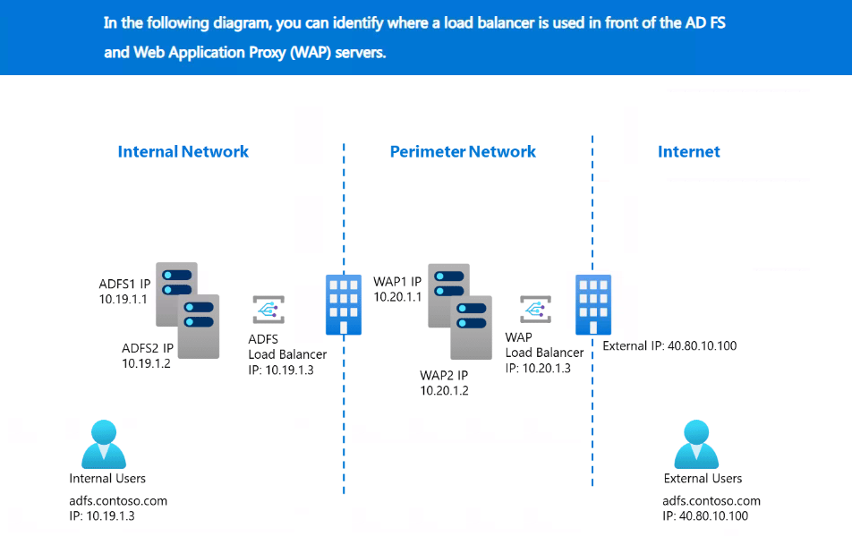

# Day 39: AD FS Load Balancing and Federation Metadata

Active Directory Federation Services (**AD FS**) is often deployed as a farm so that authentication does not depend on one server. A load balancer places one stable service address in front of those farm members and sends each request to a healthy server.

This lesson explains how load balancing fits into an AD FS and Web Application Proxy (**WAP**) deployment, which settings matter, what federation metadata contains, and how to troubleshoot metadata that is available internally but unavailable externally.

## Learning Outcomes

By the end of this lesson, you should be able to:

- explain what a load balancer does;
- distinguish an AD FS farm from a WAP farm;
- follow internal and external authentication traffic;
- identify important AD FS load-balancer requirements;
- explain why TLS pass-through, health probes, and Server Name Indication (**SNI**) matter;
- explain what federation metadata contains and how partners use it;
- test metadata through internal and external paths;
- bypass a load balancer temporarily with a controlled hosts-file entry; and
- troubleshoot DNS, load-balancer, WAP, certificate, endpoint, and AD FS failures separately.

## Prerequisites

This lesson assumes a basic understanding of:

- IP addresses and ports;
- Domain Name System (**DNS**) name resolution;
- routers, firewalls, and network paths;
- HTTPS and certificates;
- AD FS federation service names; and
- the purpose of WAP in an external AD FS deployment.

## Lesson Roadmap

| Part | Topic | Main question |
|---|---|---|
| **1** | AD FS load balancing | How does traffic reach a healthy AD FS or WAP server? |
| **2** | Federation metadata | What information does AD FS publish for federation partners? |
| **3** | Metadata troubleshooting | At which layer does metadata access fail? |
| **4** | Beginner load-balancer guide | How do all the load-balancer concepts fit together in AD FS? |

---

## Part 1: AD FS Load Balancing

### What Is a Load Balancer?

A load balancer is a hardware appliance, virtual appliance, cloud service, or software service that accepts traffic on one address and distributes it across multiple backend servers.

Users connect to a **virtual IP address (VIP)** or a DNS name that resolves to that VIP. The load balancer then selects a healthy backend server.

### Why AD FS Uses Load Balancers

| Benefit | Beginner-friendly explanation |
|---|---|
| **Availability** | If one server fails, traffic can be sent to another healthy server. |
| **Capacity** | Several servers can process concurrent authentication requests. |
| **Maintenance** | One node can be removed from service for patching while other nodes continue handling traffic. |
| **Stable address** | Users and applications use one federation service name instead of individual server names. |
| **Health-aware routing** | Failed nodes can be removed automatically when a health probe stops succeeding. |

> [!IMPORTANT]
> A load balancer does not repair AD FS, authenticate users, process claim rules, or issue tokens. It selects a backend server and forwards network traffic.

### Where Load Balancers Sit

The supplied diagram shows two separate load-balancing tiers:

- an **internal load balancer** in front of the AD FS farm; and
- an **external-facing load balancer** in front of the WAP farm.



In the example:

| Component | Example address | Purpose |
|---|---:|---|
| AD FS server 1 | `10.19.1.1` | Internal federation server |
| AD FS server 2 | `10.19.1.2` | Internal federation server |
| Internal AD FS VIP | `10.19.1.3` | Address used by internal clients for `adfs.contoso.com` |
| WAP server 1 | `10.20.1.1` | Perimeter proxy for external federation traffic |
| WAP server 2 | `10.20.1.2` | Second perimeter proxy |
| WAP load-balancer VIP | `10.20.1.3` | Internal or perimeter-side VIP shown in the source diagram |
| Public address | `40.80.10.100` | Address external DNS publishes for `adfs.contoso.com` |

> [!NOTE]
> The exact design varies. A public load balancer might expose a public VIP directly, or a firewall might perform network address translation (**NAT**) from a public address to a private load-balancer VIP. The important idea is that external clients reach WAP first, not the internal AD FS servers directly.

### Internal Authentication Path

For an internal user:

1. The browser requests `https://adfs.contoso.com`.
2. Internal DNS resolves the name to the internal AD FS VIP, such as `10.19.1.3`.
3. The internal load balancer selects a healthy AD FS node.
4. The selected AD FS server authenticates the user, evaluates policy and claim rules, and creates the federation response.
5. The browser carries the response to the relying party in a passive federation flow.

### External Authentication Path

For an external user:

1. The browser requests `https://adfs.contoso.com`.
2. Public DNS resolves the name to the external public IP address.
3. The external load balancer selects a healthy WAP server.
4. WAP proxies the federation request to the internal AD FS service.
5. Internal connectivity and name resolution allow WAP to reach AD FS.
6. AD FS performs authentication and token processing.
7. The response returns through WAP, the external load balancer, and the browser.

> [!IMPORTANT]
> WAP does not replace AD FS. WAP is the external reverse-proxy and preauthentication layer; AD FS remains the federation service that processes authentication, policy, claims, and token issuance.

### Core AD FS Load-Balancer Requirements

#### 1. Do Not Terminate TLS at the Load Balancer

The source requires the load balancer to pass encrypted TLS traffic through to the AD FS or WAP node. TLS terminates on that backend node.

This matters because AD FS supports certificate-authentication scenarios and bindings that depend on the original end-to-end TLS connection. Offloading or terminating TLS at the load balancer can break supported behavior.

| Design | Meaning | AD FS guidance in this lesson |
|---|---|---|
| **TLS pass-through** | The load balancer forwards encrypted traffic; AD FS or WAP presents the certificate. | Required by the source guidance. |
| **TLS bridging** | The load balancer decrypts and creates a new TLS connection to the backend. | Still terminates the original TLS session; do not assume it is supported. |
| **TLS offload** | The load balancer decrypts traffic and sends unencrypted HTTP to the backend. | Not supported for the AD FS scenarios described here. |

#### 2. Prefer an SNI-Capable Load Balancer

Server Name Indication (**SNI**) carries the requested hostname during the TLS handshake. It allows a server to choose the correct certificate and binding when several HTTPS names share an IP address.

Use a load balancer that supports SNI. The source notes that a `0.0.0.0` fallback binding on AD FS or WAP can provide a workaround when SNI is unavailable, but this should be treated as a compatibility measure rather than the preferred design.

#### 3. Use the Dedicated HTTP Health Probe

The recommended health-check path is:

```text
/adfs/probe
```

Examples:

```text
http://adfs1.contoso.com/adfs/probe
http://10.19.1.1/adfs/probe
http://wap1.contoso.com/adfs/probe
http://10.20.1.1/adfs/probe
```

The expected response is:

```text
HTTP 200 OK
```

The HTTP probe avoids SNI-related HTTPS checks and is served locally on the node. It tells the load balancer whether that node can answer its local probe.

> [!CAUTION]
> A successful `/adfs/probe` response does not prove that AD DS, DNS, a relying party, a claims provider, a certificate chain, or the complete sign-in path is healthy. It is a routing health signal, not an end-to-end authentication test.

#### 4. Do Not Use DNS Round Robin as the Production Load Balancer

DNS round robin returns multiple server IP addresses for one name, but it does not provide the same immediate, health-probe-based removal of a failed node.

Clients and DNS resolvers can also cache records. A user may continue trying a failed address even after DNS records change.

#### 5. Avoid IP-Based Session Affinity

Session affinity, also called **persistence** or **sticky sessions**, repeatedly directs one client to the same backend server.

AD FS is designed so that healthy farm nodes can process requests without requiring IP-based persistence. The source advises against IP affinity because many users can appear behind one proxy or NAT address, concentrating traffic on one node. This can be particularly harmful with legacy authentication traffic for mail clients.

### Requirement Summary

| Requirement | Recommended configuration | Reason |
|---|---|---|
| TLS handling | Pass encrypted traffic through to AD FS or WAP | Preserves supported certificate-authentication and binding behavior |
| SNI | Use an SNI-capable load balancer | Ensures the correct hostname and certificate binding are used |
| Health check | HTTP request to `/adfs/probe` on every node | Provides a simple node-health signal without HTTPS/SNI complications |
| DNS round robin | Do not use it as the primary HA mechanism | It lacks equivalent health-aware routing and is affected by caching |
| Session affinity | Avoid IP-based persistence | Prevents uneven distribution and overloaded nodes |
| Backend pool | Include only the correct role | AD FS nodes belong in the AD FS pool; WAP nodes belong in the WAP pool |

---

## Part 2: Federation Metadata

### What Is Federation Metadata?

Federation metadata is an XML document that describes important properties of a federation service. A relying party or federation partner can use it to create or update trust information.

The AD FS endpoint is:

```text
https://<federation-service-name>/federationmetadata/2007-06/federationmetadata.xml
```

Example:

```text
https://adfs.contoso.com/federationmetadata/2007-06/federationmetadata.xml
```

### What the Document Can Contain

| Metadata element | Why a partner needs it |
|---|---|
| Federation entity identifier | Identifies the federation service |
| Service endpoints | Shows where supported federation requests can be sent |
| Protocol information | Describes supported federation roles and bindings |
| Token-signing certificate data | Allows a partner to validate tokens signed by AD FS |
| Contact or organizational information | Provides descriptive information when configured |

> [!IMPORTANT]
> Metadata contains public certificate information, not the private token-signing key. The private key must remain protected on authorized AD FS servers.

### Metadata and Certificate Rollover

When the AD FS token-signing certificate changes, a relying party must trust the new public certificate to continue validating tokens.

If the relying party is configured to monitor reachable federation metadata, it may retrieve updated signing-certificate information automatically. If it does not monitor metadata—or cannot reach it—an administrator may need to update the certificate manually.

### Must Metadata Always Be Public?

The original source says metadata needs to be publicly available so other parties can consume it. A more precise rule is:

- expose it through the route used by the partners that must retrieve it;
- make it externally reachable when external federation partners require automatic retrieval;
- keep it internal when only internal systems consume it and public exposure is unnecessary; and
- apply the organization's security and publishing policy.

The document is intended for sharing trust information, but availability requirements depend on the federation design.

---

## Part 3: Troubleshooting Federation Metadata Availability

### Step 1: Test the Endpoint

Open the metadata URL in a browser:

```text
https://adfs.contoso.com/federationmetadata/2007-06/federationmetadata.xml
```

A healthy request normally returns or downloads XML. A timeout, certificate warning, HTTP error, proxy error, or connection refusal points to different failure layers.

| Result | Likely investigation area |
|---|---|
| XML is returned | Endpoint and tested network path are available |
| DNS name does not resolve | DNS record, DNS suffix, resolver, or split-brain DNS |
| Connection times out | Firewall, route, NAT, load balancer, WAP, or offline backend |
| Certificate warning | Name mismatch, trust-chain problem, expiry, or wrong certificate binding |
| HTTP 404 or endpoint error | Endpoint state, URL path, proxy publishing, or AD FS configuration |
| Works internally but not externally | Public DNS, firewall/NAT, external load balancer, WAP, or external certificate path |
| Works on one node only | Node-specific endpoint, certificate, service, binding, or configuration problem |

> [!TIP]
> Test from the same location as the affected consumer. An internal browser test does not prove that an external partner can reach the endpoint.

### Step 2: Verify That the Endpoint Is Enabled

The source uses the AD FS 2.0 console terminology:

1. Open **AD FS Management**.
2. In the left pane, browse to **Service > Endpoints**.
3. Locate:

```text
/FederationMetadata/2007-06/FederationMetadata.xml
```

4. Confirm that the endpoint is enabled.

Interface labels can vary by AD FS version, but the principle is the same: verify the endpoint rather than assuming it is enabled.

### Step 3: Compare External and Internal Access

Test from:

1. an external network, if external availability is required;
2. an internal workstation using the normal federation service name;
3. the WAP path, when WAP is part of the external design; and
4. a specific AD FS node through a temporary hosts-file override, when approved.

This comparison narrows the failing layer:

| External test | Internal test | Likely location |
|---|---|---|
| Fails | Fails | AD FS endpoint, AD FS service, shared certificate/configuration, or common DNS problem |
| Fails | Succeeds | Public DNS, firewall/NAT, external load balancer, WAP, or perimeter routing |
| Succeeds | Fails | Internal DNS, internal VIP, firewall, or internal routing |
| Intermittent | Intermittent | One unhealthy backend, inconsistent node configuration, or unstable network path |

### Step 4: Check Name Resolution

Query DNS:

```powershell
nslookup adfs.contoso.com
```

For a split-brain DNS design, the expected result depends on the client location:

- an internal client usually receives the internal AD FS VIP;
- an external client receives the public VIP or public NAT address.

`nslookup` queries DNS directly. It does not prove that Windows will use the same address after the hosts file, DNS cache, or other resolver behavior is considered.

### Step 5: Bypass the Load Balancer Carefully

A temporary hosts-file entry can map the federation service name directly to one AD FS server IP. This helps answer:

> Does metadata work on this node when the load balancer is removed from this test client's path?

The Windows hosts file is:

```text
C:\Windows\System32\drivers\etc\hosts
```

Procedure:

1. Run **Notepad as administrator**.
2. Open the extensionless `hosts` file.
3. Add the selected AD FS server IP and the federation service name:

```text
10.19.1.1 adfs.contoso.com
```

4. Save the file.
5. Clear cached DNS results if needed:

```powershell
ipconfig /flushdns
```

6. Test the metadata URL again.
7. Repeat against another node only if required.
8. Remove the temporary entry after testing.

> [!WARNING]
> Keep the federation service name in the URL. Mapping that name to a node preserves the hostname expected by the TLS certificate. Browsing directly to `https://10.19.1.1/...` can cause a certificate-name mismatch and does not faithfully test the service.

### Why `nslookup` May Still Show the Old Address

The source correctly notes that `nslookup` can continue displaying the DNS answer after a hosts-file change because `nslookup` queries DNS rather than reporting the complete Windows name-resolution decision.

You can display the address selected for a connection attempt with:

```powershell
ping adfs.contoso.com
```

Even when Internet Control Message Protocol (**ICMP**) replies are blocked, the first line often shows the resolved IP address.

A more targeted TCP test is:

```powershell
Test-NetConnection adfs.contoso.com -Port 443
```

> [!NOTE]
> A successful TCP connection proves only that port 443 is reachable. It does not prove that the certificate, metadata endpoint, AD FS service, WAP path, or returned XML is correct.

### Step 6: Interpret the Bypass Result

| Normal VIP test | Direct-node hosts test | Interpretation |
|---|---|---|
| Fails | Succeeds | Investigate the load balancer, pool membership, health state, listener, NAT, or forwarding configuration |
| Fails | Fails on every node | Investigate AD FS, endpoint state, certificate bindings, service health, or common dependencies |
| Intermittent | Fails on one node only | Remove or drain that node and correct its node-specific problem |
| Succeeds | Succeeds | The tested path is healthy; reproduce from the actual affected location |

### Step 7: Check Each Layer

Use this order to avoid random changes:

1. **Client:** correct URL, proxy, cache, time, and certificate trust.
2. **DNS:** correct internal or external answer.
3. **Network:** route, port 443, firewall, and NAT.
4. **Load balancer:** VIP, listener, backend pool, health probes, and forwarding mode.
5. **WAP:** service health, trust with AD FS, certificate, event logs, and backend reachability.
6. **AD FS:** service health, endpoint state, certificate binding, event logs, and farm consistency.
7. **Metadata content:** valid XML, expected entity information, and current signing certificates.
8. **Partner behavior:** metadata refresh schedule, cached certificate, and trust configuration.

---

## Part 4: Load Balancers Explained for AD FS Beginners

This section brings the major concepts together and explains what a beginner should know before operating an AD FS load balancer.

### The Four Objects to Remember

| Object | Example | Meaning |
|---|---|---|
| **Service name** | `adfs.contoso.com` | The stable hostname users and applications know |
| **VIP** | `10.19.1.3` or `40.80.10.100` | The load balancer's frontend address |
| **Backend pool** | `ADFS1`, `ADFS2` | Servers eligible to receive requests |
| **Health probe** | `GET /adfs/probe` | Check used to decide whether a backend remains eligible |

The basic decision is:

```text
Client -> service name -> DNS -> VIP -> healthy backend server
```

### AD FS and WAP Are Separate Tiers

| Tier | Location | Receives traffic from | Sends traffic to |
|---|---|---|---|
| AD FS farm | Internal network | Internal load balancer and WAP servers | AD DS, attribute stores, and the requesting path |
| WAP farm | Perimeter network | External load balancer | Internal AD FS service |

Do not place AD FS and WAP nodes in the same backend pool. They have different roles and trust boundaries.

### DNS Is the Entry Point

Users normally do not know a VIP. They use the federation service name.

A common split-brain design publishes:

| Client location | DNS answer for `adfs.contoso.com` | Destination tier |
|---|---|---|
| Internal | Internal AD FS VIP | AD FS farm |
| External | Public VIP or NAT address | WAP farm |

Both routes use the same service name and require a certificate valid for that name.

### Certificates and TLS

The AD FS or WAP node must present a certificate trusted by the client and valid for the federation service name.

Check:

- subject or Subject Alternative Name (**SAN**) includes `adfs.contoso.com`;
- certificate is not expired;
- private key is available to the service;
- chain is trusted;
- the intended certificate is bound correctly; and
- required nodes have consistent certificates and bindings.

Because TLS passes through the load balancer in the source design, the backend—not the load balancer—presents the service certificate.

### What a Health Probe Can and Cannot Tell You

| Probe result | What the load balancer should do | Limitation |
|---|---|---|
| HTTP 200 | Keep the node eligible | Does not prove complete authentication works |
| Timeout or connection failure | Mark unhealthy after the configured threshold | Could be a probe-network or firewall problem |
| Intermittent response | Investigate node health and probe timing | Aggressive thresholds can cause unnecessary flapping |

Configure probes per backend node, not merely against the VIP. Otherwise, the load balancer may test itself rather than each server.

### Load-Distribution Methods

Common algorithms include:

| Method | How it works | AD FS consideration |
|---|---|---|
| **Round robin** | Sends successive connections to successive healthy nodes | Simple and normally suitable when capacities are similar |
| **Least connections** | Chooses the node with fewer active connections | Useful when connection duration varies |
| **Weighted distribution** | Gives stronger nodes a larger share | Helpful when backend capacity differs |
| **IP hash/persistence** | Uses the client IP to keep traffic on one node | Avoid for AD FS authentication traffic as described above |

Do not confuse a load balancer's **round-robin algorithm** with **DNS round robin**. The first operates with health-aware backend selection; the second merely returns DNS addresses.

### High Availability Is More Than Two Servers

Two AD FS servers do not provide full availability if they depend on one load balancer, one switch, one firewall, or one DNS server.

A resilient design considers:

- redundant load-balancer instances or a managed HA service;
- redundant network paths and firewalls;
- multiple AD FS and WAP nodes;
- resilient DNS;
- reliable AD DS and attribute stores;
- farm database availability;
- certificate renewal and distribution;
- monitoring and alerting; and
- tested backup and recovery procedures.

### Draining a Node for Maintenance

Before patching an AD FS or WAP server:

1. Disable or drain the node in the load balancer.
2. Wait for active connections to finish according to the organization's procedure.
3. Confirm that the other nodes can carry the load.
4. Patch and restart the node.
5. Test the local service and `/adfs/probe`.
6. Return the node to the pool.
7. Confirm that it receives traffic and produces no new errors.

This is safer than shutting down a node while the load balancer is still sending new requests to it.

### Common Load-Balancer Mistakes

| Mistake | Typical symptom | Correction |
|---|---|---|
| TLS terminates on the load balancer | Certificate authentication or bindings fail | Use the supported pass-through design |
| Probe uses the wrong path or port | Healthy nodes appear down | Use HTTP `/adfs/probe` as specified |
| Probe tests the VIP instead of each node | Failed nodes remain in rotation | Target every backend node |
| IP affinity is enabled | Uneven load or overloaded node | Remove unsupported persistence unless specific guidance requires it |
| AD FS and WAP share a pool | Incorrect role handles traffic | Create separate role-specific pools |
| Public DNS points directly to AD FS | Internal federation servers are exposed | Send external traffic through the WAP tier |
| One node has a different certificate | Intermittent certificate failures | Standardize certificate and binding configuration |
| Failed node remains active | Intermittent timeouts | Correct health probes and pool state |
| DNS round robin replaces HA load balancing | Clients continue reaching failed IPs | Use a health-aware load balancer |
| Hosts-file test entry is left behind | One workstation behaves differently | Remove the entry immediately after testing |

### A Practical Troubleshooting Checklist

#### Client and DNS

- Does the name resolve to the expected internal or external VIP?
- Is the client using an unexpected proxy?
- Does the failure occur from one network or every network?

#### Frontend Listener

- Is the VIP online?
- Is TCP 443 listening?
- Is NAT forwarding to the correct VIP?
- Is the requested service name preserved?

#### Backend Pool

- Are all intended nodes present?
- Are any nodes incorrectly marked healthy or unhealthy?
- Is the correct port forwarded?
- Is session persistence disabled as recommended?

#### AD FS or WAP Node

- Does `/adfs/probe` return HTTP 200 directly?
- Is the service running?
- Is the correct certificate bound?
- Does the metadata URL work through a controlled direct-node mapping?
- Do event logs show a node-specific error?

#### End-to-End Validation

- Does the IdP or application sign-in path work?
- Does federation metadata return valid XML?
- Can WAP reach the internal federation service?
- Can the relying party validate the resulting token?

### Final Mental Model

Think of the architecture as a sequence of responsibilities:

1. **DNS** tells the client which frontend address to use.
2. **The firewall or NAT layer** permits and translates the connection where required.
3. **The load balancer** chooses a healthy server.
4. **WAP** proxies an external federation request.
5. **AD FS** authenticates, applies policy, processes claims, and issues a token.
6. **The browser** carries passive federation messages.
7. **The relying party** validates the token and creates its application session.

When troubleshooting, identify the last responsibility that succeeded and test the next layer. This is faster and safer than changing DNS, certificates, WAP, AD FS, and the load balancer at the same time.

## Conclusion

Load balancing makes an AD FS deployment scalable and resilient by directing traffic to healthy AD FS or WAP servers behind one stable service name. It does not replace DNS, WAP, AD FS, certificates, or federation trust; it connects those layers through health-aware routing.

Federation metadata is a useful test because it exercises DNS, network access, TLS, the publishing path, and the AD FS endpoint without requiring a complete user sign-in. Compare external, internal, VIP, and controlled direct-node results to locate the failing layer, and remove every temporary hosts-file override when testing is complete.

## Further Reading

- [AD FS requirements](https://learn.microsoft.com/en-us/windows-server/identity/ad-fs/overview/ad-fs-requirements)
- [AD FS design requirements](https://learn.microsoft.com/en-us/windows-server/identity/ad-fs/design/ad-fs-requirements)
