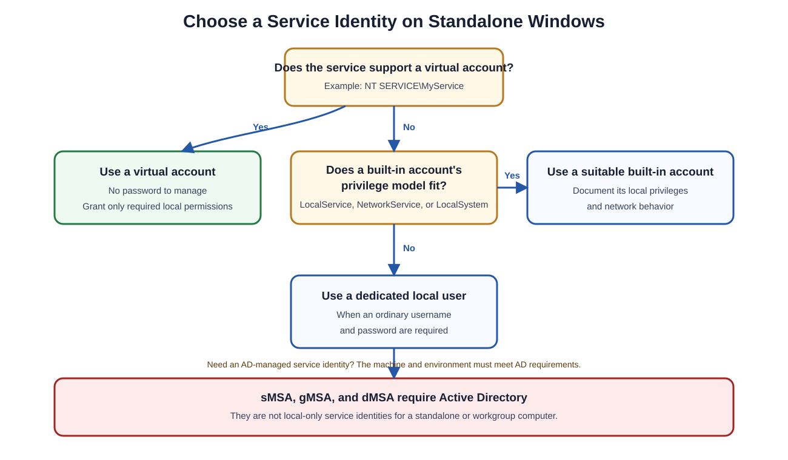

# Windows Service Accounts Without Active Directory

## Beginner-Friendly Overview

On a standalone or workgroup Windows computer, a service can run under a **local user account**, a **built-in service account**, or a **virtual account**. Active Directory-based managed service accounts—such as standalone managed service accounts (**sMSAs**), group managed service accounts (**gMSAs**), and delegated managed service accounts (**dMSAs**)—require an Active Directory environment and cannot be used as local-only identities on a standalone computer.

This lesson explains the available service identities, shows how to add one to a local group, and provides commands for verifying the resulting configuration.

> [!IMPORTANT]
> Add a service identity only to the groups and resources it genuinely needs. Membership in the local **Administrators** group grants broad control over the computer and should not be the default choice.



## What Is a Service Account?

A **service account** is an identity used by a Windows service, scheduled task, application pool, or background process. The identity determines:

- Which local files and folders the process can access.
- Which registry keys it can read or change.
- Whether it can start or control other services.
- Which local groups and privileges apply to it.
- How it attempts to access resources on another computer.

Unlike an interactive user account, a service account is normally used by software rather than by a person signing in to the desktop.

## Service-Identity Types Available Without Active Directory

Windows supports several service-identity types, but only some are suitable for a computer that is not joined to Active Directory.

| Identity type | Example | Works without AD? | Password management | Typical use |
|---|---|---:|---|---|
| Local user account | `.\MyServiceUser` | Yes | Administrator or application manages the password | A service that requires a dedicated local identity |
| Built-in service account | `LocalSystem`, `LocalService`, `NetworkService` | Yes | Windows manages the identity | Windows services with well-understood built-in privilege requirements |
| Virtual account | `NT SERVICE\MyService` | Yes | Windows manages the identity; no password is required | A supported service that needs an isolated local identity |
| sMSA | Domain-managed identity | No | Active Directory manages the password | One domain-joined server |
| gMSA | Domain-managed identity | No | Active Directory manages the password | The same service running on multiple domain-joined servers |
| dMSA | Domain-managed identity | No | Active Directory manages the identity | Supported modern AD environments and service-account migration scenarios |

### Local User Accounts

A local user account is stored in the computer's local **Security Accounts Manager (SAM)** database.

Examples include:

```text
.\MyServiceUser
COMPUTERNAME\MyServiceUser
```

A local account can be granted access to local resources, but it does not automatically become an Active Directory identity. If a service needs authenticated access to domain resources, a local account is generally not a substitute for a properly designed domain identity.

> [!NOTE]
> A remote system might accept explicitly supplied credentials or a separate account with matching credentials, but this is not the same as the service having a trusted AD identity.

### Built-In Service Accounts

Windows provides three commonly used built-in identities:

| Account | Local privilege level | Network identity |
|---|---|---|
| `LocalSystem` | Very high local privileges | Uses the computer's identity when possible |
| `NetworkService` | Limited local privileges | Uses the computer's identity when possible |
| `LocalService` | Limited local privileges | Normally presents anonymous credentials to remote systems |

Use these accounts only when their privilege and network behavior match the service's requirements.

### Virtual Accounts

A virtual account is an automatically managed local identity associated with a particular service:

```text
NT SERVICE\<ServiceName>
```

For example:

```text
NT SERVICE\MyService
```

Virtual accounts:

- Require no manually managed password.
- Provide identity separation between services.
- Can be granted permissions to local files, folders, registry keys, or groups.
- Use the computer's identity for network authentication when that behavior is supported.

On a non-domain machine, using the computer identity does not create an AD-authenticated domain identity. Plan access to remote resources separately.

### Managed Service Accounts

The following identities depend on Active Directory:

- **sMSA:** Standalone Managed Service Account
- **gMSA:** Group Managed Service Account
- **dMSA:** Delegated Managed Service Account

They cannot be created and used as purely local identities on a standalone Windows computer. If the environment has no Active Directory, choose a local user, built-in account, or supported virtual account instead.

## Choosing the Right Identity

Use this general order:

1. Prefer a **virtual account** when the service supports it and only needs an isolated local identity.
2. Consider `LocalService` or `NetworkService` when the documented built-in privilege and network behavior is appropriate.
3. Use a dedicated **local user account** when the application requires an ordinary username and password.
4. Avoid `LocalSystem` unless the service genuinely requires its extensive local privileges.
5. Do not attempt to use sMSA, gMSA, or dMSA without the required Active Directory infrastructure.

> [!TIP]
> The most secure choice is usually the identity with the fewest privileges that still allows the service to work.

## Add a Service Identity to a Local Group

Adding an identity to a local group gives it the permissions associated with that group. Use a purpose-specific group such as `IIS_IUSRS` where possible instead of automatically granting local administrator rights.

Run the following commands from an elevated Command Prompt or PowerShell window.

### Option 1: Command Prompt with `net localgroup`

#### Add a Local User

```cmd
net localgroup Administrators MyServiceUser /add
```

The original example adds the local user `pranadot` to the IIS worker-process group:

```cmd
net localgroup IIS_IUSRS pranadot /add
```

#### Add a Virtual Account

```cmd
net localgroup Administrators "NT SERVICE\MyService" /add
```

The quotation marks protect the identity name, which contains a space.

#### List Local Groups

```cmd
net localgroup
```

#### List Members of a Particular Group

```cmd
net localgroup IIS_IUSRS
```

> [!WARNING]
> The `net localgroup` command works on standalone Windows systems and can also manage local or built-in groups in other Windows configurations. Always confirm that you are changing the intended computer and group.

### Option 2: PowerShell

#### Add a Local User

```powershell
Add-LocalGroupMember -Group "Administrators" -Member "MyServiceUser"
```

#### Add a Virtual Account

```powershell
Add-LocalGroupMember -Group "Administrators" -Member "NT SERVICE\MyService"
```

#### Confirm Membership

```powershell
Get-LocalGroupMember -Group "Administrators"
```

For the IIS group:

```powershell
Get-LocalGroupMember -Group "IIS_IUSRS"
```

### Option 3: Local Users and Groups

1. Press **Windows + R**.
2. Enter:

   ```text
   lusrmgr.msc
   ```

3. Open **Groups**.
4. Open the target group, such as **Administrators** or **IIS_IUSRS**.
5. Select **Add**.
6. Enter the local user or virtual account name.
7. Confirm the selection and apply the change.

> [!NOTE]
> The Local Users and Groups console is not available in every Windows edition. If it is unavailable, use Command Prompt or PowerShell.

## Verify the Account and Group Membership

### Inspect a Local User

```cmd
net user pranadot
```

This shows details about the local account, including whether it is active and which local groups are listed for it.

### Inspect the Current Security Token

```cmd
whoami /groups
```

This command displays the groups present in the **currently running user's security token**.

> [!IMPORTANT]
> `whoami /groups` does not automatically show the token of `pranadot` or the service. To inspect another identity's effective token, run a process as that identity or inspect the actual service process using an appropriate administrative tool.

### Confirm the Service's Logon Identity

In PowerShell, inspect the service configuration:

```powershell
Get-CimInstance Win32_Service -Filter "Name='MyService'" |
    Select-Object Name, StartName, State
```

Replace `MyService` with the actual Windows service name. The `StartName` value identifies the configured service account.

## Practical Example: IIS Local Account

Suppose an IIS application needs the local account `pranadot` to receive the permissions associated with `IIS_IUSRS`.

### 1. Confirm the Account

```cmd
net user pranadot
```

### 2. Add It to the IIS Group

```cmd
net localgroup IIS_IUSRS pranadot /add
```

### 3. Confirm the Group Membership

```cmd
net localgroup IIS_IUSRS
```

### 4. Verify the Application Configuration

Confirm that the IIS application pool or related service is actually configured to use `pranadot`. Adding an account to a group does not automatically configure a service to run under that identity.

### 5. Test the Minimum Required Access

Test the application and grant only the file, folder, registry, or network permissions it requires. Do not add the account to **Administrators** merely to avoid diagnosing a specific permission failure.

## Troubleshooting Checklist

If the service still cannot access a resource, check:

1. **Correct identity:** Is the service actually running as the expected account?
2. **Correct group:** Was the identity added to the intended local group?
3. **Restart requirement:** Was the service restarted so a new security token could be created?
4. **Direct permissions:** Does the file, folder, registry key, or other resource allow the identity or group?
5. **User rights:** Does the account have the required user right, such as **Log on as a service**?
6. **Deny assignments:** Is a deny permission or deny user-right assignment overriding the allow entry?
7. **Network boundary:** Is the service attempting to access a domain or remote resource that a standalone local identity cannot authenticate to as expected?
8. **Name format:** Was the identity entered correctly, such as `.\MyServiceUser` or `NT SERVICE\MyService`?

## Security Recommendations

- Follow the principle of least privilege.
- Prefer virtual accounts when the service supports them.
- Avoid interactive sign-in for dedicated service identities.
- Deny interactive logon where appropriate.
- Use long, unique passwords for local service users and rotate them safely.
- Store passwords in a protected secret-management system rather than scripts or configuration files.
- Audit group membership and service-account usage.
- Restart the service after changing group membership so it receives a new token.
- Document why every elevated permission is required.
- Consider joining the system to a managed identity infrastructure if the service requires reliable access to domain resources.

## Quick Reference

| Task | Command |
|---|---|
| List local groups | `net localgroup` |
| Add local user to IIS group | `net localgroup IIS_IUSRS pranadot /add` |
| Add local user to Administrators | `net localgroup Administrators MyServiceUser /add` |
| Add virtual account to Administrators | `net localgroup Administrators "NT SERVICE\MyService" /add` |
| Inspect local user | `net user pranadot` |
| Inspect current token groups | `whoami /groups` |
| Add member with PowerShell | `Add-LocalGroupMember -Group "Administrators" -Member "MyServiceUser"` |
| List group members with PowerShell | `Get-LocalGroupMember -Group "IIS_IUSRS"` |

## Summary

On a non-domain Windows system:

- Use local users, built-in service accounts, or virtual accounts.
- Do not use sMSA, gMSA, or dMSA because they depend on Active Directory.
- Prefer automatically managed, low-privilege identities where the service supports them.
- Use `net localgroup`, `Add-LocalGroupMember`, or `lusrmgr.msc` to manage local group membership.
- Verify the service's configured identity instead of assuming that group membership changes its logon account.
- Remember that `whoami /groups` shows the current process token, not another user's or service's token.
- Grant only the minimum permissions needed for the service to operate.
