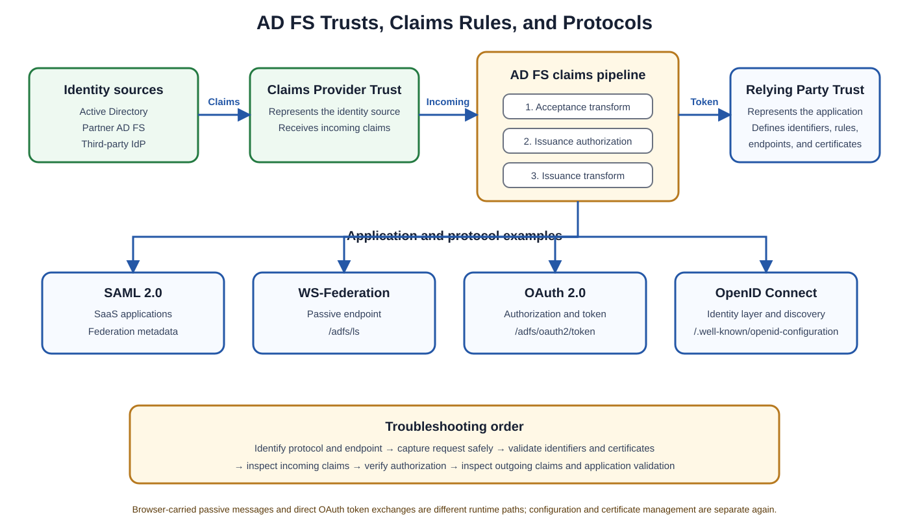

# TLA Week 2 Assessment: AD FS Fundamentals and Troubleshooting

## Overview

This assessment contains **20 questions** about Active Directory Federation Services (**AD FS**). Each question includes:

- The available answer choices
- The correct answer
- A beginner-friendly explanation
- A short explanation of why the other choices are incorrect
- A practical flow, example, or troubleshooting note where useful

The topics include claims provider and relying party trusts, claims rules, SAML, WS-Federation, OAuth 2.0, OpenID Connect (**OIDC**), Microsoft Entra ID federation, certificates, and troubleshooting tools.

> [!TIP]
> Try answering each question before opening its explanation. At the end, use the memory sheet and answer key for a quick review.



## Core Concepts at a Glance

| Concept | Beginner-friendly meaning |
|---|---|
| Claims Provider Trust (CPT) | Represents an identity source that provides claims to AD FS |
| Relying Party Trust (RPT) | Represents an application or service that trusts AD FS tokens |
| Acceptance Transform Rules | Process incoming claims from a claims provider |
| Issuance Authorization Rules | Decide whether AD FS may issue a token |
| Issuance Transform Rules | Select or transform claims for the outgoing token |
| SAML | XML-based federation protocol commonly used with SaaS applications |
| WS-Federation | Federation protocol commonly used by Microsoft-oriented web applications |
| OAuth 2.0 | Authorization framework used to obtain access tokens |
| OpenID Connect | Identity layer built on OAuth 2.0 |

---

## Question 1: Claims Provider Trust vs. Relying Party Trust

**Which statement about claims provider trusts and relying party trusts is correct?**

A. Relying party trusts represent the AD DS forests that store user accounts.  
B. Claims provider trusts represent the SaaS applications that consume AD FS tokens.  
C. They are the same object but have different labels in the AD FS console.  
D. Claims provider trusts are identity sources; relying party trusts are applications.

### Correct Answer

**D. Claims provider trusts are identity sources; relying party trusts are applications.**

### Explanation

A **Claims Provider Trust (CPT)** represents an identity source that authenticates users and provides claims to AD FS.

Examples include:

- Active Directory Domain Services (**AD DS**)
- A partner's AD FS deployment
- A third-party identity provider (**IdP**)

A **Relying Party Trust (RPT)** represents an application or service that consumes and trusts the tokens AD FS issues.

Examples include:

- Microsoft 365
- Salesforce
- ServiceNow
- Custom applications

```text
User
  -> Claims Provider Trust
  -> AD FS
  -> Relying Party Trust
  -> Application
```

### Why the Other Answers Are Incorrect

| Choice | Reason |
|---|---|
| A | An AD DS forest is an identity source, not a relying application. |
| B | A SaaS application normally acts as a relying party, not a claims provider. |
| C | CPTs and RPTs are separate trust objects with different purposes. |

---

## Question 2: Processing Claims from a Partner

**A claims provider trust for a partner AD FS deployment is configured. Which rule set controls how incoming claims from that partner are processed?**

A. Federation metadata rules  
B. Delegation authorization rules  
C. Acceptance transform rules  
D. Issuance authorization rules

### Correct Answer

**C. Acceptance transform rules**

### Explanation

Acceptance transform rules operate on claims entering AD FS through a claims provider trust. They can:

- Accept claims
- Filter claims
- Transform claim values
- Map one claim type to another

```text
Partner AD FS
  -> Claims Provider Trust
  -> Acceptance Transform Rules
  -> AD FS claims pipeline
  -> Relying Party
```

### Why the Other Answers Are Incorrect

| Choice | Reason |
|---|---|
| A | Federation metadata describes trust information such as identifiers, endpoints, and certificates; it is not a claim-rule stage. |
| B | Delegation authorization applies to delegation scenarios, not ordinary incoming-claim transformation. |
| D | Issuance authorization determines whether AD FS may issue a token to a relying party. |

---

## Question 3: Rejecting a Signed SAML Request

**A trace shows that the Service Provider (SP) posts a signed SAML request, but AD FS rejects it. Which relying-party setting should be checked?**

A. Whether the SP's signing certificate is registered on the trust  
B. The Web Application Proxy (WAP) IP address and DNS entry  
C. The extranet-lockout threshold for the user's account  
D. The AD FS service-account password and expiry

### Correct Answer

**A. Whether the SP's signing certificate is registered on the trust**

### Explanation

When an SP signs a SAML authentication request, AD FS must validate the signature with the corresponding public certificate configured on the relying party trust.

```text
Service Provider
  -> Signed SAML request
  -> AD FS validates the request signature
  -> Accept or reject
```

> [!IMPORTANT]
> The request-signing certificate proves that the request came from the trusted SP. It is different from the AD FS token-signing certificate used to sign tokens issued by AD FS.

### Why the Other Answers Are Incorrect

| Choice | Reason |
|---|---|
| B | DNS and WAP problems affect connectivity, not cryptographic validation after the request arrives. |
| C | Extranet lockout affects username-and-password authentication attempts. |
| D | The service account does not validate an SP's SAML request signature. |

---

## Question 4: Pass Through a Claim Unchanged

**What does this claim rule do?**

```text
c:[Type ==
"http://schemas.microsoft.com/ws/2008/06/identity/claims/windowsaccountname"]
 => issue(claim = c);
```

A. It passes the Windows account-name claim through unchanged.  
B. It adds a new constant claim with a fixed account-name value.  
C. It queries Active Directory for the user's account name.  
D. It denies access when the Windows account-name claim is present.

### Correct Answer

**A. It passes the Windows account-name claim through unchanged.**

### Explanation

The condition selects an incoming Windows account-name claim. The expression:

```text
issue(claim = c)
```

reissues the selected claim without changing its type, value, or other properties.

```text
Input:  CONTOSO\elijah
Output: CONTOSO\elijah
```

### Why the Other Answers Are Incorrect

| Choice | Reason |
|---|---|
| B | The rule contains no constant value. |
| C | The rule contains no attribute-store query. |
| D | The rule issues a claim; it does not deny access. |

---

## Question 5: OAuth Application Groups

**A developer uses OAuth 2.0 with AD FS 2016 or later. Which AD FS concept groups the client and Web API definitions?**

A. A Device Registration Service for OAuth clients  
B. A replica set of AD FS farm servers  
C. An application group containing the client and Web API  
D. A claims provider trust group for partner organizations

### Correct Answer

**C. An application group containing the client and Web API**

### Explanation

AD FS application groups organize related OAuth or OIDC application definitions, including:

- Native or server applications
- OAuth clients
- Web APIs
- Client permissions for an API

```text
OAuth client
  -> Application group
  -> Token request
  -> Web API
```

### Why the Other Answers Are Incorrect

| Choice | Reason |
|---|---|
| A | Device Registration Service handles device registration, not OAuth application definitions. |
| B | An AD FS farm provides service availability and scale. |
| D | Claims provider trusts represent identity sources, not OAuth containers. |

---

## Question 6: OIDC Discovery Document

**AD FS OIDC clients need to discover the available endpoints. Which document provides this information?**

A. `/adfs/services/trust/mex`  
B. `/FederationMetadata/2007-06/FederationMetadata.xml`  
C. `/adfs/probe`  
D. `/adfs/.well-known/openid-configuration`

### Correct Answer

**D. `/adfs/.well-known/openid-configuration`**

### Explanation

The OpenID Connect discovery document publishes details such as:

- Authorization endpoint
- Token endpoint
- JSON Web Key Set (**JWKS**) endpoint
- Issuer
- Supported scopes
- Supported response and signing algorithms

### Why the Other Answers Are Incorrect

| Choice | Purpose |
|---|---|
| A | WS-Trust Metadata Exchange (MEX) |
| B | SAML and WS-Federation metadata |
| C | AD FS health probing |

---

## Question 7: OAuth Token Endpoint

**A Web API called through AD FS needs an access token. Which AD FS endpoint issues tokens in the authorization-code flow?**

A. `/adfs/ls`  
B. `/adfs/oauth2/token`  
C. `/FederationMetadata/2007-06/FederationMetadata.xml`  
D. `/adfs/probe`

### Correct Answer

**B. `/adfs/oauth2/token`**

### Explanation

In the authorization-code flow:

```text
User and OAuth client
  -> /adfs/oauth2/authorize
  <- Authorization code
OAuth client
  -> /adfs/oauth2/token
  <- Access token
OAuth client
  -> Web API
```

The browser participates in the authorization stage. The client normally redeems the authorization code through a direct back-channel request to the token endpoint.

### Why the Other Answers Are Incorrect

| Choice | Purpose |
|---|---|
| A | Passive federation and sign-in endpoint |
| C | Federation metadata document |
| D | Health-probe endpoint |

---

## Question 8: Create an Email-Based NameID

**A relying party needs the user's email address as the NameID. Which AD FS rule templates are the usual starting point?**

A. Send Group Membership as a Claim, then Pass Through the NameID claim  
B. Permit All Users, then Send Group Membership as a Claim for NameID  
C. Pass Through or Filter an Incoming Claim, then Permit All Users  
D. Send LDAP Attributes as Claims, then Transform an Incoming Claim

### Correct Answer

**D. Send LDAP Attributes as Claims, then Transform an Incoming Claim**

### Explanation

The first rule retrieves the email attribute from AD DS. The second rule transforms the email claim into a NameID claim with the format required by the application.

```text
Active Directory email attribute
  -> Email-address claim
  -> Transform rule
  -> NameID with required format
```

The other choices do not both retrieve the email attribute and transform it into NameID.

---

## Question 9: Invalid ImmutableID

**Microsoft Entra ID federation with AD FS fails with an “invalid ImmutableID” error. Which claim does Entra ID rely on for user matching in this scenario?**

A. Department  
B. Employee ID  
C. Display name  
D. ImmutableID, sourced from the configured source anchor—for example, `ms-DS-ConsistencyGuid`

### Correct Answer

**D. ImmutableID**

### Explanation

In the traditional federated identity design described by the question, Microsoft Entra ID uses the ImmutableID claim to associate the federated sign-in with the synchronized cloud user.

```text
Configured AD source anchor
  -> Microsoft Entra Connect synchronization
  -> Cloud user's ImmutableID

AD FS
  -> ImmutableID claim
  -> Microsoft Entra ID matches the user
```

> [!NOTE]
> The exact source attribute depends on the organization's Microsoft Entra Connect source-anchor configuration. `ms-DS-ConsistencyGuid` is a common modern choice.

The other listed attributes may describe the user, but they are not the source anchor used by this matching process.

---

## Question 10: Inspect a Relying Party Trust

**Which AD FS PowerShell cmdlet retrieves a relying party trust's configuration for troubleshooting or export?**

A. `Get-WebApplicationProxyApplication`  
B. `Get-AdfsRelyingPartyTrust`  
C. `Get-AdfsApplicationGroup`  
D. `Get-AdfsSslCertificate`

### Correct Answer

**B. `Get-AdfsRelyingPartyTrust`**

### Explanation

```powershell
Get-AdfsRelyingPartyTrust
```

Use the `-Name` parameter to select a particular trust:

```powershell
Get-AdfsRelyingPartyTrust -Name "Application Name"
```

| Other cmdlet | What it retrieves |
|---|---|
| `Get-WebApplicationProxyApplication` | Published Web Application Proxy applications |
| `Get-AdfsApplicationGroup` | AD FS application groups |
| `Get-AdfsSslCertificate` | AD FS SSL certificate bindings |

---

## Question 11: NameID Format

**A SAML Service Provider complains that the NameID format is incorrect. How should AD FS send the required format?**

A. Change the federation-service name.  
B. Disable assertion encryption.  
C. Edit WAP settings.  
D. Use a transform rule that outputs NameID with the required format.

### Correct Answer

**D. Use a transform rule that outputs NameID with the required format.**

### Explanation

An issuance transform rule can control both:

- The NameID value
- The NameID format

Common NameID formats include:

| Format | Typical purpose |
|---|---|
| Email address | Uses an email-like identifier |
| Persistent | Provides a stable opaque identifier |
| Transient | Provides a temporary identifier |
| Unspecified | Leaves the interpretation to the trust agreement |

The relying party's SAML requirements determine which format AD FS should issue.

---

## Question 12: Issuer Uniqueness for Multiple Domains

**A customer federates multiple UPN suffixes to Microsoft Entra ID through one AD FS farm. Which claim ensures issuer uniqueness per domain in the traditional multi-domain federation rules?**

A. Authentication Methods Reference  
B. Role  
C. Group SID  
D. IssuerID built from the user's User Principal Name (UPN) suffix

### Correct Answer

**D. IssuerID built from the user's UPN suffix**

### Explanation

The IssuerID claim can distinguish users belonging to different federated domains served by the same AD FS farm.

```text
user@contoso.com
  -> UPN suffix: contoso.com
  -> IssuerID for Contoso

user@fabrikam.com
  -> UPN suffix: fabrikam.com
  -> IssuerID for Fabrikam
```

> [!NOTE]
> This answer relates to the historical Microsoft 365 and Microsoft Entra multi-domain federation claim-rule design referenced by the assessment. Always compare deployed rules with current Microsoft guidance before changing production federation.

---

## Question 13: WS-Federation Passive Endpoint

**An application uses WS-Federation passive sign-in. Which AD FS endpoint family serves it?**

A. `/adfs/ls`  
B. `/adfs/probe`  
C. `/adfs/oauth2/token`  
D. `/adfs/services/trust/13/usernamemixed`

### Correct Answer

**A. `/adfs/ls`**

### Explanation

```text
Browser
  -> Application
  <- Redirect to /adfs/ls
Browser
  -> AD FS authentication
  <- WS-Federation response
Browser
  -> Application
```

The browser carries the redirects and passive protocol response. The endpoint in option D is associated with an active WS-Trust username/mixed flow rather than browser-based passive sign-in.

---

## Question 14: Pass-Through Rule Does Not Fire

**A pass-through rule is configured, but the claim never appears. What is the best first test?**

A. Restart the network security group and flush DNS.  
B. Check that the incoming claim type matches exactly.  
C. Rebuild the domain.  
D. Reinstall .NET Framework.

### Correct Answer

**B. Check that the incoming claim type matches exactly.**

### Explanation

Claim-rule matching depends on exact claim-type identifiers. If the incoming claim type and the rule's expected type differ, the condition does not match and the rule does not fire.

```text
Incoming claim type != Rule claim type
                     -> No match
                     -> No outgoing claim
```

Check the actual incoming claims with an appropriate trace or test relying party before changing unrelated infrastructure.

---

## Question 15: Capture a SAML Exchange

**Which tool best captures and decodes a SAML request and response flowing through a browser?**

A. `LDP.exe`  
B. Active Directory Users and Computers  
C. DNS Manager  
D. Browser developer tools or a SAML-tracer extension

### Correct Answer

**D. Browser developer tools or a SAML-tracer extension**

### Explanation

Useful tools include:

- SAML-tracer
- Microsoft Edge or Chrome DevTools
- Firefox Developer Tools
- Fiddler

> [!CAUTION]
> Federation traces can contain tokens, cookies, claims, user identifiers, and other sensitive data. Capture only what is necessary, protect the trace, and remove sensitive information before sharing it.

The other tools manage LDAP, directory objects, or DNS and do not decode browser-carried SAML messages.

---

## Question 16: Transform Rules vs. Authorization Rules

**What is the difference between issuance transform rules and issuance authorization rules on a relying party trust?**

A. Both apply only to claims provider trusts.  
B. Authorization rules shape outgoing claims.  
C. They are identical.  
D. Transform rules shape outgoing claims; authorization rules gate access.

### Correct Answer

**D. Transform rules shape outgoing claims; authorization rules gate access.**

### Explanation

| Rule type | Question answered |
|---|---|
| Issuance authorization | Should AD FS issue a token for this requester and relying party? |
| Issuance transform | Which claims and values should appear in the outgoing token? |

If authorization fails, AD FS does not issue the token. If authorization succeeds, transform rules determine the outgoing claim set.

---

## Question 17: Automatic SAML Signing-Certificate Updates

**What should SAML Service Providers consume to discover updated AD FS signing certificates automatically?**

A. OIDC JWKS endpoint  
B. AD FS federation metadata URL  
C. Device Registration Service  
D. WAP health probe

### Correct Answer

**B. AD FS federation metadata URL**

### Explanation

Example:

```text
https://fs.contoso.com/FederationMetadata/2007-06/FederationMetadata.xml
```

Federation metadata can publish:

- Token-signing certificates
- Entity identifiers
- Protocol endpoints
- Updated certificate information during rollover

> [!IMPORTANT]
> Automatic rollover works only when the Service Provider supports metadata monitoring and is configured to refresh the metadata. Otherwise, administrators must update the certificate manually.

The OIDC JWKS endpoint serves keys for OIDC/OAuth token validation, while DRS and WAP health probes serve unrelated purposes.

---

## Question 18: Query Active Directory for UPN

**A relying party trust must send the user's UPN from Active Directory. Which claim-rule language statement queries AD DS?**

A. 
```text
c:[Type == windowsaccountname] =>
issue(store = "Local Attribute Store",
types = (".../upn"),
query = ";userPrincipalName;{0}",
param = c.Value);
```

B. 
```text
c:[Type == windowsaccountname] =>
issue(types = (".../upn"),
query = ";userPrincipalName;{0}",
param = c.Value);
```

C.
```text
c:[Type == windowsaccountname] =>
issue(Type = ".../upn",
Value = c.Value,
Issuer = c.Issuer);
```
 
D.
```text
c:[Type == windowsaccountname] =>
issue(store = "Active Directory",
types = (".../upn"),
query = ";userPrincipalName;{0}",
param = c.Value);
```

### Correct Answer

```text
c:[Type == windowsaccountname] =>
issue(
    store = "Active Directory",
    types = (".../upn"),
    query = ";userPrincipalName;{0}",
    param = c.Value
);
```

### Explanation

The key indicator is:

```text
store = "Active Directory"
```

This tells AD FS to query the Active Directory attribute store.

```text
WindowsAccountName
  -> Active Directory query
  -> userPrincipalName attribute
  -> UPN claim
```

> [!NOTE]
> The abbreviated `.../upn` preserves the source assessment's sample. A production rule normally contains the complete claim-type URI generated or expected by AD FS.

---

## Question 19: Convert a Group SID into a Group Name

**A claim contains a group Security Identifier (SID), but the application needs group names. What is a clean approach?**

A. Use a **Send Group Membership as a Claim** rule or an LDAP attribute rule.  
B. Run `Reset-ADFSAccountLockout`.  
C. Replace the token-signing certificate.  
D. Create a new federation service.

### Correct Answer

**A. Use a Send Group Membership as a Claim rule or an LDAP attribute rule.**

### Explanation

The goal is to issue an application-appropriate group claim rather than expose an unusable raw SID.

```text
Group identity or membership
  -> AD FS rule or directory lookup
  -> Application-required group claim
```

Example conceptual result:

```text
Input:  S-1-5-21-...
Output: Finance
```

The exact rule depends on whether the application needs one group, selected groups, or broader membership information.

The other choices deal with account lockout, token-signing certificates, or federation-service deployment—not group-claim conversion.

---

## Question 20: Encrypt a SAML Assertion

**A relying party uses encrypted assertions. Where does AD FS get the key used to encrypt the assertion?**

A. The SSL certificate on WAP  
B. The private key of the AD FS token-signing certificate  
C. Microsoft Entra ID during each sign-in  
D. The encryption certificate configured on the relying party

### Correct Answer

**D. The encryption certificate configured on the relying party**

### Explanation

AD FS encrypts the assertion with the relying party's **public encryption key**. The relying party decrypts it with the corresponding private key.

```text
Relying party encryption certificate
  -> Public key configured in AD FS
  -> AD FS encrypts assertion
  -> Relying party receives assertion
  -> Relying party uses private key to decrypt
```

### Why the Other Answers Are Incorrect

| Choice | Reason |
|---|---|
| A | The WAP SSL certificate protects HTTPS communication. |
| B | The AD FS token-signing certificate signs tokens; its private key is not the relying party's assertion-encryption key. |
| C | AD FS does not retrieve a new encryption key from Entra ID for every sign-in. |

---

## Final Exam Memory Sheet

### Trusts and Claims Rules

| Item | Remember |
|---|---|
| Claims Provider Trust | Identity source |
| Relying Party Trust | Application or token consumer |
| Acceptance Transform Rules | Process incoming claims |
| Issuance Authorization Rules | Decide whether access and token issuance are allowed |
| Issuance Transform Rules | Shape outgoing claims |

### Protocol Endpoints and Metadata

| Purpose | AD FS path or document |
|---|---|
| OIDC discovery | `/adfs/.well-known/openid-configuration` |
| OAuth token endpoint | `/adfs/oauth2/token` |
| WS-Federation passive sign-in | `/adfs/ls` |
| WS-Trust endpoints | `/adfs/services/trust/*` |
| SAML and WS-Federation metadata | `FederationMetadata.xml` |
| OIDC signing keys and configuration | OpenID Connect configuration and referenced JWKS |

### Identity and Certificate Reminders

| Scenario | Key concept |
|---|---|
| Microsoft Entra user matching | ImmutableID and the configured source anchor |
| Multi-domain federation | IssuerID in the historical multi-domain rule design |
| Encrypted SAML assertion | Relying party's encryption certificate |
| Signed SAML request | Service Provider's request-signing certificate |

## Answer Key

| Question | Answer | Question | Answer |
|---:|:---:|---:|:---:|
| 1 | D | 11 | D |
| 2 | C | 12 | D |
| 3 | A | 13 | A |
| 4 | A | 14 | B |
| 5 | C | 15 | D |
| 6 | D | 16 | D |
| 7 | B | 17 | B |
| 8 | D | 18 | D* |
| 9 | D | 19 | A |
| 10 | B | 20 | D |

\* The source answer key records Question 18 as **D**, but the source does not include its multiple-choice options. The correct AD FS claim-rule statement is preserved in the question.

## Study Strategy

1. Memorize the direction: **claims provider → AD FS → relying party**.
2. Separate claim processing into **incoming**, **authorization**, and **outgoing** stages.
3. Associate each protocol with its correct endpoint or metadata document.
4. Separate signing from encryption:
   - Signing proves who issued a message and that it was not changed.
   - Encryption protects message contents from unauthorized readers.
5. During troubleshooting, follow the actual request:
   - Confirm the protocol.
   - Confirm the endpoint.
   - Capture the browser or client exchange securely.
   - Validate certificates and identifiers.
   - Inspect the incoming and outgoing claims.
