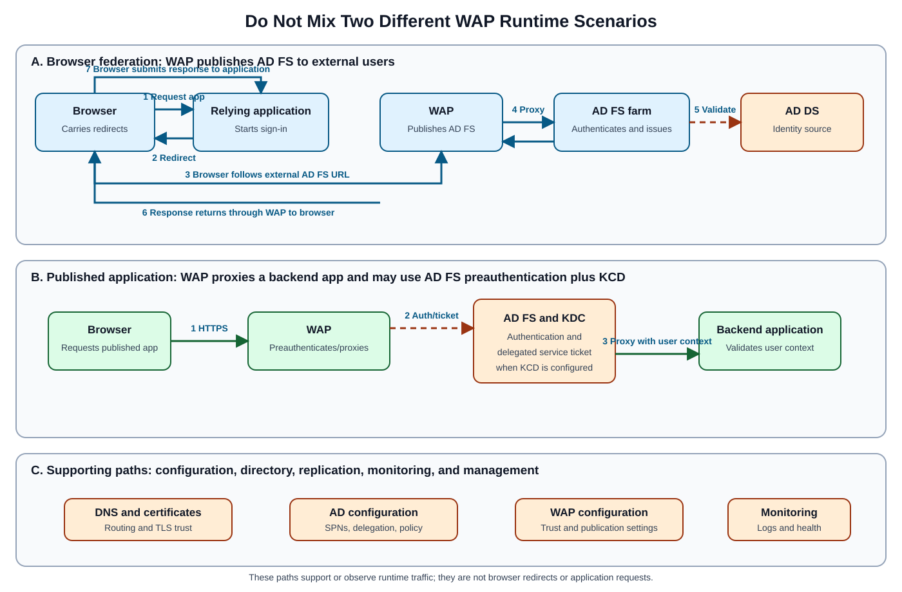
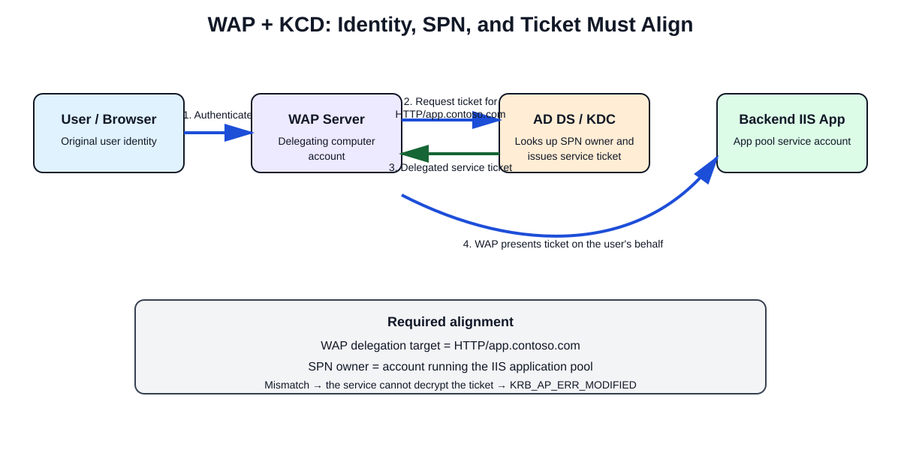

# TLA Week 3 Assessment: AD FS, WAP, Kerberos, and DNS Troubleshooting

## Overview

This **20-question** assessment builds a beginner-friendly troubleshooting path through Active Directory Federation Services (**AD FS**), Web Application Proxy (**WAP**), Windows Integrated Authentication (**WIA**), Kerberos, Service Principal Names (**SPNs**), Kerberos Constrained Delegation (**KCD**), Domain Name System (**DNS**), and certificate trust.

Each question keeps the original prompt, choices, correct answer, reasoning, exam notes, commands, warnings, examples, and conclusion. Try each prompt before reading its explanation, then use the memory sheet and answer key for review.

> [!TIP]
> Follow the symptom to the failing layer: service startup, WAP trust, backend reachability, browser authentication, Kerberos ticketing, DNS routing, or certificate validation.



## How the Main Paths Differ

| Path type | Purpose | Typical direction | Examples |
|---|---|---|---|
| Runtime traffic | Carries a live sign-in or application request | Browser → WAP or AD FS → application | HTTPS, redirects, browser-carried form posts, Negotiate headers |
| Configuration traffic | Establishes or refreshes trust and settings | Administrator/WAP → AD FS | `Install-WebApplicationProxy`, proxy-configuration retrieval |
| Directory and ticket traffic | Resolves identities, SPNs, and Kerberos tickets | Client/WAP/service → DNS, domain controller, or Key Distribution Center (KDC) | DNS queries, TGT/TGS requests, KCD |
| Replication | Copies directory or farm data between authoritative systems | Domain controller ↔ domain controller; farm data store ↔ farm nodes | Active Directory replication, AD FS configuration synchronization |
| Monitoring and management | Observes or changes the environment; it is not the user sign-in path | Admin tools/agents → managed components | Event Viewer, Microsoft Entra Connect Health, PowerShell |

> [!IMPORTANT]
> In browser-based federation, redirects and form responses are normally carried by the **browser** between the application and federation service. Do not assume every federation message is a direct server-to-server exchange. WAP-to-AD FS configuration retrieval and WAP-to-backend proxying are separate server-side paths.

## Source Verification Notes

The original answer key is internally consistent across all 20 questions. The following source statements need qualification; they are preserved in their questions and explicitly clarified rather than silently replaced:

- **Question 5:** `setspn -X` searches the current domain by default. The source itself later gives `setspn -X -F` for a forest-wide search. Because the prompt says **forest**, use the `-F` form when forest scope is required. The supplied choice and answer remain **A**.
- **Question 10:** the source groups “WS-Federation with modern auth” with OAuth/OpenID Connect. OAuth 2.0 and OpenID Connect are commonly called modern authentication; WS-Federation is a separate federation protocol and should not be treated as OAuth/OIDC.
- **Question 11:** an `Authorization: Negotiate` header proves that HTTP Negotiate authentication is in use, but the payload can negotiate Kerberos **or** NTLM. Decode the token or correlate it with `klist`/server evidence before claiming Kerberos conclusively. Choice **C** is still the best available answer.
- **Question 13:** the source presents an A record as the recommended remedy for this AD FS/WIA scenario. A CNAME does not by itself prove the root cause in every Kerberos deployment; also verify SPN ownership, browser behavior, and the applicable Microsoft guidance for the deployed AD FS version.

## Quick Memory Sheet

| Symptom or goal | First check |
|---|---|
| AD FS cannot bind HTTPS | HTTP.SYS URL ACL, SSL binding, and TCP 443 ownership |
| WAP cannot retrieve federation configuration | WAP-to-AD FS DNS/connectivity, certificate, and proxy trust |
| Internal app works but WAP publication fails | WAP-to-backend DNS, URL, firewall, and TLS trust |
| Duplicate SPN suspected | `setspn -X`; add `-F` for forest scope |
| Browser prompts instead of seamless sign-in | Local Intranet zone, WIA, supported user agent, and SPN |
| `KRB_AP_ERR_SKEW` | Time synchronization; default tolerance is five minutes |
| `KRB_AP_ERR_MODIFIED` | SPN owner and actual service account do not match |
| Need to inspect cached tickets | `klist` |
| External clients resolve an internal address | Split-horizon DNS |
| Warning occurs on only some PCs | Missing trusted root or intermediate CA on those PCs |

---

## AD FS and WAP Publishing Foundations

### Question 1: AD FS HTTPS Binding After Patching

**After a patch window the AD FS service fails to start. The Admin log shows it cannot bind to the HTTPS URL. What should you check?**

- **A.** Whether another service holds the 443 URL reservation or ACL
- **B.** Whether the WAP trust with the farm was renewed recently
- **C.** Whether the managed domain has enough replica sets configured
- **D.** Whether the Entra Connect Health agent is installed on the node

#### Correct Answer

✅ A. Whether another service holds the 443 URL reservation or ACL

#### Beginner Explanation

The key clue is:
"AD FS service fails to start" and

"cannot bind to the HTTPS URL"

AD FS uses HTTP.SYS to listen on HTTPS endpoints, typically on TCP port 443. After patching, another application, service, URL reservation, certificate binding, or ACL configuration may interfere with AD FS's ability to bind to the HTTPS URL.

Common causes include:
- Another service already using port 443.
- HTTP.SYS URL reservation conflicts.
- Incorrect URL ACL permissions.
- SSL certificate binding issues.
- Changes introduced by the patch affecting HTTP.SYS registrations.
Typical troubleshooting commands include:
```bat
netsh http show urlacl
```

```bat
netsh http show sslcert
```

```bat
netstat -ano | findstr :443
```

If another service owns the HTTPS binding or the ACL is incorrect, AD FS cannot start because it cannot claim the required HTTPS endpoint.

Therefore, Option A is the most direct and technically accurate answer.

#### Why the Other Answers Are Incorrect

**B. Whether the WAP trust with the farm was renewed recently**

**Why it is wrong:**
- Web Application Proxy (WAP) trust affects communication between WAP servers and the AD FS farm.
- A trust issue can cause authentication failures or proxy failures.
- However, it does not prevent the AD FS service from binding to an HTTPS URL during startup.
- The error specifically points to an HTTPS binding issue, not a trust relationship issue.
**C. Whether the managed domain has enough replica sets configured**

**Why it is wrong:**
- Replica sets are associated with directory service replication and infrastructure availability.
- They have no relationship with HTTP.SYS URL bindings or AD FS service startup.
- Even if replica replication was unhealthy, it would not generate a "cannot bind to HTTPS URL" startup error.
**D. Whether the Entra Connect Health agent is installed on the node**

**Why it is wrong:**
- Microsoft Entra Connect Health provides monitoring and reporting.
- The Health Agent is optional from the AD FS service perspective.
- Missing or unhealthy Health Agent installations do not stop AD FS from binding to HTTPS endpoints.
- The agent does not own port 443 or manage HTTP.SYS URL reservations.
#### Exam Tip

> [!TIP]
> Whenever you see phrases such as:
- "Cannot bind to HTTPS URL"
- "Failed to register URL"
- "Address already in use"
- "Port 443 conflict"
- "HTTP.SYS error"
> Think:
> ✅ Port 443 conflict
> ✅ SSL certificate binding
> ✅ URL reservation (URLACL)
> ✅ HTTP.SYS configuration
> These point directly to an AD FS web service binding problem rather than trust, replication, or monitoring issues.
#### Conclusion

> **Final answer:** ✅ A. Whether another service holds the 443 URL reservation or ACL

---

### Question 2: WAP Federation Configuration and Proxy Trust

**WAP pre-authentication for a published app fails with "unable to retrieve configuration from federation service". What is the likely cause?**

- **A.** The domain functional level is too low for the proxy to work
- **B.** The relying party has no issuance claim rules defined for the app
- **C.** WAP can't reach the federation service or its proxy trust broke
- **D.** The signed-in user has not registered for MFA in Entra ID yet

#### Correct Answer

C. WAP can't reach the federation service or its proxy trust broke

#### Beginner Explanation

The error message:
"Unable to retrieve configuration from federation service"

is a classic Web Application Proxy (WAP) connectivity or trust issue.

When WAP starts or processes requests, it must communicate with the AD FS Federation Service to retrieve configuration information and validate its trust relationship. If WAP cannot contact AD FS or if the proxy trust certificate/relationship becomes invalid, WAP cannot obtain the configuration and pre-authentication will fail.

Common causes include:
- Network connectivity issues between WAP and AD FS.
- DNS resolution failures.
- Firewall blocking HTTPS communication (TCP 443).
- Expired or changed AD FS service certificate.
- Broken WAP-to-AD FS proxy trust.
- AD FS federation service being unavailable.
Typical remediation commands include:
```powershell
Get-WebApplicationProxyConfiguration
```

```powershell
Install-WebApplicationProxy
```

or re-establishing the trust relationship from the WAP server.

Because the error explicitly mentions retrieving configuration from the federation service, the problem points directly to communication or trust between WAP and AD FS.

#### Why the Other Answers Are Incorrect

**A. The domain functional level is too low for the proxy to work**

**Why it is wrong:**
- Domain functional level affects available Active Directory features.
- WAP does not suddenly lose the ability to retrieve federation configuration because of domain functional level.
- If the functional level were unsupported, deployment would generally fail long before this specific runtime error appears.
Therefore, this does not match the symptom.

**B. The relying party has no issuance claim rules defined for the app**

**Why it is wrong:**
- Issuance claim rules are evaluated after authentication requests reach AD FS.
- Missing or incorrect claim rules can cause authorization or claims-related failures.
- They do not prevent WAP from retrieving federation service configuration.
The error occurs before claim issuance processing would even begin.

**D. The signed-in user has not registered for MFA in Entra ID yet**

**Why it is wrong:**
- MFA registration issues affect user authentication flows.
- A user registration problem would generate MFA-related errors during sign-in.
- It would not cause WAP to report that it cannot retrieve configuration from the federation service.
This is a user-authentication issue, not a WAP infrastructure issue.

#### Exam Tip

> [!TIP]
> If you see WAP errors such as:
- Unable to retrieve configuration from federation service
- Proxy trust could not be established
- The federation server proxy could not authenticate
- Failed to receive proxy configuration
> Think immediately:
> ✅ WAP ↔ AD FS connectivity problem
> ✅ Proxy trust issue
> ✅ Certificate issue
> ✅ DNS or firewall problem
> Not:
> ❌ Claims rules
> ❌ MFA registration
> ❌ Domain functional level
#### Conclusion

> **Final answer:** ✅ C. WAP can't reach the federation service or its proxy trust broke

---

### Question 3: WAP-to-Backend Reachability

**A WAP-published relying party works internally but not externally with pre-authentication. What is a typical misconfiguration?**

- **A.** The backend URL can't be reached from WAP, or the URL doesn't match
- **B.** The user has no mailbox provisioned in Exchange for sign-in
- **C.** The SQL farm database has run out of space for new sign-in records and logs
- **D.** The ESL threshold is set too low for that published application

#### Correct Answer

A. The backend URL can't be reached from WAP, or the URL doesn't match

#### Beginner Explanation

When an application works internally but fails when accessed externally through Web Application Proxy (WAP) with pre-authentication, one of the most common causes is a problem with the backend application configuration.

For WAP pre-authentication to function correctly:
1. The user authenticates through AD FS.
2. WAP forwards the request to the internal application.
3. WAP must be able to reach the configured backend URL.
4. The backend URL and external URL configuration must be correct.
Common misconfigurations include:
- Incorrect internal backend URL.
- DNS resolution failures from the WAP server.
- Firewall rules blocking WAP-to-backend communication.
- Backend server unavailable.
- URL mismatches between the published application settings and the actual application URL.
- SSL certificate name mismatches.
If WAP cannot reach the backend application after successful authentication, external access fails while internal access continues to work.

Therefore, Option A is the most likely and technically accurate answer.

#### Why the Other Answers Are Incorrect

**B. The user has no mailbox provisioned in Exchange for sign-in**

**Why it is wrong:**
- Exchange mailbox provisioning is unrelated to AD FS or WAP pre-authentication.
- Users can authenticate successfully without having an Exchange mailbox.
- WAP does not require Exchange mailboxes to publish applications.
This would not explain why the application works internally but fails externally.

**C. The SQL farm database has run out of space for new sign-in records and logs**

**Why it is wrong:**
- AD FS may use SQL Server in some deployments, but a database capacity issue would typically affect the entire AD FS service.
- Such a problem would likely generate widespread authentication failures and service alerts.
- It would not specifically create a scenario where only externally published access through WAP fails.
This is not a typical WAP publishing misconfiguration.

**D. The ESL threshold is set too low for that published application**

**Why it is wrong:**
- There is no commonly used AD FS/WAP publishing configuration known as an "ESL threshold" that would cause this scenario.
- This option is effectively a distractor and unrelated to normal WAP troubleshooting.
#### Exam Tip

> [!TIP]
> When you see:
> "Works internally but not externally"
> Think through the external access path:
> ✅ WAP can reach AD FS?
> ✅ WAP can reach the backend application?
> ✅ DNS resolution is correct?
> ✅ Backend URL matches the published configuration?
> ✅ Certificates are valid?
> ✅ Firewall ports are open?
> A failure after successful internal testing almost always points to a WAP-to-backend connectivity or publishing configuration issue.
#### Conclusion

> **Final answer:** ✅ A. The backend URL can't be reached from WAP, or the URL doesn't match

---

### Question 4: Trusting a Private CA on WAP

**A published backend uses HTTPS with a private CA certificate. WAP cannot connect. What should be done?**

- **A.** Switch the backend over to HTTP only for the published app
- **B.** Import the private CA chain into the WAP trusted store
- **C.** Reboot all of the AD FS servers and then re-run the WAP wizard
- **D.** Disable certificate validation for all of the client browsers

#### Correct Answer

B. Import the private CA chain into the WAP trusted store

#### Beginner Explanation

Web Application Proxy (WAP) must establish a trusted HTTPS connection to the backend application.

When the backend application uses a certificate issued by a private Certificate Authority (CA), the WAP server must trust that CA. If the issuing CA or intermediate CA certificates are not present in the WAP server's trusted certificate stores, certificate validation will fail and WAP will be unable to connect to the backend application.

A proper certificate chain should be trusted by WAP through:
- Trusted Root Certification Authorities store
- Intermediate Certification Authorities store (if applicable)
Once the complete CA chain is trusted, WAP can successfully validate the backend server certificate and establish the HTTPS connection.

This is a very common issue when publishing internal applications that use certificates issued by an internal Microsoft CA or another private PKI.

Therefore, Option B is the correct answer.

#### Why the Other Answers Are Incorrect

**A. Switch the backend over to HTTP only for the published app**

**Why it is wrong:**
- While switching to HTTP might bypass certificate validation issues, it is not the proper solution.
- It reduces security by removing encryption between WAP and the backend application.
- Microsoft best practices recommend maintaining HTTPS whenever possible.
This is a workaround, not a correct fix.

**C. Reboot all of the AD FS servers and then re-run the WAP wizard**

**Why it is wrong:**
- The issue is certificate trust between WAP and the backend application.
- Rebooting AD FS servers does not make WAP trust a private CA.
- Re-running the WAP configuration wizard will not solve a missing CA trust chain.
The root cause remains unchanged.

**D. Disable certificate validation for all of the client browsers**

**Why it is wrong:**
- Client browser certificate validation has no impact on the communication between WAP and the backend application.
- The failure occurs on the WAP server when it attempts to validate the backend server certificate.
- Disabling browser validation would be both insecure and ineffective.
This option does not address the actual problem.

#### Exam Tip

> [!TIP]
> Whenever you see:
> "Backend uses HTTPS"
> "Private CA certificate"
> "WAP cannot connect"
> "Certificate trust error"
> Think:
> ✅ Certificate chain trust
> ✅ Trusted Root CA store
> ✅ Intermediate CA store
> ✅ Certificate validation
> Do not immediately think:
> ❌ Reboot servers
> ❌ Disable SSL validation
> ❌ Downgrade to HTTP
> The most common and correct fix is to ensure the WAP server trusts the issuing CA.
#### Conclusion

> **Final answer:** ✅ B. Import the private CA chain into the WAP trusted store

---

## Kerberos, SPNs, WIA, and Delegation



### Question 5: Finding Duplicate SPNs

**Which command lists duplicate SPNs in a forest?**

- **A.** setspn -X
- **B.** nslookup -type=SRV
- **C.** klist purge
- **D.** gpupdate /force

#### Correct Answer

A. setspn -X

#### Beginner Explanation

A Service Principal Name (SPN) uniquely identifies a service instance in Active Directory for Kerberos authentication.

Duplicate SPNs are a common cause of:
- Kerberos authentication failures
- "KDC_ERR_S_PRINCIPAL_UNKNOWN" errors
- "KDC_ERR_PRINCIPAL_NOT_UNIQUE" errors
- AD FS, SQL Server, IIS, and service account authentication problems
The command:
```bat
setspn -X
```

searches Active Directory and identifies duplicate SPNs.

Example:
```bat
setspn -X
```

Output may reveal something like:
```text
Duplicate SPN found:
```

HTTP/adfs.contoso.com

This allows administrators to locate conflicting SPNs and correct them.

For larger environments, administrators may also use:
```bat
setspn -X -F
```

to search across the forest.

Because the question asks specifically for the command that lists duplicate SPNs, the correct answer is:
✅ setspn -X

#### Why the Other Answers Are Incorrect

**B. nslookup -type=SRV**

**Why it is wrong:**
This command queries DNS SRV records.

Example:
```bat
nslookup -type=SRV _kerberos._tcp.contoso.com
```

It is commonly used to:
- Verify domain controller discovery
- Check Kerberos SRV records
- Troubleshoot DNS registration issues
While useful in Active Directory troubleshooting, it does not identify duplicate SPNs.

**C. klist purge**

**Why it is wrong:**
```bat
klist is used to view and manage Kerberos tickets.
```

Example:
```bat
klist
```

displays cached Kerberos tickets.

```bat
klist purge
```

removes cached Kerberos tickets from the local computer.

This is often used during Kerberos troubleshooting but does not search Active Directory for duplicate SPNs.

**D. gpupdate /force**

**Why it is wrong:**
This command refreshes Group Policy.

Example:
```bat
gpupdate /force
```

Actions:
- Reapplies user policies
- Reapplies computer policies
- Forces policy refresh
It has no relationship to SPN management or Kerberos service registration.

#### Exam Tip

> [!TIP]
> Remember these common AD/Kerberos troubleshooting commands:

| Command | Purpose |
|---|---|
| `setspn -L accountname` | List SPNs on an account |
| `setspn -X` | Find duplicate SPNs in the current domain |
| `setspn -X -F` | Find duplicate SPNs across the forest |
| `klist` | View Kerberos tickets |
| `klist purge` | Clear Kerberos tickets |
| `nslookup -type=SRV` | Check Active Directory SRV records |
| `gpupdate /force` | Refresh Group Policy |

> A quick exam memory aid:
> SPN problem → think SETSPN
> Duplicate SPN → think setspn -X
#### Conclusion

> **Final answer:** ✅ A. setspn -X

---

### Question 6: Where to Configure KCD for WAP

**A published IWA app behind WAP requires Kerberos constrained delegation. Where is delegation configured?**

- **A.** On the DNS server that hosts the federation service record
- **B.** On the AD FS service account, with delegation to the WAP
- **C.** On the user accounts, delegating to the backend service SPN
- **D.** On the WAP computer accounts, delegating to the backend SPN

#### Correct Answer

D. On the WAP computer accounts, delegating to the backend SPN

#### Beginner Explanation

When Web Application Proxy (WAP) publishes an application that uses Integrated Windows Authentication (IWA), WAP must authenticate to the backend application on behalf of the user.

This is achieved using Kerberos Constrained Delegation (KCD).

The flow is:
1. User authenticates through WAP.
2. WAP receives the authenticated identity.
3. WAP obtains a Kerberos ticket to the backend application.
4. WAP presents that ticket to the backend service on behalf of the user.
For this to work, the WAP server (computer account) must be trusted for delegation to the specific backend service SPNs.

Examples:
```text
HTTP/app01.contoso.com
```

HTTP/intranet.contoso.com

MSSQLSvc/sql01.contoso.com

In Active Directory Users and Computers, delegation is configured on the WAP computer object, allowing delegation only to the specific backend SPNs required.

Therefore:
✅ Delegation is configured on the WAP computer account and points to the backend service SPN.

#### Why the Other Answers Are Incorrect

**A. On the DNS server that hosts the federation service record**

**Why it is wrong:**
DNS servers play no role in Kerberos constrained delegation configuration.

DNS is used for:
- Name resolution
- Service discovery
It does not store or manage KCD settings.

A DNS issue could affect connectivity, but delegation itself is not configured there.

**B. On the AD FS service account, with delegation to the WAP**

**Why it is wrong:**
The AD FS service account is not performing the delegation to the backend application.

In a WAP pre-authentication scenario:
- WAP is the component connecting to the backend resource.
- WAP must be trusted for delegation.
The AD FS service account typically does not require KCD configuration for this publishing scenario.

**C. On the user accounts, delegating to the backend service SPN**

**Why it is wrong:**
Users are the identities being delegated.

They are not the objects that perform delegation.

Kerberos constrained delegation is configured on the service or computer account that needs to act on behalf of users, which in this case is the WAP server.

Therefore, configuring delegation on user accounts would not solve the problem.

#### Exam Tip

> [!TIP]
> For WAP + IWA questions, remember:

| Component | Purpose |
|---|---|
| User | Authenticates |
| AD FS | Issues an authentication token |
| WAP | Performs delegation |
| Backend application | Receives the delegated Kerberos ticket |
| SPN | Identifies the backend service |
> A useful memory aid:
> "The server doing the delegation gets the KCD configuration."
> In a WAP publishing scenario:
> ✅ WAP performs the delegation
> ✅ WAP computer account gets the KCD settings
> ✅ Backend service SPNs are the delegation targets
#### Conclusion

> **Final answer:** ✅ D. On the WAP computer accounts, delegating to the backend SPN

---

### Question 7: Browser Support for WIA

**Chrome users get prompted but Edge users don't. Which AD FS property controls supported WIA user agents?**

- **A.** SsoLifetime
- **B.** CertificateRolloverThreshold
- **C.** WIASupportedUserAgents
- **D.** ExtranetLockoutThreshold

#### Correct Answer

C. WIASupportedUserAgents

#### Beginner Explanation

Windows Integrated Authentication (WIA) in AD FS allows supported browsers to authenticate silently using the user's logged-in Windows credentials instead of presenting a sign-in prompt.

AD FS determines whether a browser can use WIA by checking its user-agent string against the WIASupportedUserAgents property.

For example:
```powershell
Get-AdfsProperties | Select WIASupportedUserAgents
```

or

```powershell
Set-AdfsProperties -WIASupportedUserAgents @("MSAuthHost/1.0/In-Domain","Mozilla/5.0")
```

A common scenario is:
- Edge authenticates automatically.
- Chrome users receive credential prompts.
- Investigation reveals Chrome's user-agent is not included in the configured WIASupportedUserAgents list.
Since the question specifically asks which AD FS property controls supported WIA browsers/user agents, the answer is:
✅ WIASupportedUserAgents

#### Why the Other Answers Are Incorrect

**A. SsoLifetime**

**Why it is wrong:**
SsoLifetime controls how long the AD FS Single Sign-On session remains valid.

Example:
```powershell
Get-AdfsProperties | Select SsoLifetime
```

Effects:
- Determines SSO session duration.
- Controls when users must reauthenticate.
It does not determine which browsers can use Integrated Windows Authentication.

**B. CertificateRolloverThreshold**

**Why it is wrong:**
CertificateRolloverThreshold controls certificate rollover behavior in AD FS.

It is related to:
- Token-signing certificates
- Token-decrypting certificates
- Automatic certificate generation
It has no effect on browser authentication methods or user-agent detection.

**D. ExtranetLockoutThreshold**

**Why it is wrong:**
ExtranetLockoutThreshold specifies how many failed login attempts are allowed before a user is locked out through AD FS extranet access.

Example:
```powershell
Get-AdfsProperties | Select ExtranetLockoutThreshold
```

This setting impacts:
- Brute-force protection
- Account lockout prevention
It has nothing to do with WIA browser support.

#### Exam Tip

> [!TIP]
> Memorize these commonly tested AD FS properties:

| Property | Purpose |
|---|---|
| `WIASupportedUserAgents` | Browsers allowed to use Windows Integrated Authentication |
| `SsoLifetime` | AD FS SSO session duration |
| `ExtranetLockoutThreshold` | Failed-login lockout threshold |
| `CertificateRolloverThreshold` | Certificate-rollover timing |
> A useful memory aid:
> Browser getting prompted instead of seamless sign-in?
> Think WIA → WIASupportedUserAgents
#### Practical Flow or Example

If:
- Edge signs in automatically ✅
- Chrome prompts for credentials ❌
Check:
```powershell
Get-AdfsProperties | Select -ExpandProperty WIASupportedUserAgents
```

If Chrome's user-agent is absent, AD FS will fall back to forms authentication, causing credential prompts.

#### Conclusion

> **Final answer:** ✅ C. WIASupportedUserAgents

---

### Question 8: Kerberos Clock-Skew Tolerance

**Kerberos authentication fails across a domain trust only for clients whose clocks are 8 minutes off. Which setting explains this?**

- **A.** Kerberos tolerates 5 minutes of clock skew by default
- **B.** Clock skew is allowed up to 30 minutes by default
- **C.** Kerberos uses certificates that carry no time constraints
- **D.** Kerberos requires clients to be on the same subnet

#### Correct Answer

A. Kerberos tolerates 5 minutes of clock skew by default

#### Beginner Explanation

Kerberos is highly dependent on accurate time synchronization between:
- Client computers
- Domain Controllers (KDCs)
- Trusted domain resources
- Servers participating in authentication
To protect against replay attacks, Kerberos includes timestamps in its authentication tickets. By default, Active Directory Kerberos allows a maximum clock difference (clock skew) of:
```text
5 minutes
```

If a client's clock differs from the KDC by more than 5 minutes, Kerberos authentication fails.

In this scenario:
- Clients with accurate clocks authenticate successfully ✅
- Clients that are 8 minutes off fail ❌
Since 8 minutes exceeds the default 5-minute tolerance, Kerberos rejects the authentication request.

This behavior is particularly noticeable when authenticating across domain trusts because Kerberos ticket validation still relies on synchronized time.

Therefore, Option A is correct.

#### Why the Other Answers Are Incorrect

**B. Clock skew is allowed up to 30 minutes by default**

**Why it is wrong:**
Kerberos in Active Directory does not allow a 30-minute clock skew by default.

The default setting is:
```text
Maximum tolerance for computer clock synchronization = 5 minutes
```

An 8-minute difference would still fail.

If the default were 30 minutes, the scenario described in the question would not occur.

**C. Kerberos uses certificates that carry no time constraints**

**Why it is wrong:**
Kerberos primarily relies on:
- Tickets
- Session keys
- Timestamps
Time validation is one of the fundamental security protections in the Kerberos protocol.

While certificates may be used in specific scenarios (such as smart card logon), the Kerberos protocol itself absolutely enforces time-based validation.

The statement is therefore incorrect.

**D. Kerberos requires clients to be on the same subnet**

**Why it is wrong:**
Kerberos functions across:
- Different subnets
- Different sites
- Different domains
- Domain trusts
- Forest trusts
As long as:
- DNS works
- Connectivity exists
- Time is synchronized
Kerberos authentication can succeed.

Subnet membership has nothing to do with the failure described.

#### Exam Tip

> [!TIP]
> When you see errors such as:
- KRB_AP_ERR_SKEW
- Clock skew too great
- Authentication fails for some users after changing system time
- Kerberos works on some machines but not others
> Immediately check:
```bat
w32tm /query /status
```

> or
```bat
w32tm /resync
```

> Remember:

| Kerberos setting | Default value |
|---|---|
| Maximum clock skew | 5 minutes |
> A good exam memory aid:
> Kerberos = Tickets + Time
> If the clocks differ by more than 5 minutes, authentication is likely to fail.
#### Conclusion

> **Final answer:** ✅ A. Kerberos tolerates 5 minutes of clock skew by default

---

### Question 9: Diagnosing KRB_AP_ERR_MODIFIED

**A Kerberos-delegation-based SSO fails with KRB_AP_ERR_MODIFIED. What is the most common cause?**

- **A.** The client clock is out of sync by a few seconds with the domain server
- **B.** The ticket was encrypted for another account than the service runs as
- **C.** The user has no Entra ID license assigned for the target service
- **D.** The DNS TTL on the service host record is configured too long

#### Correct Answer

B. The ticket was encrypted for another account than the service runs as

#### Beginner Explanation

The Kerberos error:
```text
KRB_AP_ERR_MODIFIED
```

typically means that the service receiving the Kerberos ticket cannot decrypt it.

This most commonly occurs when:
- An SPN is registered on the wrong account.
- Duplicate SPNs exist.
- The service is running under a different account than the one associated with the SPN.
- The Kerberos ticket was encrypted using a password/key that does not match the account currently running the service.
For example:
1. The SPN HTTP/app.contoso.com is registered on ServiceAccountA.
2. The web application is actually running as ServiceAccountB.
3. The KDC issues a ticket encrypted for ServiceAccountA.
4. ServiceAccountB receives the ticket and cannot decrypt it.
5. Kerberos returns:
```text
KRB_AP_ERR_MODIFIED
```

This is one of the most common Kerberos and KCD (Kerberos Constrained Delegation) troubleshooting scenarios.

Therefore, Option B is correct.

#### Why the Other Answers Are Incorrect

**A. The client clock is out of sync by a few seconds with the domain server**

**Why it is wrong:**
Time synchronization issues produce errors such as:
```text
KRB_AP_ERR_SKEW
```

or

```text
Clock skew too great
```

A clock difference of only a few seconds is well within Kerberos tolerance.

More importantly, clock issues do not typically generate KRB_AP_ERR_MODIFIED.

**C. The user has no Entra ID license assigned for the target service**

**Why it is wrong:**
Kerberos authentication occurs entirely within Active Directory/KDC infrastructure.

An Entra ID license assignment:
- Does not affect Kerberos ticket encryption.
- Does not affect SPN processing.
- Does not cause KRB_AP_ERR_MODIFIED errors.
This option is unrelated to Kerberos delegation.

**D. The DNS TTL on the service host record is configured too long**

**Why it is wrong:**
DNS TTL determines how long a DNS response is cached.

While DNS issues can sometimes contribute to authentication problems indirectly, they do not directly cause:
```text
KRB_AP_ERR_MODIFIED
```

A long TTL does not affect ticket encryption or decryption.

The error specifically points to a mismatch between the ticket and the service account key.

#### Exam Tip

> [!TIP]
> Associate common Kerberos errors with their causes:

| Error | Most common cause |
|---|---|
| `KRB_AP_ERR_MODIFIED` | SPN mismatch or wrong service account |
| `KRB_AP_ERR_SKEW` | Time-synchronization problem |
| `KDC_ERR_S_PRINCIPAL_UNKNOWN` | Missing SPN |
| `KDC_ERR_PRINCIPAL_NOT_UNIQUE` | Duplicate SPN |
| `KDC_ERR_PREAUTH_FAILED` | Bad credentials |
> A useful memory aid:
> MODIFIED = The service could not decrypt the ticket because it was encrypted for a different account.
> Whenever you see KRB_AP_ERR_MODIFIED, immediately think:
> ✅ Check SPNs
> ✅ Check duplicate SPNs (setspn -X)
> ✅ Verify the service account running the application
> ✅ Verify Kerberos Constrained Delegation configuration
#### Practical Flow or Example

Suppose:
```text
HTTP/intranet.contoso.com
```

is registered on:
```text
CONTOSO\WebSvc01
```

but IIS is now running as:
```text
CONTOSO\WebSvc02
```

Clients obtain tickets encrypted for WebSvc01, but the application uses WebSvc02 and cannot decrypt them.

Result:
```text
KRB_AP_ERR_MODIFIED
```

This is precisely the type of issue described in the question.

#### Conclusion

> **Final answer:** ✅ B. The ticket was encrypted for another account than the service runs as

---

### Question 10: Mobile Modern Authentication vs. IWA

**A mobile app using modern auth ignores IWA but desktop browsers use it. Why?**

- **A.** Mobile clients require LDAPS to reach the federation service
- **B.** IWA is turned off for every mobile device by default in AD FS settings
- **C.** Mobile devices can't use HTTPS endpoints for the sign-in
- **D.** Such clients may not send Kerberos, so forms or modern auth is used

#### Correct Answer

D. Such clients may not send Kerberos, so forms or modern auth is used

#### Beginner Explanation

Integrated Windows Authentication (IWA) relies on Windows-based authentication protocols such as:
- Kerberos
- NTLM
Desktop browsers running on domain-joined devices can often perform seamless authentication because they:
- Are domain-aware
- Can obtain Kerberos tickets
- Support IWA negotiation
Mobile applications that use Modern Authentication (OAuth, OpenID Connect, WS-Federation with modern auth, etc.) typically do not participate in the same Kerberos-based workflow.

Instead, they commonly use:
- OAuth 2.0
- OpenID Connect (OIDC)
- Forms-based authentication
- Broker-based authentication (Microsoft Authenticator, Company Portal, etc.)
As a result, the mobile client may never attempt Kerberos authentication, causing AD FS to use an alternative authentication method instead of IWA.

This is expected behavior and explains why:
✅ Desktop browsers silently sign in using IWA

✅ Mobile applications present a modern authentication experience

Therefore, Option D is correct.

#### Why the Other Answers Are Incorrect

**A. Mobile clients require LDAPS to reach the federation service**

**Why it is wrong:**
LDAPS (LDAP over SSL/TLS) is used for directory communications.

AD FS clients do not require LDAPS connectivity to authenticate against the federation service.

Modern authentication typically occurs over HTTPS, not LDAP/LDAPS.

This is unrelated to why IWA is bypassed.

**B. IWA is turned off for every mobile device by default in AD FS settings**

**Why it is wrong:**
There is no global AD FS setting that simply disables IWA for all mobile devices by default.

The determining factor is generally:
- Client capabilities
- Browser behavior
- User-agent support
- Authentication protocol in use
Mobile apps commonly choose modern authentication rather than Kerberos.

**C. Mobile devices can't use HTTPS endpoints for the sign-in**

**Why it is wrong:**
HTTPS is the standard protocol used by:
- AD FS
- Entra ID
- OAuth
- OpenID Connect
- Modern Authentication
In fact, modern authentication requires HTTPS.

The statement is completely incorrect.

#### Exam Tip

> [!TIP]
> When comparing authentication methods:

| Authentication type | Common clients |
|---|---|
| IWA (Kerberos/NTLM) | Domain-joined Windows desktops |
| Forms authentication | External browsers |
| OAuth 2.0 | Modern applications |
| OpenID Connect | Mobile and cloud applications |
| WS-Federation | Legacy federated applications |
> A useful memory aid:
> Desktop = Kerberos/IWA
> Mobile = Modern Auth (OAuth/OIDC)
> When a question says:
> "Mobile app ignores IWA"
> Think:
> ✅ The app is using Modern Authentication instead of Kerberos.
#### Practical Flow or Example

Suppose:
- User opens an internal website from Edge on a domain-joined Windows PC.
- Browser sends Kerberos ticket.
- AD FS performs seamless sign-in via IWA.
Now the same user opens a Microsoft 365 mobile app:
- The app uses OAuth/OIDC.
- No Kerberos ticket is sent.
- AD FS presents forms-based or modern authentication.
This behavior is normal and expected.

#### Conclusion

> **Final answer:** ✅ D. Such clients may not send Kerberos, so forms or modern auth is used

---

### Question 11: Verifying Negotiate Authentication in Browser Traffic

**Which action verifies that a browser is sending a Kerberos ticket to AD FS?**

- **A.** Run gpresult on the client and review the applied policy results
- **B.** View the SQL Server error log on the AD FS database server host
- **C.** Capture traffic and look for the Authorization: Negotiate header
- **D.** Check the TTL on the DNS record of the federation service name

#### Correct Answer

C. Capture traffic and look for the Authorization: Negotiate header

#### Beginner Explanation

When a browser uses Integrated Windows Authentication (IWA) with Kerberos, the authentication exchange occurs over HTTP/HTTPS using the Negotiate protocol.

A network trace using tools such as:
- Fiddler
- Browser Developer Tools
- Wireshark
- Microsoft Network Monitor
can reveal HTTP headers similar to:
```http
Authorization: Negotiate YIIG...
```

or

```http
WWW-Authenticate: Negotiate
```

The presence of the Authorization: Negotiate header indicates that the browser is attempting Integrated Windows Authentication and is sending a Kerberos ticket (or negotiating Kerberos/NTLM).

This is the most direct method to verify whether Kerberos authentication is actually being attempted.

Therefore:
✅ Capture traffic and look for the Authorization: Negotiate header

#### Why the Other Answers Are Incorrect

**A. Run gpresult on the client and review the applied policy results**

**Why it is wrong:**
```bat
gpresult is useful for checking:
```

- Applied Group Policies
- Security settings
- Browser zone assignments
- Authentication-related policies
Example:
```bat
gpresult /h report.html
```

While this can help identify why Kerberos might not be working, it does not verify that a browser is currently sending a Kerberos ticket.

It provides configuration information, not proof of authentication traffic.

**B. View the SQL Server error log on the AD FS database server host**

**Why it is wrong:**
The AD FS configuration database stores AD FS configuration information.

SQL logs may show:
- Database connectivity issues
- Database errors
- Performance problems
They do not show whether a browser sent a Kerberos ticket.

The authentication exchange occurs between:
- Client
- Browser
- AD FS
not within SQL Server logs.

**D. Check the TTL on the DNS record of the federation service name**

**Why it is wrong:**
DNS TTL controls how long DNS responses are cached.

Example:
```text
adfs.contoso.com
```

TTL = 3600 seconds

TTL affects name resolution behavior but does not indicate:
- Whether Kerberos is being used
- Whether a ticket was sent
- Whether IWA succeeded
It is unrelated to verifying Kerberos traffic.

#### Exam Tip

> [!TIP]
> When troubleshooting IWA and Kerberos with AD FS:

| Verification goal | Best tool |
|---|---|
| See Kerberos tickets on the client | `klist` |
| Verify browser Negotiate traffic | Network trace and HTTP headers |
| Verify that AD FS supports WIA | `Get-AdfsProperties` |
| Verify the browser's Local Intranet zone | Browser or Group Policy settings |
| Verify SPNs | `setspn -L` |
> If you see:
```http
Authorization: Negotiate
```

> think:
> ✅ Browser is attempting Integrated Windows Authentication.
> If you then see:
```http
WWW-Authenticate: Negotiate
```

> the server is challenging for Kerberos/NTLM authentication.
#### Practical Flow or Example

Suppose a user reports:
"Edge signs in automatically, but Chrome keeps prompting."

A network trace shows:
```http
GET /adfs/ls/
```

but no:
```http
Authorization: Negotiate
```

This suggests Chrome is not attempting Kerberos authentication.

If instead you see:
```http
Authorization: Negotiate YIIF...
```

then Kerberos is being sent and troubleshooting should move to:
- SPNs
- Delegation
- AD FS configuration
- Service accounts
#### Conclusion

> **Final answer:** ✅ C. Capture traffic and look for the Authorization: Negotiate header

---

### Question 12: Viewing Cached Kerberos Tickets

**Which tool shows the Kerberos tickets cached by a client so you can confirm whether a service ticket was issued?**

- **A.** Get-AdfsEndpoint
- **B.** tracert
- **C.** ipconfig /all
- **D.** klist

#### Correct Answer

D. klist

#### Beginner Explanation

The klist command is the primary tool used to view the Kerberos tickets currently cached on a Windows client.

When troubleshooting Kerberos authentication, klist can show:
- Ticket Granting Tickets (TGTs)
- Service Tickets (TGSs)
- Ticket encryption types
- Expiration times
- The SPN for which a ticket was issued
Example:
```bat
klist
```

Sample output:
```text
Cached Tickets: (2)
#0> krbtgt/CONTOSO.COM
#1> HTTP/adfs.contoso.com
```

If you see a service ticket such as:
```text
HTTP/adfs.contoso.com
```

it confirms that the client successfully obtained a Kerberos service ticket for AD FS.

This makes klist one of the most frequently used tools when troubleshooting:
- AD FS IWA
- Kerberos authentication
- SPN issues
- Delegation issues
- SSO failures
Therefore, Option D is correct.

#### Why the Other Answers Are Incorrect

**A. Get-AdfsEndpoint**

**Why it is wrong:**
This PowerShell cmdlet displays AD FS endpoint configuration.

Example:
```powershell
Get-AdfsEndpoint
```

It can show:
- Endpoint paths
- Endpoint states
- Protocol settings
However, it does not display Kerberos tickets cached on a client machine.

**B. tracert**

**Why it is wrong:**
```bat
tracert traces network routes.
```

Example:
```bat
tracert adfs.contoso.com
```

It helps identify:
- Routing issues
- Network hops
- Connectivity problems
It provides no information about Kerberos tickets or authentication.

**C. ipconfig /all**

**Why it is wrong:**
This command shows:
- IP configuration
- DNS servers
- DHCP information
- Network adapter details
Example:
```bat
ipconfig /all
```

While useful for networking troubleshooting, it does not display Kerberos tickets.

#### Exam Tip

> [!TIP]
> Memorize these common Kerberos commands:

| Command | Purpose |
|---|---|
| `klist` | View Kerberos tickets |
| `klist purge` | Remove cached Kerberos tickets |
| `setspn -L` | List SPNs on an account |
| `setspn -X` | Find duplicate SPNs in the current domain |
| `whoami /all` | View user security information |
| `nltest` | Test domain trusts and domain-controller discovery |

> A simple memory aid:
> "KLIST = Kerberos LIST."
> If the question asks:
- "Was a Kerberos ticket issued?"
- "Can I verify a service ticket exists?"
- "How do I view cached Kerberos tickets?"
> Think immediately:
> ✅ klist
#### Practical Flow or Example

Suppose a user should be using IWA to AD FS:
```bat
klist
```

Output:
```text
HTTP/adfs.contoso.com
```

✅ Kerberos service ticket exists.

If no service ticket appears:
❌ Kerberos was likely not used, and authentication may have fallen back to NTLM or Forms Authentication.

This is exactly why klist is such an important troubleshooting tool.

#### Conclusion

> **Final answer:** ✅ D. klist

---

### Question 13: Federation DNS Records and Kerberos WIA

**A customer used a CNAME for the federation service name and Kerberos WIA fails. Which guidance applies?**

- **A.** Use NetBIOS names for the federation service instead
- **B.** Use a CNAME, because it is easier to manage over the long term
- **C.** Use an A (host) record for the service name, not a CNAME
- **D.** Use only a TXT record for the federation service name

#### Correct Answer

C. Use an A (host) record for the service name, not a CNAME

#### Beginner Explanation

For AD FS Windows Integrated Authentication (WIA) using Kerberos, Microsoft recommends using an A (Host) record for the federation service name rather than a CNAME.

Kerberos relies on:
- Service Principal Names (SPNs)
- Name resolution consistency
- Correct mapping between the service name and the account that owns the SPN
When a client accesses:
```text
https://adfs.contoso.com
```

Kerberos attempts to obtain a ticket for:
```text
HTTP/adfs.contoso.com
```

If adfs.contoso.com is configured as a CNAME, name resolution can introduce complications that interfere with Kerberos SPN matching and WIA behavior. This can lead to:
- Authentication prompts
- Kerberos not being attempted
- Fallback to forms authentication
- WIA failures
Using an A record provides a direct hostname-to-IP mapping and avoids these issues.

This is a well-known best practice for AD FS deployments using WIA.

Therefore, Option C is correct.

#### Why the Other Answers Are Incorrect

**A. Use NetBIOS names for the federation service instead**

**Why it is wrong:**
AD FS federation service names should use FQDNs (Fully Qualified Domain Names).

Example:
```text
adfs.contoso.com
```

not:
```text
ADFS01
```

NetBIOS names are not recommended for modern AD FS deployments and do not solve Kerberos WIA issues caused by CNAME usage.

**B. Use a CNAME, because it is easier to manage over the long term**

**Why it is wrong:**
Although CNAMEs can sometimes simplify DNS management, they are not the recommended approach for AD FS federation service names when Kerberos WIA is involved.

The question specifically states:
Kerberos WIA fails.

In this scenario, guidance is to move away from the CNAME and use an A record.

**D. Use only a TXT record for the federation service name**

**Why it is wrong:**
TXT records are used for things such as:
- Domain verification
- SPF records
- DKIM
- Miscellaneous DNS metadata
TXT records do not provide hostname resolution for AD FS services and have no role in Kerberos authentication.

#### Exam Tip

> [!TIP]
> When you see:
> Kerberos + AD FS + CNAME + WIA Failure
> Think:
> ✅ Check SPNs
> ✅ Check DNS configuration
> ✅ Prefer an A record for the federation service name
> A useful memory aid:
> Kerberos likes direct name-to-host mappings.
> A record = Good
> CNAME = Potential Kerberos complications
#### Practical Flow or Example

Suppose the federation service is configured as:
```text
adfs.contoso.com CNAME adfs01.contoso.com
```

Users may experience:
- Repeated credential prompts
- WIA failures
- Kerberos ticket acquisition issues
Changing it to:
```text
adfs.contoso.com A 10.10.10.50
```

often resolves the issue by ensuring the SPN and hostname align correctly.

#### Conclusion

> **Final answer:** ✅ C. Use an A (host) record for the service name, not a CNAME

---

### Question 14: Local Intranet Zone and Seamless Sign-In

**Users inside the corporate network are prompted for credentials by AD FS instead of getting seamless sign-in. Internal DNS resolves the service name correctly. What else should be checked?**

- **A.** That B2B guest collaboration is enabled in the Entra tenant
- **B.** That extranet smart lockout is switched on for the whole AD FS farm
- **C.** That LDAPS is configured on all of the domain controllers
- **D.** That the service URL is in the Local Intranet zone and WIA is on

#### Correct Answer

D. That the service URL is in the Local Intranet zone and WIA is on

#### Beginner Explanation

For seamless sign-in using Windows Integrated Authentication (WIA), several conditions must be met:
1. The device must be domain joined (or otherwise capable of Kerberos authentication).
2. DNS must resolve the AD FS service correctly.
3. The browser must support WIA.
4. The AD FS URL must be recognized as part of the Local Intranet Zone.
5. WIA must be enabled in the browser and AD FS.
Even if DNS resolution is working correctly, users will still receive credential prompts if the AD FS URL is treated as an Internet site rather than an Intranet site.

For example, the federation service URL:
```text
https://adfs.contoso.com
```

should typically be included in the browser's Local Intranet Zone through Group Policy or browser settings.

When the URL is in the Local Intranet Zone:
- Edge and Internet Explorer automatically attempt Kerberos authentication.
- Users receive seamless sign-in.
- No credential prompt appears.
If the URL is not in the Local Intranet Zone (or WIA is disabled), browsers often fall back to forms authentication, resulting in credential prompts.

Therefore, Option D is the correct answer.

#### Why the Other Answers Are Incorrect

**A. That B2B guest collaboration is enabled in the Entra tenant**

**Why it is wrong:**
B2B Guest Collaboration in Microsoft Entra ID controls:
- External guest access
- Cross-tenant collaboration
It has no impact on whether internal users receive seamless Kerberos sign-in through AD FS.

This setting is unrelated to WIA.

**B. That extranet smart lockout is switched on for the whole AD FS farm**

**Why it is wrong:**
Extranet Smart Lockout protects accounts from brute-force password attacks.

It affects:
- Failed authentication attempts
- Lockout protection
It does not determine whether AD FS uses seamless Integrated Windows Authentication.

Users can receive seamless sign-in whether ESL is enabled or disabled.

**C. That LDAPS is configured on all of the domain controllers**

**Why it is wrong:**
LDAPS is used for secure LDAP communications.

While certain applications may require LDAPS, Kerberos-based AD FS seamless sign-in does not require every domain controller to be configured for LDAPS.

Lack of LDAPS would not typically cause browsers to display an AD FS credential prompt.

#### Exam Tip

> [!TIP]
> When users report:
> "I'm on the corporate network but still getting an AD FS login prompt."
> Check these items first:
> ✅ Is the AD FS URL in the Local Intranet Zone?
> ✅ Is Windows Integrated Authentication enabled?
> ✅ Is the browser supported by WIASupportedUserAgents?
> ✅ Is the machine domain joined?
> ✅ Does klist show Kerberos tickets?
> ✅ Does a network trace show:
```http
Authorization: Negotiate
```

> If DNS is already confirmed working, browser zone configuration and WIA settings become the most likely causes.
#### Practical Flow or Example

Suppose:
```text
https://adfs.contoso.com
```

resolves correctly via internal DNS.

However, the browser classifies the site as:
```text
Internet Zone
```

Instead of:
```text
Local Intranet Zone
```

Result:
❌ Kerberos is not automatically attempted.

❌ Browser displays an AD FS login page.

✅ Adding the URL to the Local Intranet Zone restores seamless sign-in.

#### Conclusion

> **Final answer:** ✅ D. That the service URL is in the Local Intranet zone and WIA is on

---

### Question 15: Aligning the SPN, App Pool Identity, and KCD

**A user is delegated to a backend IIS app through WAP using KCD. The backend uses a different service account than the SPN owner. What breaks?**

- **A.** Only the SSL certificate on the backend site is affected by the change
- **B.** The SPN must sit on the app pool account and be the delegation target
- **C.** Nothing breaks, because delegation ignores which SPN is registered
- **D.** Only DNS caching breaks, because the SPN is resolved by name lookups

#### Correct Answer

B. The SPN must sit on the app pool account and be the delegation target

#### Beginner Explanation

In a Web Application Proxy (WAP) deployment using Kerberos Constrained Delegation (KCD), Kerberos tickets are issued based on the Service Principal Name (SPN).

For Kerberos authentication to work correctly:
1. The backend IIS application runs under an application pool identity (service account).
2. The SPN must be registered on that account.
3. WAP is configured to delegate to that SPN.
4. The account running the service must be able to decrypt Kerberos tickets issued for that SPN.
If the SPN belongs to one account but IIS is running under a different account:
- The KDC encrypts the ticket for the SPN owner.
- IIS receives the ticket under another account.
- The service cannot decrypt the ticket.
- Authentication fails, often producing errors such as:
```text
KRB_AP_ERR_MODIFIED
```

Therefore, the backend service account, SPN registration, and KCD delegation target must align.

✅ The SPN must be registered on the account running the application, and that SPN must be the delegation target.

#### Why the Other Answers Are Incorrect

**A. Only the SSL certificate on the backend site is affected by the change**

**Why it is wrong:**
SSL certificates are independent of Kerberos delegation.

A mismatch between the service account and SPN owner affects:
- Kerberos authentication
- Ticket decryption
- Delegation
It does not directly affect the site's SSL certificate.

**C. Nothing breaks, because delegation ignores which SPN is registered**

**Why it is wrong:**
The opposite is true.

Kerberos relies heavily on SPNs.

The KDC uses SPNs to determine:
- Which account owns the service
- Which key should encrypt the ticket
If the SPN registration is wrong, Kerberos and KCD can fail completely.

**D. Only DNS caching breaks, because the SPN is resolved by name lookups**

**Why it is wrong:**
SPNs are Active Directory objects associated with security principals.

They are not DNS cache entries.

Although hostnames often appear in SPNs:
```text
HTTP/app.contoso.com
```

Kerberos authentication depends on SPN registration in Active Directory, not DNS cache behavior.

DNS caching is not the primary issue here.

#### Exam Tip

> [!TIP]
> Remember this Kerberos rule:
> SPN owner = account that must decrypt the ticket
> For WAP + KCD:
```text
User
```

> ↓
> WAP
> ↓ (delegates)
> HTTP/app.contoso.com
> ↓
> Service Account owning SPN
> If:
```text
SPN → ServiceAccountA
```

> but
```text
IIS App Pool → ServiceAccountB
```

> expect:
> ❌ Kerberos failures
> ❌ Delegation failures
> ❌ KRB_AP_ERR_MODIFIED errors
#### Practical Flow or Example

Suppose:
```text
HTTP/intranet.contoso.com
```

is registered on:
```text
CONTOSO\WebSvc01
```

but the IIS application pool now runs as:
```text
CONTOSO\WebSvc02
```

WAP delegates to:
```text
HTTP/intranet.contoso.com
```

The KDC issues a ticket encrypted for WebSvc01, but WebSvc02 receives it and cannot decrypt it.

Result:
```text
Kerberos Authentication Failed
```

KRB_AP_ERR_MODIFIED

This is a classic KCD configuration problem.

#### Conclusion

> **Final answer:** ✅ B. The SPN must sit on the app pool account and be the delegation target

---

## DNS, Certificates, and Service Operations

### Question 16: Split-Horizon DNS for Internal and External Users

**External users resolve the federation service name to an internal IP. What is the DNS design that fixes this?**

- **A.** Use one public DNS record for both internal and external users
- **B.** Split-horizon DNS: internal names to the farm, external to the WAP
- **C.** Use LLMNR for name resolution on the internal network
- **D.** Use a hosts file entry on every internal and external PC

#### Correct Answer

B. Split-horizon DNS: internal names to the farm, external to the WAP

#### Beginner Explanation

This is a classic AD FS and Web Application Proxy (WAP) design scenario.

The problem states:
External users resolve the federation service name to an internal IP.

This means external clients are being directed to an address that is not reachable from the Internet, causing authentication failures.

A proper AD FS deployment uses split-horizon DNS (also called split-brain DNS):
Internal Users

The federation service name resolves to:
```text
adfs.contoso.com → Internal AD FS Farm IP
```

Internal clients can directly access the AD FS servers.

External Users

The same federation service name resolves to:
```text
adfs.contoso.com → WAP Public IP
```

External clients connect to the Web Application Proxy, which then communicates with the AD FS farm internally.

Example:
```text
Internal DNS
```

adfs.contoso.com → 10.10.10.20

Public DNS

adfs.contoso.com → 52.100.100.50

This ensures:
✅ Internal users reach AD FS directly

✅ External users reach WAP

✅ Authentication works from both locations

✅ Security boundaries are maintained

Therefore Option B is the correct DNS design.

#### Why the Other Answers Are Incorrect

**A. Use one public DNS record for both internal and external users**

**Why it is wrong:**
Using a single public DNS record for everyone can create issues:
- Internal traffic unnecessarily leaves the corporate network.
- Performance may suffer.
- Hairpin NAT problems may occur.
- Internal users may depend on Internet connectivity for authentication.
While possible in some environments, it is not the recommended solution for this scenario.

The preferred AD FS design is split-horizon DNS.

**C. Use LLMNR for name resolution on the internal network**

**Why it is wrong:**
LLMNR (Link-Local Multicast Name Resolution):
- Is a fallback name resolution mechanism.
- Operates on local subnets.
- Is not designed for enterprise AD FS federation service resolution.
It does not solve the issue of external clients resolving to internal IP addresses.

**D. Use a hosts file entry on every internal and external PC**

**Why it is wrong:**
Using hosts files:
- Is difficult to manage.
- Does not scale.
- Requires manual updates on all devices.
- Is not a recommended enterprise design.
DNS should handle federation service resolution centrally.

#### Exam Tip

> [!TIP]
> When you see:
> Internal users and external users need different destinations for the same name
> Think:
> ✅ Split-horizon DNS
> Example:

| User location | Resolution |
|---|---|
| Internal | AD FS farm |
| External | WAP/reverse proxy |
| Federation name | Same fully qualified domain name (FQDN) |
> A common exam clue is:
> "External users resolve to an internal IP"
> The solution is almost always:
> ✅ Separate internal and external DNS responses.
#### Practical Flow or Example

Suppose the federation service name is:
```text
adfs.contoso.com
```

Incorrect configuration:
```text
Internal DNS:
```

adfs.contoso.com → 10.10.10.20

Public DNS:
adfs.contoso.com → 10.10.10.20

External users receive:
```text
10.10.10.20
```

which is unreachable from the Internet.

Correct configuration:
```text
Internal DNS:
```

adfs.contoso.com → 10.10.10.20

Public DNS:
adfs.contoso.com → 40.80.120.50

where 40.80.120.50 is the public-facing WAP endpoint.

Authentication now succeeds for both internal and external users.

#### Conclusion

> **Final answer:** ✅ B. Split-horizon DNS: internal names to the farm, external to the WAP

---

### Question 17: Aligning DNS, Service Names, and Certificates

**Which statement about AD FS and DNS requirements is true?**

- **A.** DNS isn't needed anymore once Web Application Proxy servers are deployed
- **B.** Only SRV records are needed for the federation service name
- **C.** The name must resolve for clients and WAP and match the SSL cert
- **D.** Clients should resolve the service name to each node's own IP

#### Correct Answer

C. The name must resolve for clients and WAP and match the SSL cert

#### Beginner Explanation

AD FS relies heavily on proper DNS configuration.

For a federation service such as:
```text
https://adfs.contoso.com
```

the following must be true:
1. Clients must be able to resolve the federation service name.
2. WAP servers must be able to resolve the federation service name.
3. The SSL certificate subject name (or SAN) must match the federation service name.
For example:
```text
Federation Service Name:
```

adfs.contoso.com

Certificate Subject:
adfs.contoso.com

DNS Record:
adfs.contoso.com → AD FS Farm/WAP

If DNS resolves to the correct endpoint but the certificate is issued for:
```text
sts.contoso.com
```

users will encounter certificate validation errors.

Likewise, if the certificate is correct but DNS resolution fails, AD FS cannot be reached.

Microsoft AD FS deployments therefore require:
✅ Proper DNS resolution

✅ Consistent federation service naming

✅ Matching SSL certificates

This makes Option C the correct answer.

#### Why the Other Answers Are Incorrect

**A. DNS isn't needed anymore once Web Application Proxy servers are deployed**

**Why it is wrong:**
DNS remains essential even after WAP deployment.

WAP still depends upon DNS to:
- Locate the federation service
- Reach AD FS servers
- Publish applications
- Handle external authentication requests
Without DNS, neither clients nor WAP can properly locate services.

**B. Only SRV records are needed for the federation service name**

**Why it is wrong:**
AD FS federation service names typically depend on:
```text
A Records
```

AAAA Records (if IPv6 is used)

Examples:
```text
adfs.contoso.com → 10.10.10.20
```

or

```text
adfs.contoso.com → 52.x.x.x
```

SRV records are important for Active Directory service discovery, but they do not replace the host records required for AD FS access.

**D. Clients should resolve the service name to each node's own IP**

**Why it is wrong:**
Clients should normally resolve the federation service name to:
- A load balancer
- A virtual IP
- The farm endpoint
- A WAP endpoint (for external users)
Clients should not be directed individually to each AD FS node.

For example:
✅ Recommended:
```text
adfs.contoso.com → Load Balancer VIP
```

❌ Not Recommended:
```text
adfs01.contoso.com
```

adfs02.contoso.com

adfs03.contoso.com

for client access.

The whole purpose of a farm is to provide a single service endpoint.

#### Exam Tip

> [!TIP]
> Remember this AD FS rule:
> DNS Name = Certificate Name = Service Name
> For example:
```text
Federation Service Name:
```

> adfs.contoso.com
> DNS:
> adfs.contoso.com
> Certificate:
> CN=adfs.contoso.com
> All three should align.
> When troubleshooting AD FS connectivity, check:
> ✅ DNS resolution (nslookup adfs.contoso.com)
> ✅ Certificate subject/SAN
> ✅ Internal and external name resolution
> ✅ WAP connectivity
#### Quick Elimination

| Option | Correct? | Reason |
|:---:|:---:|---|
| A | ❌ | DNS is always required. |
| B | ❌ | AD FS requires host records, not only SRV records. |
| C | ✅ | DNS resolution and SSL certificate names must match the federation service name. |
| D | ❌ | Clients should use the farm endpoint, not individual node IPs. |

#### Conclusion

> **Final answer:** ✅ C. The name must resolve for clients and WAP and match the SSL cert

---

### Question 18: Recovering After a Service-Account Password Change

**The AD FS service account password was changed and the service now fails with logon failures. What is the correct fix?**

- **A.** Update the logon credentials on every farm node, or move to a gMSA
- **B.** Reset the token-signing certificate on the primary node
- **C.** Reboot the Web Application Proxy servers and clear their cache
- **D.** Change the federation service name and reissue the certificate

#### Correct Answer

A. Update the logon credentials on every farm node, or move to a gMSA

#### Beginner Explanation

The question states:
"The AD FS service account password was changed"

followed by:
"The service now fails with logon failures."

This strongly indicates that the AD FS Windows service is still attempting to start using the old password.

In traditional AD FS deployments using a standard domain service account:
```text
CONTOSO\ADFSSvc
```

the updated password must be reflected on every AD FS farm node where the service runs.

Typical steps include:
1. Open Services.msc
2. Locate Active Directory Federation Services
3. Update the account password
4. Restart the service
In multi-node farms, this must be done on each AD FS server.

A better long-term solution is to use a:
```text
gMSA (Group Managed Service Account)
```

because Active Directory automatically manages password changes and eliminates manual updates.

Therefore:
✅ Update the service credentials on every farm node, or migrate to a gMSA.

#### Why the Other Answers Are Incorrect

**B. Reset the token-signing certificate on the primary node**

**Why it is wrong:**
Token-signing certificates are used to:
- Sign security tokens
- Establish trust with relying parties
A changed service account password does not affect token-signing certificates.

Typical token-signing issues cause:
- Trust failures
- Token validation errors
not Windows service logon failures.

**C. Reboot the Web Application Proxy servers and clear their cache**

**Why it is wrong:**
WAP servers are not the component experiencing the failure.

The problem is:
```text
AD FS Service → Logon Failure
```

A WAP reboot cannot fix incorrect credentials for the AD FS service account.

The root cause remains unresolved.

**D. Change the federation service name and reissue the certificate**

**Why it is wrong:**
The federation service name and SSL certificates are unrelated to a service account password change.

Changing:
```text
adfs.contoso.com
```

or reissuing certificates would not correct:
```text
Logon failure: unknown user name or bad password
```

This option addresses a completely different problem.

#### Exam Tip

> [!TIP]
> When you see:
> "Service account password changed"
> Think immediately:
> ✅ Update the Windows service credentials
> ✅ Verify the service account password
> ✅ Check Event Viewer for logon failures
> ✅ Consider migrating to a gMSA
> Common Event IDs may include:
```text
Event ID 7000
```

> Event ID 7009
> Event ID 7038
> often indicating:
```text
The service could not log on.
```

> Logon failure: unknown user name or bad password.
#### Practical Flow or Example

Suppose AD FS runs as:
```text
CONTOSO\ADFSSvc
```

Password before:
```text
P@ssword1
```

Password changed in Active Directory to:
```text
P@ssword2
```

The AD FS service is still configured with:
```text
P@ssword1
```

Result:
❌ Service fails to start

❌ Logon Failure events appear

✅ Updating the service credentials (or using a gMSA) resolves the issue.

#### Conclusion

> **Final answer:** ✅ A. Update the logon credentials on every farm node, or move to a gMSA

---

### Question 19: Re-establishing WAP Proxy Trust

**WAP servers return errors for all published applications after being offline for several weeks. Event logs mention the proxy trust. What is the best remediation?**

- **A.** Rejoin the WAP servers to the managed domain and then restart them
- **B.** Re-run Install-WebApplicationProxy to re-establish the proxy trust
- **C.** Change the SPN registered for the WAP computer account
- **D.** Disable the Windows firewall on the WAP servers permanently

#### Correct Answer

B. Re-run Install-WebApplicationProxy to re-establish the proxy trust

#### Beginner Explanation

The key clue in the question is:
"Event logs mention the proxy trust."

Web Application Proxy (WAP) maintains a trust relationship with the AD FS farm. This trust is established during the initial WAP configuration using the:
```powershell
Install-WebApplicationProxy
```

cmdlet.

If a WAP server has been:
- Offline for an extended period
- Unable to communicate with the AD FS farm
- Affected by certificate changes
- Affected by trust expiration or corruption
the proxy trust can become invalid.

When this occurs, you may see symptoms such as:
- All published applications failing
- Authentication failures
- Event log messages referencing proxy trust
- WAP unable to retrieve AD FS configuration
The standard remediation is to re-establish the trust by re-running:
```powershell
Install-WebApplicationProxy
```

or reconfiguring the WAP server through the Web Application Proxy Configuration Wizard.

Therefore:
✅ Option B is the correct answer.

#### Why the Other Answers Are Incorrect

**A. Rejoin the WAP servers to the managed domain and then restart them**

**Why it is wrong:**
WAP servers do not need to be rejoined to the domain simply because the proxy trust is broken.

A broken AD FS proxy trust is separate from:
- Computer account trust
- Domain membership
If the event logs specifically reference the proxy trust, rebuilding the WAP trust is the correct action.

**C. Change the SPN registered for the WAP computer account**

**Why it is wrong:**
SPNs are relevant for:
- Kerberos authentication
- Delegation scenarios
A broken WAP proxy trust is unrelated to SPN registration.

Changing SPNs will not restore the trust relationship between WAP and AD FS.

**D. Disable the Windows firewall on the WAP servers permanently**

**Why it is wrong:**
Disabling the firewall:
- Is not a recommended troubleshooting practice
- Introduces security risks
- Does not repair a broken proxy trust
Even if connectivity issues existed, permanently disabling Windows Firewall would not be the proper fix.

#### Exam Tip

> [!TIP]
> When you see WAP errors such as:
```text
Unable to retrieve configuration from the Federation Service
```

> Proxy trust could not be established
> The trust relationship with the Federation Service failed
> Think:
> ✅ WAP trust issue
> ✅ Re-establish the trust
> ✅ Re-run:
```powershell
Install-WebApplicationProxy
```

> Do not immediately think:
> ❌ SPN issue
> ❌ Domain rejoin
> ❌ Firewall disablement
#### Practical Flow or Example

Suppose a WAP server has been powered off for several weeks.

During that time:
- AD FS certificates may have changed.
- Trust metadata may have been updated.
- The proxy trust may have become invalid.
After startup:
```text
All Published Apps = Failed
```

Event Logs = Proxy Trust Error

The most effective fix is:
```powershell
Install-WebApplicationProxy
```

to rebuild the trust relationship with the AD FS farm.

#### Conclusion

> **Final answer:** ✅ B. Re-run Install-WebApplicationProxy to re-establish the proxy trust

---

### Question 20: Certificate Warnings on Only Some PCs

**A user's browser shows a certificate warning for the federation service on some PCs only. What is the likely cause?**

- **A.** The user's UPN suffix doesn't match the federated domain name
- **B.** The WAP trust with the federation service farm has expired
- **C.** The SSL chain isn't trusted on those PCs (missing root CA)
- **D.** Kerberos constrained delegation isn't configured for the backend

#### Correct Answer

C. The SSL chain isn't trusted on those PCs (missing root CA)

#### Beginner Explanation

The key clue is:
"Certificate warning"

"on some PCs only"

If the federation service certificate itself were invalid, all users would typically see the warning.

When only certain PCs display certificate warnings, the most common cause is that those machines do not trust the certificate chain used by the federation service.

Common examples include:
- Missing Root CA certificate
- Missing Intermediate CA certificate
- Outdated Trusted Root Certification Authorities store
- Certificate deployed from an internal/private CA that is not trusted on some devices
For example:
```text
Federation Service:
```

adfs.contoso.com

Certificate:
Issued by Contoso Internal CA

Domain-joined PCs may trust the Internal CA via Group Policy, while unmanaged devices may not:
```text
Trusted Root CA Missing
```

↓

Certificate Validation Fails

↓

Browser Warning Appears

Because the issue occurs on some PCs only, trust-chain problems are the most likely explanation.

✅ Option C is correct.

#### Why the Other Answers Are Incorrect

**A. The user's UPN suffix doesn't match the federated domain name**

**Why it is wrong:**
A UPN mismatch can cause:
- Sign-in issues
- Federation routing problems
- Username recognition issues
However, it does not generate a browser SSL certificate warning.

Certificate warnings occur when the browser cannot validate the site's certificate.

**B. The WAP trust with the federation service farm has expired**

**Why it is wrong:**
A broken WAP trust can cause:
- Authentication failures
- Published applications failing
- Proxy trust errors in Event Viewer
However, users typically see application access failures rather than browser certificate warnings.

Also, a WAP trust issue would generally affect all users, not just a subset of PCs.

**D. Kerberos constrained delegation isn't configured for the backend**

**Why it is wrong:**
KCD affects:
- Backend authentication
- Single Sign-On
- Delegated Kerberos access
KCD does not influence browser certificate validation.

A missing KCD configuration may cause:
```text
401 Unauthorized
```

SSO failures

Authentication prompts

but not SSL certificate warnings.

#### Exam Tip

> [!TIP]
> When you see:
> Certificate warning on some devices only
> Think:
> ✅ Missing Root CA
> ✅ Missing Intermediate CA
> ✅ Untrusted Certificate Chain
> ✅ Outdated Certificate Store
> When you see:
> Certificate warning on every device
> Think:
> ✅ Expired certificate
> ✅ Wrong certificate subject/SAN
> ✅ Name mismatch
> ✅ Invalid certificate deployment
#### Practical Flow or Example

Suppose AD FS uses a certificate issued by:
```text
Contoso Internal Root CA
```

PC A:
```text
Trusted Root CA Installed
```

Result:
✅ No warning

PC B:
```text
Trusted Root CA Missing
```

Result:
❌ "The certificate is not trusted"

❌ Browser warning displayed

This perfectly matches the question's symptom of affecting only some PCs.

#### Quick Elimination

| Option | Correct? | Reason |
|:---:|:---:|---|
| A | ❌ | UPN issues do not generate SSL certificate warnings. |
| B | ❌ | WAP trust issues affect proxy functionality, not local certificate trust. |
| C | ✅ | Some PCs showing warnings strongly indicates a missing trusted root/intermediate CA. |
| D | ❌ | KCD affects authentication, not certificate validation. |

#### Conclusion

> **Final answer:** ✅ C. The SSL chain isn't trusted on those PCs (missing root CA)

---

## Answer Key

| Question | Answer | Question | Answer |
|---:|:---:|---:|:---:|
| 1 | **A** | 11 | **C** |
| 2 | **C** | 12 | **D** |
| 3 | **A** | 13 | **C** |
| 4 | **B** | 14 | **D** |
| 5 | **A** | 15 | **B** |
| 6 | **D** | 16 | **B** |
| 7 | **C** | 17 | **C** |
| 8 | **A** | 18 | **A** |
| 9 | **B** | 19 | **B** |
| 10 | **D** | 20 | **C** |

## Final Review Checklist

- Separate the live user request path from configuration, replication, monitoring, and management activity.
- For browser federation, identify what the browser carries and what servers exchange directly.
- Match each symptom to the correct layer before changing claims, certificates, DNS, SPNs, or delegation.
- Confirm risky changes in a test environment and preserve existing security controls such as TLS and Windows Firewall.
