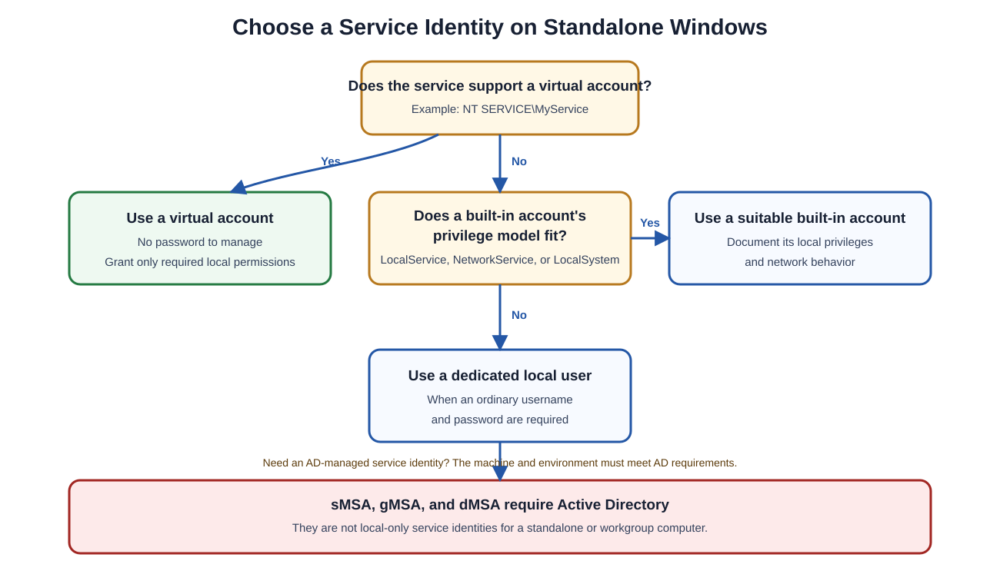

# Miscellaneous Windows Administration Notes

## Overview

This reference covers three independent Windows administration tasks:

1. Choosing and managing a service identity on a non-domain Windows computer.
2. Opening the Certification Authority management console.
3. Checking the public IP address of a lab computer with PowerShell.

> [!NOTE]
> These topics are grouped for convenience, but they are not parts of one continuous architecture or workflow.

## Service Accounts Without Active Directory

On a standalone or workgroup Windows computer, add a service identity to a local group by using a local user, built-in service account, or virtual account. Active Directory-based managed service accounts require Active Directory and cannot operate as local-only identities in a standalone environment.

### Available Service-Identity Types

| Identity type | Example | Available without AD? | Beginner-friendly explanation |
|---|---|---:|---|
| Local user | `.\MyServiceUser` | Yes | An ordinary account stored in the computer's local Security Accounts Manager (SAM) database |
| Built-in account | `LocalSystem`, `LocalService`, or `NetworkService` | Yes | A predefined Windows identity with known local and network behavior |
| Virtual account | `NT SERVICE\MyService` | Yes | An automatically managed, service-specific local identity that requires no password |
| Standalone Managed Service Account (sMSA) | Domain-managed identity | No | An account whose password is managed through Active Directory |
| Group Managed Service Account (gMSA) | Domain-managed identity | No | An AD-managed identity that can support a service across multiple approved domain computers |
| Delegated Managed Service Account (dMSA) | Domain-managed identity | No | A modern AD-managed identity intended for supported service-account migration and delegation scenarios |

Because a standalone computer has no Active Directory, its practical choices are:

- Local user accounts
- Built-in service accounts
- Virtual accounts



### Important Network-Access Distinction

A local user is suitable for a service that needs access only to resources on the same computer. It does not automatically have a trusted domain identity.

A virtual account requires no password and can use the computer account when authenticating to network resources. On a non-domain computer, however, there is no Active Directory computer account that domain resources can trust. Plan remote-resource access separately.

> [!TIP]
> For a standalone computer, a virtual account is often the simplest and safest option when the service supports it. Always choose the identity with the fewest privileges that still allows the service to operate.

## Add a Service Identity to a Local Group

Run group-management commands from an elevated Command Prompt or PowerShell window.

> [!WARNING]
> Membership in the local **Administrators** group grants extensive control over the computer. Use a narrower, purpose-specific group such as `IIS_IUSRS` whenever it meets the service's requirements.

### Option 1: Command Prompt

Use `net localgroup` to manage local groups.

#### List Local Groups

```cmd
net localgroup
```

#### Add a Local User to Administrators

```cmd
net localgroup Administrators MyServiceUser /add
```

#### Add a Virtual Account to Administrators

```cmd
net localgroup Administrators "NT SERVICE\MyService" /add
```

#### Add the Original Lab User to the IIS Group

```cmd
net localgroup IIS_IUSRS pranadot /add
```

The same `net localgroup` command manages local or built-in group membership in other Windows configurations, including appropriate built-in groups on domain controllers. Confirm that you are changing the intended machine and group before running it.

### Option 2: PowerShell

#### Add a Local User

```powershell
Add-LocalGroupMember -Group "Administrators" -Member "MyServiceUser"
```

#### Add a Virtual Account

```powershell
Add-LocalGroupMember -Group "Administrators" -Member "NT SERVICE\MyService"
```

#### Verify Group Membership

```powershell
Get-LocalGroupMember -Group "Administrators"
```

### Option 3: Local Users and Groups Console

1. Press **Windows + R**.
2. Run:

   ```text
   lusrmgr.msc
   ```

3. Open **Groups**.
4. Open the target group, such as **Administrators**.
5. Select **Add**.
6. Enter the local user or virtual account, such as:

   ```text
   NT SERVICE\MyService
   ```

7. Confirm and apply the change.

> [!NOTE]
> The Local Users and Groups console is not included in every Windows edition. Use Command Prompt or PowerShell if `lusrmgr.msc` is unavailable.

## Verify the User and Security Groups

### Inspect the Local User

```cmd
net user pranadot
```

This displays information about the local account, including whether it is active and its listed local-group memberships.

### Inspect the Current Process Token

```cmd
whoami /groups
```

This lists the groups in the security token of the **currently running process**.

> [!IMPORTANT]
> `whoami /groups` does not automatically display the groups in the token of `pranadot` or a Windows service. To inspect a different identity's effective groups, run a process as that identity or inspect the actual service process with an appropriate administrative tool.

### Service-Account Command Reference

| Task | Command |
|---|---|
| List local groups | `net localgroup` |
| Add `pranadot` to the IIS group | `net localgroup IIS_IUSRS pranadot /add` |
| Inspect `pranadot` | `net user pranadot` |
| Inspect current token groups | `whoami /groups` |
| Add a member with PowerShell | `Add-LocalGroupMember -Group "Administrators" -Member "MyServiceUser"` |

## Open the Certification Authority Console

Run:

```text
certsrv.msc
```

This opens the **Certification Authority** Microsoft Management Console (MMC) snap-in on a system where the Active Directory Certificate Services Certification Authority management tools are installed.

Administrators use the console to manage items such as:

- Issued certificates
- Pending requests
- Failed requests
- Revoked certificates
- Certificate templates made available by the CA
- Certificate Revocation List (CRL) publication

> [!NOTE]
> `certsrv.msc` manages a Microsoft Certification Authority. It is different from `certmgr.msc`, which displays certificates for the current user.

## Check the Public IP Address with PowerShell

In the lab, the goal was to identify the public IP address presented to an internet service. The original one-line command was:

```powershell
Invoke-WebRequest ifconfig.me/ip -UseBasicParsing
```

For clearer output, request the HTTPS endpoint and read only the response body:

```powershell
(Invoke-WebRequest -Uri "https://ifconfig.me/ip" -UseBasicParsing).Content.Trim()
```

### What the Command Does

| Part | Purpose |
|---|---|
| `Invoke-WebRequest` | Sends an HTTP or HTTPS request |
| `https://ifconfig.me/ip` | Returns the public source IP observed by the external service |
| `-UseBasicParsing` | Uses basic parsing in Windows PowerShell without relying on the Internet Explorer parsing engine |
| `.Content` | Selects the response body |
| `.Trim()` | Removes surrounding whitespace or line endings |

The original note ended with: “Because IE modules are not loaded, the last switch `-UseBasic...`.” The complete switch is `-UseBasicParsing`.

### PowerShell Version Note

- In **Windows PowerShell 5.1**, `-UseBasicParsing` avoids dependence on the Internet Explorer engine.
- In modern **PowerShell 7**, web requests already use basic parsing, and the switch is retained mainly for compatibility.

### What “Public IP” Means

The returned address is the source IP visible to the external website. It might belong to:

- The computer's direct internet connection
- A router performing Network Address Translation (NAT)
- A corporate proxy
- A virtual private network (VPN)
- A cloud-hosted outbound gateway

Therefore, the result is not necessarily an IP address configured directly on the Windows network adapter.

> [!CAUTION]
> This command sends a request to an external third-party service. Use it only when organizational policy permits outbound access to that service.

## Summary

- Standalone Windows computers can use local users, built-in service accounts, and virtual accounts.
- sMSAs, gMSAs, and dMSAs require Active Directory.
- Use `net localgroup`, PowerShell, or `lusrmgr.msc` to manage local group membership.
- Use `net user` to inspect a local account and `whoami /groups` to inspect the current process token.
- Use `certsrv.msc` to open the Certification Authority console when its management tools are installed.
- Use `Invoke-WebRequest` to query an external service for the public source IP, subject to organizational policy.
